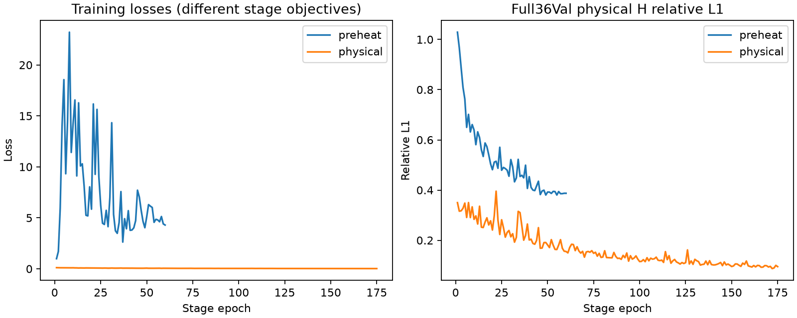

# 经典基线正式训练与调试：进度快照

2026-10-27T14:45:40.609922+08:00

仅train测量自生成场：166/166，GT未用于训练。此文件为进度快照，最终状态以各阶段summary及测试封存记录为准。

## U-Net完整训练

当前阶段：preheat；epoch 13；该阶段更新 1079；完整36Val H=0.6092506。

## 其他算法：单案例固定预算诊断

| 模型 | 稠密预热后H | 原目标末态H | E（未参与优化） | 状态 |
|---|---:|---:|---:|---|
| deeponet | 0.5796684 | 0.3968394 | 0.4067489 | 局部通过，需多案例验证 |
| fno | 0.5336229 | 0.1551847 | 0.1706934 | 局部通过，需多案例验证 |
| senseiver | 0.6673309 | 0.3366177 | 0.3442248 | 局部通过，需多案例验证 |
| gnot | 0.5726452 | 0.3152614 | 0.3853716 | 局部通过，需多案例验证 |
| deepsets | 0.7566687 | 0.3860486 | 0.4220619 | 局部通过，需多案例验证 |

## 其他算法：多案例检查

- deeponet：physical epoch8，完整Val H=0.6227325。

正式测试仅在U-Net完成300轮、模型选择与独立复核冻结后运行。单案例误差不构成三维GT精度或跨案例成功证明。
