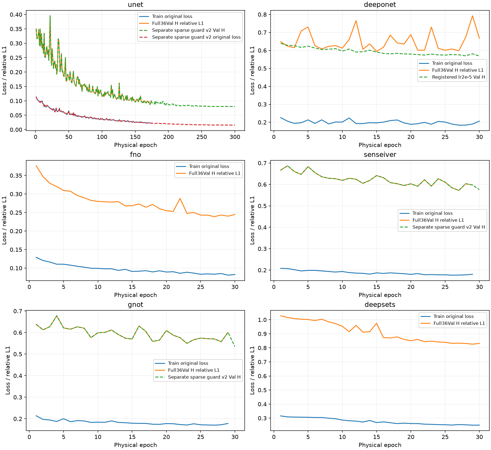
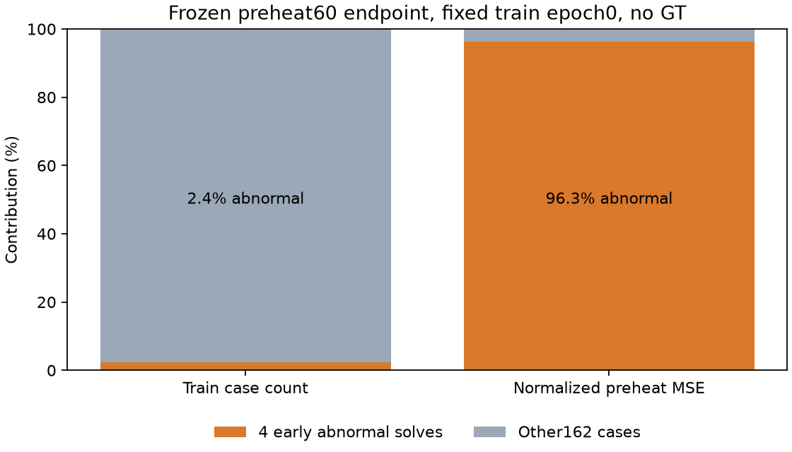

# 经典基线正式训练、测试与收敛诊断

更新时间：2026-10-27T11:23:34.521546+00:00；状态：本轮训练判定及复核已结束。

本次正式模型是标准 3D U-Net（五级卷积编码解码器及跳跃连接），增加仅由训练测量生成的可行场预热。物理阶段仍使用原始自监督 objective、完整 64³/K96、166 train/36 Val、batch2、FP32 和既定优化器。额外的场求解与 4980 次预热更新必须单列；不将其冒充历史原始自监督协议的等预算基线。表中 deepsets 专指 Ray-DeepSets-v1（masked mean、无 GeoLift）的新调试，不是冻结的正式 GeoLift-DeepSets-Sum。

| 模型 | 判定/进度 | 物理 epoch | 最佳 Val H | 末态 Val H | 正式测试 |
|---|---|---:|---:|---:|---|
| unet | STOP_PERSISTENT_COLLAPSE (physical 175) | 175 | 0.087312 | 0.095027 | 未完成/未启用 |
| deeponet | STOP_MULTICASE_GATE_FAILED (physical 30) | 30 | 0.594740 | 0.667343 | 未完成/未启用 |
| fno | MULTICASE_PILOT_GO (physical 30) | 30 | 0.238901 | 0.244623 | 未完成/未启用 |
| senseiver | STOP_PERSISTENT_COLLAPSE (physical 29) | 29 | 0.571871 | 0.597660 | 未完成/未启用 |
| gnot | STOP_PERSISTENT_COLLAPSE (physical 29) | 29 | 0.549841 | 0.600711 | 未完成/未启用 |
| deepsets | STOP_MULTICASE_GATE_FAILED (physical 30) | 30 | 0.826001 | 0.831702 | 未完成/未启用 |
| deeponet_lr2e5 | MULTICASE_PILOT_GO (physical 30) | 30 | 0.568890 | 0.568890 | 未完成/未启用 |
| unet_sparse_guard_v2 | FORMAL_300_COMPLETE_SPARSE_GUARD_V2 (physical 300) | 300 | 0.080058 | 0.080317 | 已完成 |
| senseiver_sparse_guard_v2 | MULTICASE_PILOT_GO_SPARSE_GUARD_V2 (physical 30) | 30 | 0.571871 | 0.575841 | 未完成/未启用 |
| deepsets_sparse_guard_v2 | MULTICASE_REQUALIFIED_SPARSE_GUARD_V2 (physical 30) | 30 | 0.826001 | 0.831702 | 未完成/未启用 |
| gnot_sparse_guard_v2 | MULTICASE_PILOT_GO_SPARSE_GUARD_V2 (physical 30) | 30 | 0.534842 | 0.534842 | 未完成/未启用 |

H 为未输入网络的验证测量相对 L1；它不是三维 GT 误差。多案例 pilot 只有第 29、30 轮均通过固定物理误差、场健康度及 normal/zero/wrong-case 干预门槛才记为 GO。中途最佳值不能替代末态稳定验收。

U-Net正式阶段为300轮，其余模型目前是30轮pilot；不能用本表Val H直接构造等预算架构排名。当前正式GT对比只包含U-Net修订分支及冻结主模型，两者额外预热预算的差异也必须披露。

## 已确认的诊断证据

需要区分三个层次：历史无预热协议中的网络优化困难、本轮稠密预热的异常伪目标、以及后期稀疏输出触发体素饱和告警。后两者是本轮新发现，不能拿来解释全部历史失败或重写旧NO-GO。只有控制变量试验支持的改善才归因于相应修复。

五种旧失败架构在同一固定案例上，经 train 测量自生成场预热后均能降低原目标及额外未输入站位的测量误差，并通过独立 NumPy 投影复核。这说明不能笼统归因于所有网络实现都错误；稠密初始化能帮助它们离开此前的近零吸引区域。单案例成功仍不证明跨案例泛化或三维真值恢复。

DeepONet 原多案例试验的第 29 轮平均 Val H 为 0.792651，训练/验证若干案例发生幅度过冲，normal 的 H 反而差于 zero；第 30 轮恢复至 0.667343 并通过当轮干预。因此原 NO-GO 是末段不稳定，不能描述成完全没有学习或永远没有测量依赖。独立 NumPy 复核末态 Val H 为 0.667342653，投影实现最大相对差约 2.23e-7。降低物理微调学习率的试验属于单独登记的对照，原失败记录保留。

DeepONet 固定学习率对照从同一预热末态开始，仅把物理阶段 LR 从 2e-4 降到 2e-5；30 轮末态 Val H 为 0.568890，判定为 MULTICASE_PILOT_GO。未重新生成预热目标，没有测试集调参。

### 多案例独立复核与末段稳定性

| 模型 | 第29轮未通过门槛 | 第30轮未通过门槛 | 独立 NumPy 复核 |
|---|---|---|---|
| deeponet | val_benefit, train_dependency | 全部通过 | 通过，H=0.667343 |
| fno | 全部通过 | 全部通过 | 通过，H=0.244623 |
| senseiver | healthy | 待完成/未到达 | 通过，H=0.597660 |
| gnot | healthy | 待完成/未到达 | 通过，H=0.600711 |
| deepsets | healthy | 全部通过 | 通过，H=0.831702 |
| deeponet_lr2e5 | 全部通过 | 全部通过 | 通过，H=0.568890 |

Senseiver 原流程因体素饱和计数在 epoch29 停止；独立分支只恢复同一边界补完 epoch30，新增83次更新、零新增预热。修订判据下判定为 MULTICASE_PILOT_GO_SPARSE_GUARD_V2，末态 Val H=0.575841。原29轮停止结果保留。该结果仍是多案例pilot，未启动Senseiver正式300轮训练或最终GT测试。

Ray-DeepSets 原epoch29/30的物理误差及因果门槛均通过，原NO-GO仅由epoch29体素饱和健康度触发。使用同一已固定质量加权判据，对保存的29/30权重分别重新独立计算完整36Val及normal/zero/wrong干预，判定为 MULTICASE_REQUALIFIED_SPARSE_GUARD_V2；新增optimizer更新为0，原NO-GO保留。末态Val H=0.831702，测量精度仍明显弱于FNO；该结果不是正式训练或GT测试成绩。

GNOT 原流程同样在epoch29仅因体素饱和健康度停止。经独立29轮场健康度复核后，使用同一修订判据恢复optimizer/scheduler/RNG补完最后83次更新；判定 MULTICASE_PILOT_GO_SPARSE_GUARD_V2，末态Val H=0.534842。原始29轮停止与此前GPU冲突均保留；没有新增预热、架构/学习率搜索或正式GNOT测试。

训练 epoch0 的 498 个 A/B/H 分支测量幅度最大/最小约 20.68 倍；原训练 relative epsilon 在这 498 个分支均未触发。因此本轮证据不支持将共同失败直接归因于 denominator epsilon 截断。

额外预算：166 个共享 train 场求解实际累计 9656 次接受迭代、10026 次函数求值；每个 fresh 模型另有 4980 次预热更新。U-Net 完整物理阶段为24900次更新，总网络更新预算29880次；teacher求解另计。各恢复分支共用其原训练前缀，不能重复记成新增更新。

166 个 train 自生成场中，有 4 个在一次接受迭代后 ABNORMAL 退出（索引 2/7/10/77），对应 H 仍约 0.879–0.957；其余 162 个的平均 H 约 0.0196。它们是低质量伪目标，尤其会被逐案例能量归一化的稠密 MSE 放大。它们没有被删除或偷偷替换。这属于本次预热管线的新发现，不能用它解释历史上尚未使用预热时的失败。它们约 5e-5 的输出均值也是求解器结果，不能当成真实浓度均值。

在冻结的第 60 轮预热末态、固定 train epoch0 采样上，4 个异常伪目标占全部 normalized MSE 的 96.32%；其平均 MSE 为 181.9，其余 162 个为 0.1715。异常组输出头 bias 梯度之和为 1460，其余组为 3.506。这是末态只读诊断，不是训练过程逐 batch 的 epoch 平均，也不直接等同于完整参数梯度贡献。

固定 CPU 对照是否重现原 GPU 失败：True。仅把 maxls 从 10 改到 40 的修复是否达到训练前固定的目标质量门槛：False。求解器打印 CONVERGENCE 不等于场已拟合，判断仍依据重新计算的原目标和测量残差；不按退出状态强行接受新目标。

相同初始化/相同批次的幅度适配对照，MSE 比值 0.9019、H 比值 0.9125，未达到事前启用条件，故没有用于正式训练。

## 工程执行及测试边界

原 CPU 回投影移到四个 loader 进程，网络、原目标及输入内容不变。完整场预测逐值一致；三个 epoch 的 shuffle 顺序、loader RNG 和主进程 RNG 一致。U-Net 在 epoch23/1909 更新、FNO 在 epoch8/664 更新的完整边界恢复，优化器累计 step、scheduler 与 journal 连续，无更新重放。原受控中断日志及不可变边界 checkpoint 均保留。四个数据加载进程不使用 persistent_workers，以保留原随机序列。

GPU 使用既有 UUID 锁、双空闲快照和冲突监测。大文件位于 /scratch/djc/GeoPhy-Set3D/classical_feasible_v1，测量数据使用迁移后的 /data/djc/GeoPhy-Set3D/data/processed/geophy_projection_pool_v1。冻结主模型、历史 DeepSets 和历史失败实验通过原哈希清单核验；不合并 main。

GNOT 在预热第48轮因其他进程占用同一GPU，被保护机制仅停止自身任务，已完成3914次真实更新；旧调度失败记录保留，新权威任务为pilot_gnot_resume。恢复使用中途checkpoint，核验optimizer3914/scheduler47，按epoch47边界RNG重建epoch48完整shuffle，验证中途sampler状态及实际case顺序完全一致。保留已完成13个batch，只计算未更新的第14个batch及其后续；没有重放任何optimizer更新。旧controller事件文本中的“replay interrupted epoch”未被执行。

第48轮前26案例的平均预热loss没有保存，因此该轮完整normalized_MSE和完整梯度最大值明确记为null；只记录后140案例的已观测后段loss及梯度，不用后段均值冒充完整epoch。该缺失不影响真实更新journal、后续完整Val或物理阶段独立复核。

## 稀疏背景告警及独立 v2 分支

原 U-Net 在 epoch175 / 14525 次物理更新因连续两次体素饱和比例≥95%停止；原始 STOP_PERSISTENT_COLLAPSE、未完成正式训练/未启用测试的状态保留。不能把修订后的结果称为原协议 GO。

对冻结 epoch166 best 的只读独立检查：train2 两分支低值饱和体素占比约 97.53%，却只占预测浓度总和约 2.21%；normal H 平均 0.080466。这支持将稀疏背景与整体信号塌缩区分，但不证明三维GT精度。

单独登记 UNet3D-feasible-preheat-sparseguard-v2：仅将饱和区域的统计由体素计数改为预测浓度质量占比，阈值仍为95%；mean、nearzero、std/mean、测量误差及干预门槛保留。该判据变化必须披露。CPU空场/常量/有效信号饱和反例均失败，稀疏有效信号正例通过。恢复epoch175完整模型、优化器、scheduler和RNG，在独立目录继续至累计300轮，无更新重放、无新架构或学习率搜索。v2共享前175轮及60轮预热，不把它们重复计算为新的训练更新。

详见[独立v2协议](../classical_sparse_guard_v2_protocol_zh.md)。以下正式测试表若存在，专指带此判据修订的v2分支。

最终最佳 U-Net checkpoint 的额外独立复核：True。固定 4 个 Val 和 3 个 train 案例、A/B 两分支，各执行 normal/zero/wrong 测量干预，共 42 个完整预测场及独立 NumPy H 积分；检查结果为 {'healthy': True, 'Val_H': True, 'improvement': True, 'val_benefit': True, 'train_dependency': True}。错误测量仅替换数值，recipient 几何、mask、路径及站位不变；该复核在正式测试前执行，未进行优化更新。

同一最终最佳checkpoint的原始按体素计数健康度通过状态为 False；上述GO只对应浓度质量加权的修订判据，不能据此称原协议GO。

U-Net 已完成 595 个预测（35 test × 17 layouts），全部预测先封存，再由独立评分进程读取 35 个 GT64；GT128 读取次数为 0。模型选择仅使用完整 Val H。

| 测试条件 | 三维 relative L1 | L1 95% CI | 三维 relative L2 | 质心误差 mm |
|---|---:|---|---:|---:|
| V3 | 0.163843 | [0.140551, 0.188737] | 0.228274 | 3.576 |
| V6 | 0.151671 | [0.131503, 0.173026] | 0.216083 | 2.988 |
| Val-A-V4 | 0.160357 | [0.136916, 0.185706] | 0.228083 | 3.638 |
| clustered-V4 | 0.277148 | [0.237392, 0.321242] | 0.369612 | 9.225 |
| spread-V4 | 0.155559 | [0.134906, 0.177248] | 0.221902 | 3.189 |

## 与冻结主模型的配对对比

只使用冻结主模型既有 C1 评分；未重跑主模型、未额外读取 GT。以下比较对齐同一 35 案例、相同输入站位：Val-A-V4 一次和 clustered-V4 五次，共 210 对预测。先在每案例内平均 draw，再以案例为单位做配对 bootstrap。U-Net 的额外预热预算已单列。

| 条件 | 主模型三维 L1 | U-Net 三维 L1 | U-Net−主模型的配对 95% CI |
|---|---:|---:|---|
| Val-A-V4 | 0.084930 | 0.160357 | [0.061519, 0.091081] |
| clustered-V4 | 0.298537 | 0.277148 | [-0.046196, 0.005394] |

常规Val-A-V4上，主模型的误差在35个案例均低于U-Net，配对差值区间完全大于零。clustered-V4上，U-Net均值略低，但配对差值95%区间包含零，不能宣称显著优于主模型；训练预算也不同。

IDE 中 classical_main_comparison_v2_20261026/summary.csv 属于 12 案例子集，不能与本轮 35 案例均值直接拼成同一排名。本轮单独输出汇总，原文件保持原样。DeepONet 当前实现有五个输入站位槽，其 pilot 范围为 train3–5/Val4；不声称已完成六视角 V6 或本轮 17-layout 正式测试。

机器可读结果：[训练轨迹](artifacts/classical_feasible_v1/training_metrics.csv)、[当前汇总](artifacts/classical_feasible_v1/current_comparison.csv)。最终决定须结合各 summary、独立 review 及 test seal，不能只引用平均 loss。
