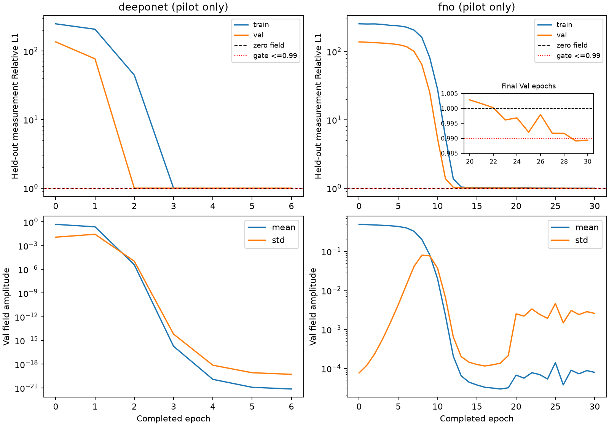

# GeoPhy-Set3D：DeepONet / FNO 经典基线实施与决策

本轮已完成已有基线冻结、两种经典模型实现、工程验证和各自科学判定。**GeoLift-DeepSets-Sum复用已有正式结果；DeepONet与FNO的当前适配均NO-GO，不进入正式精度排名。** 没有新300轮训练，没有新GT64/GT128/Pool B/test读取，没有恢复Senseiver或失败Ray系列。

交付日期：2026-10-26 00:21 UTC+08:00。独立分支`experiment/classical_operators_v1`；工作区`/scratch/djc/GeoPhy-Set3D-classical-operators-v1`。

## 1. 已有结果与主模型冻结身份

GeoLift-DeepSets-Sum：306,625参数，300epoch/24,900更新，best第292轮。实际checkpoint `/data/djc/GeoPhy-Set3D/outputs/checkpoints/deepsets_selfsup_v1/best.pt`；SHA256 `949fb63be9068f676e7c6740fa8ce67b766d1f4d3ced86127e38b67a8eccdad0`。本轮对900条prediction-row JSON和900个原预测数组逐一复算SHA并匹配冻结清单；已有逐案例指标、50项组/指标统计与独立bootstrap复核均存在并通过。本轮是身份重核，不声称重新执行全部旧GT评价。

补充实际last.pt审计确认epoch300、optimizer全部参数step24900、scheduler300及RNG存在；48/48个源码在训练提交77c595a逐hash匹配，当前差异仅为后续增量注册的models/__init__.py。原配置train_deepsets_selfsup_v1.yaml、训练源码清单f56b55d0f2ff20c1d667ee4aa58378b6e0017325f16ebb539edcaea761852128及评价源码清单完整保存。原始SharedEncoder2D/GeometryLifting/masked sum÷4/ResidualDecoder3D保持原样；这是共享GeoLift受控集合聚合对照，不是DeepSets论文官方三维重建实现，与失败Ray-DeepSets-V1不同。

既有五组3D Relative L1：G1 .135463、G2 .131762、G3 .137796、G4 .156366、G5 .618805。完整Relative L2、observed/H误差、峰值/积分及95%CI仍引用原deepsets_selfsup_v1_zh.md和其paired_statistics.csv；不挑选新模型版本。

当前主模型：`uniform_plain_set_interaction_seed20261011`，342,209参数；checkpoint `/scratch/djc/GeoPhy-Set3D/mrgr_oari_targeted_v1/training/uniform_plain_set_interaction_seed20261011/checkpoints/best.pt`；SHA `0ccea9b24a77e9d5fac025c626a98b167c3ab57fa202688e3e4acc75261bc18c`。冻结配置见history_audit.json；本轮CPU固定输入C0/C1逐位复现通过。

**比较身份限制：** 历史DeepSets报告对照的是旧SelfSup-MRGR v1 SHA1573cd84…，不是当前Plain主模型。本轮没有伪造当前主模型与新NO-GO模型的配对三维表。900固定清单为36个开发Val案例×5组×5布局，不是最终独立test；最终test禁止访问。

## 2. 固定架构与公平性

| 算法 | 适配 | 参数 | 共同目标/数据 |
|---|---|---:|---|
| GeoLift-DeepSets-Sum | 原共享几何提升及masked sum/4 | 306,625 | 已有正式自监督协议 |
| DeepONet | 全站完整测量/几何CNN branch；station-ID排序5槽；坐标MLP trunk；64维内积 | 222,033 | 原selfsup目标，H不输入 |
| FNO | 固定K96线性射线伴随3通道+XYZ；4层3D谱卷积，width16/modes8 | 4,196,657 | 原selfsup目标，H不输入 |

DeepONet依据Lu et al., NMI2021, arXiv:1910.03193；FNO依据Li et al., ICLR2021, arXiv:2010.08895。pilot后已成功下载并核查两篇arXiv原始PDF的架构段落，文件SHA见paper_sources.json：DeepONet第2.1节/图1D/式2，FNO式2/式4/图2。该文献复核未改动任何模型或门槛。没有MRGR/OARI/GCA/新attention，也没有使用GT构造输入。模型只读取合法measurement/geometry字段。DeepONet的CNN、末层线性trunk与最终sigmoid，以及FNO的GELU/无batch norm/width16/modes8/padding/sigmoid均为运行前固定的任务适配；原FNO论文实验采用ReLU及batch normalization，不声称逐项复现原论文实验超参。

DeepONet保留全部有效射线（含0测量），常规CNN下采样不是筛射线；padding在排序后剔除，最多5真实station，完整XYZ/z最快64³查询分块。FNO的T为归一化**摩尔分数线积分**，非线性质量投影P没有全局线性伴随：用已知chi导数将J_P(0)^T转换为T^T，固定计算加权回投影、log1p支持度和可见性，不把测量积分称作局部浓度真值。CPU固定顺序累积与512条有界缓存保持相同输入重复一致。薄弱支持处归一化对舍入敏感；输入在模型参数外确定，不经GT选择。

所有原训练字段逐项严格一致：Pool A、166/36拆分、原A/B/H sampler与mask、FP32、AdamW2e-4/wd1e-4、clip1、seed20261011、cosine T_max300、batch2、loader4workers。pilot固定前32个train/完整36Val，每轮16更新，上限30轮480更新，独立于正式预算。直接调用training.selfsup.objective/run_epoch/selection_metric；不复制loss、不改epsilon/权重。

预登记交集门槛：最后两次Val H<=.99，相对真正epoch0至少改善5%且绝对改善.01；非零/非恒定/非饱和；train0/1/2至少2例置零响应>=1e-3且绝对MA>=1e-8，错配H增加>=1e-6；Val前4例至少2例正常H优于置零.001；工程/访问/独立复核通过。不同loss及解析GT可辨识性实验的专用门槛不混用。所有阈值在训练前登记，失败后未降低。

## 3. 工程运行与pilot结果

| 模型 | smoke | 完整pilot轮 | Val H epoch0→最后完整轮 | Val输出mean/std | 科学结论 |
|---|---|---:|---|---|---|
| deeponet | batch2/all-ray/64³/原loss/反传/1更新通过 | 6 | 135.985614 → 1 | 7.17623e-22 / 5.14239e-20 | NO_GO |
| fno | batch2/all-ray/64³/原loss/反传/1更新通过 | 30 | 137.864663 → 0.989392991 | 7.9207e-05 / 0.00258161 | NO_GO |

两项smoke均检查了finite/range、真实参数变化、H精确排除、station置换、NaN invalid/padding、全invalid、normal/zero/wrong-case、seed重复与序列化。DeepONet峰值653,123,584 bytes/工程段.821秒；FNO峰值1,566,914,048 bytes/3.526秒；这些是多次前向/反传/更新的工程段，**不是独立推理benchmark**。未OOM，未减少有效射线或分辨率。

### deeponet

pilot在第7轮因下一次更新前FP32梯度norm非正而停止；权威last.pt为第6轮/96更新，进程实际更新96–111（精确中断计数缺失）。完整轮训练+Val实测26.891秒，峰值667,098,112 bytes，不含epoch0/干预/中断轮；全部进程时间见调度日志。

只读末态重放完整36Val与日志精确一致；另封存42个完整干预场/原始logit/H投影，第二套NumPy FP64重算sigmoid、场统计、测量L1及科学门槛通过。

```json
{
  "healthy_fields": false,
  "train_zero_2of3": false,
  "train_wrong_2of3": false,
  "val_zero_benefit_2of4": false,
  "val_below_zero": false,
  "val_initial_improvement": true,
  "val_healthy": false
}
```

| train案例索引 | normal-zero相对MA | 绝对MA | 错配H增加 |
|---|---:|---:|---:|
| 0 | 0.146321 | 5.04885e-20 | 0 |
| 1 | 0.0756397 | 2.65145e-27 | 0 |
| 2 | 0.0185433 | 3.37417e-22 | 0 |

### fno

完成30轮/480更新；训练+诊断总墙钟611.259秒，峰值1,613,342,208 bytes，初态至末态参数净变化L2=38.8449。最后两轮Val H均低于.99，确有测量拟合改善及条件响应；仍未通过输出健康度与Val置零收益联合门槛，不推广pilot权重为正式结果。

固定14个normal分支：最小输出均值7.85796e-05，最大近零比例0，最大abs(logit)>10比例0.970848。饱和比例按每个完整场独立检查，不能用聚合std掩盖。

| Val案例索引 | normal-zero相对MA | 正常H相对zero的改善（正值有利） |
|---|---:|---:|
| 0 | 0.00863897 | 3.74475e-05 |
| 1 | 0.00989297 | 4.17624e-05 |
| 2 | 0.00964319 | 0.000100906 |
| 3 | 0.00678832 | 4.46474e-05 |

```json
{
  "0": {
    "healthy_fields": false,
    "train_zero_2of3": false,
    "train_wrong_2of3": false,
    "val_zero_benefit_2of4": false,
    "val_below_zero": false,
    "val_initial_improvement": false,
    "val_healthy": false
  },
  "10": {
    "healthy_fields": true,
    "train_zero_2of3": true,
    "train_wrong_2of3": true,
    "val_zero_benefit_2of4": true,
    "val_below_zero": false,
    "val_initial_improvement": true,
    "val_healthy": true
  },
  "20": {
    "healthy_fields": true,
    "train_zero_2of3": true,
    "train_wrong_2of3": false,
    "val_zero_benefit_2of4": false,
    "val_below_zero": false,
    "val_initial_improvement": true,
    "val_healthy": true
  },
  "29": {
    "healthy_fields": false,
    "train_zero_2of3": true,
    "train_wrong_2of3": true,
    "val_zero_benefit_2of4": false,
    "val_below_zero": true,
    "val_initial_improvement": true,
    "val_healthy": true
  },
  "30": {
    "healthy_fields": false,
    "train_zero_2of3": true,
    "train_wrong_2of3": true,
    "val_zero_benefit_2of4": false,
    "val_below_zero": true,
    "val_initial_improvement": true,
    "val_healthy": true
  }
}
```

**解释边界：** loss从巨大初始值下降不等于学会利用测量；DeepONet的近零塌缩违反必要条件；FNO有响应且最后误差小于1，但部分完整场饱和及验证置零收益低于预定.001仍违反其他必要条件。DeepONet工程断言在30轮上限之前停止，因此不写成30轮完成；其必要塌缩失败已证实。FNO完成30轮但联合门槛失败，两者均按独立证据判NO-GO。DeepONet置零相对差0.02–0.15来自极小分母，绝对差约1e-20或更小，不能称有用测量依赖。末态梯度FP32/FP64范数见terminal_audit；单次末态梯度诊断不证明中断瞬间唯一机制。未实施任何学习率/损失/初始化搜索或修复候选，未将失败外推为经典算法能力上限。



## 4. 正式三维对比状态

两个新模型均未获得正式训练准入：formal=0epoch/0update、新900预测=0、新GT64评分=0。故无新三维Relative L1/L2、峰值/积分、95%CI或精度排名；不拿pilot单例代替正式全量。新增正式/selector/infer/GT入口采用完整预算、checkpoint哈希、measurement-only replay和900封存前置校验；由于本轮未获准入，这些完整路径未做端到端科学运行，不声称已经验证。

## 5. 独立复核、保护、偏离与资源

独立复核是第二套NumPy数值实现，不是外部人员复核。CPU测试初次4/5通过（合成边界fixture差异），保留失败日志；改解析射线避开舍入网格边界后5/5通过，不改算子/容差；新模型、原DeepSets、原selfsup与配对统计30项回归通过。当前主模型C0/C1固定CPU输出逐位复现。原始4835个tracked文件及原checkpoint/历史结果/旧queue哈希前后全部不变。DeepONet失败进程未在finally持久化末次访问计数，不能追补完整counter；原GTReadGuard始终禁止成功越界读取，后续零更新审计计数完整并无越界。模型独立registry没有改旧build_model白名单。

偏离/限制逐项保留：

- 远端Git数据传输7897代理失效、17890 CONNECT/直连github.com超时；随后通过官方GitHub REST API（gh与独立curl）核对main确为3f977a3，与开发基点一致。远端最新性已解决；未推送、未合并main，核验见github_main.json。
- home worktree因配额失败，使用scratch独立worktree；失败新目录仅属本轮，历史工作区保持不变。
- DeepONet中断轮精确计数未持久化，只能给96–111范围；last完整epoch权威96。之后FNO在首个pilot更新前修复逐step fsync与异常快照，独立source manifest保留前后身份。
- GPU0被其他用户占用使FNO首次预约60秒退出、零更新；登记资源修订后GPU1执行。全程既有UUID flock、15秒双空闲检查、外来冲突只停止自身；没有抢占或终止任何他人任务。GPU3既有任务保持。
- DeepONet/FNO均未完成正式预算，不生成伪造的主模型配对精度；单seed/小pilot/开发Val限制保留。

## 6. 交付与复算

- [训练前协议](../classical_operators_v1_protocol_zh.md)、[中断审计/资源修订](../classical_operators_v1_terminal_audit_zh.md)。
- [文献架构与适配核对](artifacts/classical_operators_v1/paper_sources.json)。
- [历史冻结审计](artifacts/classical_operators_v1/history_audit.json)、[状态](artifacts/classical_operators_v1/experiment_status.json)、[checkpoint路径与SHA](artifacts/classical_operators_v1/checkpoint_manifest.json)、[保护核验](artifacts/classical_operators_v1/integrity.json)。
- [DeepONet独立复核](artifacts/classical_operators_v1/deeponet_independent_review.json)、[FNO独立复核](artifacts/classical_operators_v1/fno_independent_review.json)；逐例干预/曲线/压缩日志均同目录。
- 大数组、checkpoint、完整资源快照仅在`/scratch/djc/GeoPhy-Set3D/classical_operators_v1`；配置`configs/classical_operators_v1/{deeponet,fno}.yaml`，代码`scripts/classical_operators_v1`与独立models模块。
- CPU复算已保存失败末态：`CUDA_VISIBLE_DEVICES="" PYTHONPATH=src OMP_NUM_THREADS=2 /scratch/djc/envs/gas-torch/bin/python scripts/classical_operators_v1/terminal_review.py deeponet`（FNO已完成30轮用review.py，否则terminal_review.py）。复算只读已有数组，不恢复训练。

本轮明确结论：GeoLift-DeepSets-Sum已有正式基线保持有效；DeepONet与FNO当前适配不得进入论文正式精度排名。下一步若研究明确修复假设，须独立预登记，不能自行调整本轮门槛或把新版本覆盖本轮失败。
