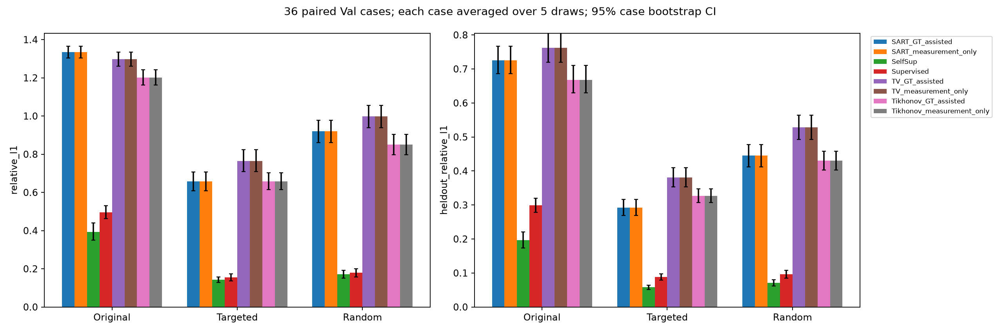
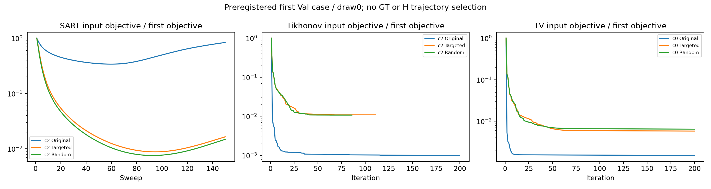
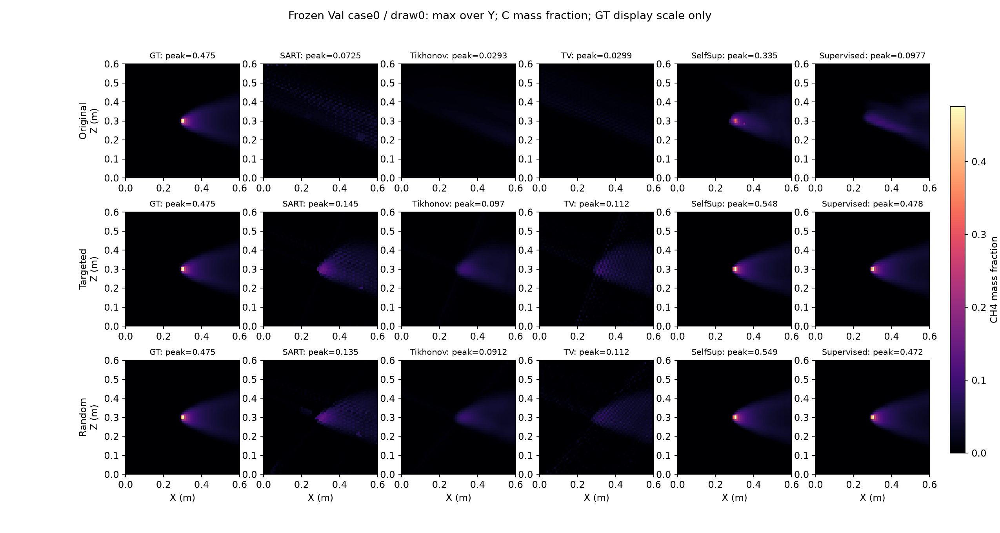

# 三维经典算法与冻结 MRGR：V4 配对比较 v1

本轮实际完成 **1620 次 Val 经典重建**，复用两个冻结网络的 **1080 条完整历史指标**，另实际完成1080次网络前向计时。范围固定为原36 Val case×5draw×Original/Targeted/Random，使用原 station IDs 和共同 H4；没有新网络训练、Pool B、最终 test 或 GT128。

## 1. 方案与方法边界

自由稀疏视角定义及物理范围见 [方案修订](../research_revision_geometry_classical_v1_zh.md)，算法来源、公式、目标与更新见 [算法登记](../classical_methods_v1_zh.md)。SART 为有界非负 station-block 三维线性 chi 重建，Tikhonov 为直接使用冻结 P_diff(C) 的有界非线性三维平滑重建，TV 为有界平滑 isotropic 三维 TV。均从零场开始，输出 XYZ64³ CH4质量分数[0,1]。TV epsilon=1e-4/m；三轴物理步长0.6/63m、末端 Neumann。

SART 使用真实 origin/direction/near/path length/valid mask 与 K96 三线性稀疏权重及真正转置；不是普通梯度下降或二维 Radon。一次 sweep 为输入顺序下4个站位 block 各更新一次。ppm·m经摩尔分数线积分解释，最后精确转换C。原投影器插值C后转换chi，SART插值chi；同一路径不代表同一离散化。两种变分算法采用投影BB梯度与单调Armijo，非闭式线性解或精确非平滑TV解。

## 2. 验证、校准与冻结

优化前协议 SHA256 `21ffd0b71257d4f585a9397a19282fcd59d4dde47187c96a34b684782498576f`；校准配置冻结 SHA256 `c8b84e574dfa0fe1ac99533cdc6ad34a768b8bee55a73f714917fd2fd4c3e729`。登记提交 a3201a1；数值源码/参数/停止规则在读取新Val结果前冻结。后续执行补充仅将不同方法分配到相同型号4090的cuda:0/1及独立目录，未改变数值规则。

校准采用冻结 source-index train 顺序的12个等间隔 case（rint(linspace(0,165,12))），每例自然随机 V4 与 clustered draw0 两种布局，各有独立不重叠H4。共216次实际校准，每方法3候选；SART150 sweep，变分200步。GT辅助选择按全部12case×2布局平均三维relative L1；测量选择按同一批输出的独立train H4 relative L1，不使用GT选择。身份严格分开。

| 方法 | 候选 | train三维L1 | train H4 L1 | GT选择 | 测量选择 |
| --- | --- | --- | --- | --- | --- |
| SART | 0 | 0.86163066 | 0.54525084 |  |  |
| SART | 1 | 0.82798544 | 0.51571971 |  |  |
| SART | 2 | 0.82404919 | 0.50273520 | 是 | 是 |
| Tikhonov | 0 | 0.84709253 | 0.54366260 |  |  |
| Tikhonov | 1 | 0.79003442 | 0.50687431 |  |  |
| Tikhonov | 2 | 0.77419490 | 0.48417498 | 是 | 是 |
| TV | 0 | 0.92710381 | 0.59707721 | 是 | 是 |
| TV | 1 | 0.99906697 | 0.65410038 |  |  |
| TV | 2 | 1.21745945 | 0.81224052 |  |  |

最终全局配置：

- SART / GT_assisted：candidate2，`{"iterations": 150, "minimum_iterations": 30, "tolerance": 1e-05, "patience": 8, "relaxation": 0.8}`。
- SART / measurement_only：candidate2，`{"iterations": 150, "minimum_iterations": 30, "tolerance": 1e-05, "patience": 8, "relaxation": 0.8}`。
- Tikhonov / GT_assisted：candidate2，`{"iterations": 200, "minimum_iterations": 40, "tolerance": 1e-05, "patience": 8, "initial_step": 1000.0, "step_bounds": [1e-05, 1000000.0], "max_backtracks": 20, "armijo": 0.0001, "lambda": 0.001}`。
- Tikhonov / measurement_only：candidate2，`{"iterations": 200, "minimum_iterations": 40, "tolerance": 1e-05, "patience": 8, "initial_step": 1000.0, "step_bounds": [1e-05, 1000000.0], "max_backtracks": 20, "armijo": 0.0001, "lambda": 0.001}`。
- TV / GT_assisted：candidate0，`{"iterations": 200, "minimum_iterations": 40, "tolerance": 1e-05, "patience": 8, "initial_step": 1000.0, "step_bounds": [1e-05, 1000000.0], "max_backtracks": 20, "armijo": 0.0001, "epsilon": 0.0001, "lambda": 0.0001}`。
- TV / measurement_only：candidate0，`{"iterations": 200, "minimum_iterations": 40, "tolerance": 1e-05, "patience": 8, "initial_step": 1000.0, "step_bounds": [1e-05, 1000000.0], "max_backtracks": 20, "armijo": 0.0001, "epsilon": 0.0001, "lambda": 0.0001}`。

两种身份若同候选只实际重建一次，同时进入两类身份表。case重建只使用输入测量与几何；输出先落盘，再读取GT64和H4作评价。不得按GT/H选择停止点；停止只看输入目标相对变化1e-5连续8次，SART至少30/变分至少40步，否则预算耗尽。所有最终输出为实际停止的最后一个iterate，无轨迹后验最优筛选。

测试含零/常量场、ppm·m、XYZ、路径、边界转换往返、伴随内积、三维phantom、有效零测量/invalid排除、物理梯度和autograd差分。完整仓库212项测试通过，另4项独立读取阻断测试通过，证据在归档日志；真实运行访问审计与测试故意阻断分开。数值验证另存 numerical_validation.json；原projectors.py和自监督训练guard未改。

## 3. Original / Targeted / Random 完整主表

各数值先平均同case五draw，再平均36case。relative L1/L2与积分proxy无量纲；MAE/RMSE/峰值绝对误差为质量分数。积分proxy沿用冻结 abs(sum(C)-sum(GT))/sum(abs(GT))，不是kg质量。H4误差通过同一冻结P_diff/K96，单位ppm·m后取相对误差。

| 方法身份 | 条件 | 三维L1 [95%CI] | 三维L2 | MAE | RMSE | H4 L1 | H4 L2 | 积分proxy误差 | 峰值绝对误差 |
| --- | --- | --- | --- | --- | --- | --- | --- | --- | --- |
| SART_GT_assisted | Original | 1.334354 [1.303127,1.365831] | 0.941429 | 0.00479766 | 0.0151565 | 0.725549 | 0.573434 | 0.0255455 | 0.326178 |
| SART_GT_assisted | Targeted | 0.657768 [0.607647,0.707447] | 0.642042 | 0.00238066 | 0.0104285 | 0.292637 | 0.298501 | 0.0130534 | 0.371954 |
| SART_GT_assisted | Random | 0.919892 [0.861584,0.977240] | 0.752529 | 0.00328189 | 0.0121234 | 0.445148 | 0.396976 | 0.012758 | 0.355326 |
| SART_measurement_only | Original | 1.334354 [1.303127,1.365831] | 0.941429 | 0.00479766 | 0.0151565 | 0.725549 | 0.573434 | 0.0255455 | 0.326178 |
| SART_measurement_only | Targeted | 0.657768 [0.607647,0.707447] | 0.642042 | 0.00238066 | 0.0104285 | 0.292637 | 0.298501 | 0.0130534 | 0.371954 |
| SART_measurement_only | Random | 0.919892 [0.861584,0.977240] | 0.752529 | 0.00328189 | 0.0121234 | 0.445148 | 0.396976 | 0.012758 | 0.355326 |
| SelfSup | Original | 0.393402 [0.349745,0.439952] | 0.529294 | 0.00129879 | 0.00836898 | 0.196163 | 0.232187 | 0.0410537 | 0.157421 |
| SelfSup | Targeted | 0.142418 [0.128204,0.156807] | 0.213082 | 0.000505223 | 0.00336711 | 0.0582749 | 0.0737469 | 0.0142213 | 0.105212 |
| SelfSup | Random | 0.170992 [0.150077,0.192776] | 0.25847 | 0.000578629 | 0.00408005 | 0.07084 | 0.0894893 | 0.014538 | 0.0978375 |
| Supervised | Original | 0.495210 [0.462681,0.530006] | 0.665068 | 0.00170946 | 0.0105905 | 0.29874 | 0.349188 | 0.107936 | 0.415935 |
| Supervised | Targeted | 0.155090 [0.136120,0.172937] | 0.213278 | 0.000611537 | 0.00364283 | 0.0882615 | 0.109476 | 0.0238415 | 0.0598188 |
| Supervised | Random | 0.179599 [0.157199,0.201004] | 0.255116 | 0.000645373 | 0.00418709 | 0.0962412 | 0.119969 | 0.0271228 | 0.0803982 |
| TV_GT_assisted | Original | 1.298637 [1.261480,1.335119] | 0.896679 | 0.00466011 | 0.0144723 | 0.76182 | 0.605348 | 0.111027 | 0.564693 |
| TV_GT_assisted | Targeted | 0.765157 [0.708525,0.822984] | 0.693366 | 0.00266128 | 0.0111625 | 0.381192 | 0.345985 | 0.0409804 | 0.511457 |
| TV_GT_assisted | Random | 0.998157 [0.939048,1.056662] | 0.777832 | 0.00349705 | 0.012498 | 0.528396 | 0.446267 | 0.0655853 | 0.521877 |
| TV_measurement_only | Original | 1.298637 [1.261480,1.335119] | 0.896679 | 0.00466011 | 0.0144723 | 0.76182 | 0.605348 | 0.111027 | 0.564693 |
| TV_measurement_only | Targeted | 0.765157 [0.708525,0.822984] | 0.693366 | 0.00266128 | 0.0111625 | 0.381192 | 0.345985 | 0.0409804 | 0.511457 |
| TV_measurement_only | Random | 0.998157 [0.939048,1.056662] | 0.777832 | 0.00349705 | 0.012498 | 0.528396 | 0.446267 | 0.0655853 | 0.521877 |
| Tikhonov_GT_assisted | Original | 1.200945 [1.161671,1.241747] | 0.85622 | 0.00426503 | 0.0137991 | 0.668018 | 0.540917 | 0.0437573 | 0.568432 |
| Tikhonov_GT_assisted | Targeted | 0.658652 [0.614433,0.703259] | 0.646602 | 0.00235938 | 0.0104885 | 0.327163 | 0.311317 | 0.0114287 | 0.533707 |
| Tikhonov_GT_assisted | Random | 0.849584 [0.796947,0.902956] | 0.716821 | 0.00300241 | 0.0115584 | 0.430792 | 0.383352 | 0.0189807 | 0.543227 |
| Tikhonov_measurement_only | Original | 1.200945 [1.161671,1.241747] | 0.85622 | 0.00426503 | 0.0137991 | 0.668018 | 0.540917 | 0.0437573 | 0.568432 |
| Tikhonov_measurement_only | Targeted | 0.658652 [0.614433,0.703259] | 0.646602 | 0.00235938 | 0.0104885 | 0.327163 | 0.311317 | 0.0114287 | 0.533707 |
| Tikhonov_measurement_only | Random | 0.849584 [0.796947,0.902956] | 0.716821 | 0.00300241 | 0.0115584 | 0.430792 | 0.383352 | 0.0189807 | 0.543227 |

bootstrap固定seed2026101304、10,000次、36case成对percentile95%CI；射线/180draw不作独立样本。全部10指标的均值及区间见summary.csv；同布局各方法全部配对与同方法布局配对见paired_statistics.csv，逐case均值及逐case/draw来源完整归档。

## 4. 配对结果：算法能力与布局收益分别报告

以下算法间差值统一为经典算法−网络，同一输入布局；负值表示经典误差更低。GT_assisted带train GT调参，measurement_only不以三维GT选配置；SelfSup训练无体积GT且用原测量Val选checkpoint，Supervised训练使用GT且历史checkpoint由同Val监督损失选择，存在Val模型选择偏倚。

两个网络也按同输入比较，差值SelfSup−Supervised；差异同时包含训练目标/标签/模型选择条件，不能解释成标签使用的单一因果效果：

| 条件 | 指标 | SelfSup−Supervised | 95%CI | 胜/负/平 |
| --- | --- | --- | --- | --- |
| Original | relative_l1 | -0.101808 | [-0.119334,-0.083418] | 33/3/0 |
| Original | relative_l2 | -0.135775 | [-0.162486,-0.111100] | 36/0/0 |
| Original | heldout_relative_l1 | -0.102577 | [-0.114335,-0.090607] | 36/0/0 |
| Original | heldout_relative_l2 | -0.117001 | [-0.130431,-0.103635] | 36/0/0 |
| Targeted | relative_l1 | -0.012672 | [-0.024983,-0.000322] | 22/14/0 |
| Targeted | relative_l2 | -0.000196 | [-0.024211,+0.024631] | 20/16/0 |
| Targeted | heldout_relative_l1 | -0.029987 | [-0.035949,-0.024179] | 36/0/0 |
| Targeted | heldout_relative_l2 | -0.035729 | [-0.043611,-0.027956] | 35/1/0 |
| Random | relative_l1 | -0.008607 | [-0.018069,+0.001083] | 20/16/0 |
| Random | relative_l2 | +0.003354 | [-0.015112,+0.023483] | 18/18/0 |
| Random | heldout_relative_l1 | -0.025401 | [-0.030002,-0.020894] | 36/0/0 |
| Random | heldout_relative_l2 | -0.030480 | [-0.036227,-0.024870] | 36/0/0 |

| 经典身份 | 网络 | 相同条件 | 三维L1差 | 配对95%CI | 胜/负/平 |
| --- | --- | --- | --- | --- | --- |
| SART_GT_assisted | SelfSup | Original | +0.940952 | [+0.891952,+0.988098] | 0/36/0 |
| SART_GT_assisted | Supervised | Original | +0.839144 | [+0.796577,+0.879427] | 0/36/0 |
| SART_measurement_only | SelfSup | Original | +0.940952 | [+0.891952,+0.988098] | 0/36/0 |
| SART_measurement_only | Supervised | Original | +0.839144 | [+0.796577,+0.879427] | 0/36/0 |
| TV_GT_assisted | SelfSup | Original | +0.905235 | [+0.850522,+0.957087] | 0/36/0 |
| TV_GT_assisted | Supervised | Original | +0.803427 | [+0.754356,+0.849249] | 0/36/0 |
| TV_measurement_only | SelfSup | Original | +0.905235 | [+0.850522,+0.957087] | 0/36/0 |
| TV_measurement_only | Supervised | Original | +0.803427 | [+0.754356,+0.849249] | 0/36/0 |
| Tikhonov_GT_assisted | SelfSup | Original | +0.807543 | [+0.756433,+0.856524] | 0/36/0 |
| Tikhonov_GT_assisted | Supervised | Original | +0.705735 | [+0.659113,+0.749689] | 0/36/0 |
| Tikhonov_measurement_only | SelfSup | Original | +0.807543 | [+0.756433,+0.856524] | 0/36/0 |
| Tikhonov_measurement_only | Supervised | Original | +0.705735 | [+0.659113,+0.749689] | 0/36/0 |
| SART_GT_assisted | SelfSup | Targeted | +0.515349 | [+0.473107,+0.557513] | 0/36/0 |
| SART_GT_assisted | Supervised | Targeted | +0.502678 | [+0.459827,+0.547162] | 0/36/0 |
| SART_measurement_only | SelfSup | Targeted | +0.515349 | [+0.473107,+0.557513] | 0/36/0 |
| SART_measurement_only | Supervised | Targeted | +0.502678 | [+0.459827,+0.547162] | 0/36/0 |
| TV_GT_assisted | SelfSup | Targeted | +0.622738 | [+0.573434,+0.673976] | 0/36/0 |
| TV_GT_assisted | Supervised | Targeted | +0.610067 | [+0.555114,+0.667777] | 0/36/0 |
| TV_measurement_only | SelfSup | Targeted | +0.622738 | [+0.573434,+0.673976] | 0/36/0 |
| TV_measurement_only | Supervised | Targeted | +0.610067 | [+0.555114,+0.667777] | 0/36/0 |
| Tikhonov_GT_assisted | SelfSup | Targeted | +0.516234 | [+0.479231,+0.554717] | 0/36/0 |
| Tikhonov_GT_assisted | Supervised | Targeted | +0.503562 | [+0.464021,+0.545266] | 0/36/0 |
| Tikhonov_measurement_only | SelfSup | Targeted | +0.516234 | [+0.479231,+0.554717] | 0/36/0 |
| Tikhonov_measurement_only | Supervised | Targeted | +0.503562 | [+0.464021,+0.545266] | 0/36/0 |
| SART_GT_assisted | SelfSup | Random | +0.748900 | [+0.693807,+0.803645] | 0/36/0 |
| SART_GT_assisted | Supervised | Random | +0.740292 | [+0.682550,+0.796739] | 0/36/0 |
| SART_measurement_only | SelfSup | Random | +0.748900 | [+0.693807,+0.803645] | 0/36/0 |
| SART_measurement_only | Supervised | Random | +0.740292 | [+0.682550,+0.796739] | 0/36/0 |
| TV_GT_assisted | SelfSup | Random | +0.827165 | [+0.772519,+0.881205] | 0/36/0 |
| TV_GT_assisted | Supervised | Random | +0.818558 | [+0.759039,+0.876613] | 0/36/0 |
| TV_measurement_only | SelfSup | Random | +0.827165 | [+0.772519,+0.881205] | 0/36/0 |
| TV_measurement_only | Supervised | Random | +0.818558 | [+0.759039,+0.876613] | 0/36/0 |
| Tikhonov_GT_assisted | SelfSup | Random | +0.678592 | [+0.629801,+0.726870] | 0/36/0 |
| Tikhonov_GT_assisted | Supervised | Random | +0.669985 | [+0.618448,+0.720742] | 0/36/0 |
| Tikhonov_measurement_only | SelfSup | Random | +0.678592 | [+0.629801,+0.726870] | 0/36/0 |
| Tikhonov_measurement_only | Supervised | Random | +0.669985 | [+0.618448,+0.720742] | 0/36/0 |

自身求解残差与统一P_diff重投影分别如下；各方法objective形式/归一化不同，不能直接把objective数值横向排名：

| 方法 | 条件 | 自身relative L2 | 自身objective | P_diff输入L1 | P_diff输入L2 | 共同H4 L1 |
| --- | --- | --- | --- | --- | --- | --- |
| SART/c2 | Original | 0.0510306 | 0.00143693 | 0.0416739 | 0.0514851 | 0.725549 |
| SART/c2 | Targeted | 0.0258188 | 0.000419757 | 0.0270154 | 0.0262048 | 0.292637 |
| SART/c2 | Random | 0.0302584 | 0.000570077 | 0.0286056 | 0.0307164 | 0.445148 |
| Tikhonov/c2 | Original | 0.014561 | 2.495e-05 | 0.00958506 | 0.014561 | 0.668018 |
| Tikhonov/c2 | Targeted | 0.0317965 | 8.02214e-05 | 0.0475567 | 0.0317965 | 0.327163 |
| Tikhonov/c2 | Random | 0.0266981 | 6.44728e-05 | 0.0316034 | 0.0266981 | 0.430792 |
| TV/c0 | Original | 0.013578 | 2.26585e-05 | 0.0114632 | 0.013578 | 0.76182 |
| TV/c0 | Targeted | 0.0227998 | 3.30138e-05 | 0.0393676 | 0.0227998 | 0.381192 |
| TV/c0 | Random | 0.0213453 | 3.10424e-05 | 0.0285433 | 0.0213453 | 0.528396 |

SART本次评价进程实际冷构建60个站位稀疏算子，共11.153s；其后按station缓存复用。每case/draw未缓存等价构建时间也保存，平均值为0.817s。这个准备成本不算作网络前向开销，亦不隐藏为SART速度优势。

固定方法与V4预算的布局对照如下，表示输入几何改变的收益，不解释为网络结构更新：

| 方法身份 | 布局配对 | 三维L1差 | 95%CI | 胜/负/平 |
| --- | --- | --- | --- | --- |
| SART_GT_assisted | Targeted−Original | -0.676587 | [-0.722644,-0.634534] | 36/0/0 |
| SART_GT_assisted | Targeted−Random | -0.262124 | [-0.310789,-0.212419] | 34/2/0 |
| SART_GT_assisted | Random−Original | -0.414462 | [-0.462180,-0.369817] | 36/0/0 |
| SART_measurement_only | Targeted−Original | -0.676587 | [-0.722644,-0.634534] | 36/0/0 |
| SART_measurement_only | Targeted−Random | -0.262124 | [-0.310789,-0.212419] | 34/2/0 |
| SART_measurement_only | Random−Original | -0.414462 | [-0.462180,-0.369817] | 36/0/0 |
| SelfSup | Targeted−Original | -0.250984 | [-0.291366,-0.213457] | 36/0/0 |
| SelfSup | Targeted−Random | -0.028574 | [-0.042301,-0.014911] | 27/9/0 |
| SelfSup | Random−Original | -0.222410 | [-0.252850,-0.194119] | 36/0/0 |
| Supervised | Targeted−Original | -0.340120 | [-0.379816,-0.303101] | 36/0/0 |
| Supervised | Targeted−Random | -0.024509 | [-0.044904,-0.004792] | 23/13/0 |
| Supervised | Random−Original | -0.315611 | [-0.341476,-0.291259] | 36/0/0 |
| TV_GT_assisted | Targeted−Original | -0.533480 | [-0.580130,-0.489251] | 36/0/0 |
| TV_GT_assisted | Targeted−Random | -0.233000 | [-0.279064,-0.187156] | 34/2/0 |
| TV_GT_assisted | Random−Original | -0.300480 | [-0.345321,-0.258133] | 36/0/0 |
| TV_measurement_only | Targeted−Original | -0.533480 | [-0.580130,-0.489251] | 36/0/0 |
| TV_measurement_only | Targeted−Random | -0.233000 | [-0.279064,-0.187156] | 34/2/0 |
| TV_measurement_only | Random−Original | -0.300480 | [-0.345321,-0.258133] | 36/0/0 |
| Tikhonov_GT_assisted | Targeted−Original | -0.542293 | [-0.583870,-0.503255] | 36/0/0 |
| Tikhonov_GT_assisted | Targeted−Random | -0.190932 | [-0.229303,-0.151748] | 34/2/0 |
| Tikhonov_GT_assisted | Random−Original | -0.351361 | [-0.393089,-0.311634] | 36/0/0 |
| Tikhonov_measurement_only | Targeted−Original | -0.542293 | [-0.583870,-0.503255] | 36/0/0 |
| Tikhonov_measurement_only | Targeted−Random | -0.190932 | [-0.229303,-0.151748] | 34/2/0 |
| Tikhonov_measurement_only | Random−Original | -0.351361 | [-0.393089,-0.311634] | 36/0/0 |

## 5. 时间、内存与收敛

| 方法/candidate | 实际重建/前向数 | 构建/查找均值s | 迭代/前向均值s | 转换均值s | 评价均值s | 平均实际迭代 | 停止状态 | GPU peak MiB |
| --- | --- | --- | --- | --- | --- | --- | --- | --- |
| SART/c2 | 540 | 0.02068 | 0.12926 | 0.00010 | 0.00810 | 150.0 | {"budget_exhausted": 540} | 898.4 |
| Tikhonov/c2 | 540 | 0.00001 | 3.61093 | 0.00001 | 0.02253 | 156.3 | {"budget_exhausted": 190, "objective_stable": 350} | 63.5 |
| TV/c0 | 540 | 0.00001 | 3.56666 | 0.00001 | 0.01976 | 200.0 | {"budget_exhausted": 540} | 63.5 |
| SelfSup | 540 | 0.00000 | 0.05509 | 0.00000 | 0.00000 | 0.0 | {} | 1104.4 |
| Supervised | 540 | 0.00000 | 0.05493 | 0.00000 | 0.00000 | 0.0 | {} | 1104.1 |

计时用GPU同步的wall clock；网络仅前向（输入准备、投影评价另计），5次warmup/model。经典算法GPU峰值为求解阶段，包含已有驻留稀疏cache；评价阶段峰值未单独记录，不能视为端到端峰值。RSS是进程高水位，reserved memory亦完整保存。两张4090为共享服务器，结果不等于专用硬件速度基准。SART geometry cache按站位复用，冷构建总成本与每case未缓存等价成本在operator_build和runtime表中保存；不能把缓存准备藏为速度优势。变分直接调用原P_diff，每次仍有坐标生成开销。停止状态仅表示统一有限规则，objective_stable不是最优性证明。

重建图固定原case0/draw0，显示沿Y的最大值投影，仅用于形态检查；所有图共享GT确定的显示色标，超过色标的预测峰值另标在标题，不用于参数或停止选择。

## 6. 结果解释、尚未解决问题与下一阶段

- Original：本预算三维L1最低为 SelfSup=0.393402；SelfSup=0.393402，Supervised=0.495210。方法能力比较严格限于本行同输入。
- Targeted：本预算三维L1最低为 SelfSup=0.142418；SelfSup=0.142418，Supervised=0.155090。方法能力比较严格限于本行同输入。
- Random：本预算三维L1最低为 SelfSup=0.170992；SelfSup=0.170992，Supervised=0.179599。方法能力比较严格限于本行同输入。

冻结Pool A实际射线：单位方向最大偏差2.220e-16；near/far端点超出物理域最大量5.551e-16m；path length与far−near最大差0.000e+00m。首个校准case的精确valid零测量数=0，invalid非零数=0；有效零值保留另由合成零场测试验证，不要求真实case必须包含精确零值。

实际Pool A算子伴随内积相对差=1.528e-15；常量C=0.2时稀疏算子与冻结P_diff的相对L1差=2.359e-08；mass/mole往返最大绝对差=2.220e-16。小型三维phantom的SART/Tikhonov/TV三维L1为0.051710/0.043764/0.033472；它只验证小规模实现，不代表稀疏Val可唯一恢复。

SART最终C上，插值chi与插值C后转换chi的差异relative L1均值=0.00298856、最大=0.0117195；独立train GT64诊断均值=0.00405535。这些是实际输出/GT64诊断，不作为Val调参。差异还包含稀疏权重float64构建与P_diff FP32坐标的浮点差异；常量场检查给出其数值量级参考。

Original clustered的平均三维L1高于Targeted的身份：SART_GT_assisted、SART_measurement_only、SelfSup、Supervised、TV_GT_assisted、TV_measurement_only、Tikhonov_GT_assisted、Tikhonov_measurement_only。这是布局退化的实测范围；若某方法不符合该方向也保留，不声称所有指标/所有case一致。

优势并不覆盖全部指标：SART在Original/Targeted/Random的积分proxy误差均值为0.0255455/0.0130534/0.0127580，低于监督MRGR的0.107936/0.0238415/0.0271228；对应配对差的95%CI均全负。Original中SART还优于SelfSup的积分proxy（差−0.0155082，CI[−0.0286878,−0.00402573]），但Targeted/Random相对SelfSup的积分proxy区间包含0。Original峰值绝对误差SART也低于监督MRGR（差−0.0897569，CI[−0.124412,−0.0535724]），同时劣于SelfSup。网络三维分布/共同H优势不能替代这些独立量化指标，也不能被概括为所有指标更优。

经典评价数值失败/线搜索失败计数=0；达到预算上限=1270。未按Val追加参数、延长迭代或调参重试。若经典预算耗尽，其结果只能说明这个有限协议的性能，不能将未收敛差距包装为网络理论优势或经典理论下限。

网络的摊销推理与训练形成的先验、经典的零初始化/稀疏测量歧义，以及GT调参身份是不同条件。监督网络标签优势也不能被视为无标签方法能力。几何覆盖和方向不足时，误差增加可能混合信息不足、表示误差和方法优化能力，不能由一次比较唯一归因。

所有输入均来自128³/K256冻结参考，而输出64³/K96；表示、积分和mass/mole插值非交换误差仍在。SART最终输出的离散化误差单独记录；没有把它全算成SART算法不足。几何分数不是条件数，Targeted只是方向启发式，非全局最优设计。单网络seed、同Val选择的监督checkpoint、case家族相关性、探索性多重比较、有限经典预算均限制结论。

下一阶段判断：值得优先登记一次匹配的几何分层采样训练受控验证。依据是冻结网络在相同V4预算下仅改变一个输入站位，Original→Targeted的误差已有明确下降；这条同网络证据比把未收敛经典差距当作训练收益更可靠。固定结构、标签条件、训练budget与自然随机控制，仅改变预登记Pool A采样分布，并在相同自然随机/分层/压力布局上配对。训练能否帮助原退化布局尚未验证，覆盖不足与歧义不能靠改变采样保证消除。经典TV/SART等预算耗尽限制仍需承认，不能宣称已解决几何歧义。本轮只提出建议，停止，不训练或追加蒸馏/模块/先验。

## 7. 完整性、归档与未运行扩展

独立核验 `independent_verification.json` 通过：216个校准体积、1620个Val体积的内容hash、XYZ64³/FP32/[0,1]范围、站位/H4配对、全部曲线与冻结预算规则均核对；1080项case bootstrap配对统计重新按五draw差值聚合并重采样，全部一致。真实访问禁止尝试为0；两次已修正的辅助检查失败单独保留，不混同求解失败。

完整性审计核对冻结数据/原GT128 metadata（不打开GT128）、历史checkpoint/日志/比较/诊断metadata、原tracked文件与数值源码hash。两网络checkpoint hash及1080条输入/H IDs逐条核对，原Original复现2240项通过证据保留。原自监督读取保护、投影器、历史结论与未跟踪绘图脚本均保留。没有重训、覆盖或恢复其他实验。

归档含协议、station清单、1323条几何与180条V4描述、参数身份与候选、216次校准、Val逐case/draw、配对统计、全部scalar收敛曲线、关键图、时间/内存、源码及来源hash、测试/访问/完整性审计。体积/测量/GT/checkpoint/大型算子不提交Git。外部输出目录为 `/data/djc/GeoPhy-Set3D/outputs/evaluations/classical_v4_v1`。

V3/V6及完整几何分层扩展仅完成协议与几何清单，未运行模型矩阵；普通固定V4参照本轮未追加。Pool B、最终test、GT128、新网络训练及下一轮实验均未执行。

补充路径诊断首次误设首个真实case必须含精确valid零测量的检查而停止；该case实际为0条精确零值，后续如实记录，invalid非零检查保持。有效零值逻辑已通过合成测试。原失败日志与审计保留，未修改求解器、数据、参数或任何Val输出。

网络计时首次因漏设原关闭TF32开关在首条输出一致性核对时停止，失败日志保留（首条失败前向和5次warmup共6次未纳入成功计时）；恢复原seed_everything设置后才完成计时，没有采用失败计时或替换历史指标。经典数值源码/参数及全部Val重建没有因此修改。

复现先运行 register_geometry_catalog.py / run_classical_v4.py register；完整校准或evaluation已有结果会核验并退出，缺项只按自身保存的重建/评价边界恢复，不重复已完成重建。worker入口与执行补充登记互相核对。报告入口只读实际标量，不重建、不填估计数字。
