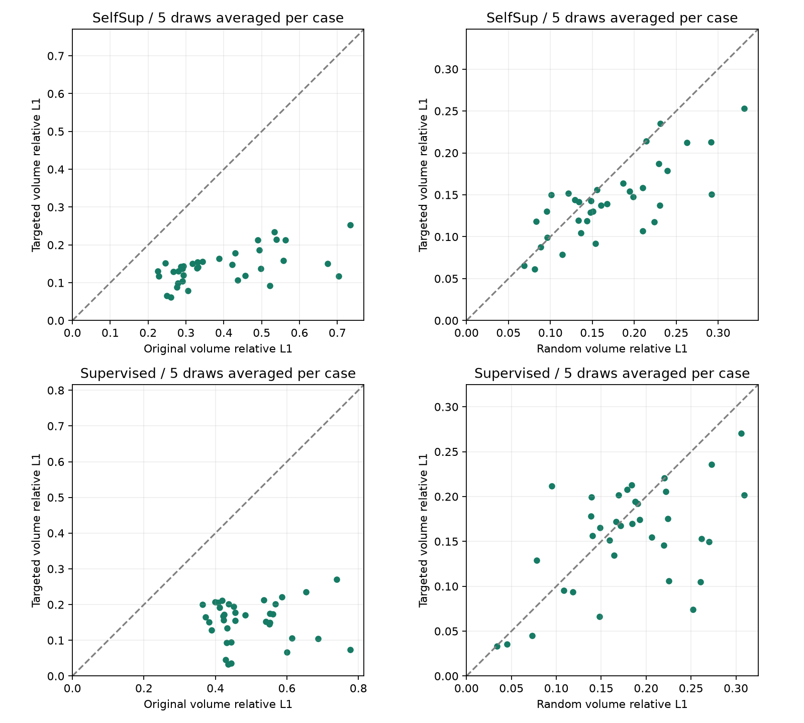
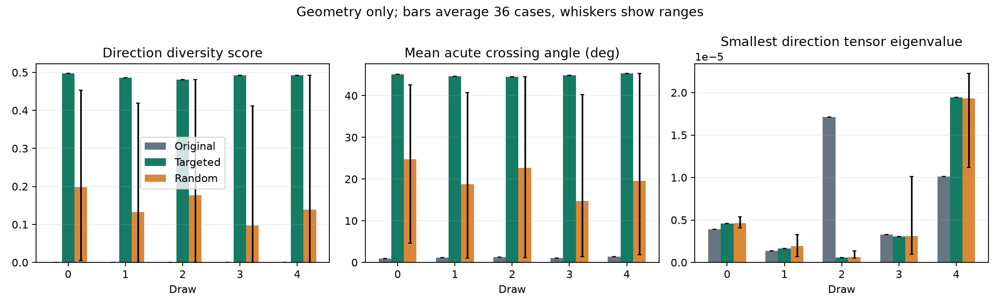
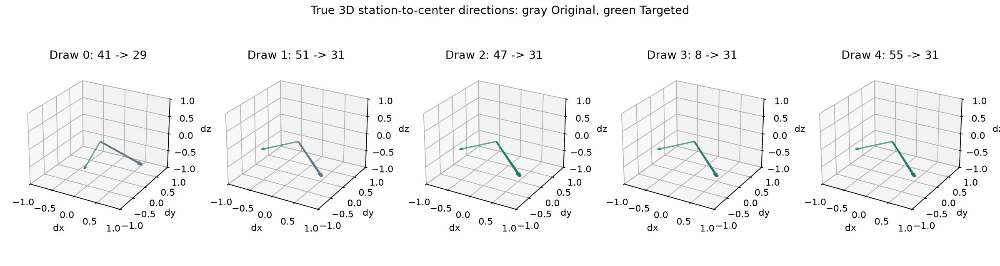
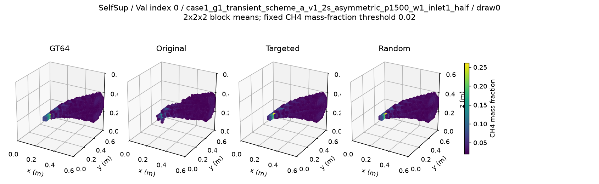
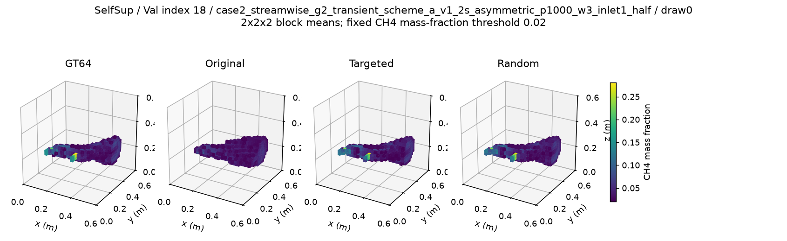
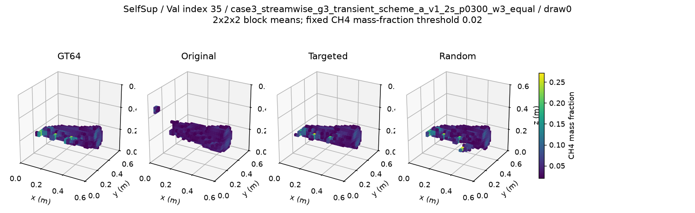
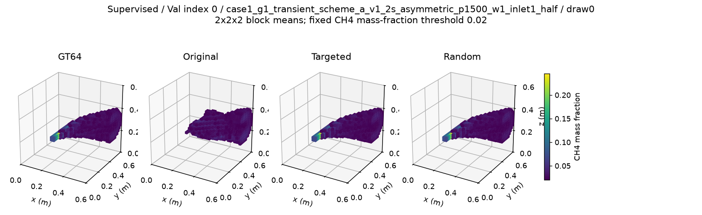
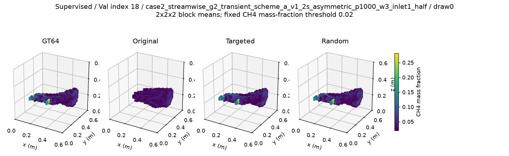
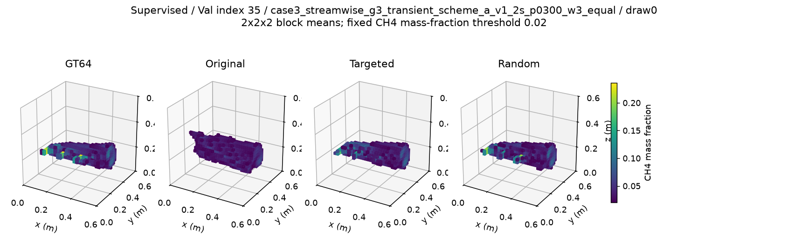

# 冻结模型 clustered V4：单站位互补替换诊断

**Targeted 相对 Original 的主指标支持改善；Targeted 相对 Random 支持改善。** SelfSup v1 C1 的 Targeted−Original 三维 relative L1 均值差为 **-0.25098398**，95% case 配对区间 **[-0.29200701, -0.21370441]**；Targeted−Random 为 **-0.02857371**，区间 **[-0.04252315, -0.01514082]**。这是固定 V=4、更换一次输入几何的单checkpoint诊断，未更新模型。

## 1. 实际执行与原结果复现（已确认事实）

开始时本地/远端均为 `0a010bb9a2163ebec2c322f972e512795c8128e5`；未发现适用的祖先/仓库 AGENTS.md、同协议已完成或未完成产物。读取 SelfSup v1、监督MRGR、原clustered协议与逐case/draw记录、最新RVTC匹配报告。最新RVTC报告的 Val-A36 测量 Treatment−Control L1 为 +0.03139504，区间 [+0.01683308,+0.04647491]；这是历史引用，本轮未重跑对照、训练或梯度诊断。保留 SelfSup v1 与原v2 NO-GO，不调整历史判据。

独立入口 `scripts/diagnose_clustered_one_swap.py`，配置 `configs/diagnose_clustered_one_swap.yaml`，独立外部目录 `/data/djc/GeoPhy-Set3D/outputs/diagnostics/clustered_v4_one_swap`。协议在零前向推理时登记，SHA256 `0962e23bf409d7e085e0a369a281b0d0d2cc9161ceb16837c34d85dbe0eda4a5`；登记代码、180条站位清单与测试先提交为 `ac6c4e9`，然后才运行 Original 和新条件。登记阶段没有读取投影或GT。站位采样器与两模型历史ID逐条一致；全部36 Val / Pool A案例、原draw0–4保留。

两模型均为 GeoLift-OARI-MRGR-Res3D，332,070参数，C1、eval、FP32，推理时 requires_grad=False / inference_mode。SelfSup v1 checkpoint SHA256 `1573cd84dffeabeb58fbbfb1afec9c9dc865a0a674e21229711bb25b22e3c026`，源提交 `3f76c3fe3cb17f75e4244bf67424b00355eca6bf`，第278轮，原300轮完全结束后按无GT held-out测量选定。监督MRGR SHA256 `4c9a39fd39432988cf5971b9a657a4cf22180650d3490bf65f3a8a7aeb04905c`，源提交 `2d6e22a5a129d1db860684054f72737ddd0e1a20`，第295轮，按同一Val的监督损失选定；辅助结果因此带有Val模型选择偏倚。checkpoint未改写，未加载其他权重。

Original两模型共360次真实前向；四项三维指标、两项输入测量指标逐case复现，另核对draw mean/pooled，总计 **2240项比较全部通过**。预登记容差 abs1e-8 + rel1e-5×|历史值|，沿用冻结参考容差，未按结果调整。最大绝对差 1.11e-16。三维L1 SelfSup=0.39340238915257336，监督=0.4952099720969504，与历史一致。

新条件720次真实前向，共1080条模型×条件×case×draw结果。没有optimizer、反向传播、更新、GT128、Pool B或最终test读取。模型参数和buffer前后canonical hash一致，数据/GT128及历史产物的size/mtime/inode清单前后相同；原数值源码、历史指标、checkpoint SHA256逐项相同。数据完整性证据是访问写阻断和全文件元数据清单对比，没有冒称重读全部训练数据做逐字节哈希。

导出时曾出现一次summary内NumPy bool无法JSON序列化的实现错误。错误发生在全部实际前向、逐条指标、配对统计和完整性记录成功保存之后；保留failure_evaluate与原日志，通过独立报告入口仅从已存标量补写摘要并重新验证1080条/36项区间，**没有重复推理，没有修改已登记源码、选择或数值规则**。几何图首次绘制还因常量的浮点舍入使误差棒出现微小负值而停止；仅将绘图范围长度截到0后完成，保留绘图错误日志与failed审计session，不影响任何数值结果。

## 2. 冻结选择、共同H与统计（已确认事实）

几何中心(0.3,0.3,0.3)m，真实三维 d=normalize(center−station_origin)，score=mean(1−|d_i·d_j|)，不使用测量、GT、误差或输出。遍历4种删除与60个Original外Pool A候选，最大分数；精确float64平分按删除ID、新增ID字典顺序。原三个站位及其输入位置保留，新站位占删除位置。绝对内积使近乎反向的平行方向仍计为不互补。这是方向多样性启发式，不是完整可观测性、条件数或数学最优站位。

Random从排序的Original外站位均匀选1个，删除与Targeted相同ID，seed=2026101203；180次中随机恰好等于Targeted **2次**，全部保留。H4从三条件输入并集之外均匀无放回抽样，独立seed=2026101204，各模型/条件同case/draw使用同一H4与完全相同有效射线。identity seed采用 purpose+NUL+case_id 的 blake2b16/little-endian u32，经SeedSequence(base,draw,words)与PCG64重放。完整ID、origin、azimuth、删除/新增、H、方向描述与checkpoint哈希已归档。

测量、全部geometry/mask、station IDs沿同一索引同步，H不输入网络。保留linear_p99_5尺度32284.894580078173 ppm·m，冻结投影64³/K96/all rays/view_chunk2；参考测量128³/K256。分辨率/积分误差仍存在，共同H只保证配对公平，不消除建模误差。

所有均值先对每case的5draw平均，再对36case平均；差值为左−右，负为误差降低，相对改善=−均值差/右均值。胜/负/平由case平均差值的<0/>0/==0确定。95% percentile配对bootstrap共10,000次，seed=2026101205，只重采样36个case；不将180记录、视角或射线视为独立样本。所有比较用同一重采样seed。区间全负且均值负支持改善，全正且均值正支持恶化，含0不确定；主指标之外均为辅助探索，未多重校正。独立汇总代码重新按draw差值聚合并核算36项区间，通过。

## 3. 三维主指标与随机替换比较（已确认事实）

| 模型 | 指标 | 配对 | 左均值 | 右均值 | 均值差 | 中位数差 | 相对改善 | 胜/负/平 | case配对95%CI | 规则结论 |
| --- | --- | --- | --- | --- | --- | --- | --- | --- | --- | --- |
| SelfSup | relative_l1 | Targeted-Original | 0.14241841 | 0.39340239 | -0.25098398 | -0.19467424 | +63.80% | 36/0/0 | [-0.29200701, -0.21370441] | 支持改善 |
| SelfSup | relative_l1 | Targeted-Random | 0.14241841 | 0.17099213 | -0.02857371 | -0.02291163 | +16.71% | 27/9/0 | [-0.04252315, -0.01514082] | 支持改善 |
| SelfSup | relative_l1 | Random-Original | 0.17099213 | 0.39340239 | -0.22241026 | -0.19098439 | +56.54% | 36/0/0 | [-0.25346233, -0.19479052] | 支持改善 |
| Supervised | relative_l1 | Targeted-Original | 0.15508995 | 0.49520997 | -0.34012003 | -0.33009939 | +68.68% | 36/0/0 | [-0.37950132, -0.30352109] | 支持改善 |
| Supervised | relative_l1 | Targeted-Random | 0.15508995 | 0.17959938 | -0.02450944 | -0.01358075 | +13.65% | 23/13/0 | [-0.04469224, -0.00486591] | 支持改善 |
| Supervised | relative_l1 | Random-Original | 0.17959938 | 0.49520997 | -0.31561059 | -0.31204150 | +63.73% | 36/0/0 | [-0.34085987, -0.29145160] | 支持改善 |

SelfSup主L1改善约63.80%，相对随机替换进一步改善约16.71%；对应L2、MAE/RMSE及共同H的L1/L2方向一致且区间全负。监督MRGR的三维四指标都支持Targeted优于Original，L1/L2/RMSE还支持优于Random，说明该几何干预的体积收益在这两个不同训练方式的冻结checkpoint上均出现；但监督MRGR的Targeted−Random **MAE及共同H L1/L2区间包含0**，因此辅助优势并非全部得到确认。Targeted对Random的case L1并非全胜：SelfSup有9例更差，监督有13例更差，全部保留。



## 4. 三维与共同H辅助指标（已确认事实）

MAE/RMSE单位为CH4质量分数，relative L1/L2无量纲。各行是独立指标，不以测量改善替代体积结论。

| 模型 | 指标 | 配对 | 左均值 | 右均值 | 均值差 | 中位数差 | 相对改善 | 胜/负/平 | case配对95%CI | 规则结论 |
| --- | --- | --- | --- | --- | --- | --- | --- | --- | --- | --- |
| SelfSup | relative_l2 | Targeted-Original | 0.21308225 | 0.52929375 | -0.31621151 | -0.28552312 | +59.74% | 36/0/0 | [-0.35117943, -0.28371735] | 支持改善 |
| SelfSup | relative_l2 | Targeted-Random | 0.21308225 | 0.25847001 | -0.04538777 | -0.03832595 | +17.56% | 28/8/0 | [-0.06337864, -0.02655603] | 支持改善 |
| SelfSup | relative_l2 | Random-Original | 0.25847001 | 0.52929375 | -0.27082374 | -0.26755214 | +51.17% | 36/0/0 | [-0.29795437, -0.24481192] | 支持改善 |
| SelfSup | mae | Targeted-Original | 0.00050522 | 0.00129879 | -0.00079357 | -0.00079806 | +61.10% | 36/0/0 | [-0.00090379, -0.00068672] | 支持改善 |
| SelfSup | mae | Targeted-Random | 0.00050522 | 0.00057863 | -0.00007341 | -0.00010423 | +12.69% | 27/9/0 | [-0.00011601, -0.00002827] | 支持改善 |
| SelfSup | mae | Random-Original | 0.00057863 | 0.00129879 | -0.00072017 | -0.00067354 | +55.45% | 36/0/0 | [-0.00082165, -0.00062704] | 支持改善 |
| SelfSup | rmse | Targeted-Original | 0.00336711 | 0.00836898 | -0.00500187 | -0.00539776 | +59.77% | 36/0/0 | [-0.00548973, -0.00449818] | 支持改善 |
| SelfSup | rmse | Targeted-Random | 0.00336711 | 0.00408005 | -0.00071294 | -0.00064106 | +17.47% | 28/8/0 | [-0.00101096, -0.00039859] | 支持改善 |
| SelfSup | rmse | Random-Original | 0.00408005 | 0.00836898 | -0.00428893 | -0.00420829 | +51.25% | 36/0/0 | [-0.00473694, -0.00385807] | 支持改善 |
| SelfSup | heldout_relative_l1 | Targeted-Original | 0.05827485 | 0.19616287 | -0.13788801 | -0.11564048 | +70.29% | 36/0/0 | [-0.16176975, -0.11681847] | 支持改善 |
| SelfSup | heldout_relative_l1 | Targeted-Random | 0.05827485 | 0.07083996 | -0.01256511 | -0.01046968 | +17.74% | 25/11/0 | [-0.01969928, -0.00562751] | 支持改善 |
| SelfSup | heldout_relative_l1 | Random-Original | 0.07083996 | 0.19616287 | -0.12532291 | -0.11234067 | +63.89% | 36/0/0 | [-0.14387167, -0.10914265] | 支持改善 |
| SelfSup | heldout_relative_l2 | Targeted-Original | 0.07374688 | 0.23218681 | -0.15843993 | -0.13171243 | +68.24% | 36/0/0 | [-0.18831250, -0.13245838] | 支持改善 |
| SelfSup | heldout_relative_l2 | Targeted-Random | 0.07374688 | 0.08948933 | -0.01574245 | -0.01430239 | +17.59% | 23/13/0 | [-0.02500013, -0.00689767] | 支持改善 |
| SelfSup | heldout_relative_l2 | Random-Original | 0.08948933 | 0.23218681 | -0.14269748 | -0.12512479 | +61.46% | 36/0/0 | [-0.16535249, -0.12294012] | 支持改善 |
| Supervised | relative_l2 | Targeted-Original | 0.21327786 | 0.66506829 | -0.45179043 | -0.43579674 | +67.93% | 36/0/0 | [-0.48986465, -0.41357768] | 支持改善 |
| Supervised | relative_l2 | Targeted-Random | 0.21327786 | 0.25511615 | -0.04183829 | -0.02181802 | +16.40% | 27/9/0 | [-0.06940893, -0.01405544] | 支持改善 |
| Supervised | relative_l2 | Random-Original | 0.25511615 | 0.66506829 | -0.40995214 | -0.39275501 | +61.64% | 36/0/0 | [-0.43994076, -0.38193160] | 支持改善 |
| Supervised | mae | Targeted-Original | 0.00061154 | 0.00170946 | -0.00109792 | -0.00104260 | +64.23% | 36/0/0 | [-0.00123293, -0.00096887] | 支持改善 |
| Supervised | mae | Targeted-Random | 0.00061154 | 0.00064537 | -0.00003384 | -0.00004950 | +5.24% | 23/13/0 | [-0.00009584, +0.00003476] | 不确定 |
| Supervised | mae | Random-Original | 0.00064537 | 0.00170946 | -0.00106408 | -0.00096139 | +62.25% | 36/0/0 | [-0.00121147, -0.00092483] | 支持改善 |
| Supervised | rmse | Targeted-Original | 0.00364283 | 0.01059054 | -0.00694770 | -0.00698870 | +65.60% | 36/0/0 | [-0.00733326, -0.00653243] | 支持改善 |
| Supervised | rmse | Targeted-Random | 0.00364283 | 0.00418709 | -0.00054426 | -0.00037532 | +13.00% | 27/9/0 | [-0.00095089, -0.00010650] | 支持改善 |
| Supervised | rmse | Random-Original | 0.00418709 | 0.01059054 | -0.00640344 | -0.00630637 | +60.46% | 36/0/0 | [-0.00686179, -0.00596755] | 支持改善 |
| Supervised | heldout_relative_l1 | Targeted-Original | 0.08826147 | 0.29874016 | -0.21047869 | -0.19533006 | +70.46% | 36/0/0 | [-0.23497974, -0.18838597] | 支持改善 |
| Supervised | heldout_relative_l1 | Targeted-Random | 0.08826147 | 0.09624123 | -0.00797975 | -0.00398895 | +8.29% | 21/15/0 | [-0.01931449, +0.00289727] | 不确定 |
| Supervised | heldout_relative_l1 | Random-Original | 0.09624123 | 0.29874016 | -0.20249893 | -0.19902452 | +67.78% | 36/0/0 | [-0.22040272, -0.18621678] | 支持改善 |
| Supervised | heldout_relative_l2 | Targeted-Original | 0.10947600 | 0.34918773 | -0.23971173 | -0.22108939 | +68.65% | 36/0/0 | [-0.27097936, -0.21240323] | 支持改善 |
| Supervised | heldout_relative_l2 | Targeted-Random | 0.10947600 | 0.11996908 | -0.01049308 | -0.00424061 | +8.75% | 21/15/0 | [-0.02557285, +0.00352284] | 不确定 |
| Supervised | heldout_relative_l2 | Random-Original | 0.11996908 | 0.34918773 | -0.22921865 | -0.21562554 | +65.64% | 36/0/0 | [-0.25063397, -0.21033053] | 支持改善 |

## 5. 每draw与几何描述（已确认事实）

| 模型 | draw | Original L1 | Targeted L1 | Random L1 |
| --- | --- | --- | --- | --- |
| SelfSup | 0 | 0.43943852 | 0.18756339 | 0.16992214 |
| SelfSup | 1 | 0.37887483 | 0.13584839 | 0.17954970 |
| SelfSup | 2 | 0.39880701 | 0.12309031 | 0.14961655 |
| SelfSup | 3 | 0.41735754 | 0.14797332 | 0.20073471 |
| SelfSup | 4 | 0.33253404 | 0.11761666 | 0.15513754 |
| Supervised | 0 | 0.57672886 | 0.20698051 | 0.18424237 |
| Supervised | 1 | 0.46892625 | 0.15374546 | 0.17801179 |
| Supervised | 2 | 0.49994765 | 0.12954747 | 0.15599744 |
| Supervised | 3 | 0.51364090 | 0.16830859 | 0.22118755 |
| Supervised | 4 | 0.41680620 | 0.11686770 | 0.15855777 |

draw0中两模型Targeted的平均L1都高于Random，另外4个draw都低于Random；5draw预登记聚合结果支持额外优势，不能包装为每draw都更好，也没有因此剔除draw0或改变规则。

Original/Targeted几何跨case相同，Random依case变化；下表Random分数取36case均值，角度/特征值仅描述，不用于调整选择。

| draw | Original IDs | 删除 → 新增 | Original分数 | Targeted分数 | Random分数均值 | 平均锐crossing angle ° | Q最小特征值 |
| --- | --- | --- | --- | --- | --- | --- | --- |
| 0 | [57, 12, 61, 41] | 41 → 29 | 0.00015430 | 0.49791299 | 0.19815316 | 0.90 → 45.16 | 3.88e-06 → 4.57e-06 |
| 1 | [21, 55, 8, 51] | 51 → 31 | 0.00025807 | 0.48617126 | 0.13276232 | 1.15 → 44.62 | 1.38e-06 → 1.64e-06 |
| 2 | [55, 8, 51, 47] | 47 → 31 | 0.00028072 | 0.48065268 | 0.17662384 | 1.25 → 44.49 | 1.71e-05 → 5.51e-07 |
| 3 | [11, 21, 55, 8] | 8 → 31 | 0.00023050 | 0.49226661 | 0.09739119 | 1.09 → 44.91 | 3.26e-06 → 3.08e-06 |
| 4 | [38, 11, 21, 55] | 55 → 31 | 0.00039902 | 0.49286986 | 0.13958783 | 1.41 → 45.38 | 1.01e-05 → 1.94e-05 |




crossing angle=acos(|dot|)，Q=mean(d dᵀ)，特征值升序，全部6个pair角度与3个特征值存于原始记录。Q仅描述中心方向的空间分布，不是重建系统条件数。Targeted分数显著增大并不保证所有方向都得到改善：最小特征值仍约1e-6至1e-5，draw2/3甚至下降，中心方向仍接近一个平面；这阻止将分数改善解释为三维完整可观测性。

| 模型 | 配对 | case均值几何变化与L1变化 Pearson（描述性） |
| --- | --- | --- |
| SelfSup | Targeted-Original | 不可识别：几何增量在case间恒定 |
| SelfSup | Random-Original | +0.01026 |
| SelfSup | Targeted-Random | -0.04459 |
| Supervised | Targeted-Original | 不可识别：几何增量在case间恒定 |
| Supervised | Random-Original | -0.06556 |
| Supervised | Targeted-Random | -0.02923 |

## 6. 仍存在的大误差案例与固定图例（事实／解释边界）

按预登记规则列出各模型Targeted case平均L1最大的5例，没有结果后设定“严重失败”阈值或删去不利案例。其完整5draw、H误差和尺度在逐条文件。

| 模型 | case | Original L1 | Targeted L1 | Random L1 | Targeted−Original |
| --- | --- | --- | --- | --- | --- |
| SelfSup | case3_crosswind_g3_transient_scheme_a_v1_2s_asymmetric_p0300_w3_inlet1_half | 0.733705 | 0.252971 | 0.331053 | -0.480734 |
| SelfSup | case2_streamwise_g2_transient_scheme_a_v1_2s_p0100_w3_equal | 0.533508 | 0.234834 | 0.231189 | -0.298674 |
| SelfSup | case3_streamwise_g3_transient_scheme_a_v1_2s_p0300_w3_equal | 0.538293 | 0.214157 | 0.214473 | -0.324136 |
| SelfSup | case3_crosswind_g3_transient_scheme_a_v1_2s_asymmetric_p1000_w3_inlet2_half | 0.489713 | 0.212872 | 0.291649 | -0.276842 |
| SelfSup | case3_streamwise_g3_transient_scheme_a_v1_2s_asymmetric_p0300_w3_inlet3_half | 0.563195 | 0.212583 | 0.262614 | -0.350612 |
| Supervised | case3_crosswind_g3_transient_scheme_a_v1_2s_asymmetric_p0300_w3_inlet1_half | 0.738463 | 0.270591 | 0.306061 | -0.467872 |
| Supervised | case2_1_g2_transient_scheme_a_v1_2s_asymmetric_p1500_w1_inlet1_half | 0.653541 | 0.235520 | 0.272580 | -0.418021 |
| Supervised | case2_streamwise_g2_transient_scheme_a_v1_2s_p0100_w3_equal | 0.585718 | 0.220588 | 0.220115 | -0.365130 |
| Supervised | case3_streamwise_g3_transient_scheme_a_v1_2s_p0300_w3_equal | 0.535143 | 0.212838 | 0.183910 | -0.322305 |
| Supervised | case3_streamwise_g3_transient_scheme_a_v1_2s_p0100_w0_equal | 0.418079 | 0.211823 | 0.094825 | -0.206256 |

原始与Targeted方向分数在各case完全相同，却对应不同误差，因此该分数不能解释所有困难案例，也不能在case层面估计Targeted−Original的分数/误差相关性。随机条件的描述性相关不构成因果或策略最优性证据。

图例在评价前固定为Val顺序索引0、18、35，draw0，每模型各3例，未按结果挑成功。图为2×2×2体素块均值≥0.02的可视化，固定elev25/azim−60、0–0.6m域；低于阈值部分不显示，所有指标仍在原64³全体素计算。每case四面板共用颜色尺度，case之间颜色尺度可不同，不能将阈值图当完整误差图。













## 7. 证据解释与尚未验证

**已确认事实：** 本轮配对结果检验同一冻结模型、固定四站位预算下的一次输入替换；两种训练方式的指标分别完整报告。若两者同方向，仅支持几何影响在这两个checkpoint上跨训练方式出现，不支持普遍规律或优于所有随机策略。原clustered输入上的能力没有因此提升。

**解释假设：** 两模型在替换后均改善、随机替换也明显改善，与集中输入的方向冗余限制重建这一解释一致；Targeted相对Random的增量说明预设方向多样性选择在本轮有帮助。集中输入方向的信息不足、训练分布适配及网络利用多样几何的能力，均可能影响结果。替换带来几何与站位对应测量一起变化，是合理输入干预；测量与体积改善是否一致应按表逐项判断，不能仅凭几何分数因果归因。仅4个方向到中心的描述也不包含全部射线覆盖和体积结构。

**尚未验证：** 唯一恢复、真实完整可观测性、跨checkpoint/seed稳定性、独立数据来源/工况、最终test及其他几何池均未评价。同来源案例可能有工况相关性，case bootstrap不能消除此相关性；两个模型各仅一个checkpoint，监督checkpoint的Val选择偏倚进一步限制外推。本轮没有训练新模型或评估模型可改进空间的优化收益，不调整评分，不扩池、不增视角，不自动启动后续实验。

## 8. 测试、审计、归档与重放

本轮实际执行27项测试全部通过（新增8项与原视角/测量测试19项），并独立重核1080条实际结果、36项配对区间，以及只用冻结几何重放全部180组站位。几何穷举/平分、反向平行、保留三站位、Random相同删除与巧合保留、H隔离、同步mask/geometry/测量索引、case5draw聚合、参数bufferhash及允许/禁止路径均有针对性测试。合成数据仅作为单元测试fixture，没有用于实际评价或补齐结果。

`access_sessions.jsonl`记录register/original/evaluate/render各阶段；运行审计中禁止访问尝试均0，允许GT64/Pool A均仅36个Val文件，登记0测量/GT读取；optimizer创建/更新均0。测试日志里的预期拒绝属于测试fixture，与实际数据运行审计分开。原训练访问保护完全不变。

仓库归档包含协议、180条完整站位描述、1080条CSV/JSON、逐case配对、逐draw、Original2240项复现比较、完整访问和不可变性日志、测试、关键图以及源码/产物SHA256。`SHA256SUMS`校验归档和新脚本/配置/测试/报告；`artifact_manifest.json`记录外部完整清单的hash和排除项。不提交checkpoint、投影、GT或用于作图的体积NPZ。完整模型/数据仍在原位置，外部缓存保留不覆盖历史。

```bash
PYTHONPATH=src:tests /scratch/djc/envs/gas-torch/bin/python -m unittest test_clustered_one_swap test_evaluation_view_selection test_measurement_consistency -v
/scratch/djc/envs/gas-torch/bin/python scripts/diagnose_clustered_one_swap.py register
/scratch/djc/envs/gas-torch/bin/python scripts/diagnose_clustered_one_swap.py original
/scratch/djc/envs/gas-torch/bin/python scripts/diagnose_clustered_one_swap.py evaluate
/scratch/djc/envs/gas-torch/bin/python scripts/report_clustered_one_swap.py
sha256sum -c docs/reports/artifacts/clustered_v4_one_swap/SHA256SUMS
```

已有完整同协议文件时诊断入口只校验并跳过，不重复前向。首次register要求27项测试日志在独立输出目录的父目录，命名clustered_one_swap_tests.log且以OK结束；已有未完成标记时拒绝覆盖并报错。报告入口只读取已有结果、冻结几何与固定缓存，不运行模型。完成本轮后停止；SelfSup v1及原v2 NO-GO均保留。
