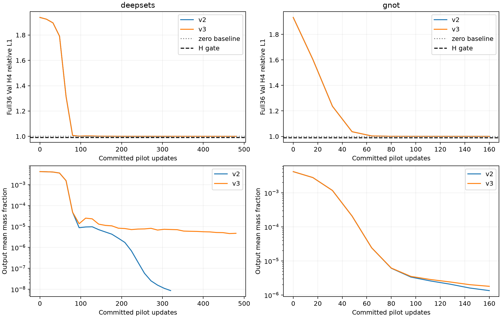

# DeepSets / GNOT 训练塌缩：根因审计、两轮有界修复与NO-GO报告

完成时间：2026-10-24T17:42:32.732020+08:00；开始时仓库commit：`871f4511625474f0b4b2c87d6391954c399fe784`。本轮仅使用合法train/val测量，不读取或评分测试GT。

**两个模型均未解决有效学习问题。** 已完成物理/损失/梯度/优化器审计、每模型两个有依据的修复候选、固定32train/完整36val的pilot及科学门槛复核。四项pilot均NO-GO，未启动任何新的300轮训练、第二种子或Senseiver。旧失败实验和主模型保持不变；不能把本轮工程通过写成科学成功。

## 1. 已确认的机制与证据边界

| 判断 | 证据 | 能支持的结论 |
|---|---|---|
| 初态浓度尺度失配 | 原fresh固定train0/1输出mean为DeepSets0.49827、GNOT0.37400；训练测量闭式尺度0.004195626 | logit0的输出远高于当前测量支持的平均尺度，是早期整体压低输出的合理来源；不是全部根因 |
| 深负sigmoid饱和及测量梯度衰减 | 原失败logits中位DeepSets−36.514、GNOT−25.088；sigmoid导数约1.67e−16/1.27e−11 | 已确认末态饱和与近零输出，不能据末态反推唯一训练起因 |
| consistency存在共同幅度缩小奖励 | 固定A/B场，L(alpha)=alpha*N/(alpha*D+1e−6)，导数严格为正；独立FP64 AD/FD/解析核验 | 固定epsilon确实产生额外的径向缩小激励；v3去除后仍失败，故不是唯一或充分根因 |
| 部分阶段consistency梯度占优 | 原失败DeepSets weighted consistency8.43e−9 vs hold1.10e−13；GNOT1.32e−7 vs2.41e−8。DeepSets v2 e20为.00484475 vs2.28e−5 | 总gradient非零可掩盖重建梯度衰减；不能仅看总loss/总norm判断在学习测量 |
| 条件学习不足 | 原fresh DeepSets对置零观测的relative输出变化仅9.17e−7；两版本最终val干预均未达2/4案例H收益门槛 | 当前编码/条件解码优化仍未形成有效映射；信息瓶颈的具体位置未被唯一识别 |

投影器/预处理没有发现足以解释塌缩的实现错误：三处Y_SCALE、loss measurement_scale和train有效射线p99.5均为32284.894580078173 ppm·m；raw线积分单位ppm·m、几何单位m，质量分数先转换摩尔分数再积分。独立NumPy XYZ线性场积分与实际K96最大差1.82e−12 ppm·m，物理链路FP64 AD/FD相对差5.49e−13。原XYZ→grid_sample ZYX重排正确，64³端点网格、路径长度、方向、有效零、padding、view_mask和A/B/H两两不交均核验。H未输入重建网络。

在精确零场，固定训练两例体素梯度约99.85%为负，正梯度数为0，证明测量loss能提供向上恢复方向；在正的均匀场C=.001，共同幅度方向导数转为+72.14，缩小均匀场反而降低loss。固定尺度探针亦显示均匀预测可通过趋零降损失。这是缺少空间结构时的优化陷阱证据，不证明loss符号错误，也不说明有结构的浓度场不能拟合测量。审计JSON中的通用背景梯度文字应以这些实际数值为准。

AdamW每参数step均为24900，原末态epoch300/24900updates、cosine last_epoch300、RNG状态键及恢复事件吻合；既有跨进程恢复检查未发现失配。本轮未找到优化器漏更新、调度提前耗尽或恢复丢失作为主要原因的证据。

原四分项hold/cross/observed/consistency及其末层bias/weight、encoder、decoder/latent梯度范数、加权范数和夹角保存在审计中。初态三个measurement方向接近同向；consistency在不同阶段可轻微相反或占优，不能强行称为唯一“梯度冲突”。原失败点极小梯度的网络参数有限差分受FP32总loss分辨率限制，本轮用合理浓度扰动的完整FP64物理链路核验，未宣称末态所有参数FD均精确通过。

DeepSets与GNOT都有尺度压低/负饱和和条件学习不足，但程度不同：DeepSets末态更极端、consistency与measurement梯度比例更大；GNOT原输出较接近常量，初始化修复后仍迅速压低幅度。不能将两个模型归为已完全证实的同一单因果。

## 2. 同输入基准与修复定义

下表只对固定val前2例、相同A/B/H、同K96与指标做诊断对照，不冒充完整36案例selector：

| 模型/状态 | held-out Relative L1 |
|---|---:|
| zero / zero | 1 |
| deepsets / fresh | 270.881923763 |
| deepsets / failed | 1 |
| gnot / fresh | 224.658331231 |
| gnot / failed | 1.00000000372 |

每个pilot另对完整36个固定val案例计算零场，结果精确为1.0。网络未训练、失败checkpoint与修复pilot的指标均使用相同有效射线/宏平均定义；不把数值误差级别的1附近变化算成功。

v2：新增 `baseline_measurement_init_v2.py` 两个继承类，只将最终linear weight乘.01、bias置logit(C_init)。C_init由全166个train案例epoch0合法A/B的2,977,913条有效射线闭式估计：chi=Σ(length*y)/(1e6Σlength²)=.007549523682215568，精确转质量分数得.004195626187323315、bias−5.4695082277569576。没有使用GT统计、val/test来定初始化，没有加载旧失败/主模型/监督权重。其余参数逐元素与同seed v1一致，参数量不变，sigmoid与前向结构不变。

v3：与v2相同fresh初态参数，唯一数值变化是独立基线consistency采用齐次比值N/D，零/零定义0，FP64归约后回到FP32，保留原四loss权重1/.5/.1/.05及所有measurement discrepancy。通过新文件 `baseline_consistency_repair_v3.py` 和仅v3进程adapter接入，原selfsup.py与冻结主模型loss源码不改。**这是新loss协议，不是声称与原Plain训练公式完全相同。** 没有移入GeoLift/MRGR/PRF或改变预测目标。

原失败权重仍在 `deep_baselines_v1/training_registered_v2/`；本轮新目录为 `/scratch/djc/GeoPhy-Set3D/deep_baselines_repair_v2/pilots/<arm>_<v2/v3>_seed20261011/`。新配置位于 `configs/baselines/<arm>/model_repair_v2.json` / `model_repair_v3.json`；配置/协议/源码与best/last哈希见pilot_summary.csv及各protocol.json。旧报告、配置、checkpoint、日志和哈希未覆盖。

## 3. Pilot：工程通过，科学门槛全部失败

固定train前32例、完整val36例，seed20261011 fresh，64³/FP32/全部有效射线/K96、原A/B/H、batch2、AdamW2e−4/wd1e−4/clip1/cosine T_max300；loader workers0用于完整审计。前10轮，只有e5→e10改善>=.005且健康才延长，最多30轮。GO还要求最后连续两轮H<=.99、较初态改善>=.01、非近零、跨案例差异及至少2/4固定val案例正常测量较置零测量有H收益>=.001且输出relative MA>=.001。阈值未事后降低。

| 模型/候选 | epochs / updates | 初始全val H | 最后全val H | best H@epoch | 零场 | 干预通过 | 决策 |
|---|---|---:|---:|---|---:|---:|---|
| deepsets v2 | 20 / 320 | 1.938704265 | 1.000001102 | 1.000001102@20 | 1.0 | 0/4 | NO_GO_NEAR_ZERO_COLLAPSE |
| deepsets v3 | 30 / 480 | 1.938704265 | 1.000662862 | 1.000641917@29 | 1.0 | 0/4 | NO_GO_PILOT_BUDGET_EXHAUSTED |
| gnot v2 | 10 / 160 | 1.933147622 | 1.000190454 | 1.000190454@10 | 1.0 | 0/4 | NO_GO_NO_SCIENTIFIC_TREND |
| gnot v3 | 10 / 160 | 1.933147622 | 1.000256099 | 1.000256099@10 | 1.0 | 0/4 | NO_GO_NO_SCIENTIFIC_TREND |

| 模型/候选 | mean | std | min / max | <1e−10比例 | 跨案例相对差 |
|---|---:|---:|---|---:|---:|
| deepsets v2 | 8.66657e-09 | 1.94219e-09 | 2.394e-09 / 2.808e-08 | 0.000000 | 0.174107 |
| deepsets v3 | 4.73817e-06 | 8.65951e-07 | 1.576e-06 / 1.252e-05 | 0.000000 | 0.036903 |
| gnot v2 | 1.35166e-06 | 1.93553e-08 | 1.313e-06 / 1.429e-06 | 0.000000 | 0.007064 |
| gnot v3 | 1.80538e-06 | 2.38737e-08 | 1.760e-06 / 1.898e-06 | 0.000000 | 0.001114 |

跨案例相对差并不等于对测量的有效依赖：geometry本身变化也可造成输出差异，且小场的相对变化可能大而绝对量无意义。因此门槛同时要求绝对幅度和val置零测量的H收益。最终4个候选均未满足完整科学条件；不以空间std非零、gradient有限或从很高初始误差下降来制造成功。

每轮分项loss、LR、有效更新、clip前gradient最大norm、输出/案例差、GPU峰值及耗时都保存；初始和epoch1/5/10/20/30还记录四分项及编码器/解码器/末层梯度和logits。pilot_summary.csv提供初始/终末验证loss、首/末训练loss。工程smoke各独立1次更新后从磁盘重载model/AdamW/cosine/RNG，输出逐位相同，再重新fresh初始化pilot；smoke更新不计科学pilot预算。这验证状态往返，不宣称本轮pilot做了跨进程连续训练等价实验。

独立验收从日志和干预数字重建4项pilot的全部GO条件，并逐项核验v2/v3初态state哈希、案例、数据文件哈希、相同epoch的A/B/H station digest及LR。共30个共同epoch完全对齐，paired CSV只比较共同预算，不把不同终点当公平胜负。

## 4. 正式训练状态与不能解决的部分

**没有候选获准正式300轮。** 本轮新增正式更新数为0，未启动第二种子或Senseiver；旧DeepSets seed20261019仍保留epoch240/19920updates，不恢复旧队列。不存在新的“成功300轮”checkpoint、best epoch或最后一轮成绩，不能填入正式精度榜单。四个pilot的best/last只用于诊断归档，不能作为后续fresh正式训练的warm-start。

已排除当前证据能覆盖的单位/轴序/有效射线丢弃/优化器步数问题，确认尺度失配与sigmoid末态饱和、固定epsilon缩幅奖励，但两项修复不足。DeepSets v3比v2减轻了极端趋零仍未优于零场；GNOT两候选早期轨迹接近，说明epsilon机制不足以解释其早期失败。仍待确定：单测量通道相对202几何特征的条件信号利用、全局mean/operator统计后的可辨识性、坐标decoder的近均匀先验，以及原relative-L1在稀疏近零测量上的优化压力。不能据此断言DeepSets/GNOT原算法无法学习或主模型普遍优越。

最有价值的后续工作是另行登记一个低成本、仅train/val的可辨识性/梯度对照，区分编码器是否保留可读测量变化与解码器是否使用条件信号，再考虑是否需要不同但公平的独立表示。可以同时先用固定合成非零场和合法测量目标验证条件读出的可学性；不移植主模型模块，不使用GT，也不自动开始新的架构/LR/seed搜索。本轮按“两候选/模型”上限停止，第二种子不具备启动条件。

## 5. 工程异常、资源与最终完整性

只使用GPU0/RTX4090；GPU1–3的其他用户进程未终止或干预。沿用全局UUID flock、15秒双空闲快照、资源门槛、FD继承和进程组冲突处理。pilot顺序执行；等待中的controller不占GPU，无多个未验证正式训练。所有原始GPU快照/任务状态在scheduling目录。

保留了以下工程异常及修正：最初helper名common.py与历史导入冲突，在任何诊断更新前改为repair_context.py；首轮GNOT分项梯度诊断在eval-with-grad关闭分块重计算，OOM后本任务退出释放显存，改用无dropout/BN的train模式启用原分块checkpoint，完整64³/射线保持不变；第一次pytest漏PYTHONPATH导致导入失败，修正环境后通过；合成幅度探针极小alpha的绝对导数断言受相消影响，改核验有条件良好的对数幅度导数，原失败日志保留，未修改科学门槛。上述均未改动旧模型/训练协议，也未停止其他用户进程。

相关测试：初始化隔离/合成契约及原DeepSets/GNOT/共同契约16 passed、3 subtests passed；新consistency尺度不变/零边界/AD-FD2 passed。初始与最终冻结主模型CPU代表性C0/C1逐位回归通过；原两个baseline best/checkpoint及日志、主模型双种子权重/协议哈希不变。没有声称整个仓库历史测试全部通过。

所有科学数据读写受train/val白名单审计；四个pilot均无GT/违规访问。预先存在train_statistics.json中虽含历史GT汇总键，本轮只使用投影归一化字段，初始化完全来自新读取的合法train A/B测量；无GT64/GT128、测试数组、Pool B或监督checkpoint读取。主模型权重仅供原回归函数使用，不用于基线初始化。此轮没有三维GT评价，因此也不声称重建三维浓度已经正确。

- [验收及全部checkpoint身份](artifacts/deep_baselines_repair_v2/acceptance.json) · [每模型pilot汇总CSV](artifacts/deep_baselines_repair_v2/pilot_summary.csv)
- [独立GO门槛复核](artifacts/deep_baselines_repair_v2/independent_pilot_verification.json) · [同预算配对CSV](artifacts/deep_baselines_repair_v2/matched_epochs_v2_v3.csv)
- [完整根因审计](artifacts/deep_baselines_repair_v2/audit.json) · [优化器/恢复审计](artifacts/deep_baselines_repair_v2/optimizer_audit.json) · [尺度/掩码审计](artifacts/deep_baselines_repair_v2/scale_mask_audit.json)
- [consistency解析对照](artifacts/deep_baselines_repair_v2/consistency_causal_probe.json) · [同输入零/未训练/失败比较](artifacts/deep_baselines_repair_v2/same_input_zero_fresh_failed_comparison.json)
- [最终主模型逐位回归](artifacts/deep_baselines_repair_v2/final_main_regression.json) · [预登记协议](../deep_baselines_collapse_repair_v2_protocol_zh.md)
- [v2候选依据](../deep_baselines_repair_v2_hypothesis_zh.md) · [v3候选依据](../deep_baselines_repair_v3_hypothesis_zh.md)

复核入口：`scripts/deep_baselines_repair_v2/audit.py`、`pilot.py`、`pilot_v3.py`、`finalize.py`。Git保存新模型/adapter、四配置、协议、日志、梯度/输出/访问记录、来源及checkpoint哈希、CSV/曲线与本报告；权重仅保留独立scratch目录，不上传GT或大数组。保存目录不可覆盖；禁止直接重跑已归档pilot或把NO-GO改成GO。
