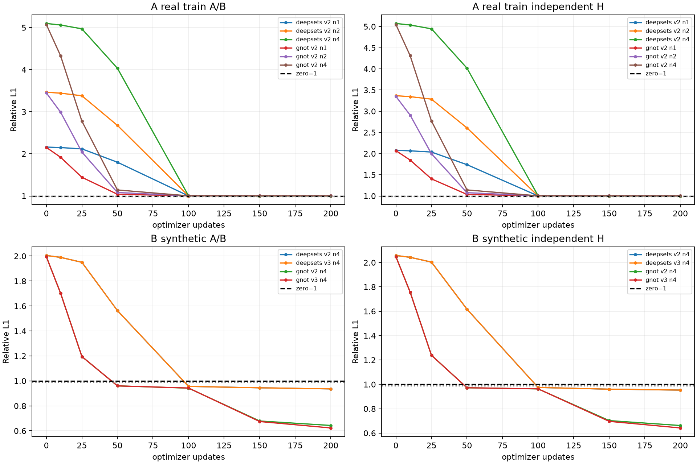
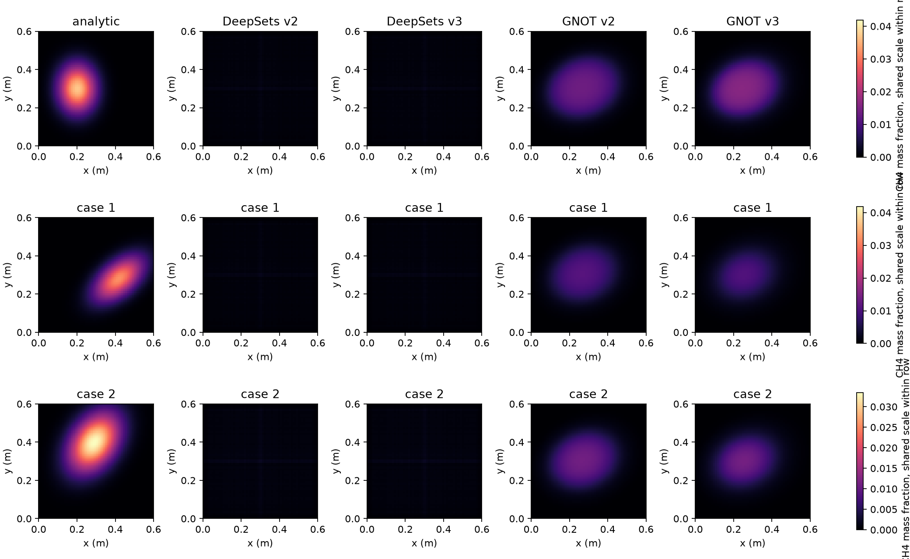
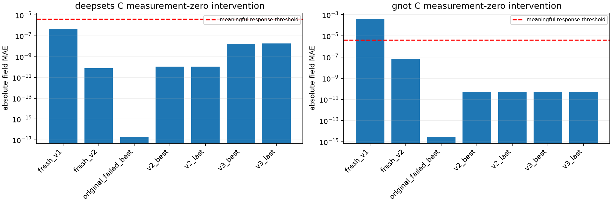

# DeepSets / GNOT 条件学习能力与塌缩诊断 v1

完成时间：2026-10-24T19:14:28.310035+08:00。起始main commit：`0b44cc75eb3183a922edc9cca50b63cb25bca5c8`，已fetch并核验远端main一致。

A/B共10项、每项200次有效optimizer更新，合计2000；C覆盖14个模型状态、每状态2个固定train案例，更新数0。初步条件学习GO为0/10。**所有结果均为诊断，不授权正式300epoch、第二种子或Senseiver；原正式队列保持暂停。**

## 1. 目的、预登记与信息边界

A检验真实少样本A/B拟合与同案例独立H泛化，B检验受控解析非均匀场，C定位测量信号传播及饱和。三者分开执行和解释。C先运行。A固定train索引0/1/2/3的嵌套1/2/4例；C为前2例；A4/B4/H4按原sampler、seed20261011、epoch0固定且两两不交。完整案例/站位及输入SHA见registration.json。
全新v2测量尺度初始化，四个B条件同一模型初态逐位相同；没有从失败或监督权重warm-start。64³/FP32/全部有效射线/K96不变。独立诊断loss=0.5cross+0.1observed+0.05consistency，完全移除hold。A只用v2；B仅v2/v3 consistency差别。AdamW2e-4/wd1e-4/clip1、固定LR、batch=min(2,N)、固定顺序，每项恰好200次。固定LR是本轮诊断协议，不冒充原cosine300正式训练。
真实实验A的H只在评价函数抽取，无梯度评价，不作为输入、不进入训练目标；训练函数只有A/B能力。B的H在合成生成期封存，训练步骤不读取，只有评价函数读取。生成B几何时复用getter曾临时载入所选真实train测量（包括H），随后全部覆盖为合成积分，原值未用于合成定义、初始化或目标。合成真场仅在生成及独立评价访问。新的train-only适配器复用原getter，但不调用读取混合统计JSON的构造函数；Y_SCALE和初始化只复用既有合法train测量统计常量。历史train_statistics.json只由冻结身份核验逐字节读取以计算SHA，未解析其GT统计字段，也未用其设计初始化；数据适配器不打开该文件。无真实GT数组、GT统计数值、val/test数组、GT128、Pool B或监督权重使用。冻结主模型回归改用同一个合法train输入，避免为回归额外读取val。
首次读取测量前封存preregistration.json及SHA。阈值：全部case训练L1<=.99且较初态改善>=.01，H连续两次评价<=.99，全部分支mean>=1e-8、空间CV>=.05，置零或固定有效射线置换的绝对MAE/固定C_init>=.001（绝对约4.20e-6），重复前向逐位相同；输入measurement-channel gradient L2>1e-12且AD/FD有可辨认证据。低于分辨率的FD不冒充有效响应。阈值未改变。每个候选全部条件满足才GO；预算耗尽而证据不足为INCONCLUSIVE。
C的operator/query/readout梯度tap只覆盖首个8192-query块；encoder、token、DeepSets聚合为完整表示，整体输出及H投影仍为完整64³。没有将局部query梯度冒充整个解码器。C无训练改善条件，因此最多提供响应证据，不能单独判训练科学GO。A/B原运行详细梯度/FD采样首例；独立验收再以零optimizer更新补齐其余20个case终态审计，合计30个case，完全复用原阈值。最终GO按全部case检查；原run初筛status保留，experiment_summary.csv另列original_run_status以区分。

## 2. A：真实train少样本测量过拟合

| 模型 | 案例数 | updates | AB初始→最终L1 | H初始→最终L1 | mean / 空间CV | 置零MAE | 结果 |
|---|---:|---:|---|---|---|---:|---|
| deepsets | 1 | 200 | 2.160816 → 1.000094 | 2.076258 → 1.000083 | 5.91e-07 / 0.212 | 4.62e-09 | NO_GO |
| deepsets | 2 | 200 | 3.464636 → 1.000117 | 3.366736 → 1.000107 | 4.42e-07 / 0.182 | 3.15e-09 | NO_GO |
| deepsets | 4 | 200 | 5.097739 → 1.000001 | 5.072065 → 1.000001 | 1.69e-09 / 0.2 | 1.77e-11 | NO_GO |
| gnot | 1 | 200 | 2.153329 → 1.001471 | 2.069120 → 1.001280 | 7.72e-06 / 0.0454 | 1.33e-10 | NO_GO |
| gnot | 2 | 200 | 3.448192 → 1.001046 | 3.350803 → 1.000970 | 2.44e-06 / 0.0136 | 1.63e-10 | NO_GO |
| gnot | 4 | 200 | 5.073610 → 1.000925 | 5.048244 → 1.000922 | 1.1e-06 / 0.0159 | 2.38e-11 | NO_GO |

AB为两分支对A/B全部四条预测-目标组合先在case内平均，再case宏平均；H为两分支先case内平均。零场L1/L2均按相同目标/掩码重算，精确1.0。表中mean/CV/干预是分支与case均值，仅展示；GO按全部case逐一检查，不以平均掩盖失败。L2、discrepancy、每条投影、每步loss/LR/模块梯度、峰值显存均有原始记录。spatial_and_logit_statistics.csv给出每个评价点的跨案例绝对MAE/voxel std和logits分位数；单案例的跨案例差异记NA。中间logits由保存FP32 sigmoid输出反算并注明端点clamp，初始/最终另有真实hook logits，不混淆两者。训练L1从高尺度下降到1附近不自动等于学会空间反演。

## 3. B：解析羽流合成反演

固定四例：左侧各向异性单高斯、右侧旋转高斯、上侧旋转高斯和双羽流；center/sigma/rotation/peak在预登记design.json中固定，峰值由既有train-only初始化尺度的固定倍数定义，不来自真实GT。连续解析质量分数通过独立NumPy FP64 Gauss-Legendre256阶积分和显式物理换算生成目标，反演使用原64³/K96可微投影器。
128/256阶参考积分最大绝对差为1.38e-10 ppm·m，最大相对L1差6.74e-15；64³/K96对独立参考的相对L1离散差范围0.1255%–0.1889%。128/256阶比较在FP64转存前计算，训练目标另保存为FP32并有舍入；上述64³/K96比较使用实际FP32目标。避免完全同路径生成/反演，但仍是相同物理假设、理想无噪声的有限合成例，不能证明真实反演。

| 模型/条件 | updates | AB初始→最终 | H初始→最终 | H末两次失败case数 | 合成三维L1 | mean / CV | 置零MAE | 结果 |
|---|---:|---|---|---:|---:|---|---:|---|
| deepsets v2 | 200 | 2.004877 → 0.936105 | 2.057978 → 0.953020 | 1 / 4 | 1.042899 | 0.000492 / 0.346 | 6.29e-07 | NO_GO |
| deepsets v3 | 200 | 2.004877 → 0.936113 | 2.057978 → 0.953020 | 1 / 4 | 1.042861 | 0.000492 / 0.346 | 6.29e-07 | NO_GO |
| gnot v2 | 200 | 1.995319 → 0.643084 | 2.048550 → 0.662135 | 0 / 4 | 0.811262 | 0.00111 / 2.08 | 1.17e-06 | NO_GO |
| gnot v3 | 200 | 1.995319 → 0.623101 | 2.048550 → 0.642170 | 0 / 4 | 0.785064 | 0.00109 / 2.07 | 1.91e-06 | NO_GO |

合成体积L1为case/分支宏平均，零场为1；逐case的MAE/RMSE、峰值幅度与位置、空间std在final_case_branch_metrics.csv。H测量改善和合成三维恢复必须分别判断；平滑或共同空间模板也可能降低测量误差。四例使用不同的固定站位子集，不能完全排除几何识别案例的捷径；置零/置换响应也不等于对有效测量分布上的正确条件映射。

## 4. C：信息传播、逐层梯度与输入敏感性

| 模型/状态 | H L1 | 置零 / 置换MAE | encoder相对变化 | latent/query相对变化 | logits<-12比例 | C判定 |
|---|---:|---:|---:|---:|---:|---|
| deepsets fresh_v1 | 280.884 | 4.71e-07 / 8.27e-08 | 0.00767 | 0.00253 | 0 | C_NO_GO_EFFECTIVE_RESPONSE |
| deepsets fresh_v2 | 3.36674 | 7.9e-11 / 1.39e-11 | 0.00767 | 0.00253 | 0 | C_NO_GO_EFFECTIVE_RESPONSE |
| deepsets original_failed_best | 1 | 1.72e-17 / 1.18e-19 | 0.00248 | 0.000831 | 1 | C_NO_GO_EFFECTIVE_RESPONSE |
| deepsets v2_best | 1 | 1.09e-10 / 1.83e-12 | 0.00314 | 0.00102 | 1 | C_NO_GO_EFFECTIVE_RESPONSE |
| deepsets v2_last | 1 | 1.09e-10 / 1.83e-12 | 0.00314 | 0.00102 | 1 | C_NO_GO_EFFECTIVE_RESPONSE |
| deepsets v3_best | 1.00189 | 1.77e-08 / 2.76e-10 | 0.00233 | 0.000747 | 0.949 | C_NO_GO_EFFECTIVE_RESPONSE |
| deepsets v3_last | 1.00197 | 1.8e-08 / 3.17e-10 | 0.00233 | 0.000745 | 0.934 | C_NO_GO_EFFECTIVE_RESPONSE |
| gnot fresh_v1 | 213.777 | 0.0004 / 3.04e-05 | 0.0108 | 0.00348 | 0 | C_RESPONSE_ONLY_INCONCLUSIVE |
| gnot fresh_v2 | 3.3508 | 7.33e-08 / 5.57e-09 | 0.0108 | 0.00348 | 0 | C_NO_GO_EFFECTIVE_RESPONSE |
| gnot original_failed_best | 1 | 2.6e-15 / 8.17e-16 | 0.00874 | 0.000196 | 1 | C_NO_GO_EFFECTIVE_RESPONSE |
| gnot v2_best | 1.00055 | 5.32e-11 / 1.99e-11 | 0.00583 | 7.29e-05 | 1 | C_NO_GO_EFFECTIVE_RESPONSE |
| gnot v2_last | 1.00055 | 5.32e-11 / 1.99e-11 | 0.00583 | 7.29e-05 | 1 | C_NO_GO_EFFECTIVE_RESPONSE |
| gnot v3_best | 1.00074 | 5.22e-11 / 2.22e-11 | 0.00585 | 7.49e-05 | 1 | C_NO_GO_EFFECTIVE_RESPONSE |
| gnot v3_last | 1.00074 | 5.22e-11 / 2.22e-11 | 0.00585 | 7.49e-05 | 1 | C_NO_GO_EFFECTIVE_RESPONSE |

C表为前2train案例、A/B输入的平均；梯度/AD-FD为A输入路径，B参与相同A/B诊断目标。正常、0、.5、1.5、有效射线固定置换全部保存。输入measurement通道与202个geometry通道分别记录gradient L2/max/finite_fraction，另含phi/mean/latent或measurement/geometry encoder、每层operator/query、末层weight/bias和logits。中间表示的相对变化使用自身稳定范数；最终输出一律另报绝对变化及固定初始化尺度，不能用近零输出作分母夸大响应。相同权重state哈希的best/last明确复用诊断，checkpoint身份仍各自记录。
- deepsets fresh v2：置零测量引起encoder相对L2变化0.00767174、latent/query变化0.00252829，输出绝对MAE仅7.89728e-11。原失败权重饱和logit比例1、sigmoid平均导数4.20571e-16，输出干预MAE为1.71964e-17。
- deepsets fresh v1→v2输出置零响应缩小约5965倍；fresh v2的logits<-12比例为0。因此新初态的弱绝对响应不能直接等同于末态深饱和；readout×.01和低浓度sigmoid斜率的作用需与训练后饱和分开。置换后的latent/query相对变化仅0.000249017，逐层完整变化见CSV；不同层的相对范数比不是信息容量或唯一因果证据。
- gnot fresh v2：置零测量引起encoder相对L2变化0.0108467、latent/query变化0.00348121，输出绝对MAE仅7.33135e-08。原失败权重饱和logit比例1、sigmoid平均导数1.27286e-11，输出干预MAE为2.59565e-15。
- gnot fresh v1→v2输出置零响应缩小约5458倍；fresh v2的logits<-12比例为0。因此新初态的弱绝对响应不能直接等同于末态深饱和；readout×.01和低浓度sigmoid斜率的作用需与训练后饱和分开。置换后的latent/query相对变化仅0.000383369，逐层完整变化见CSV；不同层的相对范数比不是信息容量或唯一因果证据。

AD/FD对输入共同幅度方向分别用完整输出均值/固定尺度及平均logits，epsilon=.01/.001；允许5%相对误差加1e-8绝对容差。所有原始AD/FD和误差可复核；低幅度、FP32相消或非线性处不满足数值核验的项目标precision-limited/不通过，不强行声称所有状态敏感性都被精确验证。
最终30个case的补充审计见[全部case敏感性记录](artifacts/deep_baselines_identifiability_v1/final_case_sensitivity.json)。下表按每项全部case要求判定；AD/FD未通过表示当前数值证据不足，不等于梯度为零，也不覆盖已有独立失败门槛。

| 实验 | 输入测量梯度全部通过 | 输出AD/FD全部通过 |
|---|---|---|
| A_deepsets_v2_n1 | True | True |
| A_deepsets_v2_n2 | True | True |
| A_deepsets_v2_n4 | True | False |
| A_gnot_v2_n1 | True | True |
| A_gnot_v2_n2 | True | True |
| A_gnot_v2_n4 | True | False |
| B_deepsets_v2_n4 | True | True |
| B_deepsets_v3_n4 | True | True |
| B_gnot_v2_n4 | True | True |
| B_gnot_v3_n4 | True | True |

## 5. 证据分级与当前不能证明的结论

- 六项真实少样本实验的训练A/B本身均未实质优于零场，故当前失败不能仅解释为“训练已拟合但独立H泛化差”；但200次预算也不能证明架构永远不能拟合。移除H后仍失败，说明H项不是出现失败的必要条件，不代表H对原训练完全无影响。
- 合成条件中确有A/B测量改善；结合已知64³真场可将测量误差压到约0.2%以内的正对照，不支持“整个物理/梯度链完全不能拟合”这一绝对解释。测量改善、条件响应和三维恢复仍须分开判断。
- 部分合成案例的三维场误差确实低于零场，并出现非均匀空间结构，削弱“空间解码器完全不能表达非均匀场”的解释；这仍不能证明输出空间结构正确依赖输入测量。共同模板、几何捷径与有效条件映射需要区分。
- deepsets真实1/2/4例：最终AB L1范围1–1.00012，H范围1–1.00011；通过条件门槛0/3。
- deepsets合成v2：AB=0.936105、H=0.95302，三维L1=1.0429（1/4案例优于零场），置零MAE=6.29e-07；独立H连续两次/所有case门槛=False、条件响应门槛=False。
- deepsets合成v3：AB=0.936113、H=0.95302，三维L1=1.04286（1/4案例优于零场），置零MAE=6.29e-07；独立H连续两次/所有case门槛=False、条件响应门槛=False。
- gnot真实1/2/4例：最终AB L1范围1.00092–1.00147，H范围1.00092–1.00128；通过条件门槛0/3。
- gnot合成v2：AB=0.643084、H=0.662135，三维L1=0.811262（3/4案例优于零场），置零MAE=1.17e-06；独立H连续两次/所有case门槛=True、条件响应门槛=False。
- gnot合成v3：AB=0.623101、H=0.64217，三维L1=0.785064（3/4案例优于零场），置零MAE=1.91e-06；独立H连续两次/所有case门槛=True、条件响应门槛=False。

**已验证事实：** 测量信息并非在token入口被全部丢弃；C的encoder和聚合/operator表示存在可重复变化。旧失败权重深负logits及其sigmoid导数衰减保留了饱和机制证据；饱和是末态现象，不能由此证明唯一训练起因。v2 readout权重×.01及负bias虽修正幅度，也会在初态进一步减弱输出对同一latent变化的绝对响应；fresh v1/v2共享其余参数，C可直接核对此影响。A/B的条件门槛、逐case预测/测量指标及失败条件均来自保存数值，见表和CSV。
**较强假设：** 当前表示、条件解码及稀疏测量loss之间的优化匹配仍有困难，不能只归因于consistency固定epsilon。若B的H降低而三维结构或测量响应失败，则共同空间先验/几何捷径和非唯一解是合理替代解释；不能仅以非零encoder梯度说明它学会了正确反演。
**未解决问题：** 200次更新是否足以获得最优条件映射、全局聚合是否构成决定性瓶颈、同几何下测量变化的可读性、坐标解码器与相对L1的作用各占多少，本轮不能唯一分离。A前4例为来源清单顺序中的相近条件，B仅4个理想例；本轮不支持完整数据分布或充分调优算法的普遍能力结论。没有真实三维GT评价，不能声称真实浓度场恢复。NO-GO仅表示本轮固定条件和预算下未过门槛；即便如此，架构在更充分且合理优化下的能力仍是未解决问题，不能自动增加预算来回答。

## 6. 独立复核、工程异常与资源

独立review.py直接从保存的逐射线预测/目标/掩码以NumPy重算2960个L1/L2字段、零场、case宏平均、空间std/干预MAE和B体积指标，并独立重建GO条件；不调用训练scores/decide。复核2000次AdamW step、所有C状态0更新、B初态及输入身份一致。额外独立合成能力测试将H放大1000倍，A/B诊断loss及模型参数梯度逐位相同，H输入/几何梯度均不存在，网络只见A/B；该审计不执行optimizer更新。新CPU工程13 passed+3 subtests，显存adapter等价1 passed、精确路径dispatch1 passed；前后冻结主模型同合法train输入C0/C1逐位一致。双种子权重、冻结源码/配置、原loss及历史已跟踪结果内容均未改变。

保留三项工程异常与恢复记录。其一：GNOT C在完整输入梯度FD阶段OOM，发生在任何训练更新之前。原控制器停止该任务并释放GPU0，失败日志与部分数组移到engineering_failures，未覆盖。仅新增engineering_memory_v2.py：tap用weakref避免checkpoint closure保留Trace/计算图，独立梯度调用间gc.collect；CPU验证前向和输入梯度逐位一致。原登记数值文件和阈值不改，amendment及新源码SHA先封存，再按--recover-reason重试；没有减小64³、查询范围、射线数、loss或科学预算。C DeepSets保留原成功版本，GNOT及十项训练调用等价的内存adapter，命令和映射可追溯。其二：首项训练启动按通用名称导入了历史train模块，在建立run目录或任何更新之前退出；新增显式文件路径dispatch，CPU回归通过，原登记文件不改。其三：首项DeepSets1例已封存200次更新、checkpoint及NO-GO结果，末尾status写入重复at参数报错。核验全部200条日志、AdamW step及checkpoint哈希后接收该科学结果，仅修复状态，不重跑更新；其余九项使用逐行一致、仅修正该状态写入的一份新train_fixed_v2.py，差异与源码SHA预先登记。
全程只用GPU0全局UUID flock，15秒双空闲快照/FD继承/外来冲突监控；等待最多60秒。GPU1–3其他用户任务未停止或抢占。全部训练更新恰好2000，无额外smoke optimizer更新；C/CPU测试均0。每项耗时/峰值显存、调度、访问和恢复记录已保存。主模型回归只读权重并前向；未重训/微调。

## 7. 唯一建议的下一步与停止边界

建议另行授权一个**固定完全相同A/B/H几何、多个不同解析羽流的配对条件读出实验**，同时比较正常测量与跨羽流测量交换。理由：本轮已能定位“内部响应存在但输出是否有效”的差距，现有不同案例的站位子集仍允许几何捷径，而置零/射线置换可能偏离正常测量分布。相同几何下交换物理合法测量可以更直接检验条件解码，而不需要新架构、GT或宽泛搜索。此建议未执行；即使本轮有诊断GO，也需用户审阅后决定下一步。

## 8. 产物入口

- [独立诊断状态](artifacts/deep_baselines_identifiability_v1/final_status.json) · [十项实验汇总](artifacts/deep_baselines_identifiability_v1/experiment_summary.csv) · [逐case指标](artifacts/deep_baselines_identifiability_v1/case_metrics.csv)
- [C状态及checkpoint身份](artifacts/deep_baselines_identifiability_v1/C_state_summary.csv) · [全部五种干预](artifacts/deep_baselines_identifiability_v1/C_interventions.csv) · [逐层梯度](artifacts/deep_baselines_identifiability_v1/C_layer_gradients.csv) · [最终case/branch及合成指标](artifacts/deep_baselines_identifiability_v1/final_case_branch_metrics.csv)
- [独立复核](artifacts/deep_baselines_identifiability_v1/independent_review.json) · [H隔离和历史完整性](artifacts/deep_baselines_identifiability_v1/integrity_audit.json) · [跨案例/中间logits](artifacts/deep_baselines_identifiability_v1/spatial_and_logit_statistics.csv) · [输入/源码登记](artifacts/deep_baselines_identifiability_v1/registration.json) · [首次运行前协议](artifacts/deep_baselines_identifiability_v1/preregistration.json) · [内存修复登记](artifacts/deep_baselines_identifiability_v1/engineering_memory_v2.json)
- [预登记说明](../deep_baselines_identifiability_v1_protocol_zh.md) · [最终主模型回归](artifacts/deep_baselines_identifiability_v1/main_after.json)

全部原始数组及checkpoint位于 `/scratch/djc/GeoPhy-Set3D/deep_baselines_identifiability_v1`，每个run独立，哈希在JSON/CSV。Git仅保存小体积日志、配置、SHA、CSV、图片及报告，不上传真实GT或完整预测大数组。
