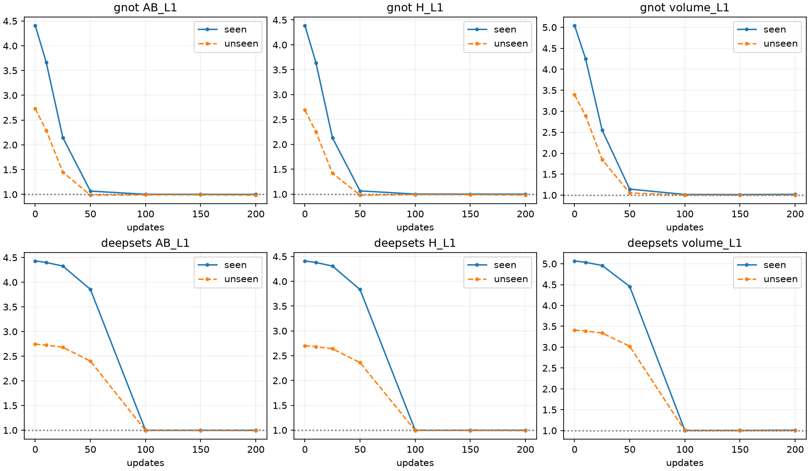
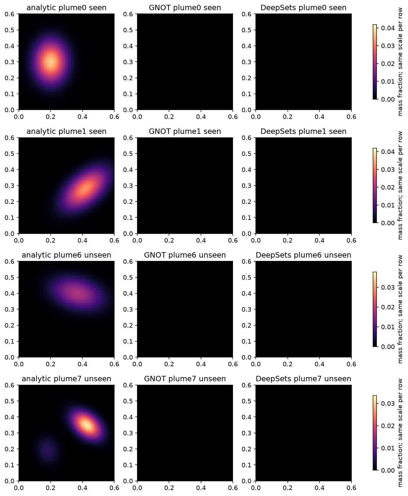

# 固定几何、变化测量的条件重建诊断 v2

完成时间：2026-10-25T15:33:39.852566+08:00。起始提交 `36bdf16faac582e71f96cbcb31d4013c33fc7009`；远端main已核对一致。

本轮只回答同一几何下的测量条件依赖。两个fresh模型各200次更新，v1累计2000加本轮400为2400，剩余100未使用。固定update200，不通过H/真场选模，正式队列仍暂停。诊断结论不能授权正式300epoch或第二种子。

## 协议与数据隔离

直接geometry-only读取唯一train_geometry.npz，没有实例化历史dataset或调用真实投影getter，也不读取真实测量、GT/GT128、val/test/Pool B或真实GT统计。A=[0,3,6,9]、B=[1,4,7,10]、H=[2,5,8,11]两两不交，8例全部几何、掩码、站位及case_id/sample_id逐位相同。6个seen与2个unseen定义和全部28个配对在design.json预登记。配对按seen-seen15、seen-unseen12、unseen-unseen1分别报告；8个测量与解析真场的SHA各不相同。
复用同一seed20261011的v2初始化，与v1同模型初态SHA一致；一致性固定为原v3齐次公式。AdamW2e-4/wd1e-4/batch2，固定[0,1]/[2,3]/[4,5]循环、FP32/TF32关闭、clip1、无调度，loss=.5cross+.1observed+.05consistency。前6例AB是训练worker唯一可打开的数组。CPython文件open审计对整个训练worker启用，拒绝H、真场、unseenAB和所有真实数组；拒绝测试有记录。这是文件访问层隔离，不冒充OS沙箱。
两个训练进程全部退出后，独立评价进程按预定0/10/25/50/100/150/200权重节点评价；因此训练不接收H/真场结果。H仅在评价中用于投影误差，真场仅用于独立三维评价；训练无H/GT损失、无warm-start。checkpoint200为唯一终态。每节点8例双分支记录全部测量/三维指标、零场、置零/置换/交换、全体积观测损失的measurement-token与末层梯度，梯度审计0次更新。
交换时除raw和相应归一化测量外的全部输入不变；构造后的输入逐位等于donor原始输入。因此复用donor已重复逐位核验的完整预测，明确标记复用来源，没有把同一输出伪称为新独立样本。全部56个配对分支、112个有向交换每节点保留。输出绝对变化、固定C_init尺度、变化方向余弦、匹配/错配真场L1优势均独立重算。

## 参考积分与预登记门槛

独立NumPy FP64解析生成，128/256阶GL最大参考绝对差=1.346e-10 ppm·m；64³/K96对实际FP32目标相对L1偏差范围=0.0971%–0.4140%。解析真场保存FP64；模型、测量和逆投影仍FP32，投影生成与反演路径独立。
GO要求seen各例AB<=.99并较初始改善>=.01，所有例H末两次<=.99，输出非近零且CV>=.05；全部配对绝对MAE/C_init>=.001且重复一致；每分支每配对组方向cos>0至少80%、中位数>=.1；seen至少4/6、unseen2/2三维L1<=.99；seen/unseen recipient分别至少75%交换具有>=.01匹配真场L1优势；输入测量梯度非零且有限。响应或近零失败为NO-GO，其余证据不足为INCONCLUSIVE。阈值运行前封存，结果后未调整。

## 终态结果：seen与unseen分别报告

| 模型 | 羽流 | AB L1 | H L1 | 三维L1 | 优于零场分支/总数 | 置零MAE | 结论 |
|---|---|---:|---:|---:|---:|---:|---|
| gnot | seen | 0.999642 | 0.999544 | 1.019577 | 10/12 | 7e-10 | NO_GO |
| gnot | unseen | 0.984280 | 0.982997 | 0.999535 | 2/4 | 5.33e-10 | NO_GO |
| deepsets | seen | 0.999058 | 0.999063 | 1.010480 | 10/12 | 1.24e-07 | NO_GO |
| deepsets | unseen | 0.990373 | 0.989864 | 0.998645 | 2/4 | 1.08e-07 | NO_GO |

优于零场计数展示A/B分支；验收按各案例及各分支检查。零场测量L1/L2和三维L1均按同目标重算为1。unseen的AB在评价时是可见输入测量，不属于训练样本。逐例/逐分支及所有节点完整数据见case_metrics.csv，不用seen平均掩盖unseen。

| 模型 | 配对组 | 平均预测MAE | 最小固定尺度响应 | 方向cos中位数 | 正方向比例 |
|---|---|---:|---:|---:|---:|
| gnot | seen_seen | 5.55e-10 | 1.96e-08 | 0.0516 | 60.0% |
| gnot | seen_unseen | 4.89e-10 | 1.66e-08 | 0.0686 | 66.7% |
| gnot | unseen_unseen | 2.82e-10 | 6.68e-08 | -0.0567 | 0.0% |
| deepsets | seen_seen | 5.89e-08 | 1.73e-07 | -0.1094 | 3.3% |
| deepsets | seen_unseen | 4.61e-08 | 1.95e-07 | -0.1182 | 8.3% |
| deepsets | unseen_unseen | 1.49e-08 | 3.34e-06 | -0.0351 | 0.0% |

## 证据、替代解释与逐项回答

- **gnot：NO_GO**。固定几何终态配对MAE平均5.17143e-10，有向交换匹配优势>=.01比例0.0%；未通过条件：seen_training, independent_H, pair_response, direction_A_seen_seen, direction_A_seen_unseen, direction_A_unseen_unseen, seen_volume_A, unseen_volume_A, matching_A_seen, matching_A_unseen, direction_B_seen_seen, direction_B_seen_unseen, direction_B_unseen_unseen, seen_volume_B, unseen_volume_B, matching_B_seen, matching_B_unseen。数值变化存在与有效条件重建必须区别。
- **deepsets：NO_GO**。固定几何终态配对MAE平均5.18356e-08，有向交换匹配优势>=.01比例0.0%；未通过条件：seen_training, independent_H, pair_response, direction_A_seen_seen, direction_A_seen_unseen, direction_A_unseen_unseen, seen_volume_A, unseen_volume_A, matching_A_seen, matching_A_unseen, direction_B_seen_seen, direction_B_seen_unseen, direction_B_unseen_unseen, seen_volume_B, unseen_volume_B, matching_B_seen, matching_B_unseen。数值变化存在与有效条件重建必须区别。

逐模型明确回答：
- gnot：固定几何下全部配对响应门槛未通过；与真实差分方向的一致性门槛未通过；正确测量相对错配测量的真场优势门槛未通过。H连续改善门槛未通过。因此本轮不足以确认有效条件重建，不是对架构普遍能力的否定。
- deepsets：固定几何下全部配对响应门槛未通过；与真实差分方向的一致性门槛未通过；正确测量相对错配测量的真场优势门槛未通过。H连续改善门槛未通过。因此本轮不足以确认有效条件重建，不是对架构普遍能力的否定。

终态逐羽流三维相对L1（A/B分支均值；各分支原值见CSV）：

| 羽流 | 角色 | GNOT | DeepSets |
|---|---|---:|---:|
| single_left | seen | 0.994467 | 0.994527 |
| rotated_right | seen | 0.999536 | 0.998050 |
| rotated_high | seen | 0.997392 | 0.997436 |
| double | seen | 0.989719 | 0.991822 |
| compact_low_amplitude | seen | 1.137058 | 1.085772 |
| broad_shifted | seen | 0.999290 | 0.995276 |
| unseen_rotated_bridge | unseen | 1.002503 | 1.001036 |
| unseen_triple | unseen | 0.996567 | 0.996254 |

**固定几何能否区分羽流、谁更依赖测量：** 当前配对绝对响应较大的是deepsets（5.184e-08），这是测量依赖幅度比较，不自动代表质量更好；能否有效区分必须同时检查上表变化方向及每个模型的pair_response/direction/matching门槛。seen与unseen误差和配对组已分别报告。
**已验证事实：** 本轮排除了“不同羽流输入携带不同几何/标识”的捷径；模型所有几何输入一致，任何逐位可复现的输出差异只能来自测量及其确定性计算。差异是否有正确重建意义由真场差分、匹配优势和H共同判断。没有达到全部门槛时，不把微小非零变化写成学会重建。
**较强假设与未解决问题：** 共享几何下仍可学习共同空间模板，因而弱条件响应与共同先验/条件读出受抑制相符。它不能反向证明v1一定依赖几何识别，也不能把200次预算不足、全局聚合/decoder优化和输出层初始化的影响唯一分离。本轮没有调整初始化或输出非线性，故不声称已锁定输出层为唯一根因。8例/单几何/单seed/有限更新不能代表算法普遍能力。
**正式训练授权与最小下一步：** 本任务无正式训练授权，即便诊断GO也不启动。建议先只读固定同几何的测量编码/latent，对已登记羽流的解析场差分做预登记线性可读性对照（与原decoder输出比较），区分内部保留的条件信息和读出利用失败；对照必须固定划分与正则，不作宽泛搜索。本轮未执行，也不使用剩余100次预算自动训练。

## 独立审计、异常与资源

独立review_v2.py未导入运行期metrics/decide，直接从保存数组重算1344个L1/L2字段、224条case/branch记录、784条配对和1568条有向交换，独立重建科学判定。全部400条更新、7节点AdamW状态、初态SHA、输入和checkpoint身份核验通过。全部历史跟踪文件及冻结主模型双种子checkpoint哈希不变；旧队列保持paused_by_user。
5项CPU工程测试通过，覆盖geometry-only/互斥/文件拒绝/GL参考/完整64³物理反传/序列化/干预；两个完整配置GPU batch2前向、反向和checkpoint保存smoke通过，均无optimizer更新。训练worker访问记录只包含train_AB.pt，评价worker单独记录H/真场读取。拒绝测试属于预期拒绝；实际运行异常/资源冲突以scheduling事件与日志为准，没有自动重试或参数更改。
启动前静态复核发现独立审计的几何读取白名单断言过严：生成器为计算新真场SHA会重新读自己刚写的合成文件，不能把这些自有文件误判为额外真实数据读取。第一次GPU/optimizer运行前仅修正该审计断言及对应封存/报告逻辑，原源码保存在engineering/preupdate_original_sources并有前后SHA修订记录。没有改模型、loss、阈值、输入或合成定义，未丢弃任何训练结果。
首个GNOT GPU smoke在任何optimizer更新之前因grid_sampler_3d_backward_cuda不支持严格确定性模式而失败。保留失败日志/目录，登记前后源码及协议SHA后，将框架严格确定性开关恢复为冻结流程原设置；未替换CUDA物理算子、精度、模型或训练设置。固定种子/采样与逐位重复推理检查保留，CUDA反传的原子累加不宣称逐位可复现。按明确recover-reason重新完成smoke后才封存并开始训练，无训练更新重放。
评价首次在update0完成8例原始数组后，于交换输入逐位断言停止；原因是CPU预处理的归一化伴随字段与GPU重算有舍入差异。raw积分和非测量字段完全相同，模型ray_tokens只使用raw。独立GPU preflight验证两个完整模型、A/B分支修订前后的64³输出逐位一致。保持登记的训练/模型/阈值/原评价源码不变，以新增evaluation_recovery_v2.py在swap时同时复制donor的raw及归一化伴随字段；保留8个失败数组与14个checkpoint哈希，明确recover-reason后只恢复评价，0次新optimizer更新。所有异常均保留，没有用成功重试覆盖原失败。
首次独立复核因finite_fraction严格等于1的断言停止：CUDA对全True掩码求double均值时部分记录为0.9999999999999999。原文件保留。另行封存零更新审计，逐一重算全部224个case/branch的measurement/geometry/readout梯度，使用整数finite_count/total_count和Boolean all判定，不放宽“全部有限”要求；原分数乘以元素数后对应的整数有限数也与全体元素一致。独立复核器新增版本只采用此精确计数，保留original_run_checks；梯度门槛由记录舍入造成的false纠正为true，其余门槛和两个NO-GO总判定不变。未修改任何checkpoint、原数组或科学阈值，未增加optimizer更新。
只用GPU0既有UUID全局锁、15秒双空闲快照、最多60秒获取及外来冲突停止。未抢占或停止GPU1–3其他任务。原始数组、权重和完整资源快照在scratch，Git只含小型记录。

## 交付索引

- [执行状态](artifacts/deep_baselines_identifiability_v2/final_status.json) · [独立重算](artifacts/deep_baselines_identifiability_v2/independent_review.json) · [逐例指标](artifacts/deep_baselines_identifiability_v2/case_metrics.csv)
- [配对差分](artifacts/deep_baselines_identifiability_v2/pair_metrics.csv) · [有向测量交换](artifacts/deep_baselines_identifiability_v2/swap_metrics.csv) · [初始化/协议封存](artifacts/deep_baselines_identifiability_v2/registration.json) · [几何/输入哈希](artifacts/deep_baselines_identifiability_v2/input_registration.json)
- [完整运行前协议](../deep_baselines_identifiability_v2_protocol_zh.md)

本地完整原始产物：`/scratch/djc/GeoPhy-Set3D/deep_baselines_identifiability_v2`。所有报告结果属于有界诊断，不进入论文正式基线排名。
