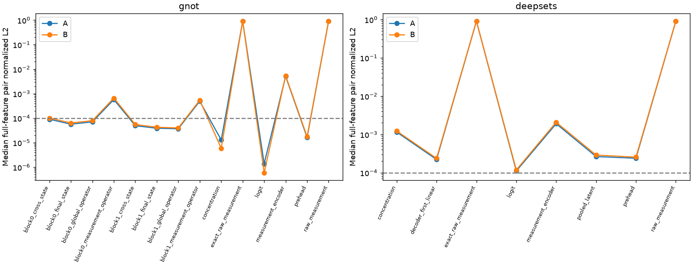
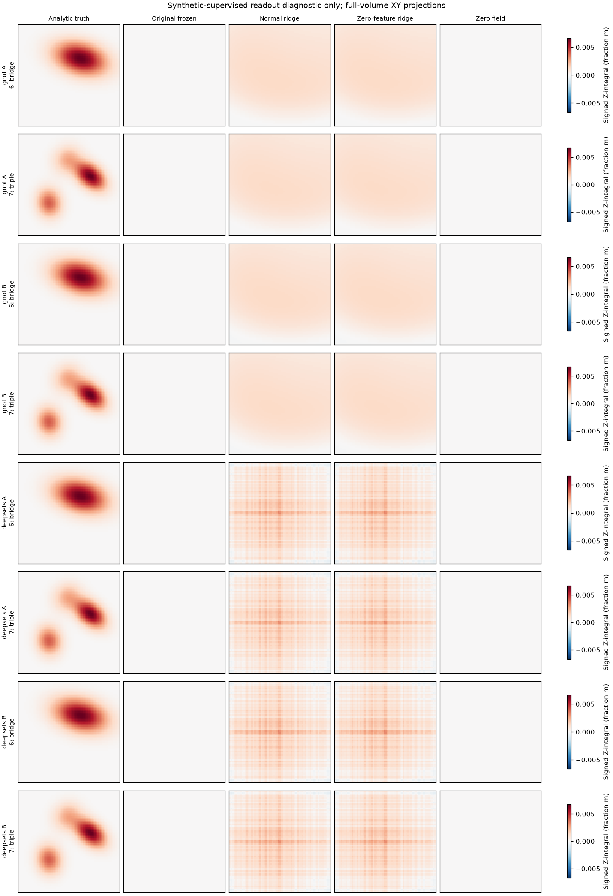

# DeepSets / GNOT 冻结内部表示与线性可读性诊断 v1

完成时间：2026-10-25T21:28:38.486339+08:00；基于Git `8ff19fba896acb038001a56356bcea66a50fe276`。所有结果为单seed/单固定几何、6 seen＋2 unseen解析合成羽流上的诊断，不能进入正式重建精度榜单。

**最终判定：gnot = INCONCLUSIVE；deepsets = NO-GO。** 本轮未得到正常测量特征读出在两个unseen上同时优于原decoder和测量置零读出的充分证据。本轮GNOT的INCONCLUSIVE不撤销v2对原重建模型的NO_GO，也不赋予训练GO。继续训练或输出头修复均不获本轮证据支持；建议保持当前实现暂停，不消耗剩余100次诊断更新。

## 冻结、数据边界与复现

两个 checkpoint_200 按注册SHA核验：GNOT `a69e1b2cbeda198be13d34feb90a8fd41a56940a1e10d8c03ca5f99c4419c6e2`；DeepSets `ca2abaab4bf06a0d5d39d81187b8f08eba36aabd7c5714d2f97683cf04486607`。严格加载200次更新状态，eval()、requires_grad_(False)、inference_mode()，无神经optimizer实例或step调用。每模型16个正常/16个置零全64³前向与v2原数组逐位相同；18次normal/zero独立特征捕获全部hook开启/关闭逐位相同；每分支另实跑一次交换，各层均逐位等于donor。参数state_hash在推理前后相同，checkpoint未重存。

直接复用登记train_AB/unseen_AB、原A/B固定站位及几何；所有8例非测量字段逐位一致。全部28对、每分支56个有向交换严格复制raw和归一化伴随字段，验证全输入等于donor后复用其已验证表示。每分支zero输入逐位相同，保存一份并为8例登记别名。H输入/站位、几何和解析场SHA保存在原注册映射，本轮无需重新读取H测量数组；无真实GT/GT128、真实val/test体积、Pool B、真实GT统计。启动时SHA检查会读取unseen标签文件的原始字节用于身份核验；拟合阶段没有解析或打开两个unseen标签，访问清单可独立检查。

CPU三项工程测试覆盖已知仿射ridge恢复及整羽流排除、边界拒绝、两模型hook透明性。原token通道反归一化存在FP32往返舍入，因此保留raw_measurement捕获并另以CPU脚本直接保存exact_raw_measurement及完整spatial_valid_mask；未改源输入或神经前向，补充源码/数组SHA单独登记。原packed valid_mask是token排除掩码的反值，不能与完整站位有效射线mask混淆。

## 实际提取层与响应

DeepSets：203维ray token → phi per-ray128 → masked mean pooled128 → concat坐标Fourier96 → decoder Linear128/GELU/Linear128/GELU → **prehead128** → scalar logit → sigmoid。首decoder Linear输出也保存。

GNOT：203维measurement_encoder64和202维geometry分支 → 两块异质cross算子、expert、全局self算子、expert → head Linear64/GELU → **prehead64** → scalar logit → sigmoid。保存每块cross后全空间状态、after_self最终状态、测量源key/context统计和全查询global self统计；不存在DeepSets式单一pooled latent，不能虚构该层。

下表为28对完整特征的归一化L2中位数。所有逐例均值/标准差/shape/有限整数计数、置零/有向交换和余弦见附件CSV。有向交换层统计另表逐一展开：验证完整输入等于donor后，引用已独立复核的donor正常特征统计；未虚称重复执行相同前向。距离与解析真场差分RMS的相关另列，28对共享案例，不能当28个独立样本做显著性推断。

| 模型 | 分支 | 层 | normal配对L2中位 | normal−zero中位 |
|---|---|---|---:|---:|
| gnot | A | block0_cross_state | 9.00343e-05 | 0.000297357 |
| gnot | A | block1_final_state | 3.8766e-05 | 0.000128621 |
| gnot | A | block1_global_operator | 3.69198e-05 | 0.000121187 |
| gnot | A | block1_measurement_operator | 0.000492414 | 0.00164273 |
| gnot | A | concentration | 1.28616e-05 | 1.79588e-05 |
| gnot | A | exact_raw_measurement | 0.903005 | 1 |
| gnot | A | logit | 1.38446e-06 | 2.12099e-06 |
| gnot | A | measurement_encoder | 0.0050612 | 0.00505617 |
| gnot | A | prehead | 1.61861e-05 | 5.25317e-05 |
| gnot | B | block0_cross_state | 0.000101034 | 0.000351359 |
| gnot | B | block1_final_state | 4.25931e-05 | 0.000150528 |
| gnot | B | block1_global_operator | 3.97616e-05 | 0.000138826 |
| gnot | B | block1_measurement_operator | 0.000540274 | 0.00185659 |
| gnot | B | concentration | 5.90217e-06 | 8.14143e-06 |
| gnot | B | exact_raw_measurement | 0.910067 | 1 |
| gnot | B | logit | 5.92102e-07 | 1.18802e-06 |
| gnot | B | measurement_encoder | 0.00539675 | 0.00553911 |
| gnot | B | prehead | 1.7595e-05 | 6.14788e-05 |
| deepsets | A | concentration | 0.0011553 | 0.00394641 |
| deepsets | A | exact_raw_measurement | 0.903005 | 1 |
| deepsets | A | logit | 0.000111098 | 0.000380066 |
| deepsets | A | measurement_encoder | 0.00190671 | 0.00189867 |
| deepsets | A | pooled_latent | 0.00026447 | 0.000909421 |
| deepsets | A | prehead | 0.000239269 | 0.000818744 |
| deepsets | B | concentration | 0.00123067 | 0.00425138 |
| deepsets | B | exact_raw_measurement | 0.910067 | 1 |
| deepsets | B | logit | 0.000118422 | 0.000409739 |
| deepsets | B | measurement_encoder | 0.00207945 | 0.00213504 |
| deepsets | B | pooled_latent | 0.000289588 | 0.000993408 |
| deepsets | B | prehead | 0.000255282 | 0.00088336 |

## 独立线性读出：解析监督、完整体积

每个模型/分支分别拟合normal与zero两种读出：DeepSets129个系数、GNOT65个系数（含截距）。原生特征维数不同，不能称等参数比赛；流程、标签、全部64³体素权重和ridge网格完全相同。FP64充分统计，按整羽流6折，每fold中心/尺度只读5例seen，std下限1e−6；lambda固定[1e−6,1e−4,1e−2,1]，按平均验证relative L1选取、平局取大值。最终6例重拟合并封存后才读unseen标签。读出是独立解析监督诊断，不能回填原checkpoint，也不是原无监督网络的正式成绩。

线性输出不裁剪；negative/above-one比例均保存。质心仅用预测正部计算，零质量时未定义；质量误差用原始有符号积分，体素体积(.6/63)^3；此为mass fraction的体积积分而非使用额外气体密度换算的kg质量。所有指标计算完整体积，无内部羽流mask或体素筛选。

| 模型 | 分支 | 条件 | lambda | 6折平均L1 | fold最佳与所选一致数 | cond |
|---|---|---|---:|---:|---:|---:|
| gnot | A | normal | 1 | 2.297550 | 2/6 | 47.94 |
| gnot | A | zero | 1 | 2.297059 | 2/6 | 47.94 |
| gnot | B | normal | 1 | 2.299710 | 3/6 | 48 |
| gnot | B | zero | 1 | 2.298306 | 2/6 | 48.01 |
| deepsets | A | normal | 1 | 2.314975 | 5/6 | 34.22 |
| deepsets | A | zero | 1 | 2.300240 | 5/6 | 34.22 |
| deepsets | B | normal | 1 | 2.316104 | 5/6 | 34.22 |
| deepsets | B | zero | 1 | 2.300257 | 5/6 | 34.23 |

下表完整列出A/B各分支seen/unseen的案例宏平均relative L1。两unseen分开保留在case_metrics.csv，未把体素或分支当独立案例。0场L1恒1；ridge标签为解析监督，原输出从未使用本轮标签更新。

| 模型 | 分支 | 集合 | 原decoder | normal ridge | zero-feature ridge | 零场 |
|---|---|---|---:|---:|---:|---:|
| gnot | A | seen | 1.019573 | 2.110658 | 2.110397 | 1.000000 |
| gnot | A | unseen | 0.999534 | 1.509184 | 1.509186 | 1.000000 |
| gnot | B | seen | 1.019581 | 2.112413 | 2.111537 | 1.000000 |
| gnot | B | unseen | 0.999536 | 1.510737 | 1.510596 | 1.000000 |
| deepsets | A | seen | 1.010435 | 2.125704 | 2.116377 | 1.000000 |
| deepsets | A | unseen | 0.998639 | 1.544078 | 1.543100 | 1.000000 |
| deepsets | B | seen | 1.010526 | 2.126418 | 2.116401 | 1.000000 |
| deepsets | B | unseen | 0.998651 | 1.543978 | 1.543119 | 1.000000 |

全部MAE、输出mean/std/max/结构比例、正部质心误差、质量/积分误差、相关性见逐案例CSV和aggregate_metrics.csv；每例normal读出相对三对照的L1改善量见probe_improvements.csv。seen分数是在6例重拟合后的描述性拟合分数，不能代替留一验证成绩。

每行共享包含所有预测的有符号色标，避免逐图自动放大近零原输出；图为完整Z积分，不是只选羽流局部。数值判断使用三维全体积指标。

## 瓶颈判断与后续建议

### gnot：INCONCLUSIVE

- A分支：上游 `block1_measurement_operator` 配对L2中位=0.000492414，预登记响应判据=通过；两个unseen相对全部三对照改善>=.01分别为[False, False]；unseen差分cos=-0.09532572264664003，差分relative L1=1.00005；稳定性=未通过；证据类别D。
- B分支：上游 `block1_measurement_operator` 配对L2中位=0.000540274，预登记响应判据=通过；两个unseen相对全部三对照改善>=.01分别为[False, False]；unseen差分cos=-0.10331231120495074，差分relative L1=1.00006；稳定性=未通过；证据类别D。

预登记的整羽流lambda稳定性门槛未全部通过，按D给出INCONCLUSIVE；不得把微小非零表示响应、求解器残差很小或共同模板拟合改写为可泛化条件信息。当前结果不足以支持readout瓶颈或追加训练，保持暂停；不是算法本身不可学的证明。

### deepsets：NO-GO

- A分支：上游 `pooled_latent` 配对L2中位=0.00026447，预登记响应判据=通过；两个unseen相对全部三对照改善>=.01分别为[False, False]；unseen差分cos=-0.03903248079351805，差分relative L1=1.00043；稳定性=通过；证据类别C。
- B分支：上游 `pooled_latent` 配对L2中位=0.000289588，预登记响应判据=通过；两个unseen相对全部三对照改善>=.01分别为[False, False]；unseen差分cos=-0.03904735283796572，差分relative L1=1.00049；稳定性=通过；证据类别C。

可测内部响应未转化为通过条件收益门槛的线性恢复。不能据此断言encoder完全丢失信息；非线性组织、所选层、6例覆盖和固定几何反演可辨识性均是替代解释。没有B证据，建议停止当前版本追加训练。

**是否继续：** 当前不进入decoder修复或正式训练。没有模型达到完整B/GO，因而本轮不提出自动执行的新架构方案、不扩大正则搜索，也不动剩余100次预算。若未来独立授权进一步验证，必须先针对已观察到的条件响应/跨羽流稳定性提出单一可证伪机制；本报告不将它当已获支持的修复方案。2个unseen、单几何/seed不足以外推算法普遍能力；线性失败也不能证明不存在非线性可读信息。

## 独立复核、资源及完整性

独立脚本未导入执行期ridge/metric/decision函数；从原始冻结特征重新累计不同分块的充分统计，重拟合所有192个lambda/fold分数及8个最终读出；逐一核验划分、选择、全部预测与独立系数映射，重算1792个逐例指标、448条空间差分和4784条表示差异，另核验832条层统计，重建两个最终分类。全部通过。

仅GPU0沿用全局UUID flock与15秒双空闲快照、60秒有界等待、冲突监控；两个模型顺序只读提取，GPU1–3未使用。ridge、评价和复核使用CPU双线程。调度/峰值显存/耗时与资源快照均保留，无神经更新、无checkpoint写入、无历史队列恢复。CPU测试中的拒绝为预期边界测试；正式提取/拟合/评价访问日志无违规读取。首次独立复核发现原输出配对余弦的执行期分母使用了FP32范数，极小差分下与独立FP64重算不符。保留原pair_metrics.csv/evaluation.json、review.log及失败访问清单，另行封存pair_precision_amendment.json；仅新增FP64配对重算脚本和review_latent_fp64.py，统一在相减/范数前转FP64，未放宽复核容差。权威表为pair_metrics_fp64.csv，分类逐项不变，系数、预测、指标阈值不动，0次新神经前向/更新。另有只读状态显示误用系统Python缺少NumPy，修正解释器后重跑显示，异常单独保留。精确raw补充为仪器读数精度说明而非科学协议调整。

| 模型 | 参数量 | GPU提取耗时秒 | 峰值allocated MiB |
|---|---:|---:|---:|
| gnot | 527109 | 31.83 | 275.24 |
| deepsets | 104577 | 13.45 | 85.41 |

原v2 checkpoint/全部登记输入、冻结主模型双种子checkpoint、所有既有Git跟踪文件及旧queue_status哈希前后不变。源代码运行前封存；后续仅新增独立复核/精确raw补充/配对FP64精度更正/报告脚本，身份见delivery_sources.json。没有修改任何旧报告或实验追踪表，新追踪单独保存。

## 产物索引

- [最终状态](artifacts/deep_baselines_latent_readout_v1/final_status.json) · [独立复核](artifacts/deep_baselines_latent_readout_v1/independent_review.json) · [运行前协议](../deep_baselines_latent_readout_v1_protocol_zh.md)
- [逐案例指标](artifacts/deep_baselines_latent_readout_v1/case_metrics.csv) · [汇总](artifacts/deep_baselines_latent_readout_v1/aggregate_metrics.csv) · [CV](artifacts/deep_baselines_latent_readout_v1/cross_validation.csv) · [读出封存](artifacts/deep_baselines_latent_readout_v1/probe_seal.json)
- [逐层统计](artifacts/deep_baselines_latent_readout_v1/layer_statistics.csv) · [逐有向交换层统计](artifacts/deep_baselines_latent_readout_v1/swap_layer_statistics.csv) · [逐层配对/zero/swap](artifacts/deep_baselines_latent_readout_v1/representation_differences.csv) · [空间差分](artifacts/deep_baselines_latent_readout_v1/pair_metrics_fp64.csv)
- [注册与全部输入/源码身份](artifacts/deep_baselines_latent_readout_v1/registration.json) · [预测清单及SHA](artifacts/deep_baselines_latent_readout_v1/evaluation_fp64.json) · [源码补充身份](artifacts/deep_baselines_latent_readout_v1/delivery_sources.json)

全体积特征、原输出、读出预测、系数及完整资源快照：`/scratch/djc/GeoPhy-Set3D/deep_baselines_latent_readout_v1`。Git只导出小型表格、系数、哈希、日志与图；原权重留在v2路径。复算入口为同名scripts目录中的recheck_latent.py（内部调用独立review_latent_fp64.py，写入新的rechecks目录，不能覆盖本轮结果）；所有科学原始数组有SHA，可在相同环境独立复核。
