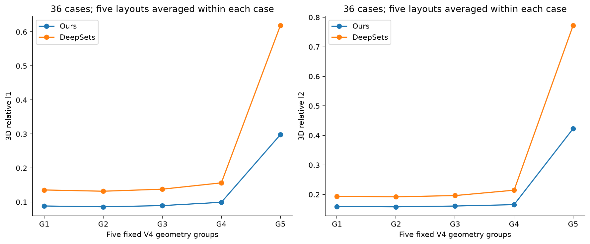
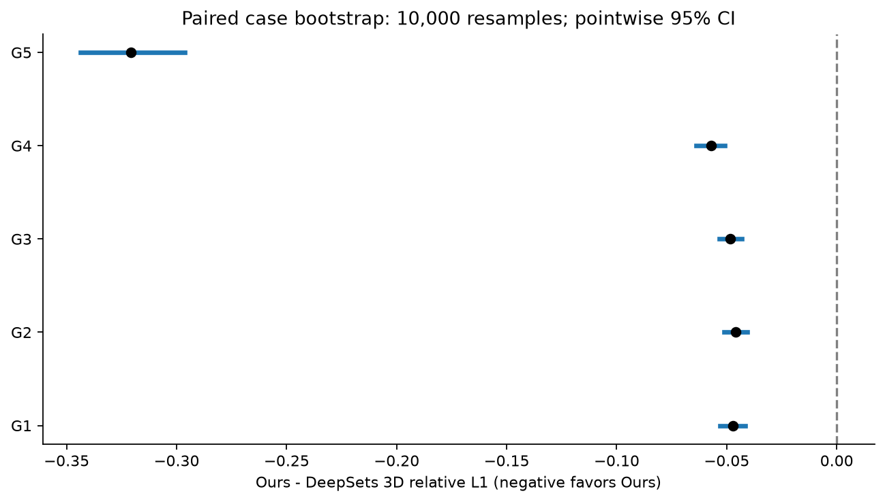
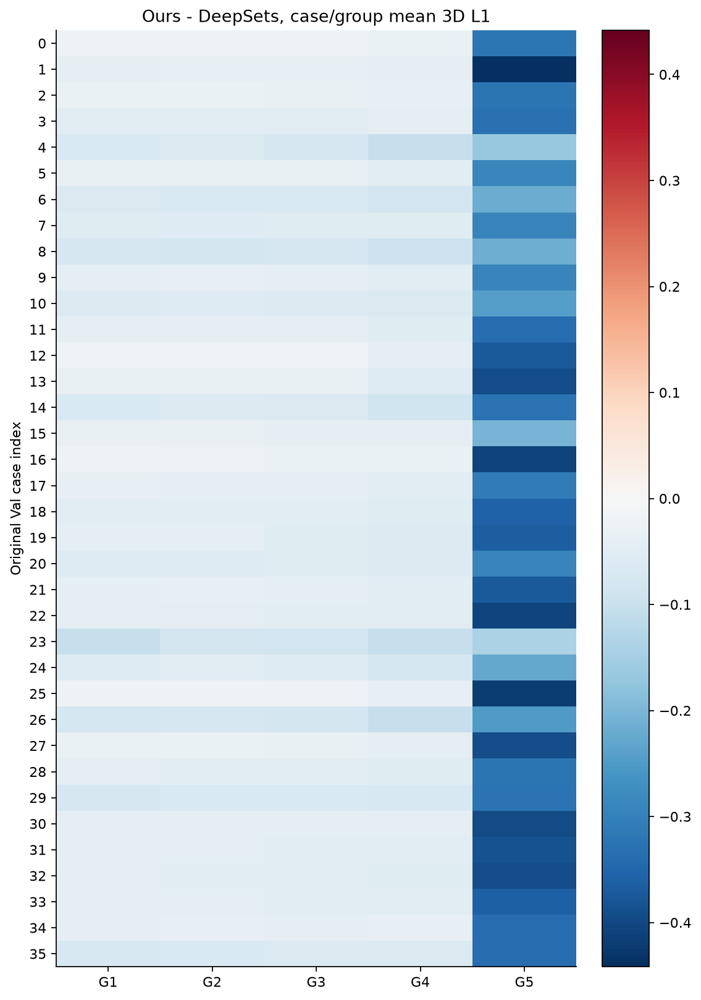
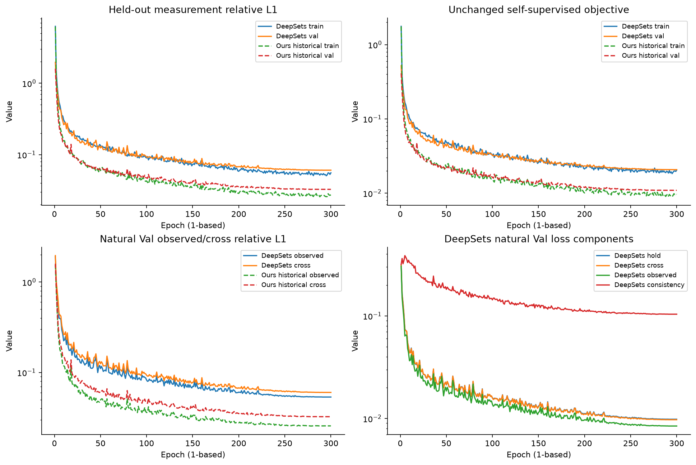
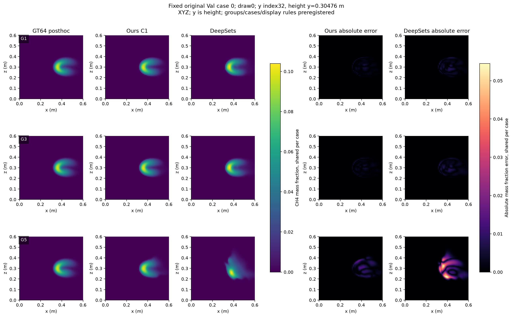
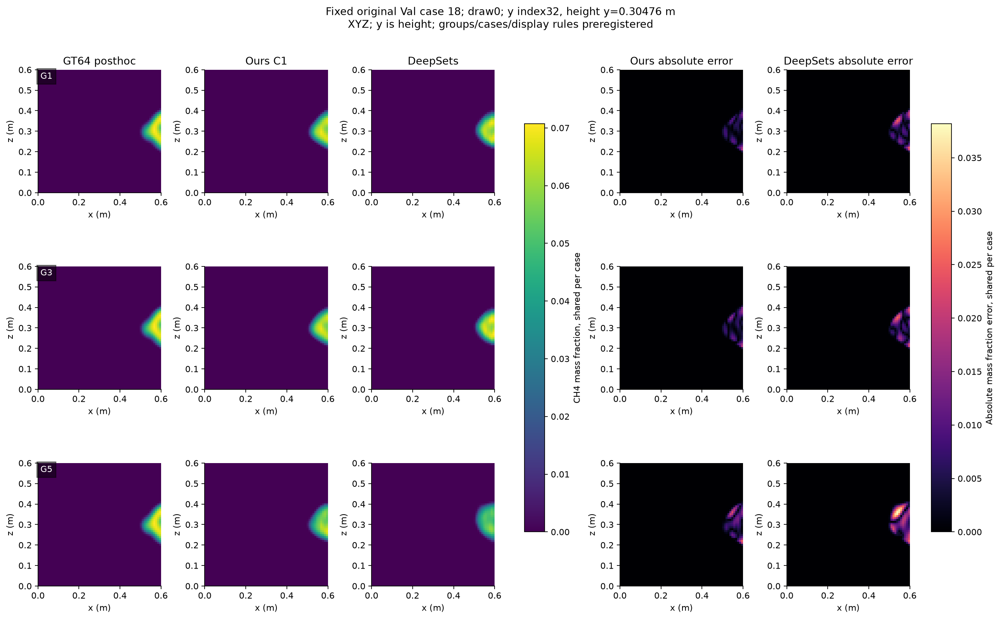
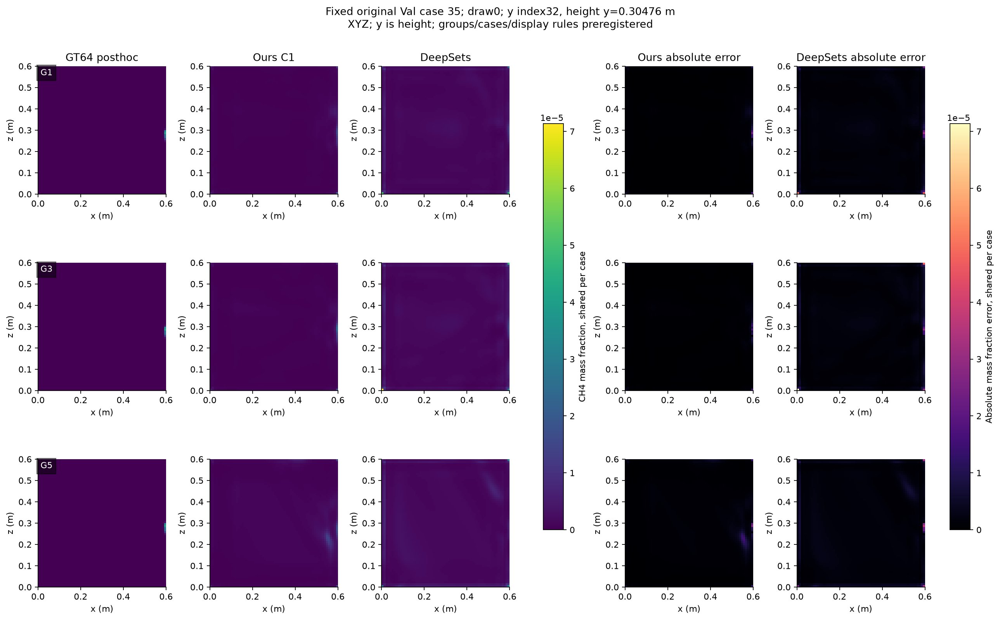

# GeoLift-DeepSets-Sum 第一轮自监督同条件对照

**实际完成300轮、24,900次正式更新；原SelfSup-MRGR v1保持冻结。** Ours主L1均值更低的组：G1, G2, G3, G4, G5；更高的组：无。逐项95%CI完全低于0：G1, G2, G3, G4, G5；跨0：无。

G1–G4宏平均3D L1由DeepSets的0.140347降至Ours的0.090760（降低35.33%）；G5由0.618805降至0.298018（降低51.84%，Δ95%CI=[−0.343692,−0.296426]）。正常与困难几何均有优势，但Ours的G5仍是G1的3.37倍，不能称坏几何已解决。

这是单seed、共享encoder/lifting/decoder的基础集合聚合对照，不代表最终强基线集合。允许基线胜出，未按本轮GT调整结构、布局、loss或训练预算。下一阶段优先任务：**按相同信息、标签、选模和冻结评价协议接入一个Senseiver任务适配基线，先独立预注册并验证接口**；当前DeepSets数值/协议检查通过，没有发现需要先修复的明确工程阻塞。本轮只建议，不自动实现或训练Senseiver。

协议：[训练前中文协议](../deepsets_selfsup_v1_protocol_zh.md)，登记commit `719d159`；训练实现commit `77c595a`。来源、配置、冻结清单和源码hash见[protocol.json](artifacts/deepsets_selfsup_v1/protocol.json)、[training_source_manifest.json](artifacts/deepsets_selfsup_v1/training_source_manifest.json)、[evaluation_source_manifest.json](artifacts/deepsets_selfsup_v1/evaluation_source_manifest.json)。结果与cost全部来自实测。

## 1. 实现、数值与完整训练

GeoLift-DeepSets-Sum（306,625参数）：原SharedEncoder2D接收每站完整64×64 measurement、valid-ray mask、path；原GeometryLifting保留真实站位与射线方向。在32³空间点，以真实view×visibility进行masked sum/4；固定V_ref=4，不除以实际V；原ResidualDecoder3D接sigmoid输出[B,1,64,64,64]质量分数。没有station编号embedding、OARI、GCA、MRGR或额外loss。invalid ray的测量/path置零；padding不会进入求和；全不可见聚合特征为0，decoder可非零。

Deep Sets原论文：Zaheer et al., https://arxiv.org/abs/1703.06114 。已读取结构定理及点云分类适配：共享元素映射+求和+后置映射提供不变形式；论文可数域定理与不可数固定集合大小的论证有适用条件。本任务元素是站位的二维场及几何，φ含空间lifting，ρ为空间卷积decoder，mask/固定尺度为任务适配。**不是原论文三维重建官方实现**，不将有限32通道表示称为普适唯一三维恢复保证。[来源与摘录](artifacts/deepsets_selfsup_v1/paper_source.json)。

独立临时模型A5/B5/H2、batch2真实forward/backward/AdamW一步通过，shape/range/有限梯度/置换/padding/全invalid及H排除均通过；置换最大差1.6391e−6，padding差0，峰值2.495GiB。首个检查在step前因诊断梯度字典键笔误终止；更正键后重启fresh smoke，没有科学设定更改，原日志保留。正式模型重新seed随机初始化，初态SHA=`56e43c54fe633c49c280075fd5bb5247b993a779e48111433fcec0636445eee2`，不读取smoke/监督/旧训练权重。

完成166 cases×300 epochs，每轮83次step，总24,900；FP32、batch2/accum1、seed20261011、AdamW lr2e−4/wd1e−4、clip1、cosine T_max300，无early stop和搜索。DeepSets训练+Val逐epoch墙钟合计1.344h，平均16.133s/epoch，完整训练进程墙钟1.348h（观察误差至多1秒），训练峰值2.514GiB；共享RTX4090，非独占benchmark。AdamW真实step计数及clip后norm已记录，没有NaN/Inf中断。

best第292轮，natural Val平均held-out relative L1=0.06072933。best SHA256=`949fb63be9068f676e7c6740fa8ce67b766d1f4d3ced86127e38b67a8eccdad0`，路径`/data/djc/GeoPhy-Set3D/outputs/checkpoints/deepsets_selfsup_v1/best.pt`。完整预算结束后冻结，独立measurement-only selector重放=0.06072933，容差abs1e−8+rel1e−5通过。

best Val输出min/max/mean/std=1.16594e-10/0.873016/0.00364886/0.0162934，近1占比=0，case间MA差=0.00448654；空间方差与case间差异均非零，未出现全零、恒定场或近1饱和塌缩。这些仅为数值行为证据，不把低measurement误差当作唯一正确场证明。

## 2. 同信息、标签、loss与选模身份

两方法均166 train/36 Val、Pool A、自然A3–5/B3–5/H2两两不交，Val固定A4/B4/H4；H不进network。归一化32284.894580078173 ppm·m，原P_diff/K96/all valid rays；完整调用原`training.selfsup.objective/run_epoch/selection_metric`，含内部SmoothL1 beta=.01、relative权重.1/epsilon1e−6与体积一致性epsilon1e−6，外权重1/.5/.1/.05，未复制或改写loss数值路径。

实际Val IDs与原v1一致；全部300轮case/station digest与原历史相同=True。新run额外保存有序case/batch/V/station清单与digest，检查每轮166个case恰好一次、输入逐条符合stateless sampler。历史原v1缺少逐步参数/optimizer与完整有序batch trace，同seed不同结构也不等于相同初始权重；本比较为**同协议、同信息/标签/预算的历史冻结参考比较**，不能包装为严格随机化配对训练实验或逐步数值重放。

训练/selection GT64、GT128、Pool B/test与foreign checkpoint禁止尝试均0。GT仅在300轮及best/全部预测冻结后的独立saved-output evaluator读取36个Val GT64；GT128和最终test没有读取。第一GT边界与预测hash见[first_posthoc_gt_boundary.json](artifacts/deepsets_selfsup_v1/first_posthoc_gt_boundary.json)。[访问及完整性审计](artifacts/deepsets_selfsup_v1/integrity.json)。

统一接口由新model注册、独立严格config验证、模型身份、GT-free数据/objective/selector、来源/冻结、固定清单预测和配对统计构成；旧v1验证仍锁定MRGR，旧B0与所有数值源码保持原行为。后续基线可复用信息/评价合同，需独立模型/训练协议校验，不在本轮扩展白名单或伪造MRGR分支。

## 3. G1–G5主终点：同输入3D relative L1

原900条V4布局全部复用，input IDs及顺序、measurement/path/geometry、valid/view/lifting visibility masks和共同H4身份匹配。Ours采用最新normal C1已验证完整标量，原checkpoint SHA=`1573cd84dffeabeb58fbbfb1afec9c9dc865a0a674e21229711bb25b22e3c026`；此前900行十指标复现通过，本轮未重跑900个Ours结果。DeepSets900次独立冻结推理，先保存预测/identity hash再评价GT64。

先同case/group平均五layout，再36case配对bootstrap10,000次、seed2026101801；Δ=Ours−DeepSets，负值有利Ours。下表CI逐项95%，**未校正同时覆盖率**；本轮不计算p值、不作多重检验显著性断言。胜/负/平阈值|Δ|≤1e−8。900条、ray、voxel不作为独立样本。

| 组 | Ours | DeepSets | Δ均值 | Δ中位数 | 95%CI | Ours胜/DeepSets胜/平 | Ours相对降低 |
| --- | --- | --- | --- | --- | --- | --- | --- |
| G1 | 0.088386 | 0.135463 | -0.047077 | -0.041956 | [-0.053119, -0.041477] | 36/0/0 | 34.75% |
| G2 | 0.085894 | 0.131762 | -0.045868 | -0.042911 | [-0.051185, -0.040754] | 36/0/0 | 34.81% |
| G3 | 0.089508 | 0.137796 | -0.048288 | -0.045404 | [-0.053493, -0.043254] | 36/0/0 | 35.04% |
| G4 | 0.099251 | 0.156366 | -0.057115 | -0.051978 | [-0.063876, -0.050928] | 36/0/0 | 36.53% |
| G5 | 0.298018 | 0.618805 | -0.320787 | -0.327520 | [-0.343692, -0.296426] | 36/0/0 | 51.84% |

Ours主L1均值更低的组：G1, G2, G3, G4, G5；更高的组：无。逐项95%CI完全低于0：G1, G2, G3, G4, G5；跨0：无。 每组对预先固定的同输入进行比较，不因结果删除组或更换布局。详细[900配对行](artifacts/deepsets_selfsup_v1/paired_900.csv)、[180 case/group均值](artifacts/deepsets_selfsup_v1/case_group_180.csv)。

## 4. 普通精度与困难几何、退化幅度

| 统计 | 指标 | Ours | DeepSets | Δ | 95%CI |
| --- | --- | --- | --- | --- | --- |
| G1_G4_macro | relative_l1 | 0.090760 | 0.140347 | -0.049587 | [-0.055203, -0.044248] |
| G5_minus_G1 | relative_l1 | 0.209632 | 0.483342 | -0.273710 | [-0.300390, -0.244367] |
| G5_div_G1_grand_mean_ratio | relative_l1 | 3.371779 | 4.568069 | -1.196290 | [-1.673394, -0.752303] |
| G1_G4_macro | relative_l2 | 0.161080 | 0.199291 | -0.038212 | [-0.044832, -0.031756] |
| G5_minus_G1 | relative_l2 | 0.263677 | 0.578410 | -0.314733 | [-0.354681, -0.275182] |
| G5_div_G1_grand_mean_ratio | relative_l2 | 2.654144 | 3.982784 | -1.328640 | [-1.730241, -0.972062] |
| G1_G4_macro | heldout_relative_l1 | 0.029787 | 0.057397 | -0.027610 | [-0.030389, -0.024927] |
| G5_minus_G1 | heldout_relative_l1 | 0.117478 | 0.359921 | -0.242443 | [-0.260804, -0.223889] |
| G5_div_G1_grand_mean_ratio | heldout_relative_l1 | 5.236589 | 7.697771 | -2.461182 | [-3.218483, -1.695905] |

G5绝对误差见主表；G1–G4宏平均以每case四组等权均值计算。G5−G1是每case差值后平均；G5/G1是**组总体均值之比**，bootstrap每次重算两组均值，不是case比值均值。不能只凭退化比值小判断更好，要结合普通精度与G5绝对误差。固定旧25布局G5与历史clustered V4、增强确认G5不是同一评价身份；本报告不混用。

## 5. 辅助指标是否一致？

3D L2、observed L1及共同H4 L1与主L1方向一致：五档均36/36 case更低，逐项区间均低于0。积分proxy均值也在五档更低，但G1–G4仍分别有5/6/4/5个case由DeepSets更好。**峰值结论不一致**：G1–G4区间全部跨0，G4 Ours均值略高（Δ=+0.003342），只有14/36 case胜出；G5峰值误差则36/36改善。不能写成所有指标、所有case都更好，或峰值优势已在普通几何得到确认。

| 组 | 辅助指标 | Ours | DeepSets | Δ | 逐项95%CI | Ours胜/DeepSets胜/平 |
| --- | --- | --- | --- | --- | --- | --- |
| G1 | relative_l2 | 0.1594036 | 0.193916 | -0.03451235 | [-0.0415172, -0.02796057] | 36/0/0 |
| G2 | relative_l2 | 0.1582865 | 0.1921917 | -0.03390523 | [-0.04056048, -0.02741073] | 36/0/0 |
| G3 | relative_l2 | 0.1609671 | 0.1964366 | -0.03546945 | [-0.04160808, -0.0294401] | 36/0/0 |
| G4 | relative_l2 | 0.1656616 | 0.2146217 | -0.04896006 | [-0.05673422, -0.04123574] | 36/0/0 |
| G5 | relative_l2 | 0.4230802 | 0.7723255 | -0.3492453 | [-0.3836459, -0.3154249] | 36/0/0 |
| G1 | observed_relative_l1 | 0.02344836 | 0.04977854 | -0.02633018 | [-0.02917506, -0.02357816] | 36/0/0 |
| G2 | observed_relative_l1 | 0.02517055 | 0.05230806 | -0.02713751 | [-0.02983481, -0.02446633] | 36/0/0 |
| G3 | observed_relative_l1 | 0.02540625 | 0.05361728 | -0.02821103 | [-0.03099558, -0.0254536] | 36/0/0 |
| G4 | observed_relative_l1 | 0.02461 | 0.05524077 | -0.03063076 | [-0.03339969, -0.02790139] | 36/0/0 |
| G5 | observed_relative_l1 | 0.08305182 | 0.3660222 | -0.2829704 | [-0.3018793, -0.2643954] | 36/0/0 |
| G1 | heldout_relative_l1 | 0.02772937 | 0.05373741 | -0.02600805 | [-0.02896103, -0.02320182] | 36/0/0 |
| G2 | heldout_relative_l1 | 0.02766419 | 0.05338494 | -0.02572075 | [-0.02838267, -0.0231124] | 36/0/0 |
| G3 | heldout_relative_l1 | 0.02900615 | 0.0564697 | -0.02746355 | [-0.03027184, -0.02474416] | 36/0/0 |
| G4 | heldout_relative_l1 | 0.03475001 | 0.06599571 | -0.0312457 | [-0.03443304, -0.02829986] | 36/0/0 |
| G5 | heldout_relative_l1 | 0.1452073 | 0.4136583 | -0.268451 | [-0.2864179, -0.2505657] | 36/0/0 |
| G1 | peak_value_absolute_error | 0.1113403 | 0.1197142 | -0.008373978 | [-0.0223067, 0.0040396] | 18/18/0 |
| G2 | peak_value_absolute_error | 0.1136187 | 0.1222075 | -0.008588809 | [-0.02422772, 0.006195915] | 15/21/0 |
| G3 | peak_value_absolute_error | 0.1084507 | 0.1151011 | -0.006650384 | [-0.02122843, 0.006563904] | 17/19/0 |
| G4 | peak_value_absolute_error | 0.1127796 | 0.1094379 | 0.00334168 | [-0.01130722, 0.01752194] | 14/22/0 |
| G5 | peak_value_absolute_error | 0.108955 | 0.4233015 | -0.3143465 | [-0.3398116, -0.2887171] | 36/0/0 |
| G1 | integrated_concentration_relative_error | 0.006937081 | 0.0123417 | -0.005404616 | [-0.007957923, -0.00331032] | 31/5/0 |
| G2 | integrated_concentration_relative_error | 0.006840749 | 0.01226165 | -0.005420897 | [-0.008219283, -0.003059062] | 30/6/0 |
| G3 | integrated_concentration_relative_error | 0.006929046 | 0.01258203 | -0.005652987 | [-0.008122046, -0.003525663] | 32/4/0 |
| G4 | integrated_concentration_relative_error | 0.007534973 | 0.01319585 | -0.005660873 | [-0.007267844, -0.004061597] | 31/5/0 |
| G5 | integrated_concentration_relative_error | 0.02571948 | 0.240652 | -0.2149325 | [-0.2452756, -0.1859254] | 36/0/0 |

辅助L2、input/H4、peak和integral的方向/CI完整保留，即使与主L1不一致也不筛掉。MAE/RMSE及峰值为无量纲CH4质量分数尺度；积分指标是冻结voxel sum相对proxy，不能称真实总质量。全部50项组×指标统计见[paired_statistics.csv](artifacts/deepsets_selfsup_v1/paired_statistics.csv)，未对辅助结果作经校正显著性宣称。测量拟合与三维重建分别解读，不将H4改善单独认定为正确三维恢复。

## 6. 参数、大小与实测推理成本

| 模型 | 参数 | FP32参数MiB | checkpoint MiB | 前向median ms | 前向P90 ms | 峰值GiB |
| --- | --- | --- | --- | --- | --- | --- |
| Ours | 332070 | 1.267 | 3.947 | 22.646 | 23.191 | 1.078 |
| DeepSets | 306625 | 1.170 | 3.603 | 7.260 | 7.394 | 0.103 |

同一NVIDIA GeForce RTX 4090、cuda:0、batch1、FP32、TF32关闭；同9个固定case/layout，每model/输入warmup10、同步重复30，交替执行模型顺序。Ours前向包含内部P_diff；外部metric projector不计入forward。共各360次cost前向（含warmup），单独记录于[timing.json](artifacts/deepsets_selfsup_v1/timing.json)。峰值为CUDA allocated扣除另一个同进程驻留模型tensor字节；库/allocator共存状态可能影响测量，不当作独占硬件benchmark或系统总显存。checkpoint含optimizer/RNG，参数字节更直接表示架构存储成本。

DeepSets训练墙钟1.344h与原历史Ours约2.749h分别记录，GPU共享负载和历史时段不同，不能据此严格归因训练速度。Ours参数多8.30%，实测前向median耗时约为DeepSets的3.12倍，allocated峰值约为10.45倍；这次精度收益伴随明确计算成本增加。参数变化之外，interaction/fusion/refinement一起改变，性能差不能单独归因OARI或MRGR。

## 7. 固定预算下收敛与最坏case

best在第292轮；Val selector末30轮均值0.060928，前30轮均值0.062236，末轮0.060750。best位于末30轮且近期均值仍下降，有预算末期继续改善迹象；按300轮停止，不延长训练。

| 组 | 指标 | 模型 | case均值P90 | case均值P95 | 最大case均值 | 原Val索引 |
| --- | --- | --- | --- | --- | --- | --- |
| G1 | relative_l1 | Ours | 0.143054 | 0.169230 | 0.202353 | 20 |
| G1 | relative_l1 | DeepSets | 0.220413 | 0.239524 | 0.260389 | 20 |
| G2 | relative_l1 | Ours | 0.136401 | 0.165386 | 0.195402 | 20 |
| G2 | relative_l1 | DeepSets | 0.203902 | 0.232421 | 0.252118 | 20 |
| G3 | relative_l1 | Ours | 0.142361 | 0.171060 | 0.204106 | 20 |
| G3 | relative_l1 | DeepSets | 0.210191 | 0.236233 | 0.257852 | 20 |
| G4 | relative_l1 | Ours | 0.167028 | 0.183152 | 0.205775 | 20 |
| G4 | relative_l1 | DeepSets | 0.225670 | 0.256337 | 0.288863 | 23 |
| G5 | relative_l1 | Ours | 0.456695 | 0.545705 | 0.641913 | 4 |
| G5 | relative_l1 | DeepSets | 0.763854 | 0.765475 | 0.808318 | 4 |
| G1 | relative_l2 | Ours | 0.214092 | 0.248041 | 0.268044 | 20 |
| G1 | relative_l2 | DeepSets | 0.288313 | 0.309606 | 0.334457 | 20 |
| G2 | relative_l2 | Ours | 0.210510 | 0.253365 | 0.273432 | 20 |
| G2 | relative_l2 | DeepSets | 0.286545 | 0.300219 | 0.333773 | 20 |
| G3 | relative_l2 | Ours | 0.217166 | 0.256538 | 0.273765 | 20 |
| G3 | relative_l2 | DeepSets | 0.291124 | 0.301809 | 0.335120 | 20 |
| G4 | relative_l2 | Ours | 0.238020 | 0.266334 | 0.286706 | 20 |
| G4 | relative_l2 | DeepSets | 0.317026 | 0.326924 | 0.378576 | 23 |
| G5 | relative_l2 | Ours | 0.577701 | 0.667565 | 0.745863 | 4 |
| G5 | relative_l2 | DeepSets | 0.826394 | 0.846007 | 0.881108 | 10 |

G5最坏case均值L1：Ours=0.641913、DeepSets=0.808318，两者均为原Val索引4；P95分别0.545705/0.765475。尾部也改善，但Ours仍有明显残余误差。

tail基于36个case/group五layout均值；逐layout900行保留用于描述，不当独立推断。完整worst case ID与全部指标分位数见[tails.csv](artifacts/deepsets_selfsup_v1/tails.csv)。

## 8. 固定重建图与后续判断

预先固定原Val索引0/18/35、draw0、G1/G3/G5；y为高度，y32=0.30476m；x/z单位m。三方法显示浓度每case共享显示字段最大值色标，两个绝对误差另共享色标；同时保留固定水平切片与沿高度y的均值图，没有按GT误差挑例或切片。

本轮验证了一个具有同信息/同标签/同selector/同预算的基础集合参考；只一个seed、36例开发Val、固定站位，历史Ours没有同时fresh重训。无论优势/劣势方向，都不证明优于Senseiver、DeepONet或GNOT，不是独立训练模块消融。完整归档全部组和指标，保留原v1及增强NO-GO、C0/C1历史结论。

**唯一优先下一阶段：独立预注册并接入Senseiver同条件任务适配比较。** 当前实现/协议检查通过，停止于本次DeepSets报告，不用本轮Val GT修改Ours，不打开最终test，不自动启动新模型或超参搜索。

## 交付与访问边界

实际正式预算300epochs/24,900steps；主预测900、selector replay36次batch2前向/72个case预测、成本DeepSets360/Ours360；成功独立smoke七次batch2 forward/一步，失败检查两次batch2 forward/零步，不计正式预算；正式train/Val分别49,800/10,800次batch2 model调用。完整现有回归259项通过，新增独立配对统计三项通过。首次主评价因旧guard仅允许case_images子目录而阻止读取本run已保存的NPZ；更正输出子目录并保留失败审计。首个预测SHA核验后复用，仅补测量/身份记录，没有重复network forward；该行前向独立耗时未保存，记null，不估计，统一9输入成本benchmark完整。禁读原始GT/Pool B/test/foreign checkpoint尝试仍0。历史源码（除新增注册）、dataset、旧输出/checkpoint metadata/hash核验通过；GT128仅核对冻结metadata，内容未读。

配置 `configs/train_deepsets_selfsup_v1.yaml`；训练入口 `scripts/train_deepsets_selfsup.py`；统一接口 `src/geophy_set3d/training/deep_comparison.py`；独立评价 `scripts/evaluate_deep_comparison.py`；报告入口 `scripts/report_deep_comparison.py`。标量/图/协议/审计在本报告同目录artifacts；大预测与checkpoint仅外部目录`/data/djc/GeoPhy-Set3D/outputs/comparisons/deepsets_selfsup_v1`和`/data/djc/GeoPhy-Set3D/outputs/checkpoints/deepsets_selfsup_v1`，不提交Git。

正文补充解读基于已冻结的完整标量及图表；报告入口可重建图表与基础报告草稿，公开报告保留上述辅助指标一致性、残余几何风险及成本解释。
