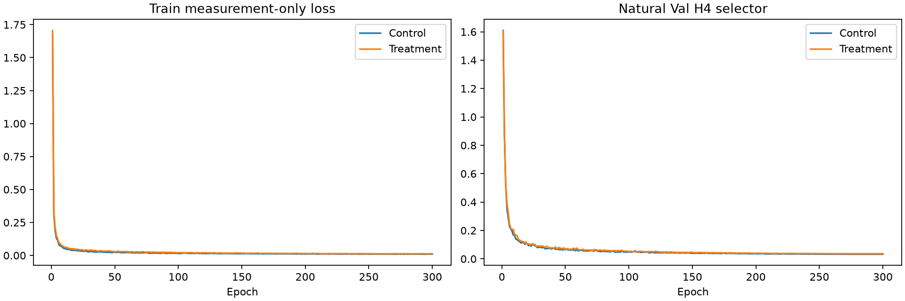
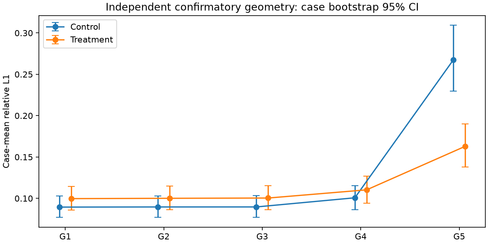
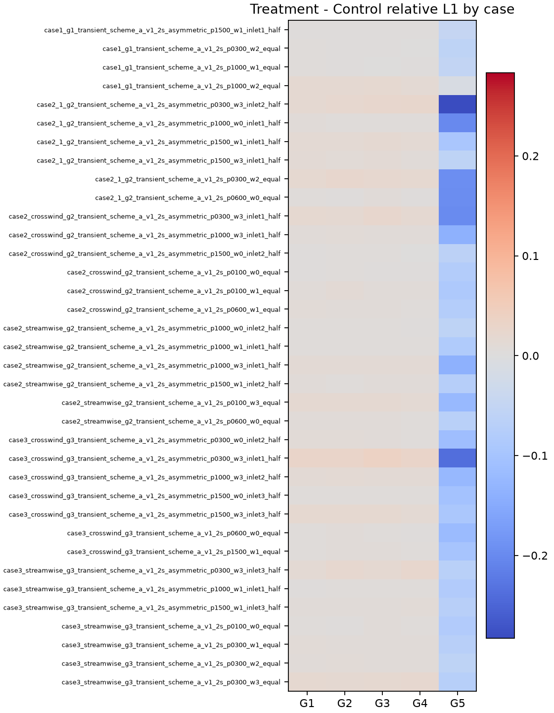
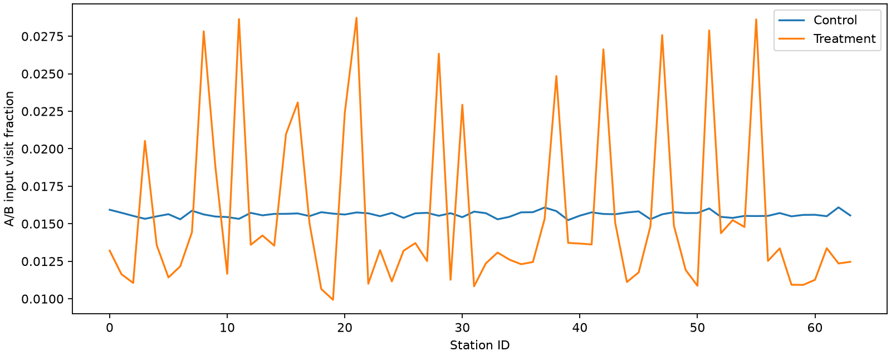

# 显式 Geometry Augmentation formal v1：匹配实验报告

**GEOMETRY_AUGMENTATION = NO-GO**。G5改善39.09%，但natural macro恶化11.13%，超过3%非劣界限，也超过预注册PARTIAL的10%上限。唯一主要实验变量是训练时A/B几何采样分布。旧same-q实验与original frozen v1保持原结论；本轮不构成geometry比capacity/optimizer/loss更主要的因果证明。

预注册：[正式协议](../geometry_augmentation_formal_v1_protocol_zh.md)，commit36c041c（正式训练前提交，已同步GitHub）。完整源码/config、输入、旧标量哈希见[归档协议](artifacts/geometry_augmentation_formal_v1/protocol.json)。5760次真实冻结推理；historical natural/development/confirmatory分开，不把开发集当确认集。

## 指定15项回答

1. 未复用：CONTROL_REUSE=REJECTED。历史逐步参数/optimizer/clip后梯度与运行flags缺失，完整numeric equivalence不可证明；保留旧same-q NO-GO。

2. 完全匹配：两臂fresh、同初态/seed/case order/V schedule、各300epochs与24,900steps。唯一主要干预是50/25/25站位采样；station marginal shift包含于机制。

3. 训练/Val/selector审计GT64/GT128、Pool B/test、foreign checkpoint尝试全部为0。独立posthoc只读36例Val GT64，禁读计数为0。

4. 确认G5 relative L1：Control=0.267472、Treatment=0.162915，delta=-0.104557。

5. 改善=39.09%（T/C=0.6091；非常明显）。这是一次预注册干预，不追加搜索。

6. case bootstrap95%CI=[-0.124289, -0.086607]，完全低于0：True。

7. 36例内Treatment wins/Control wins/ties=36/0/0；先每case平均10layout。

8. 确认G1–G4 natural macro：C=0.092349、T=0.102626，ratio=1.1113、CI=[1.096218, 1.127767]，point-rule≤1.03：False。CI仅报告，不偷换成CI非劣证明。

9. grand-mean G5/G1：2.9903→1.6341，delta CI=[-1.660017, -1.103092]。G5−G1变化=-0.114812；完整case-ratio诊断另列，定义不混用。

10. 确认G5 case-group最大L1：0.645623→0.407136；p90/p95/median及worst IDs见统计JSON。单layout极端也独立记录。

11. 确认G5 input relativeL1=0.065912→0.027300，delta CI=[-0.047715, -0.030618]。本次与G5三维误差同向改善；拟合更好不单独证明三维恢复更好。

12. 确认G5共同H4 relativeL1=0.124272→0.063806，delta CI=[-0.072696, -0.049575]；仅最终评价，不参与确认集选参或重建输入。

13. station visits分布TV distance=0.1417，最大单站概率变化=0.0133；hard inclusion范围=[0.0, 0.27318644607063314]。mode条件频率/包含排除概率/拒绝数完整保存，不重平衡。

14. GEOMETRY_AUGMENTATION = NO-GO。严格使用预注册G5 CI与natural point ratio；PARTIAL不称正式成功。

15. 下一步仅建议独立预注册model-side geometry awareness及四臂ablation：Base、Base+augmentation、Base+geometry-aware、二者结合。无论本轮结果都不在当前Val GT搜索ratio、span、curriculum或loss。本轮不实现新模块或启动新训练。

## 前置验证、冻结与访问边界

真实train-mode batch2 AdamW smoke共4step，首步loss重放相同；参数hash/optimizer hash不同，参数最大差约3.28e-7/2.24e-7，optimizer最大差约6.98e-10/4.66e-10。CUDA grid_sample backward非确定性如实登记；10步原函数/标量记录函数差及100步fresh replay详见归档，历史记录不可用不捏造。原replay generator追加时全局step标签多计数，原预注册记录保留，另附control_fresh_replay_index_erratum按实际顺序修正第1/10/100步索引；local step/epoch/hash/损失及实际100次更新均不变，正式训练独立step counter不受影响。GPU2首次OOM（其他用户工作负载进入）在optimizer前退出；改用GPU0/1，保留错误记录，不改batch/超参，不终止他人。

Control/Treatment best仅由原自然Val双A4/B4/H4 measurement selector选取；完成300后SHA冻结，先独立measurement-only评价和selector replay，再以saved-output逐体hash验证进入GT64 evaluator。GT不选epoch、布局、采样边界或判定阈值。确认布局与历史25组合不同，G5≤5°；训练hard≤10°。自然Val selector不采用confirmatory布局。

## 训练预算、时间与收敛

| arm | epochs | steps | best_epoch | selector | hours | forward_ms | peak_GiB |
| --- | --- | --- | --- | --- | --- | --- | --- |
| Control | 300 | 24900 | 287 | 0.032702 | 2.725 | 23.77 | 7.67 |
| Treatment | 300 | 24900 | 300 | 0.036292 | 2.772 | 23.43 | 7.67 |

训练曲线与逐epoch total/hold/cross/observed/consistency、LR、clip前/后norm、best状态已归档；全部完成，无NaN/Inf；完整回归252项通过。Treatment的best位于预算末轮，不证明达到优化最优或全局收敛，仍按预注册预算结束，不追加训练。时间来自共享RTX4090，每epoch含train+Val+日志，不等于独占GPU速度；网络前向单独同步计时。没有调整预算或按GT挑迭代点。最终完整性审计确认dataset及历史metadata、历史标量hash均未变；源码hash和best hash全部验证，独立posthoc只读36个Val GT64文件。

Control best SHA256=`1c3eb23f315a96e964aa08189eb0e90a5f11ebff55ce03337e344ed45bab4e34`；Treatment best SHA256=`fc6a6b2d7f3d955b92498343a48037a1f1dd3f4be3177f49cb85269aa665f45c`。checkpoint路径在[frozen_best.json](artifacts/geometry_augmentation_formal_v1/frozen_best.json)，不提交权重。

## 配对3D relative L1

36case为统计单位，先同case/group平均draw，bootstrap10,000 seed2026101603。表中wins为T/C/ties；delta=T−C，原始Wilcoxon p列仅描述，secondary统一Holm结果在CSV/JSON，不依据未校正p追加实验。

### natural

| group | Control | Treatment | delta | median | CI | ratio | wins | p |
| --- | --- | --- | --- | --- | --- | --- | --- | --- |
| natural | 0.095513 | 0.105035 | 0.009523 | 0.008442 | [0.007371, 0.011826] | 1.0997 | 1/35/0 | 5.82e-11 |

### development

| group | Control | Treatment | delta | median | CI | ratio | wins | p |
| --- | --- | --- | --- | --- | --- | --- | --- | --- |
| G1 | 0.088309 | 0.098594 | 0.010285 | 0.007349 | [0.008103, 0.012628] | 1.1165 | 0/36/0 | 2.91e-11 |
| G2 | 0.085715 | 0.096062 | 0.010346 | 0.008089 | [0.008449, 0.012363] | 1.1207 | 0/36/0 | 2.91e-11 |
| G3 | 0.090006 | 0.100031 | 0.010025 | 0.008018 | [0.008236, 0.011897] | 1.1114 | 0/36/0 | 2.91e-11 |
| G4 | 0.100126 | 0.109127 | 0.009001 | 0.006071 | [0.006791, 0.011381] | 1.0899 | 1/35/0 | 5.82e-11 |
| G5 | 0.288273 | 0.175530 | -0.112743 | -0.094621 | [-0.133149, -0.094200] | 0.6089 | 36/0/0 | 2.91e-11 |

### confirmatory

| group | Control | Treatment | delta | median | CI | ratio | wins | p |
| --- | --- | --- | --- | --- | --- | --- | --- | --- |
| G1 | 0.089445 | 0.099700 | 0.010255 | 0.008281 | [0.008379, 0.012250] | 1.1146 | 0/36/0 | 2.91e-11 |
| G2 | 0.089613 | 0.100076 | 0.010462 | 0.008301 | [0.008437, 0.012640] | 1.1168 | 0/36/0 | 2.91e-11 |
| G3 | 0.089639 | 0.100410 | 0.010771 | 0.007783 | [0.008483, 0.013290] | 1.1202 | 0/36/0 | 2.91e-11 |
| G4 | 0.100697 | 0.110319 | 0.009622 | 0.006914 | [0.007445, 0.012005] | 1.0956 | 0/36/0 | 2.91e-11 |
| G5 | 0.267472 | 0.162915 | -0.104557 | -0.082390 | [-0.124289, -0.086607] | 0.6091 | 36/0/0 | 2.91e-11 |

## 全部指标、测量与最坏案例

完整10指标（L1/L2、MAE/RMSE、peak absolute、integral relative proxy、input/H L1/L2）逐组配对均值/median/CI、Wilcoxon与Holm见[paired_metrics.csv](artifacts/geometry_augmentation_formal_v1/reports/paired_metrics.csv)；[statistics.json](artifacts/geometry_augmentation_formal_v1/reports/statistics.json)含worst-case mean/median/p90/p95/max/IDs。peak是CH4质量分数绝对误差，integral是冻结voxel sum proxy相对误差，无量纲，不虚构物理质量单位。

| group | metric | Control | Treatment | delta | CI |
| --- | --- | --- | --- | --- | --- |
| G1 | observed_relative_l1 | 0.025301 | 0.029647 | 0.004346 | [0.003473, 0.005263] |
| G1 | heldout_relative_l1 | 0.029584 | 0.033801 | 0.004217 | [0.003509, 0.004950] |
| G2 | observed_relative_l1 | 0.024752 | 0.028821 | 0.004069 | [0.003361, 0.004804] |
| G2 | heldout_relative_l1 | 0.029671 | 0.033906 | 0.004235 | [0.003586, 0.004895] |
| G3 | observed_relative_l1 | 0.025931 | 0.030851 | 0.004920 | [0.003791, 0.006156] |
| G3 | heldout_relative_l1 | 0.030190 | 0.034908 | 0.004718 | [0.003768, 0.005750] |
| G4 | observed_relative_l1 | 0.025333 | 0.028513 | 0.003180 | [0.002489, 0.003921] |
| G4 | heldout_relative_l1 | 0.035120 | 0.038982 | 0.003862 | [0.003062, 0.004711] |
| G5 | observed_relative_l1 | 0.065912 | 0.027300 | -0.038612 | [-0.047715, -0.030618] |
| G5 | heldout_relative_l1 | 0.124272 | 0.063806 | -0.060466 | [-0.072696, -0.049575] |

### 确认G5最坏案例（case内平均10layout后）

| arm | mean | median | p90 | p95 | max | worst case ID |
| --- | --- | --- | --- | --- | --- | --- |
| Control | 0.267472 | 0.224116 | 0.409698 | 0.487532 | 0.645623 | case3_crosswind_g3_transient_scheme_a_v1_2s_asymmetric_p0300_w3_inlet1_half |
| Treatment | 0.162915 | 0.137472 | 0.262067 | 0.287753 | 0.407136 | case3_crosswind_g3_transient_scheme_a_v1_2s_asymmetric_p0300_w3_inlet1_half |

单layout最大L1：Control=0.870833、Treatment=0.713977，均为同一crosswind不对称case的confirm-V4-G5-d7。G1–G4每组的mean/median/p90/p95/max全部变差；确认G1–G4各组36/36案例三维L1变差。因此G5增强明显改善极端布局，同时普通几何存在稳定代价，不称正式成功。两臂G5仍明显比各自G1差，不能宣称几何歧义消失。

## station机制、局限与后续

hard候选集使站位频率不均匀；natural/moderate/hard条件频率、A/B与3×3联合分布、V频率、inclusion/exclusion probability及joint rejection见登记station_marginals。实际全部epoch case/station digest与计划核对，非事后重新抽样或平衡。

原始评价、bootstrap/决策/Holm实现训练前冻结；汇总、绘图与报告入口在训练期间完成，其SHA在任何冻结模型测量或GT评价前另行登记，不改变分析定义。CI刻画固定seed/固定布局集的case变异，不包含training-seed或geometry-population uncertainty。单一matched seed不能估计training-seed variability。50个确认layout从既有同一Pool A和已知分层规则中独立抽出，排除了旧25组合，但不代表新物理采集域或未知几何分布；36Val曾用于历史研究，不替代最终test。G5极端冗余几何仍可能存在严重信息歧义，布局排序、空间表示与非线性离散化限制继续存在，粗coverage饱和不证明唯一可恢复。共同H只是有限测量约束。augmentation若改善，只说明该干预在冻结架构中的效果；若失败，保留NO-GO，不根据Val GT重试。

历史数据/checkpoint/配置/训练源码及历史结论未修改；用户未跟踪绘图脚本未提交。Pool B、final test、GT128、经典新baseline、新网络模块、ratio/span搜索均未运行。后续只提出model-side建议，完成本轮后停止。
