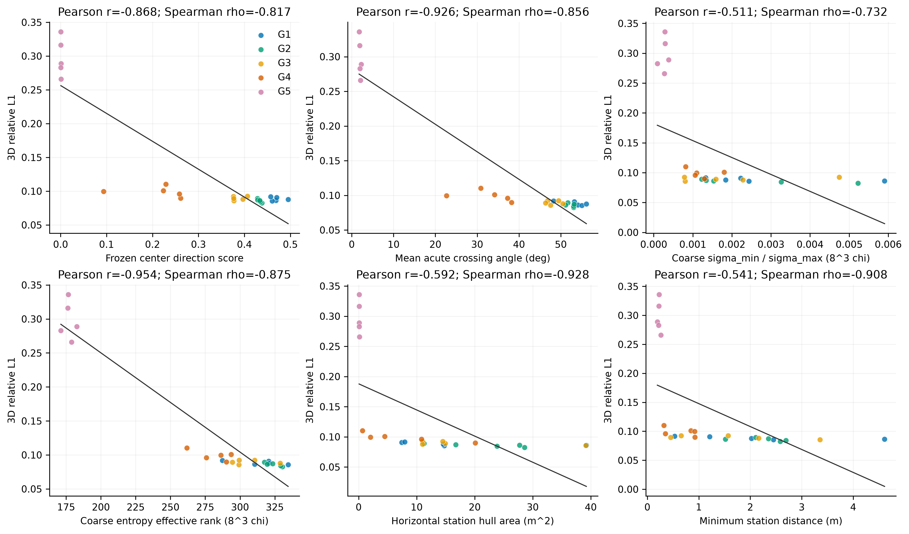
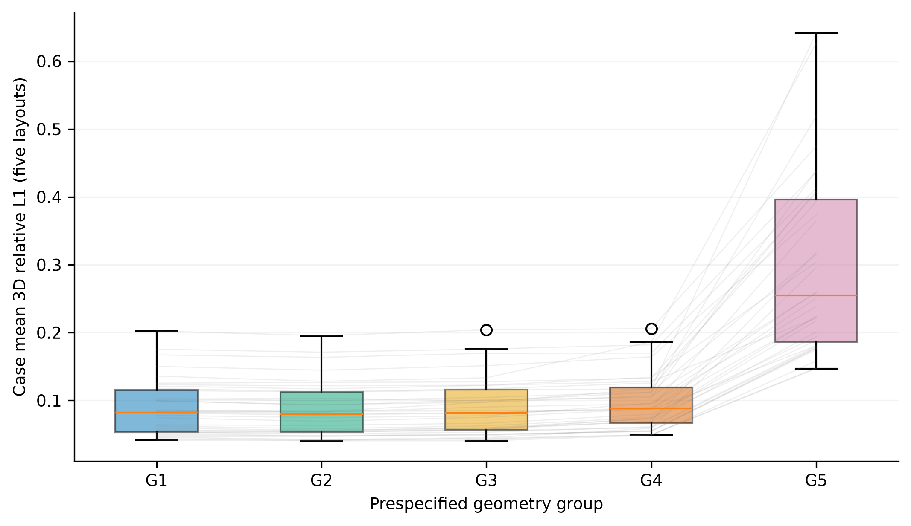
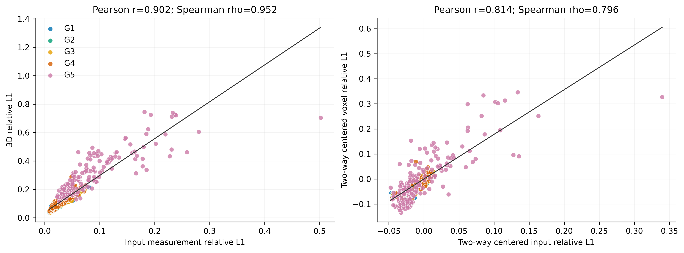
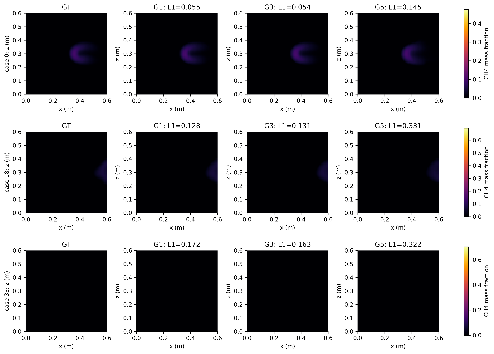
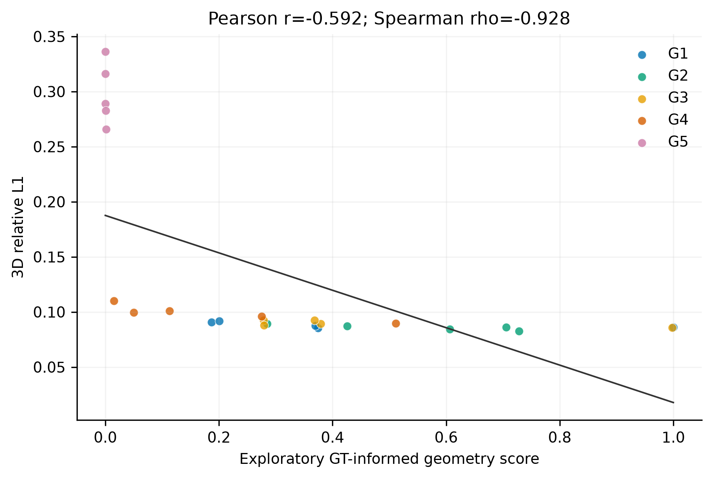
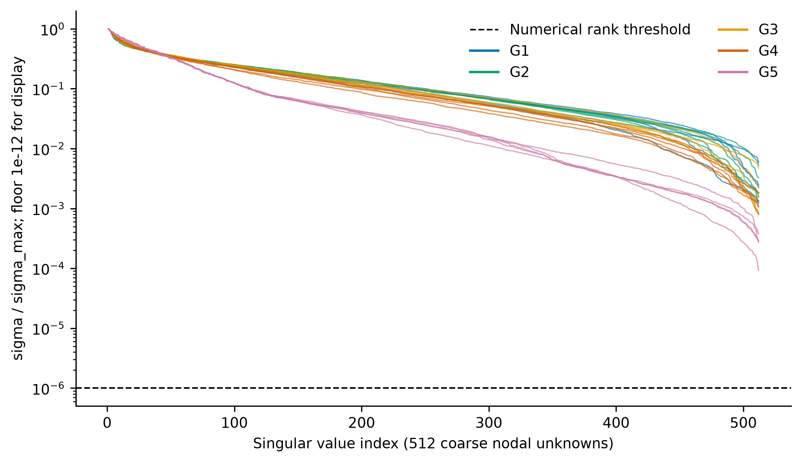
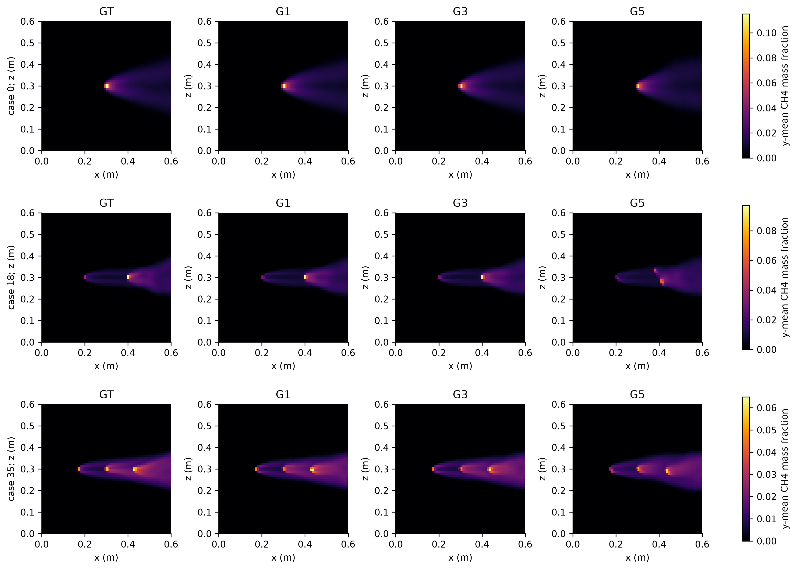

# Geometry Sensitivity Analysis：冻结 SelfSup v1 中文总结

本轮实际完成900次原SelfSup v1冻结前向：36 Val案例×25固定V4布局（G1–G5各五draw），先完成五条smoke再恢复余895条。checkpoint `1573cd84dffeabeb58fbbfb1afec9c9dc865a0a674e21229711bb25b22e3c026`，未训练/改网络/损失/投影器。保留上轮同q A/B采样NO-GO。几何依赖结论：**支持**；“几何比容量更主要”没有被证明。

## 1. 五档与测量身份

定义和预算在新推理前提交，见[协议](../geometry_sensitivity_v1_protocol_zh.md)。Pool A全部635,376组合，仅按预生成几何确定q05/q40/q60/q80；G1≥q80、G2[q60,q80)、G3[q40,q60)、G4[q05,q40)、G5<q05且最小方位跨度≤5°。G5是极端压力组，五档不是自然总体等概率代表；排除其余低尾组合，全部case保留。每case/draw H4在五档输入并集外且组间相同，不参与prediction。输入ppm·m、C为XYZ64³质量分数[0,1]，y为高度。

## 2. 案例级分布与配对干预

| 组 | mean [95%CI] | median | sample std | q25/q75 | worst |
| --- | --- | --- | --- | --- | --- |
| G1 | 0.08839 [+0.07563, +0.10211] | 0.08195 | 0.04140 | 0.05323/0.11549 | 0.20235 |
| G2 | 0.08589 [+0.07349, +0.09910] | 0.07959 | 0.04019 | 0.05403/0.11253 | 0.19540 |
| G3 | 0.08951 [+0.07680, +0.10315] | 0.08174 | 0.04134 | 0.05686/0.11570 | 0.20411 |
| G4 | 0.09925 [+0.08626, +0.11322] | 0.08855 | 0.04232 | 0.06688/0.11931 | 0.20578 |
| G5 | 0.29802 [+0.25774, +0.34106] | 0.25482 | 0.13287 | 0.18654/0.39615 | 0.64191 |

五档没有严格单调：G2比G1低约0.002492，对应配对表也保留。中心方向最高分不保证最低误差，G1的五个固定布局与G2不同；自然范围的趋势须结合连续指标。worst case IDs完整保存在group_summary.csv；所有十指标的分布和case均值完整归档。先平均五draw，再以36case为统计单位，bootstrap10,000/seed2026101504。工况家族相关性未消除，区间是本案例集合的描述性不确定性。

| 差（后档−前档） | L1差 [95%CI] | 变差/改善/平 | Wilcoxon Holm p |
| --- | --- | --- | --- |
| G2-G1 | -0.00249 [-0.00328, -0.00172] | 5/31/0 | 7.54e-07 |
| G3-G1 | 0.00112 [+0.00031, +0.00208] | 23/13/0 | 0.026 |
| G4-G1 | 0.01086 [+0.00832, +0.01413] | 36/0/0 | 2.91e-10 |
| G5-G1 | 0.20963 [+0.17768, +0.24472] | 36/0/0 | 2.91e-10 |
| G3-G2 | 0.00361 [+0.00266, +0.00464] | 33/3/0 | 7.89e-08 |
| G4-G2 | 0.01336 [+0.01062, +0.01690] | 36/0/0 | 2.91e-10 |
| G5-G2 | 0.21212 [+0.17986, +0.24737] | 36/0/0 | 2.91e-10 |
| G4-G3 | 0.00974 [+0.00736, +0.01296] | 36/0/0 | 2.91e-10 |
| G5-G3 | 0.20851 [+0.17653, +0.24368] | 36/0/0 | 2.91e-10 |
| G5-G4 | 0.19877 [+0.16732, +0.23288] | 36/0/0 | 2.91e-10 |

| 组 | 3D L2 | MAE | RMSE | 输入L1 | H4 L1 |
| --- | --- | --- | --- | --- | --- |
| G1 | 0.15940 | 0.0002785 | 0.0024520 | 0.02345 | 0.02773 |
| G2 | 0.15829 | 0.0002700 | 0.0024351 | 0.02517 | 0.02766 |
| G3 | 0.16097 | 0.0002839 | 0.0024740 | 0.02541 | 0.02901 |
| G4 | 0.16566 | 0.0003221 | 0.0025520 | 0.02461 | 0.03475 |
| G5 | 0.42308 | 0.0009536 | 0.0066214 | 0.08305 | 0.14521 |

## 3. 几何与误差：25布局均值及20布局敏感性

关联先在每geometry ID上平均36case误差；Pearson/Spearman CI只bootstrap案例，布局保持固定。置换p在布局级计算，各scope×相关类型跨描述量Holm，不能当900独立观测。下表列全部五档Spearman；Pearson及去除G5的G1–G4关联全数见geometry_correlations.csv/json。多描述量、固定单seed/Pool A和同Val开发样本限制外推。

| 描述量 | rho [95%CI] | Holm置换p |
| --- | --- | --- |
| center_direction_score | -0.81692 [-0.86308, -0.74769] | 0.00210 |
| actual_ray_direction_score_sampled | -0.79769 [-0.83846, -0.73462] | 0.00210 |
| ray_tensor_lambda_min_over_max | -0.85077 [-0.91308, -0.75846] | 0.00210 |
| ray_tensor_lambda_mid_over_max | -0.89308 [-0.94385, -0.80846] | 0.00210 |
| min_pairwise_distance_m | -0.90769 [-0.94310, -0.83538] | 0.00210 |
| mean_pairwise_distance_m | -0.83615 [-0.89846, -0.73692] | 0.00210 |
| max_pairwise_distance_m | -0.82993 [-0.89534, -0.73374] | 0.00210 |
| horizontal_hull_area_m2 | -0.92769 [-0.96154, -0.85538] | 0.00210 |
| station_hull_volume_m3 | -0.88077 [-0.89615, -0.83923] | 0.00210 |
| station_hull_surface_area_m2 | -0.92538 [-0.95846, -0.85308] | 0.00210 |
| min_center_acute_angle_deg | -0.85802 [-0.90920, -0.78876] | 0.00210 |
| mean_center_acute_angle_deg | -0.85615 [-0.91462, -0.76769] | 0.00210 |
| station_azimuth_span_deg | -0.82509 [-0.89128, -0.73081] | 0.00210 |
| center_abs_cosine_redundancy | 0.81692 [+0.74769, +0.86308] | 0.00210 |
| actual_ray_abs_cosine_redundancy | 0.79769 [+0.73462, +0.83846] | 0.00210 |
| coverage_fraction | 未定义 未定义 | 未定义 |
| coverage_at_least_two_stations | 未定义 未定义 | 未定义 |
| coarse_sigma_min_raw_ppm_m | -0.72462 [-0.79077, -0.66846] | 0.00210 |
| coarse_sigma_min_over_max | -0.73154 [-0.79846, -0.67154] | 0.00210 |
| coarse_condition_number | 0.73154 [+0.67154, +0.79846] | 0.00210 |
| coarse_retained_condition_number | 0.73154 [+0.67154, +0.79846] | 0.00210 |
| coarse_numeric_rank | 未定义 未定义 | 未定义 |
| coarse_effective_rank | -0.87538 [-0.93846, -0.79308] | 0.00210 |
| coarse_stable_rank | -0.85462 [-0.90385, -0.80308] | 0.00210 |

本次coverage及至少两站coverage在全部25布局均为1，均导出null/未定义，不填0。凸包描述的是站位分布，不是重建域信息充分性。距离/体积/方向之间共线，相关不等于各指标独立因果贡献。

### 算子谱的范围

实际射线、全部valid、K96、三维稀疏线性chi算子，8³=512未知；仅Gram512×512稠密。保存全512奇异值、熵有效秩/稳定秩/数值秩、raw sigma_min和保留子空间condition。阈值1e−6 sigma_max；秩亏整体condition=null，不将保留子空间condition冒称全场条件数。Gram小sigma受舍入影响。冻结P_diff先插值C再非线性转chi；粗chi谱不是其Jacobian，更不是完整64³谱。每布局full64零空间下界见geometry_descriptors.csv，完整64³稀疏视角线性算子必有零空间；粗谱有限condition不能证明唯一恢复。本次25个8³算子数值秩均为512，但G5熵有效秩仅约171–183，其他档约262–335；所有64³线性布局仍至少有251,600维零空间下界。这同时说明分辨率依赖和有效谱质量劣化，不能用粗网格full rank忽略真实稀疏逆问题。

| 范围 | 描述量 | 相关类型 | 系数 [CI] |
| --- | --- | --- | --- |
| all_G1_G5 | center_direction_score | Pearson | -0.86828 [-0.87595, -0.85808] |
| all_G1_G5 | center_direction_score | Spearman | -0.81692 [-0.86308, -0.74769] |
| all_G1_G5 | horizontal_hull_area_m2 | Pearson | -0.59182 [-0.60196, -0.58098] |
| all_G1_G5 | horizontal_hull_area_m2 | Spearman | -0.92769 [-0.96154, -0.85538] |
| all_G1_G5 | coarse_effective_rank | Pearson | -0.95363 [-0.95963, -0.94481] |
| all_G1_G5 | coarse_effective_rank | Spearman | -0.87538 [-0.93846, -0.79308] |
| natural_G1_G4 | center_direction_score | Pearson | -0.74632 [-0.83121, -0.64175] |
| natural_G1_G4 | center_direction_score | Spearman | -0.64662 [-0.73684, -0.50977] |
| natural_G1_G4 | horizontal_hull_area_m2 | Pearson | -0.71764 [-0.76685, -0.64655] |
| natural_G1_G4 | horizontal_hull_area_m2 | Spearman | -0.86015 [-0.92632, -0.72030] |
| natural_G1_G4 | coarse_effective_rank | Pearson | -0.80315 [-0.88564, -0.69407] |
| natural_G1_G4 | coarse_effective_rank | Spearman | -0.76992 [-0.89173, -0.60602] |

去除G5后center score与误差Spearman仍约−0.647、coarse effective rank约−0.770，说明全局趋势不只由极端组造成；但不能保证每档均值严格单调。

## 4. Measurement fitting与voxel正确性：实际为强正相关

本轮不支持“测量拟合与体积误差相关较弱”。全局Pearson=0.9023、Spearman=0.9524；双向去均值后仍为0.8136/0.7963，各档内也均为强正相关。因此输入误差在当前冻结网络和数据分布中是有用的诊断信号；这不等价于拟合唯一确定体积，未测试更广泛算法/场的充分性。

| 范围 | 相关 | 系数 [case CI] |
| --- | --- | --- |
| pooled_descriptive | Pearson | 0.90229 [+0.87877, +0.93484] |
| pooled_descriptive | Spearman | 0.95238 [+0.92391, +0.95855] |
| two_way_centered | Pearson | 0.81359 [+0.75984, +0.86228] |
| two_way_centered | Spearman | 0.79632 [+0.69935, +0.84315] |
| G1 | Pearson | 0.93665 [+0.88243, +0.96420] |
| G1 | Spearman | 0.94723 [+0.88921, +0.96210] |
| G2 | Pearson | 0.95199 [+0.91939, +0.97029] |
| G2 | Spearman | 0.95849 [+0.90371, +0.96968] |
| G3 | Pearson | 0.95009 [+0.91155, +0.96968] |
| G3 | Spearman | 0.95494 [+0.90788, +0.96523] |
| G4 | Pearson | 0.89503 [+0.85485, +0.92159] |
| G4 | Spearman | 0.93307 [+0.87244, +0.94777] |
| G5 | Pearson | 0.83966 [+0.79942, +0.88917] |
| G5 | Spearman | 0.86520 [+0.78986, +0.90279] |

全行pooled仅描述性、不给独立行p值；组内和去除case/layout双向均值用于检验混合几何及case难度是否驱动关系。每case跨25布局关联另存within_case。输入拟合是网络输出经同一P_diff的误差，无任何优化或拟合后选点；H4独立重投影另报。因此弱/强必须按上述范围回答，不能先假定projection consistency与体积精度无关。

## 5. 图与exploratory score

根据预登记选择规则，候选中最强正确方向单指标为 `horizontal_hull_area_m2`；Spearman=-0.92769。按当前25布局几何范围minmax，质量方向=+1。这是**exploratory、GT-informed**：指标身份依据Val GT误差关联选出，存在选择偏倚，尚未在新布局/独立集验证。不改旧center score、边界或模型，不用于本次组定义/调参/训练；不拟合多指标权重。

代表case预先固定0/18/35、draw0、G1/G3/G5，均同y=32水平切片，统一XYZ轴和每case GT全体积max色标，case之间GT峰值不同所以色标可不同；没有挑最优/最差GT iterate或case。预设y32在case35几乎不穿过羽流，保留原图并补充全体积y均值投影Figure7；补图规则在结果后作为呈现修订，全部case/布局相同操作，没有按误差挑slice或改变任何统计。















## 6. 七个问题与下一阶段判断

1. 普通自然V4历史case平均relative L1=0.095649，本轮G1/G2/G3=0.088386/0.085894/0.089508。在当前单seed/Val范围可称相对稳定，不能称已证明跨seed/任意几何稳定。

2. G5=0.298018，G5−G1=+0.209632，95%CI=[+0.17768, +0.24472]，变差36/36case；这是冻结模型的配对几何干预，不是网络新能力。

3. 本次25布局最强单指标是horizontal_hull_area_m2，但须结合去除G5的关联、尺度/表示差异和共线性，不能当理论可观测性。

4. 本轮测量拟合与voxel错误强正相关，不能支持弱相关假设；也不证明低测量误差保证三维正确或唯一恢复。

5. 独立历史单站替换Original/Matched-Random/Targeted L1=0.393402/0.170992/0.142418；保留原完整来源。两段收益分别是打破极端集中及额外互补指导，不将全部收益归于score。

6. 本轮证实或量化几何敏感性，并未操纵容量、优化或physics loss，不能排除这些因素及网络先验/训练分布。主瓶颈四选一没有可识别的比较证据；准确判断是“几何是当前v1可操作的显著瓶颈之一”，而非“容量不是问题”。

7. 若配对和关联支持几何依赖，有理由实现独立显式normal/moderate/extreme增强sampler并做读取/数值smoke，保留v1。上次same-q方案主要约束A/B联合分布且普通几何质量未提升，其NO-GO保留；新的50/25/25并未被该结果检验。该判据不等于证明增强会成功。正式训练需独立冻结明确匹配预算/协议；当前不自动启动curriculum或hard weighting。

## 7. 成本、保护、验证与交付

| 组 | 前向数 | 均值/总前向秒 | 评价总秒 | 峰值MB |
| --- | --- | --- | --- | --- |
| G1 | 180 | 0.02858/5.15 | 1.18 | 1159.6 |
| G2 | 180 | 0.02264/4.08 | 1.19 | 1159.6 |
| G3 | 180 | 0.02265/4.08 | 1.17 | 1159.6 |
| G4 | 180 | 0.02262/4.07 | 1.18 | 1159.6 |
| G5 | 180 | 0.02267/4.08 | 1.18 | 1159.6 |

GPU为共享RTX4090 cuda:2；同步前向包含网络内部MRGR投影，评价含GT加载及两个P_diff，不含最外层projection读取/batch准备/checkpoint加载。smoke第一条含CUDA冷启动，逐条保留而不隐藏；不可当专用硬件性能基准。算子冷构建、Gram缓存、谱计算单独在operator_cost.json及描述CSV；只用于几何诊断，不加速网络。统计/绘图墙钟另存report_runtime.json。

注册不读measurement/GT/checkpoint内容；实际推理只读36 Val Pool A和36 Val GT64，GT/H在prediction之后用于评价。原训练读取保护未修改。注册、smoke、full访问计数见access_audit.json，禁止尝试均0；源/权重/历史输入byte hash及数据/历史产物metadata核对通过。没有全量GT数据byte hash的夸大声明。未改任何历史数据、checkpoint、配置、数值训练代码、协议或实验结论。未跟踪用户绘图脚本保留且不提交。

新增与已有针对性40项测试通过；完整仓库测试日志见full_tests.log。边界/圆周跨度/凸包轴单位/秩亏/常量关联测试与原RayMatrix伴随、phantom、单位/非线性/物理梯度验证复用；真实全部使用的站位另做float64伴随内积。主CSV900行，180 case×group均值、100个十指标配对、完整相关/谱/固定代表图/审计归档。

源码入口均从config/CLI解析数据与输出路径，没有硬编码部署绝对路径；权重、measurement、GT、体积和大算子缓存仅外部存储不提交。V3/V6新五档、Pool B、最终test、容量/损失改动及curriculum均未运行。

```bash
python scripts/run_geometry_sensitivity.py --config configs/geometry_sensitivity_v1.yaml --stage register
python scripts/run_geometry_sensitivity.py --config configs/geometry_sensitivity_v1.yaml --stage smoke --device cuda:2
python scripts/run_geometry_sensitivity.py --config configs/geometry_sensitivity_v1.yaml --stage full --device cuda:2
python scripts/report_geometry_sensitivity.py --config configs/geometry_sensitivity_v1.yaml
python scripts/verify_geometry_sensitivity.py --config configs/geometry_sensitivity_v1.yaml
```

## 8. 证据后的下一阶段实现状态

[独立50/25/25采样准备协议](../geometry_augmentation_preparation_v1_zh.md)已实现，49,800对/99,600输入的前瞻计划物化；实际模式计数natural/moderate/hard=49,429/25,027/25,144，联合拒绝最多38次。新sampler各A/B mode独立，moderate按各V纯几何q05/q40、hard跨度≤10°，未采用本轮GT-informed hull-area score。原模型、loss及原采样器没有改变。

正式训练前只执行九种mode组合的真实原objective前向/反向smoke（4.317s）。有限非零梯度、输出[0,1]、初态hash及parameters/buffers不变均通过；GT/外部checkpoint/Pool B/test尝试0，实际读取9个train Pool A文件。没有optimizer、训练步数0、没有新checkpoint或训练效果结论。此前主敏感性流程仅Val；这一独立准备流程才按登记读取必要train测量。

后续值得开展一次明确匹配的正式增强训练；当前49,800仅planned sampler pairs，不是已训练步数。正式训练、curriculum/hard weighting不在本入口自动执行范围。原v1与旧NO-GO完整保留。

最终新采样器加入后的完整仓库回归：246项全部通过，原243项日志与最终日志分别保留。独立几何审计另核对900条输入/100个配对bootstrap/84个有效关联/9个代表体积L1；增强计划独立审计另核对49,800对全部模式、V、disjoint、分数/跨度/频次。
