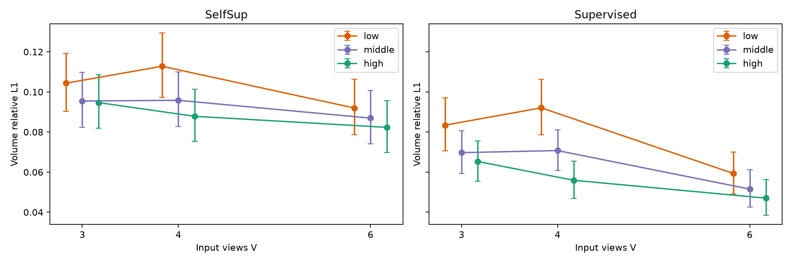
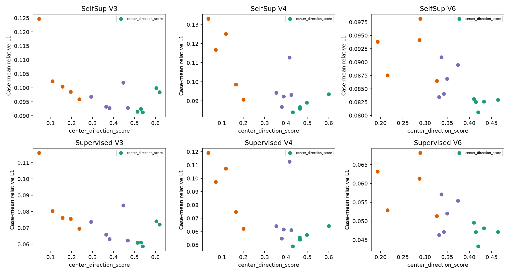
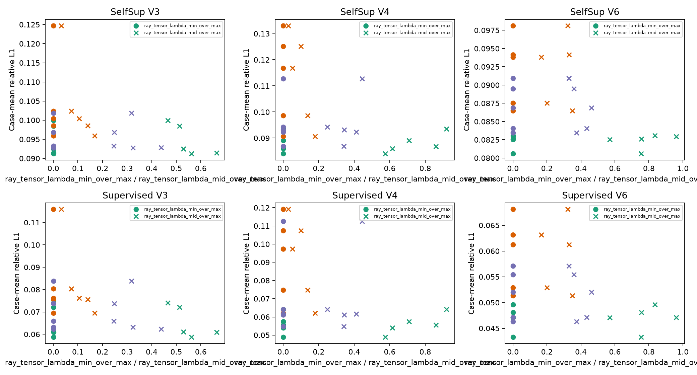
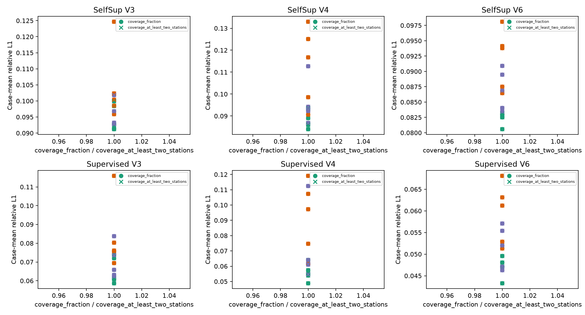
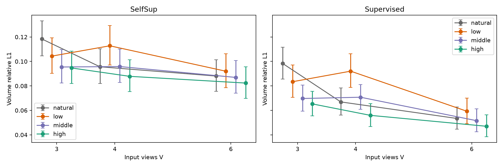
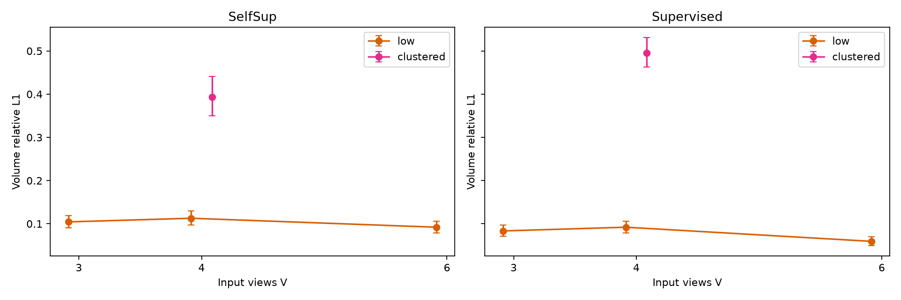

# 冻结 MRGR 的几何分层验证 v1


Stage C **GO**。两套冻结网络实际完成4,680次前向，覆盖全部36 Val case、5draw、V3/V4/V6自然随机与9个受控分层格，以及独立clustered V4压力测试。判据在提交c982b05、加载checkpoint之前冻结；本报告不改变分数、边界、draw或门槛。


## 1. 当前状态、纠错与稳定总体

起始本地/远端13d62826e220f1cc891e704a3b418fccf55fbad6；协议提交c982b05。报告生成时HEAD为`c982b053f857e9251c3f1cf77e45000dbbbf3e21`。未跟踪的用户绘图脚本不提交。

高度旧轴z(index2)改为y(index1)，x–z为水平面。64站位实际高度范围[0.253432709,0.348728316]m，均在[.25,.35]m。显式λ_min/mid/max及两个比值已加入，分母max(λ_max,1e-12)。原数组保持升序兼容；原v1清单不追溯修改。新清单另存origins/azimuth/水平radius/center distance、有效射线、实际方向分数、覆盖和平面覆盖。

| V | 总体数 | 方式 | low/middle边界 | middle/high边界 |
| --- | --- | --- | --- | --- |
| 3 | 41664 | exhaustive | 0.250090973083 | 0.499757900604 |
| 4 | 635376 | exhaustive | 0.311830489553 | 0.429670971191 |
| 6 | 100000 | unique_deterministic_monte_carlo | 0.327740858384 | 0.402882714947 |

总体仅从origin计算原center score，V独立tertile，平界归右。V3/V4全枚举；V6 seed2026101401确定性100,000唯一组合。分位、均值、std、min/max、源码/geometry hash见boundaries.json。边界阶段测量opens=0、GT opens=0、checkpoint/model opens=0，未计算K96 coverage。冻结边界后才计算选择布局的K96覆盖。每cell五layout跨case共用，输入顺序冻结。


## 2. 冻结模型与评价身份

- SelfSup: `1573cd84dffeabeb58fbbfb1afec9c9dc865a0a674e21229711bb25b22e3c026`。
- Supervised: `4c9a39fd39432988cf5971b9a657a4cf22180650d3490bf65f3a8a7aeb04905c`。

网络相同GeoLift-OARI-MRGR-Res3D/332,070参数、XYZ64³质量分数，FP32、eval、inference_mode、TF32关闭。SelfSup v1训练无体积GT，原measurement Val selector；监督MRGR训练/Val selector用GT，存在同Val模型选择偏倚。参数和buffer逐模型前后hash一致。无optimizer或更新。

受控同case/V三个strata和五draw共同H4，排除15输入并集；自然H4独立键控排除各输入；clustered沿用历史H4。所有IDs/顺序/mask/path length/测量/GT在模型间相同。H不输入网络，不选参数。冻结P_diff为C插值后转χ、K96；参考测量128³/K256，存在表示/积分差异，本轮不读GT128内容。


## 3. 六个模型×V分层主表

每case先均值五draw再36case均值。95% percentile bootstrap10,000次、seed2026101404，单位case。CI不把draw/射线作为独立样本；工况家族相关性未消除。三维relative指标无量纲、MAE/RMSE/峰值为质量分数。积分proxy abs(sum(C)−sum(GT))/sum(abs(GT))，不是kg。辅助指标全数归档，不按好坏删case。

### SelfSup V3

| stratum | 三维L1 [95%CI] | L2 | MAE | RMSE | Input L1/L2 | H4 L1/L2 | 积分proxy | 峰值绝对误差 |
| --- | --- | --- | --- | --- | --- | --- | --- | --- |
| low | 0.104355 [+0.090391, +0.119301] | 0.170495 | 0.00033782 | 0.00261904 | 0.023912/0.031547 | 0.036139/0.046161 | 0.007753 | 0.111735 |
| middle | 0.095470 [+0.082329, +0.109749] | 0.164883 | 0.00030785 | 0.00253757 | 0.026150/0.035314 | 0.033164/0.042440 | 0.007049 | 0.109502 |
| high | 0.094678 [+0.081875, +0.108480] | 0.161236 | 0.00030450 | 0.00247937 | 0.024854/0.033257 | 0.031210/0.040906 | 0.006942 | 0.115369 |

### SelfSup V4

| stratum | 三维L1 [95%CI] | L2 | MAE | RMSE | Input L1/L2 | H4 L1/L2 | 积分proxy | 峰值绝对误差 |
| --- | --- | --- | --- | --- | --- | --- | --- | --- |
| low | 0.112798 [+0.097222, +0.129385] | 0.179389 | 0.00036026 | 0.00275367 | 0.027236/0.035375 | 0.043514/0.054504 | 0.007741 | 0.102789 |
| middle | 0.095823 [+0.082723, +0.110072] | 0.168590 | 0.00030819 | 0.00261792 | 0.024821/0.034240 | 0.033187/0.043814 | 0.008069 | 0.109771 |
| high | 0.087837 [+0.075304, +0.101287] | 0.157817 | 0.00027931 | 0.00243176 | 0.024273/0.033226 | 0.028897/0.038743 | 0.006720 | 0.114927 |

### SelfSup V6

| stratum | 三维L1 [95%CI] | L2 | MAE | RMSE | Input L1/L2 | H4 L1/L2 | 积分proxy | 峰值绝对误差 |
| --- | --- | --- | --- | --- | --- | --- | --- | --- |
| low | 0.091999 [+0.078554, +0.106318] | 0.160828 | 0.00029175 | 0.00247573 | 0.024058/0.033270 | 0.031011/0.042260 | 0.007694 | 0.112983 |
| middle | 0.086940 [+0.074163, +0.100775] | 0.158440 | 0.00027348 | 0.00243934 | 0.023448/0.032653 | 0.027810/0.038985 | 0.007653 | 0.116333 |
| high | 0.082332 [+0.069830, +0.095697] | 0.157120 | 0.00025637 | 0.00241855 | 0.024809/0.034687 | 0.026229/0.037130 | 0.007396 | 0.113468 |

### Supervised V3

| stratum | 三维L1 [95%CI] | L2 | MAE | RMSE | Input L1/L2 | H4 L1/L2 | 积分proxy | 峰值绝对误差 |
| --- | --- | --- | --- | --- | --- | --- | --- | --- |
| low | 0.083441 [+0.070650, +0.097164] | 0.102271 | 0.00028129 | 0.00158096 | 0.033190/0.042836 | 0.045030/0.056555 | 0.006333 | 0.033185 |
| middle | 0.069721 [+0.059259, +0.080645] | 0.083827 | 0.00023812 | 0.00130972 | 0.032654/0.043537 | 0.040627/0.051593 | 0.006050 | 0.031351 |
| high | 0.065301 [+0.055441, +0.075490] | 0.074114 | 0.00022210 | 0.00114136 | 0.032098/0.042080 | 0.038311/0.049427 | 0.005070 | 0.025209 |

### Supervised V4

| stratum | 三维L1 [95%CI] | L2 | MAE | RMSE | Input L1/L2 | H4 L1/L2 | 积分proxy | 峰值绝对误差 |
| --- | --- | --- | --- | --- | --- | --- | --- | --- |
| low | 0.092064 [+0.078711, +0.106356] | 0.107190 | 0.00030348 | 0.00164520 | 0.035904/0.047033 | 0.052133/0.064807 | 0.007670 | 0.032518 |
| middle | 0.070750 [+0.060852, +0.081186] | 0.090738 | 0.00024391 | 0.00145063 | 0.033574/0.045696 | 0.040714/0.053348 | 0.005814 | 0.023891 |
| high | 0.055932 [+0.046862, +0.065607] | 0.064556 | 0.00018527 | 0.00098181 | 0.030196/0.040918 | 0.034001/0.045738 | 0.004476 | 0.024191 |

### Supervised V6

| stratum | 三维L1 [95%CI] | L2 | MAE | RMSE | Input L1/L2 | H4 L1/L2 | 积分proxy | 峰值绝对误差 |
| --- | --- | --- | --- | --- | --- | --- | --- | --- |
| low | 0.059323 [+0.049195, +0.070060] | 0.067608 | 0.00019371 | 0.00102317 | 0.030064/0.041265 | 0.035502/0.048565 | 0.004827 | 0.026610 |
| middle | 0.051569 [+0.042584, +0.061281] | 0.059808 | 0.00016750 | 0.00090353 | 0.028881/0.040382 | 0.032070/0.045525 | 0.004276 | 0.024208 |
| high | 0.047004 [+0.038415, +0.056296] | 0.055780 | 0.00014949 | 0.00083719 | 0.028764/0.040285 | 0.030675/0.044299 | 0.004485 | 0.023895 |


## 4. 配对差、连续关联与预登记决策

| 模型 | V | low−high L1 | 95% case CI |
| --- | --- | --- | --- |
| SelfSup | 3 | +0.009677 | [+0.006729, +0.013037] |
| SelfSup | 4 | +0.024961 | [+0.019712, +0.031638] |
| SelfSup | 6 | +0.009667 | [+0.008137, +0.011259] |
| Supervised | 3 | +0.018140 | [+0.012858, +0.024234] |
| Supervised | 4 | +0.036132 | [+0.029538, +0.044287] |
| Supervised | 6 | +0.012319 | [+0.010086, +0.014691] |

| 模型 | V | 描述量 | Spearman rho | case-bootstrap95%CI |
| --- | --- | --- | --- | --- |
| SelfSup | 3 | center_direction_score | -0.5607 | [-0.628571, -0.317857] |
| SelfSup | 3 | ray_tensor_lambda_min_over_max | -0.6857 | [-0.757143, -0.471429] |
| SelfSup | 3 | ray_tensor_lambda_mid_over_max | -0.7571 | [-0.792857, -0.528571] |
| SelfSup | 3 | coverage_fraction | 不可识别（常量） | 不可识别（常量） |
| SelfSup | 3 | coverage_at_least_two_stations | 不可识别（常量） | 不可识别（常量） |
| SelfSup | 4 | center_direction_score | -0.6893 | [-0.757143, -0.607143] |
| SelfSup | 4 | ray_tensor_lambda_min_over_max | -0.6893 | [-0.750089, -0.600000] |
| SelfSup | 4 | ray_tensor_lambda_mid_over_max | -0.6821 | [-0.750000, -0.592857] |
| SelfSup | 4 | coverage_fraction | 不可识别（常量） | 不可识别（常量） |
| SelfSup | 4 | coverage_at_least_two_stations | 不可识别（常量） | 不可识别（常量） |
| SelfSup | 6 | center_direction_score | -0.8000 | [-0.832143, -0.717857] |
| SelfSup | 6 | ray_tensor_lambda_min_over_max | -0.7786 | [-0.842857, -0.710714] |
| SelfSup | 6 | ray_tensor_lambda_mid_over_max | -0.8393 | [-0.889286, -0.771429] |
| SelfSup | 6 | coverage_fraction | 不可识别（常量） | 不可识别（常量） |
| SelfSup | 6 | coverage_at_least_two_stations | 不可识别（常量） | 不可识别（常量） |
| Supervised | 3 | center_direction_score | -0.6107 | [-0.692857, -0.460714] |
| Supervised | 3 | ray_tensor_lambda_min_over_max | -0.7179 | [-0.782232, -0.567857] |
| Supervised | 3 | ray_tensor_lambda_mid_over_max | -0.7821 | [-0.828571, -0.639286] |
| Supervised | 3 | coverage_fraction | 不可识别（常量） | 不可识别（常量） |
| Supervised | 3 | coverage_at_least_two_stations | 不可识别（常量） | 不可识别（常量） |
| Supervised | 4 | center_direction_score | -0.6286 | [-0.710714, -0.571429] |
| Supervised | 4 | ray_tensor_lambda_min_over_max | -0.5750 | [-0.667857, -0.542857] |
| Supervised | 4 | ray_tensor_lambda_mid_over_max | -0.5929 | [-0.685714, -0.539286] |
| Supervised | 4 | coverage_fraction | 不可识别（常量） | 不可识别（常量） |
| Supervised | 4 | coverage_at_least_two_stations | 不可识别（常量） | 不可识别（常量） |
| Supervised | 6 | center_direction_score | -0.6786 | [-0.750000, -0.600000] |
| Supervised | 6 | ray_tensor_lambda_min_over_max | -0.6964 | [-0.764286, -0.610714] |
| Supervised | 6 | ray_tensor_lambda_mid_over_max | -0.7536 | [-0.807143, -0.667857] |
| Supervised | 6 | coverage_fraction | 不可识别（常量） | 不可识别（常量） |
| Supervised | 6 | coverage_at_least_two_stations | 不可识别（常量） | 不可识别（常量） |

连续关联逐V/model，在15个受控geometry ID上先聚合36case误差。bootstrap只重采样case，保留全部15几何再重算rho；不对重复geometry×case作经典p值。CI描述case组成不确定性，不包含重新抽布局的变动；仅15个固定布局，不能外推至全部总体。常量描述量的rho/CI明确为不可识别（JSON null），不填0，也不进入关联通过条件。coverage和direction-tensor为几何诊断proxy，不是正式可观测性、条件数、Fisher信息、rank证明或唯一恢复。

登记的稳定排序要求至少一个模型在三个V均low>middle>high、low−high CI下端>0，且每V至少一个指定描述量rho≤−.30；.30仅工程参考，关联CI报告但不作为额外门槛。

| 模型 | V | 顺序成立 | low−high CI>0 | 指定描述量rho≤−.30 | 该V通过 |
| --- | --- | --- | --- | --- | --- |
| SelfSup | 3 | True | True | True | True |
| SelfSup | 4 | True | True | True | True |
| SelfSup | 6 | True | True | True | True |
| Supervised | 3 | True | True | True | True |
| Supervised | 4 | True | True | True | True |
| Supervised | 6 | True | True | True | True |

最终Stage C：**GO**。通过全部V的模型：['SelfSup', 'Supervised']。

本轮六组均出现low>middle>high，两个模型的center score和λ_min/max均有负向非微弱关联，支持这些预设方向描述量在本次固定自然布局中表征难度趋势。coverage与coverage≥2在受控布局均饱和为1，当前16³/K96触达proxy没有区分力；这是该覆盖描述的实际局限，不能据此宣称连续覆盖或可观测性相同。监督模型在全部自然tertile均值更低，自监督模型在极端clustered均值更低；标签、训练目标与Val selector差异共同存在，不能作标签的单因果结论。极端集中对两个模型都更难，但本轮不证明任意布局具有相同可恢复性。


## 5. 自然随机与极端压力保留

| 模型 | 条件 | V | 三维L1 [95%CI] | H4 L1 |
| --- | --- | --- | --- | --- |
| SelfSup | clustered | 4 | 0.393402 [+0.349570, +0.440829] | 0.196163 |
| SelfSup | natural | 3 | 0.118364 [+0.104518, +0.133100] | 0.044234 |
| SelfSup | natural | 4 | 0.095649 [+0.082046, +0.110370] | 0.031882 |
| SelfSup | natural | 6 | 0.088058 [+0.075510, +0.101434] | 0.028419 |
| Supervised | clustered | 4 | 0.495210 [+0.462782, +0.530897] | 0.298740 |
| Supervised | natural | 3 | 0.098309 [+0.085523, +0.111654] | 0.054239 |
| Supervised | natural | 4 | 0.066923 [+0.056209, +0.078421] | 0.038577 |
| Supervised | natural | 6 | 0.053401 [+0.044557, +0.062848] | 0.033079 |

历史复现全部通过：自然随机6480项、clustered 2160项，共8640项；最大绝对差0，容差abs1e-8+rel1e-5未按结果调整。自然H4属新增评价，不能和历史不同H策略直接声称复现；历史核对四项体积+两项input误差。clustered不纳入tertile均值。

历史单站位替换仅作独立解释：SelfSup Original/Matched-Random/Targeted L1=0.393402/0.170992/0.142418，监督=0.495210/0.179599/0.155090。Matched-Random与Targeted共用删除ID，仅新增站位随机。Original→Matched-Random打破极端集中，SelfSup改善56.54%；Matched-Random→Targeted额外改善16.71%，不将全部63.8%归于center score。历史Random字段不改。














## 6. 成本、测试、访问与完整性

| 模型 | 条件 | V | 前向数 | 均值前向秒 | 前向总秒 | 评价总秒 | 峰值allocated MB |
| --- | --- | --- | --- | --- | --- | --- | --- |
| SelfSup | clustered | 4 | 180 | 0.027176 | 4.892 | 0.997 | 1160.4 |
| SelfSup | controlled | 3 | 540 | 0.027302 | 14.743 | 3.108 | 1151.8 |
| SelfSup | controlled | 4 | 540 | 0.027592 | 14.900 | 3.093 | 1160.4 |
| SelfSup | controlled | 6 | 540 | 0.031146 | 16.819 | 3.334 | 1181.0 |
| SelfSup | natural | 3 | 180 | 0.025732 | 4.632 | 0.987 | 1151.8 |
| SelfSup | natural | 4 | 180 | 0.027308 | 4.915 | 1.025 | 1160.4 |
| SelfSup | natural | 6 | 180 | 0.031131 | 5.604 | 1.089 | 1181.0 |
| Supervised | clustered | 4 | 180 | 0.058649 | 10.557 | 4.386 | 1160.4 |
| Supervised | controlled | 3 | 540 | 0.057184 | 30.879 | 13.813 | 1151.8 |
| Supervised | controlled | 4 | 540 | 0.056095 | 30.291 | 12.802 | 1160.4 |
| Supervised | controlled | 6 | 540 | 0.063239 | 34.149 | 17.055 | 1181.0 |
| Supervised | natural | 3 | 180 | 0.056918 | 10.245 | 4.368 | 1151.8 |
| Supervised | natural | 4 | 180 | 0.059133 | 10.644 | 4.763 | 1160.4 |
| Supervised | natural | 6 | 180 | 0.064004 | 11.521 | 5.856 | 1181.0 |

同一共享RTX4090 cuda:0上顺序运行两模型。监督运行与全量CPU测试有重叠，耗时不可解释为两种训练方式的速度差。时间区分同步网络前向和体积/重投影评价，不含文件读取、batch准备及checkpoint加载；没有隐藏持久算子缓存，GeometryLifting和P_diff保持原实现。共享GPU的其他任务与热身会影响计时，非专用硬件基准。逐条保留device/peak allocated/reserved bytes，CPU统计/绘图成本另在报告日志外层。

新增13项必需测试与原27项共40项针对性测试通过，全仓229项测试通过。覆盖高度实际family、特征值/finite ratio、纯几何边界读阻断、V独立/抽样复现/membership、两模型IDs/order一致、自然历史IDs、clustered排除及Pool B/test阻断。独立标量核验全部2340输入记录、4680模型row、936个case均值和180个十指标配对区间，并重算几何中心分数/高度/层级。测试故意拒绝的fixture访问不混入真实审计。

| 阶段 | 测量opens | GT64 opens | checkpoint opens | 禁止尝试 |
| --- | --- | --- | --- | --- |
| boundary_access_audit.json | 0 | 0 | 0 | 0 |
| registration_access_audit.json | 0 | 0 | 0 | 0 |
| SelfSup_access_audit.json | 108 | 108 | 8 | 0 |
| Supervised_access_audit.json | 108 | 108 | 8 | 0 |

Pool B accessed=False，final test accessed=False，GT128 content accessed=False。两模型分别仅36个Val Pool A文件及36个Val GT64用于评价。未读取train内容，未更改原自监督读取保护。所有历史产物内容/元数据保留，授权改动仅新清单源码；旧全src协议哈希前瞻不兼容单独记载，不改旧hash。源projector/模型/数值训练代码、冻结权重未变。数据完整性依据写阻断和metadata对比，未冒称全量数据byte hash。首次标量汇总因常量coverage导致NaN不能写JSON而停止，保留失败日志；仅将未定义rho/CI明确导出为null，重新汇总已存标量，没有重复前向或改变统计/判据。


## 7. 结论与下一阶段边界

预登记几何排序判据通过，可进入独立登记的fresh匹配Control/Treatment采样实验。优化前必须提交其完整协议，C结果本身不证明采样训练收益。

单站位极端→互补收益与自然tertile排序是不同问题；不能用前者代替后者证据。本结果限定固定Pool A、36 Val、15受控几何/V、两个单seed checkpoint；低分数并不自动等同所有case难恢复，几何歧义与网络先验/训练分布共同作用，体积/测量差异保留。结构、训练目标、RVTC关闭状态不变，不追加score搜索、教师、loss、模块、TV/PDE网络先验、Pool B/test或经典矩阵。经典1,270次预算耗尽仍只说明登记有限预算性能，不能称理论下限。


## 8. 重放与归档

协议、boundaries、2340站位/H、590几何描述、4680逐case/draw、case均值、完整十指标summary/配对、五描述量rho/区间、访问/完整性/source manifest/tests/runtime/6图均归档。权重、数据、GT、体积和大型算子不提交。

```bash
OMP_NUM_THREADS=2 MKL_NUM_THREADS=2 PYTHONPATH=src:tests /scratch/djc/envs/gas-torch/bin/python -m unittest test_geometry_strata_v2 test_clustered_one_swap test_evaluation_view_selection test_measurement_consistency -v
/scratch/djc/envs/gas-torch/bin/python scripts/register_geometry_strata_v2.py
/scratch/djc/envs/gas-torch/bin/python scripts/evaluate_geometry_strata_frozen.py --model SelfSup --device cuda:0
/scratch/djc/envs/gas-torch/bin/python scripts/evaluate_geometry_strata_frozen.py --model Supervised --device cuda:0
/scratch/djc/envs/gas-torch/bin/python scripts/report_geometry_strata_frozen.py
```

登记及完整结果存在时核对退出；未完成按自身已写成功row恢复，不能按Val结果重抽或调参。报告入口只读标量，不重新推理。
