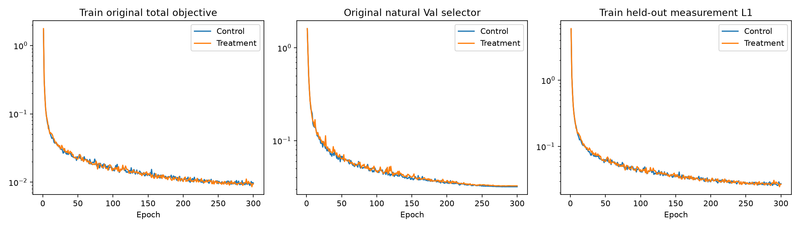
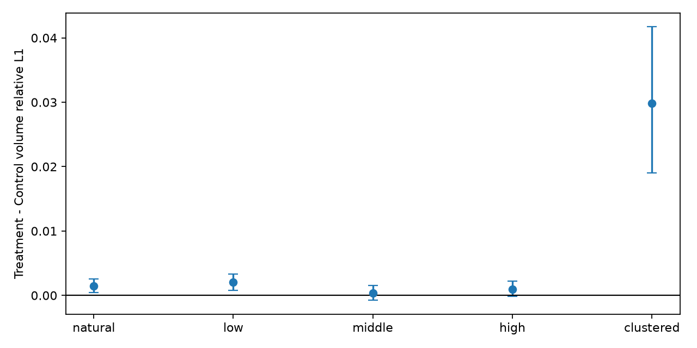
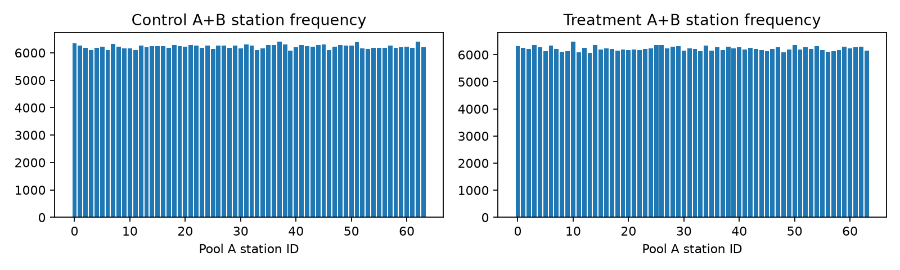

# 自监督几何采样匹配300轮实验 v1

Stage D **NO-GO**。两组均实际完成166train×300epochs、24,900次optimizer step；两组best按原无GT自然Val测量selector冻结后，先完成4,680次measurement-only前向，再独立读取36 Val GT64作post-hoc评价。没有按GT修改采样/参数。

## 1. 登记与匹配边界

Stage C已验证两个冻结模型在V3/V4/V6的方向描述量排序，见[冻结评价报告](geometry_strata_frozen_v1_zh.md)。训练优化前协议/源码/计划/初态/评价IDs随提交c2d7454先同步GitHub，随后才创建optimizer。

两组fresh seed20261011初态SHA256 `af76bbf4afd36c0d34fa3407dce4e7497a3a57b5b4b2ca837b95afc7a2311a3c` 完全一致。禁止旧checkpoint warm start。原332,070参数网络、objective、P_diff/K96/all rays/view chunk2、FP32、clip1、AdamW2e-4/wd1e-4、cosine300、effective batch2均相同。每epochcase顺序相同、83step，视角数量逐case/epoch相同。原GT-free训练代码/guard与冻结SelfSup v1不改。

唯一科学干预是A/B联合几何采样：Control原独立3–5自然随机；Treatment均匀q、A/B同q、A/B/H互斥、H2同uniform disjoint policy。两个输入的数量从Control原sampler直接继承。自然tertile本来各约1/3，不能称Treatment提高优质布局占比；同层A/B相关性是干预的一部分，不是所有几何边际严格相同。Extreme clustered只evaluation，未等权加入训练。

V5独立100,000唯一Pool A组合定义自己的边界`[0.32982286878067174, 0.4072867584152859]`，V3/V4用Stage B；边界/采样登记测量opens=0、GT opens=0、checkpoint reads=0。

| 组 | 平均中心分数 | A/B stratum3×3频数 |
| --- | --- | --- |
| Control | 0.34777323 | [[5333, 5552, 5655], [5512, 5601, 5541], [5632, 5587, 5387]] |
| Treatment | 0.34740644 | [[16569, 0, 0], [0, 16698, 0], [0, 0, 16533]] |

完整per-station A/B/H频数、方位/半径/高度与separation/score直方图在审计文件；这些边际变化原样报告，不后验强制匹配。

## 2. Checkpoint选择、实际预算与标签身份

| 组 | best SHA256 | best epoch | 原Val H L1 | 300轮实测秒 |
| --- | --- | --- | --- | --- |
| Control | 6a7de2314158032c0ab357af1c301f3fc58a3eab1cb341d93642eabf139516b5 | 283 | 0.031849 | 9967.2 |
| Treatment | 63023467bf48a25aa100ca9a83ca537a94dfbb9d8288b97a623e3ebe455a6e9c | 283 | 0.032446 | 9787.7 |

两组同原Val-A A4/B4/H4固定36case，selector为原dual-input两个预测的平均held-out测量relative L1，不是tertile macro，不读GT。原训练/验证/选择均GT-free，最终GT仅评价；研究路线由此前Stage C含Val GT的几何验证支持，不能称整个研究开发从未使用GT。best可早于300，但必须300全部结束才准posthoc GT；实际完整optimizer步数已逐epoch核验。共享RTX4090 cuda0/1有其他用户任务，计时不是专用硬件基准，也不是只sampler影响速度的因果对照。

冻结后各2,340次实际前向，Control纯前向合计56.397秒，Treatment 55.776秒。measurement从best冻结至完成的文件时间跨度345.264秒，独立posthoc从measurement完成至GT评价完成跨度38.941秒；跨度包含启动间隔、评价和压缩/存取缓存，纯前向时间不含这些成本。训练epoch时间包括训练/Val而不含checkpoint写入，完整内存/时间曲线及逐forward秒数归档。

## 3. 相同输入的完整分层/自然/压力配对

每case五draw先均值，再36case均值。所有station IDs/order/H/mask/测量和GT一样。差值Treatment−Control，负为改善；case bootstrap10,000、seed2026101404、percentile95%CI，不把draw/射线作独立样本。以下主L1，完整十指标均值/区间与配对在summary/paired_statistics.csv。

| section | V | stratum | Control L1 | Treatment L1 | T−C | 95%case CI | 胜/负/平 |
| --- | --- | --- | --- | --- | --- | --- | --- |
| clustered | 4 | clustered | 0.382537 | 0.412372 | +0.029835 | [+0.018995, +0.041731] | 6/30/0 |
| controlled | 3 | high | 0.094292 | 0.094953 | +0.000661 | [-0.000791, +0.002161] | 17/19/0 |
| controlled | 3 | low | 0.104505 | 0.106316 | +0.001811 | [+0.000104, +0.003415] | 10/26/0 |
| controlled | 3 | middle | 0.095624 | 0.095540 | -0.000083 | [-0.001150, +0.000981] | 20/16/0 |
| controlled | 4 | high | 0.087249 | 0.088129 | +0.000880 | [-0.000193, +0.001970] | 17/19/0 |
| controlled | 4 | low | 0.111422 | 0.114354 | +0.002931 | [+0.001103, +0.005103] | 10/26/0 |
| controlled | 4 | middle | 0.096443 | 0.096839 | +0.000396 | [-0.000985, +0.001710] | 14/22/0 |
| controlled | 6 | high | 0.081294 | 0.082715 | +0.001420 | [+0.000357, +0.002582] | 16/20/0 |
| controlled | 6 | low | 0.091552 | 0.092864 | +0.001312 | [+0.000280, +0.002409] | 13/23/0 |
| controlled | 6 | middle | 0.086124 | 0.086933 | +0.000809 | [-0.000444, +0.002077] | 16/20/0 |
| natural | 3 | natural | 0.116528 | 0.118160 | +0.001633 | [+0.000404, +0.002953] | 12/24/0 |
| natural | 4 | natural | 0.095353 | 0.097081 | +0.001728 | [+0.000327, +0.003291] | 13/23/0 |
| natural | 6 | natural | 0.087272 | 0.088395 | +0.001123 | [+0.000041, +0.002226] | 15/21/0 |

## 4. 完整三维及测量辅助指标

| 组 | 条件 | 三维L2 | MAE/RMSE | Input L1/L2 | H4 L1/L2 | 积分proxy | 峰值误差 |
| --- | --- | --- | --- | --- | --- | --- | --- |
| Control | clustered/V4/clustered | 0.511562 | 0.00125744/0.00810964 | 0.116756/0.161572 | 0.187823/0.223197 | 0.046232 | 0.217118 |
| Control | controlled/V3/high | 0.159887 | 0.00030442/0.00246220 | 0.024504/0.032903 | 0.030974/0.040602 | 0.006214 | 0.105456 |
| Control | controlled/V3/low | 0.167731 | 0.00033999/0.00258022 | 0.023932/0.031247 | 0.036512/0.046046 | 0.006898 | 0.102102 |
| Control | controlled/V3/middle | 0.164485 | 0.00031105/0.00254412 | 0.026109/0.035155 | 0.033266/0.042539 | 0.006740 | 0.104536 |
| Control | controlled/V4/high | 0.155685 | 0.00027784/0.00239624 | 0.024040/0.032981 | 0.028672/0.038382 | 0.006564 | 0.108404 |
| Control | controlled/V4/low | 0.175294 | 0.00035861/0.00269799 | 0.026467/0.034494 | 0.042476/0.053306 | 0.007206 | 0.097210 |
| Control | controlled/V4/middle | 0.166950 | 0.00031147/0.00258615 | 0.025049/0.034194 | 0.033217/0.043432 | 0.007628 | 0.099429 |
| Control | controlled/V6/high | 0.155168 | 0.00025267/0.00238303 | 0.024525/0.034321 | 0.026143/0.037016 | 0.007134 | 0.107656 |
| Control | controlled/V6/low | 0.159485 | 0.00028956/0.00244875 | 0.023532/0.032815 | 0.030817/0.042166 | 0.007377 | 0.105919 |
| Control | controlled/V6/middle | 0.155922 | 0.00027096/0.00239811 | 0.023186/0.032201 | 0.027812/0.039026 | 0.006977 | 0.106988 |
| Control | natural/V3/natural | 0.186908 | 0.00039735/0.00292180 | 0.029232/0.039022 | 0.042919/0.054551 | 0.007715 | 0.101432 |
| Control | natural/V4/natural | 0.162203 | 0.00030479/0.00248962 | 0.024673/0.033637 | 0.032001/0.041631 | 0.006566 | 0.104912 |
| Control | natural/V6/natural | 0.157301 | 0.00027709/0.00242207 | 0.023776/0.033500 | 0.028364/0.038124 | 0.006973 | 0.105941 |
| Treatment | clustered/V4/clustered | 0.566134 | 0.00137131/0.00899076 | 0.125235/0.170237 | 0.205793/0.245244 | 0.047860 | 0.203787 |
| Treatment | controlled/V3/high | 0.161754 | 0.00030413/0.00248940 | 0.024803/0.033279 | 0.031200/0.040693 | 0.007017 | 0.123705 |
| Treatment | controlled/V3/low | 0.172208 | 0.00034682/0.00264765 | 0.023982/0.031471 | 0.036988/0.046999 | 0.007045 | 0.115811 |
| Treatment | controlled/V3/middle | 0.166577 | 0.00030899/0.00257098 | 0.025961/0.035454 | 0.033202/0.042539 | 0.007266 | 0.120245 |
| Treatment | controlled/V4/high | 0.158510 | 0.00027928/0.00244331 | 0.024149/0.033278 | 0.028718/0.038361 | 0.006870 | 0.125927 |
| Treatment | controlled/V4/low | 0.181735 | 0.00036614/0.00279340 | 0.027015/0.035335 | 0.043577/0.054629 | 0.007380 | 0.115517 |
| Treatment | controlled/V4/middle | 0.169173 | 0.00031107/0.00261720 | 0.025052/0.034523 | 0.032910/0.043328 | 0.007193 | 0.121828 |
| Treatment | controlled/V6/high | 0.157863 | 0.00025645/0.00242880 | 0.024978/0.034922 | 0.026568/0.037670 | 0.006951 | 0.130461 |
| Treatment | controlled/V6/low | 0.161724 | 0.00029298/0.00248723 | 0.023722/0.033046 | 0.031303/0.042670 | 0.007651 | 0.128707 |
| Treatment | controlled/V6/middle | 0.158237 | 0.00027214/0.00243527 | 0.023501/0.032565 | 0.028008/0.039321 | 0.007427 | 0.129611 |
| Treatment | natural/V3/natural | 0.189667 | 0.00040012/0.00295608 | 0.029521/0.039388 | 0.043885/0.055254 | 0.008263 | 0.122515 |
| Treatment | natural/V4/natural | 0.166116 | 0.00030729/0.00254430 | 0.025053/0.034401 | 0.032795/0.042702 | 0.007426 | 0.127318 |
| Treatment | natural/V6/natural | 0.159049 | 0.00027988/0.00245290 | 0.023967/0.033791 | 0.028639/0.038461 | 0.007134 | 0.127531 |

MAE/RMSE与峰值是质量分数，relative指标无量纲；积分proxy沿原 abs(sum(C)−sum(GT))/sum(abs(GT))并非kg。固定P_diff插值C后转χ/K96，对参考128³/K256测量仍有表示/积分误差；本轮不读GT128内容、不改变投影器。H只评价。

## 5. 预登记macro判据与结论

| macro/压力 | Control L1 | Treatment L1 | T−C | 相对变化 | case95%CI |
| --- | --- | --- | --- | --- | --- |
| natural | 0.099718 | 0.101212 | +0.001494 | +1.50% | [+0.000484, +0.002549] |
| low | 0.102493 | 0.104511 | +0.002018 | +1.97% | [+0.000802, +0.003303] |
| middle | 0.092730 | 0.093104 | +0.000374 | +0.40% | [-0.000769, +0.001525] |
| high | 0.087612 | 0.088599 | +0.000987 | +1.13% | [-0.000149, +0.002176] |
| clustered | 0.382537 | 0.412372 | +0.029835 | +7.80% | [+0.018995, +0.041731] |

macro按每case先平均V3/V4/V6，再case配对；自然/low/middle/high各自独立宏平均，不把clustered混入low。判据：自然CI下端≤0；low均值下降；high若相对增加>5%且CI下端>0则材料性受损。5%为事前工程尺度，clustered只是secondary。

最终规则结果：`{"natural_not_clearly_worse": false, "low_improves_direction": false, "high_not_materially_harmed": true}`；Stage D **NO-GO**。不因为极端压力改善而忽略普通场景损害，不据posthoc GT改变边界、sampler、score或checkpoint。

本次自然macro误差相对增加约1.50%、low增加约1.97%，相应配对区间全正，均支持受损；middle约+0.40%、high约+1.13%且区间含0，尚不确定。clustered约+7.80%、区间全正，同样受损。两个best均在第283轮由原测量selector选定，所以上述差异不来自一组换用层级selector。Stage C的方向描述量关联成立，而同层A/B采样干预未带来收益；这是两个不同命题，不因训练NO-GO改写描述量或边界。

一种解释假设是同层配对减少了训练中跨几何信息条件的组合，使原consistency所遇到的样本关系改变；本轮没有机制性梯度干预，不能把受损唯一归因于该假设。原自然单输入tertile边际本就近似均衡，不能将此结果包装为“增加低信息布局训练的普遍失败”，也不支持自动搜索新weights或score。

## 6. 审计、测试、完整性与解释局限

优化前10项新增匹配测试通过，覆盖同初态/工序/步数/loss/完整V计划、唯一sampler变化、A/B/H不交、A/B同q、clustered排除及同selector；前置全仓229项通过。优化后10项再次通过，最终全仓239项通过；另独立重算4,680条row、936个case均值及170项十指标配对/macro区间，全部匹配，并重放全部49,800个Control sample验证原sampler完全一致。再次核验600条epoch日志、每组24,900step、所有计划视角数量、实际train/Val站位digest。运行中原metric float转换警告属于原实现的诊断标量，不修改数值代码，不当作求解失败。

训练GT64/GT128 opens=0、Pool B=0、test=0、foreign weights=0，原历史/数据metadata对比通过。模型新checkpoint只保存在独立外部实验目录。两组complete→frozen_best→measurement_complete→posthoc_complete时间顺序验证`True`；measurement阶段GT opens=0，posthoc单独打开36GT64，仅评价已存输出。完整访问日志、hash和阶段证据归档。

本次单matched seed/两个新checkpoint，不能外推普遍采样收益；自然与tertile共享Val工况，case bootstrap不消除家族相关性；原measurement selector也用同Val。Stage C描述量有效不保证训练采样干预有效。A/B同层改变联合分布与consistency条件，即使两组loss不变，也须避免把结果解释为简单增加low训练占比。V3/V4/V6只在Pool A和Val评价，Pool B/test未打开。监督历史模型身份、原SelfSup v1、RVTC关闭及经典有限预算结论全部保留。

## 7. 交付与停止

协议、V5边界、计划/source/initial hashes、station分布审计、selector/evaluation IDs、训练曲线/耗时/step、best SHA、measurement与独立posthoc GT审计、逐case/draw、case均值、十指标配对/宏区间、关键图和完整性均归档。数据、GT、权重、输出体积与大型完整采样计划仍只在外部，Git保留小标量/证明文件。

Stage D结果为NO-GO，本轮工作结束。维持原冻结架构及历史基线，不自动进行v2、multi-seed、新score/教师/loss/模块/先验、经典重跑、Pool B或最终test。
