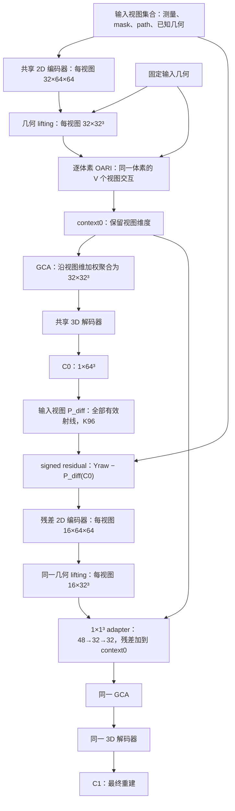

# GeoPhy-Set3D：整体架构、性能瓶颈与可行改进调研

日期：2026-10-14。对象：冻结的 **SelfSup-MRGR v1 / GeoLift-OARI-MRGR-Res3D**。本次只分析源码、已有结果和公开论文；没有改动模型、启动训练或新增科学前向实验。参数统计仅在 CPU 构造空模型完成。

**核心判断：现有网络的有效方向已经得到支持，但“物理残差如何变成三维更新”和“无完整三维标签时如何约束不可辨识分量”仍是值得优先研究的环节。** 多尺度三维推理是另一条相对独立、可控的路线。现有证据不能把全部误差归因于容量、分辨率、几何描述或某个损失权重，更不能据此保证某个新模块一定有效。

研究边界保持：**相同站位、相同观测数量、相同测量值、相同有效掩码、相同可用几何信息。** 下面的改进都针对如何利用这些信息，不把换站、扩大视角跨度、增加观测或重分配训练站位几何分布列为解决方案。

## 1. 当前 Ours 的身份与能力

当前主模型是 332,070 参数的 GeoLift-OARI-MRGR-Res3D，采用 SelfSup v1 训练。最近的 C0 适配器试验是独立探索分支，结论为 NO_GO，没有替换主模型。IDE 中打开的 Ray-Senseiver 报告描述的是另一条基线路线，不能用它的结构或失败现象解释 Ours。

主要已有结果如下。表中数值是三维 relative L1，`0.09` 表示相应定义下约 9% 的相对误差，不是体素 MAE，也不是准确率。

| 评价身份 | Ours | 比较对象 | 可以支持的判断 |
| --- | ---: | ---: | --- |
| 原固定 900 布局，G1–G4 普通组宏平均 | 0.090760 | 自监督 DeepSets 0.140347 | 相同观测与自监督协议下，误差降低 35.33% |
| 同一 900 布局，极端 G5 | 0.298018 | 自监督 DeepSets 0.618805 | 误差降低 51.84%，但绝对误差仍较高 |
| 历史 Val-A 固定 V4 | 0.096193 | 同结构监督 MRGR 0.067980 | 无三维标签训练可行；普通条件仍有明显差距 |
| 历史 clustered V4 | 0.393402 | 同结构监督 MRGR 0.495210 | 监督版本不是所有几何下的性能上界 |

来源：[DeepSets 同条件对照](deepsets_selfsup_v1_zh.md)、[SelfSup v1](selfsup_mrgr_v1.md)。历史 Val-A、历史 clustered 与新 G1–G5 使用不同的固定输入身份，不能混成一张统一排行榜。DeepSets 比较同时改变了交互、聚合和反馈模块，也不能把全部收益单独归给 OARI。

[经典方法比较](classical_v4_comparison_v1_zh.md)在其历史 Original V4 条件下记录 Ours 0.393402，SART 1.334354、Tikhonov 1.200945、TV 1.298637。它证明在该实现、校准集合和有限预算下 Ours 更好；经典方法每类只校准三个候选，且部分运行耗尽预算，不能将其视为经典算法能达到的最优上限。该表也不直接等于新 900 布局比较。

## 2. 整体架构：从测量到 C0，再到 C1

### 2.1 数据与物理量

每个视图是一张 64×64 的角度扫描测量图。测量为 CH4 路径积分浓度，单位 ppm·m；输出是 `[0,0.6]³ m` 域内 64³ 端点对齐网格上的 CH4 **质量分数**，轴序 XYZ，其中 y 是高度。

单视图输入三个通道：

1. `Y / 32284.894580078173`，训练集有效射线 p99.5 固定归一化，无逐图最大值归一化；
2. 有效射线 mask；有效的零测量仍然有效；
3. `path_length / (sqrt(3) × 0.6)`。

站位原点、扫描坐标基、角度、方位角等几何由后续 lifting、OARI、GCA 和投影器使用。网络接收的不是未知三维场上的点传感器读数；一条射线的测量约束沿程浓度积分。

图中的两个 GCA 与两个 decoder 分别共享同一套权重，不是复制两套网络。

### 2.2 逐模块说明

| 模块 | 实际计算 | 作用与局限 |
| --- | --- | --- |
| 共享 2D encoder | Conv3×3，3→32；GN/SiLU；3 个双卷积残差块，全程 64×64 | 学习单站扫描图的局部结构；不直接与其他站交互 |
| GeometryLifting | 从每个 32³ 空间点计算站位扫描角，双线性采样对应二维特征 | 把多站信息放到共同物理坐标，显式利用标定几何 |
| OARI | 每个空间点独立组织 V 个 32 维 token；单层、4 头、FFN64，自注意力带几何 bias | 比较同一空间点处不同视图的特征及方向互补性 |
| GCA pooling | 几何 4→16；特征与几何共同打分；在有效视图上 softmax，32 通道加权求和 | 得到置换不变的统一三维特征，但不再保留显式视图维度 |
| 3D decoder | 32³ 上 3 个 32 通道残差块；三线性上采样到 64³；32→24 卷积；2 个残差块；1×1×1 输出 + sigmoid | 负责空间整合、去伪影、形状和幅度恢复 |
| 测量反馈 | C0 经可微物理投影，与原始输入测量求带符号差 | 提供当前估计违反测量的具体位置与方向 |
| 残差 encoder / adapter | 3→16 二维卷积及 2 个残差块；lifting；与 context0 拼接，1³ 卷积 48→32→32 | 在逐视图三维特征上修正，再重新融合和解码 |

OARI 的几何细节：

- 每视图几何描述为角坐标 2 维、归一化站位距离 1 维、方位角 1 维。
- 视图对关系为局部射线方向绝对余弦、正弦、站位方位角差，共 3 维。
- 在每个体素，构造方向二阶矩 `T = mean_v(u_v u_vᵀ)`；取迹归一化特征值 3 维、λmin/λmax 1 维、局部可见视图占输入视图比例 1 维。
- 特征 32、几何 embedding 16、局部方向 embedding 8，共 56 维，再映射为 32 维 token。关系 3 维和局部描述 5 维一起形成每个头的 attention bias。

**“observability”在这里是局部方向多样性的代理描述。** 它没有完整射线路径耦合、质量分数到摩尔分数的导数、观测噪声协方差或全体素相关，不能等同于 Fisher 信息、真实 Jacobian 条件数或完整三维可恢复性。

迹归一化的三个特征值和特征值比也不是四个独立自由度；当前描述没有显式保留二阶矩的方向主轴。增加描述维数是否有用仍需实验，不能从这一点直接推出网络缺少全部方向信息，因为其他几何输入仍包含方向相关信息。

### 2.3 参数与计算：小参数量不等于低开销

本次按当前源码静态统计：

| 模块 | 参数量 | 占总量 |
| --- | ---: | ---: |
| 共享 2D encoder | 56,832 | 17.11% |
| 3D decoder | 249,793 | 75.22% |
| GCA fusion | 1,953 | 0.59% |
| OARI interaction | 10,980 | 3.31% |
| 残差 encoder | 9,888 | 2.98% |
| 残差 adapter | 2,624 | 0.79% |
| lifting / 几何描述 | 0 | 0% |
| 合计 | 332,070 | 100% |

decoder 占多数参数，不说明它一定是主要精度瓶颈，也不说明 OARI 不重要。32³×V 的中间特征、投影采样和自动微分才是重要的显存来源。

已有同设备、同输入计时记录：Ours 前向中位数 22.646 ms，DeepSets 7.260 ms；allocated 峰值约 1.078/0.103 GiB。Ours 约 3.12 倍耗时，包含内部物理投影，但不含外部评价投影。它是特定 RTX4090/FP32/batch1 的测量，不是整个部署系统的保证。后续多步展开应把额外投影次数和显存作为主要成本约束。

### 2.4 两个需要准确理解的结构事实

**lifting 不等于物理投影器的伴随。** 当前 lifting 是“查找这个体素从某站看过去对应哪个角度，再采样二维特征”。它没有按 P_diff 的离散积分权重把残差沿路径分配到体素。射线上不同深度可以得到相似的测量特征，距离/几何编码和三维推理再帮助解歧。此设计有效且计算直接，但不能称为严格反投影梯度。

**MRGR 是特征残差修正，不是 `C1 = C0 + ΔC` 的体积更新。** 实际上：

`C0 = Decoder(GCA(context0))`

`context1 = context0 + Adapter(context0, Lift(EncResidual(Y − P(C0))))`

`C1 = Decoder(GCA(context1))`

它没有显式步长、沿真实目标下降的约束，也没有再次投影 C1 后继续校正。C0 未 detach，最终目标可以经 `P(C0)` 回传。最后一层 adapter 为零初始化，只保证初始 C1=C0，不保证训练后的更新稳定性或误差单调性。

## 3. 训练目标与信息边界

SelfSup v1 使用 166 个 train、36 个 Val 案例；训练 300 轮、24,900 次更新。每例 A/B 各取 3–5 站、H 取 2 站，三者不交；Val 固定 A4/B4/H4。对 A/B 分别重建，网络共享权重。

测量误差 M 是归一化后有效射线 SmoothL1(beta=0.01)，加 0.1×逐案例测量 relative L1。总目标为：

`L = L_hold + 0.5 L_cross + 0.1 L_observed + 0.05 L_consistency`。

- hold：C_A、C_B 投影到共同 H；
- cross：C_A 预测 B、C_B 预测 A；
- observed：各自输入视图的测量误差；
- consistency：C_A 和 C_B 的归一化逐体素绝对差，两端都可微。

H 只用于训练目标和对应的验证测量指标，不进入网络。训练集中的 B/H 是额外的**训练测量监督**；论文应说明其数量，不能把“推理只需四站”写成“整个训练也仅有四站测量”。同标签等级的基线须获得同样的训练测量。无三维标签不等于无数据监督，也不等于已经在真实仪器数据上验证。

best 仅按自然 Val held-out measurement relative L1 选择，第 278 轮。体积 GT 仅在冻结后的独立评价使用。这个协议确实降低完整三维标签依赖，但测量选择指标没有唯一决定三维误差。

源码入口：[主模型](../../src/geophy_set3d/models/geolift_oari_mrgr_res3d.py)、[OARI](../../src/geophy_set3d/models/ray_relational_interaction.py)、[lifting](../../src/geophy_set3d/models/lifting.py)、[decoder](../../src/geophy_set3d/models/decoder3d.py)、[自监督目标](../../src/geophy_set3d/training/selfsup.py)、[物理投影器](../../src/geophy_set3d/physics/projectors.py)。

## 4. 现有证据实际定位了什么

### 4.1 结构增益并非只来自“参数更多”

历史监督系列在对应相同 Val-A V4 观测与监督协议下：

| 结构 | 三维 L1 | 解释 |
| --- | ---: | --- |
| B0：lifting + mean + decoder | 0.108330 | 基础几何提升已具备重建能力 |
| B1：加入 GCA | 0.103431 | 学习融合有增益 |
| B2：加入普通逐体素视图 self-attention | 0.098907 | 视图交互有进一步增益 |
| OARI：几何关系 bias / 局部方向描述 | 0.093694 | 比普通集合注意力更好 |
| MRGR 等参数零残差训练对照 | 0.094630 | 仅保留新增容量，没有复现完整 MRGR 收益 |
| 完整 MRGR | 0.067980 | 支持真实 signed residual 的额外作用 |

来源：[B1](supervised_b1_gca_v1.md)、[B2](supervised_b2_gcsi_v1.md)、[OARI](supervised_oari_v1.md)、[MRGR](supervised_oari_mrgr_v1.md)、[独立训练零残差对照](mrgr_residual_control_v1.md)。这是单 seed、监督训练条件的证据，不能不加验证地把每项增益数值搬到纯自监督条件。

普通注意力 B2 在历史 clustered V4 上只比 B1 小幅改善（0.653769→0.652042），OARI 为 0.565045，MRGR 为 0.495210。这比“再堆一层通用 attention”更支持有物理针对性的交互与反馈研究。

### 4.2 劣几何误差已在 C0 出现；MRGR 通常仍然有益

在原 900 布局诊断中：

| 组 | C0 L1 | C1 L1 | 内部阶段相对改善 |
| --- | ---: | ---: | ---: |
| G1 | 0.113980 | 0.088386 | 22.45% |
| G4 | 0.127159 | 0.099251 | 21.95% |
| G5 | 0.398727 | 0.298018 | 25.26% |

每组 36 个 case 在平均五布局后都改善；G5 只有 3/180 个单布局 L1 恶化。因此，把不良几何问题归结为“MRGR 普遍过修正，应关闭反馈”与现有数据不符。

但 C0 是联合训练的中间输出，没有独立 C0 目标；其较差不意味着独立训练的 C0 网络必然这么差。C0→C1 是阶段行为，不替代从头训练的模块消融。来源：[C0/C1 诊断](selfsup_v1_c0c1_geometry_diagnostic_zh.md)。

### 4.3 残差更小不保证三维场更准

同一诊断记录了 4/900 个单布局：输入投影 L1 降低，但三维 L1 上升。输入 L1 改善但三维 L2 恶化，在普通 G1–G4 的 case/group 辅助统计中达到 37/144；这些行并非独立样本。经典 Tikhonov 在历史 Original 条件下输入 L1 约 0.009585，三维 L1 却为 1.200945，也说明低输入残差可以对应很差的体积。

这不是否定物理一致性，而是说明：**物理一致性约束可被测量看见的分量；正确的形状先验还要限制低灵敏度方向上的不合理解。** H 能缓解输入过拟合，但有限 H 仍不是完整场唯一性证明。

### 4.4 最近的小改动没有提供有效的新突破

[C0 局部描述适配器](ours_c0_adapter_matched_v1_zh.md)增加 1,152 参数，沿用相同观测、目标和 20 轮继续训练：

- G5 C1 L1：Control 0.293973392，Treatment 0.293949987；相对增量改善仅 0.00796%。
- Treatment−Control 的 95% case 区间跨零；18 胜/18 负。
- 相对原 v1 的约 1.36% 均值降低几乎全部也出现在 Control 中。
- G5 case 均值 p95 从原 0.545705 到 Treatment 0.599069，尾部并未同步改善。

权重和梯度确有更新，没有“模块根本没学”的工程证据。它不支持继续围绕同一 5 维描述添加小 MLP；也不证明多尺度、完整算子反馈或所有几何条件化方案无效。

### 4.5 其他失败路线限制了哪些推断

| 已有试验 | 已观察结果 | 不应推出的结论 |
| --- | --- | --- |
| RVTC 富视角 teacher 体积一致性有限匹配对照 | Val H L1 由 0.296954 到 0.328349，显著不利于该次配置 | 不能据此否定 v1 原有的双子集 0.05 consistency；两者不是同一目标 |
| 同 q 的 A/B 几何采样 | 普通和困难条件未获益 | 不能证明所有目标或结构设计无效 |
| 显式几何增强 | 独立确认 G5 降低 39.09%，普通 macro 恶化 11.13% | 不能称为全面鲁棒性提高；也不符合本次固定分布的研究方向 |
| 64³ 表达审计 | 改善拟合测量后 held-out 仍有偏差 | 不能把有限、GT64 初始化的优化当作理论表达下限 |

来源：[RVTC](selfsup_rvtc_matched_80.md)、[same-q](geometry_stratified_selfsup_matched_v1_zh.md)、[显式增强](geometry_augmentation_formal_v1_zh.md)、[64³ 审计](representation_capacity_64_v1.md)。

## 5. 瓶颈分层：哪些已确认，哪些仍是假设

### 5.1 第一层：固定稀疏观测的不可辨识性——确定存在，无法由网络凭空消除

64³ 有 262,144 个未知量，四站每站 64² 即便全部有效，也只有 16,384 个标量测量；实际有效数量更少。原完整线性 chi 网格分析给出相应布局至少 251,600 维的零空间下界。该线性结论不能原样移植为非线性 P_diff 的全局唯一性定理，但足以提醒：方向矩阵看似满秩，不等于全场可恢复。

G5 的 C1 L1 为 G1 的约 3.37 倍，粗算子有效秩和几何方向描述与误差相关，说明不良几何下弱约束更严重。不过这没有分离架构、优化和先验的贡献，不能宣称“全部瓶颈都是几何”。

固定观测下仍可提升，因为现有网络未必已充分利用可见信息，也未必已学到最合适的先验；提升应来自这些部分。对于确实不可辨识的分量，应报告风险和不确定性，而不是承诺无条件精确恢复。

### 5.2 第二层：测量残差到体积修正的物理对应——有明确结构差异，收益待验证

当前 MRGR 让卷积和 adapter 学习“这张残差图应如何修改三维场”。由于 lifting 并非 P_diff 的伴随，它没有显式提供每个体素对每条射线的灵敏度；残差分配依赖特征学习。只修正一次，也没有状态化的后续闭环。

物理投影器实际为：

`P_r(C) = 10^6 × length_r / K × sum_k χ(s_rk)`，`s_rk = sum_i w_rki C_i`，

其中 `χ(c) = (c/M_CH4) / ((c/M_CH4) + (1−c)/M_air)`，`w_rki` 为三线性采样权重。也就是说先插值质量分数，再做质量分数→摩尔分数转换。

在 clamp 的可微内部，其 Jacobian 元素为：

`J_ri(C) = 10^6 × length_r / K × sum_k χ'(s_rk) w_rki`。

残差经 `J(C)ᵀ` 才得到与该离散物理模型一致的局部回传。简单将场改成 chi 再插值一般不与当前投影器完全等价。因此“使用 Aᵀ”必须明确 A 对应哪个变量、哪种插值和积分。

这使“保留 OARI 初始化，增加算子一致的体积修正”具有针对性，但经典结果同时提醒：正确梯度只能改善数据项，仍需要先验控制弱约束分量。

### 5.3 第三层：空间推理与融合压缩——结构上值得怀疑，尚无直接归因实验

OARI 的 token 交互发生在**同一体素的不同视图之间**；它不是体素间 self-attention。跨空间的内容整合主要依赖二维局部卷积、三维 decoder，以及 MRGR 中的全局投影耦合。

2D encoder 的七层 3×3 卷积名义卷积感受野为 15×15。3D decoder 在 32³ 上只有六个 3³ 卷积，再上采样；64³ 上有五个 3³ 卷积。没有显式更粗尺度的空间分支或 U-Net 跳连。

这里不能说网络“绝对没有全局依赖”：GroupNorm 使用跨空间统计，物理投影也沿射线耦合多个体素。更准确的不足假设是：**缺少显式多尺度、内容相关的长距离空间推理路径**，而全局均值/方差依赖并不等价于这种推理。

GCA 又把每个体素的 V×32 特征压为 32 维，且同一视图权重用于全部通道。上下文 token 已含交互信息，因此该操作不一定造成关键丢失；“单一池化不能保留足够的方向分歧和多假设”仍需容量匹配对照证明。

### 5.4 第四层：自监督先验与评价目标不完全对齐——有行为证据，机制尚未分离

完整体积一致性鼓励 A/B 给出相同的场，但相同的场也可能是共同偏差。自然 Val 的测量均值 selector 又可能看不见极端 G5 或体积峰值风险。最近适配器的均值/尾部不同向，就是需要关注这一点的例子。

同时，v1 已经表现良好，RVTC 失败也不证明原 consistency 有害。当前没有充分依据直接删除原一致性项、改大某个权重或强加 PDE。

训练没有 TV、稀疏性、PDE、时间演化或完整体积先验损失。这里的机会是找到在固定测量下有效、且不引入额外标签的约束；不是无依据地把“物理”一词加入任意正则项。若没有实测流速、扩散系数和边界条件，静态浓度不宜强行套用输运 PDE。

### 5.5 第五层：离散表示、幅度和细节——真实存在的候选限制，优先级较低

已有审计的全 train pooled 测量 L1：128³/K96 对原 K256 参考偏差约 0.0958%，naive GT64 为 1.3993%。另一个 12-case 审计中，GT64 初始化优化后的 held-out 测量 L1 均值约 1.5774%，并非理论下限。

这些是**测量误差**，不能与三维 L1 9% 或 30% 直接相减，也不能据此断言表达误差只占某个比例。它们说明存在离散失配，需要在后期细节优化时处理；还不足以把“全部升到 128³”列为第一优先。

sigmoid 保证质量分数范围，但小浓度区间梯度尺度值得检查。当前 Ours 的输出并未出现近 1 饱和塌缩；Ray-Senseiver 的弱测量依赖也不能移植为 Ours 的诊断。改变为 softplus 或对数变量只能作为独立幅度参数化消融，不能先认定激活函数是根因。

## 6. 文献调研：哪些机制与本任务真正相关

本次实际在线获取了下列 10 篇原论文的 arXiv 元数据/摘要，并进一步读取 Learned Primal-Dual、NAF、Equivariant Imaging 的 HTML 正文。其他论文的解释限定在获取到的摘要和明确可核验的机制层面；没有将摘要阅读冒称为全文复现。检索是围绕当前瓶颈的定向调研，不是截至 2026 年全部最新方法的穷尽综述。来源、访问时间和检索失败记录见[调研归档](artifacts/geophy_architecture_research_v1/)。

| 工作 | 核心机制 | 与当前模型的关系 | 迁移条件与限制 |
| --- | --- | --- | --- |
| **Learned Primal-Dual**，Adler & Öktem，[原文](https://arxiv.org/abs/1707.06474)，2018 | 在图像域/测量域保留状态，用前向算子及导数伴随连接可学习更新 | 比当前单次特征反馈更明确地组织物理更新和迭代记忆 | 原文使用重建真值训练；不能据其结果承诺本任务 GT-free 同等有效 |
| **MoDL**，Aggarwal 等，[原文](https://arxiv.org/abs/1712.02862)，初稿 2017 | 共享迭代 CNN 先验与显式 data-consistency 求解，文中采用 CG | 支持共享更新器、控制参数增幅的展开设计 | 经典线性数据一致性 CG 不能不加修改用于当前非线性 P(C)；“共享参数”也不自动保证收敛 |
| **SSDU**，Yaman 等，[原文](https://arxiv.org/abs/1912.07669)，初稿 2019 | 可用测量拆为网络数据一致性使用集与外层 loss 集 | 当前 A/B/H 已有拆分思想；新机会在算子一致的网络内部，而非重新发明 held-out loss | MRI k-space 与 TDLAS 路径积分不同；不能把 MRI 的监督接近性结论直接迁移 |
| **Noise2Inverse**，Hendriksen 等，[原文](https://arxiv.org/abs/2001.11801)，2020 | 利用测量噪声独立、零均值等条件构造可训练的重建配对 | 可为未来真实噪声数据设计启发 | 本任务主要矛盾是少视角欠定，当前合成数据无离线噪声；其理论不等于任意 A/B 体积一致性定理 |
| **Equivariant Imaging**，Chen 等，[原文](https://arxiv.org/abs/2103.14756)，2021 | 借助信号分布的群对称性补充单一算子看不到的信息 | 直接针对 measurement-only 学不到零空间先验的问题 | 气体羽流受重力、边界、入口约束，不可假设任意旋转/翻转仍属同一分布；原文线性分析也有适用范围 |
| **NAF**，Zha 等，[原文](https://arxiv.org/abs/2209.14540)，2022 | 对单个物体优化连续神经衰减场，以投影误差监督，采用 hash encoding | 是无完整体积标签、稀疏视图体积分布重建的直接相关路线 | 原文为 CBCT 衰减场、几十个投影；不是四站 TDLAS，也不是一次前向的跨案例摊销网络；正文报告单例分钟级优化 |
| **Instant-NGP**，Müller 等，[原文](https://arxiv.org/abs/2201.05989)，2022 | 多分辨率可训练 hash 特征与小 MLP | 可用于粗网格加连续残差的细节表达 | 编码提高容量/速度，不提供缺失测量信息；论文加速依赖实现，不能直接许诺本项目同量级加速 |
| **Set Transformer**，Lee 等，[原文](https://arxiv.org/abs/1810.00825)，ICML 2019 | 视图元素交互与 attention pooling，可用多个汇聚 seed | 为多槽融合提供参考；当前 OARI 已经包含集合注意力 | V 仅 3–6，减少大集合二次复杂度不是主要需求；直接“换成 Transformer”缺少针对性 |
| **MVSNet**，Yao 等，[原文](https://arxiv.org/abs/1804.02505)，2018 | 几何 warping、跨视图统计 cost volume、3D 正则化 | 支持保留均值之外的分歧统计这一设计思路 | 表面多视几何的光度一致性不适用于沿程积分，不能照搬“同体素各视图值应相等”的损失 |
| **Deep Image Prior**，Ulyanov 等，[原文](https://arxiv.org/abs/1711.10925)，2018 | 未经数据集预训练的生成器结构作为单例优化先验 | 可研究无标签的测试时小规模校正 | 需要逐例优化和停止策略，可能过拟合不良几何；不是免费获得更强的羽流先验 |

文献共识与本项目证据相符：把已知算子嵌入网络是合理方向，但物理一致性、可学习先验和验证协议需要一起设计。文献中“无需完整标签”的结果依赖具体噪声、算子、信号分布及采样条件，不能当作本任务的普适保证。

## 7. 可行改进方案：按价值、风险与现有证据排序

以下均为**候选研究设计**，本次没有实现或训练。优先级表示值得先检验，不表示已证实有收益。

### 方案 A：算子一致的残差回传，随后再考虑少步展开——最高研究优先级

**具体变化。** 保留 OARI/GCA 的初始化能力，在残差分支加入与真实离散 P_diff 匹配的体积梯度，供学习更新器使用。对归一化物理算子 `Q=P/Y_scale`，令 `r_t=Q(C_t)−Y/Y_scale`，可先使用平方数据项代理：

`g_t = J_Q(C_t)ᵀ W r_t`；

`C_(t+1) = Prox_θ(C_t − α_t D_t^(-1) g_t, context, sensitivity)`。

若要对应原 SmoothL1/relative L1，应使用其实际输出端导数代替 `W r_t`；上式只是明确的候选数据项，不冒充原损失精确梯度。`Prox_θ` 表示学习的先验更新器，未经额外约束不能宣称它是真正凸近端或具备收敛保证。

`D_t` 可以是受限的灵敏度预条件，例如 `diag(J_Qᵀ W J_Q)+ε` 的可计算近似；只用 `Jᵀ1` 时应称覆盖/灵敏度代理，不能冒称相同的对角 Hessian。对极小灵敏度方向必须给归一化设置下限和上限，防止噪声/离散误差被无限放大。

**推荐拆成两个问题。** 先只比较“同样一步、同样更新器，feature lifting 与真实伴随梯度有何差别”；若有用，再比较 1/2/3 步共享更新。不要一次同时引入真实伴随、多步、U-Net 和新损失，否则无法知道增益来自哪里。

**为什么优先。** 已有等参数对照支持真实残差有用，当前反馈又确实缺少显式灵敏度分配和多步闭环。它是在现有有效机制上深化物理对应，区别于已失败的小描述 adapter。

**代价与风险。** 需要额外前向/伴随和可学习先验；输入残差降低不保证体积变准。若直接通过 `autograd.grad(create_graph=True)` 构建展开层，训练可能需要 grid_sample 的高阶导数；本次没有验证环境的双反向支持，实施前须确认，必要时实现有一致 forward/backward 的离散积分/伴随算子。直接 detach 梯度是另一种算法，必须明确，不能仍宣称完全端到端展开。

**信息边界。** 推理时梯度只能使用当前输入集合的测量与几何；不能把 B/H 放入内部修正，哪怕它们曾经是训练 loss 的目标。外层自监督目标仍可使用原来允许的训练 B/H，不增加站位或三维标签。

### 方案 B：多尺度三维空间推理，优先改善 C0——较稳妥的架构路线

**具体变化。** 将现有纯 32³→64³ decoder 改为轻量多尺度网络：32³ 特征下采样至 16³/8³，进行空间整合，再通过跳连恢复 32³/64³；保留局部高分辨率信息。也可在较粗尺度加入少量空间 attention，先以卷积 U-Net 式结构作为清晰对照。

**为什么可行。** 不新增输入，仍用原 measurement-only 目标；能直接检验缺少显式粗尺度空间推理的假设。C0 已显现 G5 大误差，因此比仅在 C0 后拼接同一几何描述更有结构针对性。

**关键对照。** 需要与参数量/计算量接近的“原 decoder 加宽”比较，避免把容量增加当成多尺度机制。C0 和 C1 都要记录，因为共享 decoder 改动会同时影响两阶段。为保持清晰，首轮不同时加新的 C0 辅助损失。

**风险。** 多尺度先验可能把真实细羽流平滑掉；普通 L1 更好也可能伴随峰值/L2 更差。应关注细结构、峰值位置和困难案例尾部，而非仅观察均值。它的收益目前是待检验假设。

### 方案 C：保留方向分歧的融合，而非单一加权平均——中等优先级

**具体变化。** OARI 之后保留加权均值之外的特征方差、有效权重样本量 `1/sum(w²)`、覆盖度，或者使用 2–4 个共享可学习汇聚槽，再映射为 decoder 输入。槽的定义须与输入顺序无关，不能依靠 station ID 排序；不同槽不保证自动获得不同几何含义。

**为什么可行。** GCA 当前每视图一个标量权重，加权平均可能混合互相矛盾的特征；多槽/分歧统计让 decoder 看到“信息是否一致”，而非只看平均结果。它不重复 OARI 已有的 token attention。

**必须避免的误用。** 各视图观测的是不同线积分，不能用原始测量在同体素的方差作为应归零的光度损失。特征方差应被学习模块解释；几何不同本身就能带来合理差异。需要与同宽通道扩展作容量匹配。

**风险。** V 小、已有 OARI 上下文化，单一 32 维统计可能已经足够；新增槽可能坍缩为重复结果。此路线缺少现有直接因果证据，优先级低于 A/B。

### 方案 D：重新检查自监督约束作用在哪些分量——必要但应先诊断

**具体变化。** 分别考察原有体积一致性、测量项和阶段目标的作用；候选包括用可靠尺度/分量的一致性替代强制全分辨率逐体素相同，或加入弱的边缘保持平滑先验。所有组沿用相同的原始 A/B/H 采样轨迹，不改变几何分布。

**合理动机。** 相近投影可以容许多种场，两个不交视图子集的正确不确定性也可能不同。全体积一致性可能把不可辨识分量过早压到共同解；这是机制假设，不是 v1 已有故障。

**先做什么。** 在未来授权的独立研究中，先比较原 0.05 consistency 的有/无严格匹配对照，再讨论更复杂的一致性；不要用 RVTC 的负结果代替这个实验。C0 辅助测量损失也可以独立研究，但会改变两阶段分工，不能与 A/B 同时添加。

**边界。** 粗尺度不一定更可观测；低频/高频也不能直接等同于可见/零空间。若按 Jacobian 区分分量，需要 JVP/VJP 或适当低维近似，并明确其范围。直接增大 TV 或稀疏惩罚可能损害扩散羽流和峰值，不能把“场稀疏”当作无须验证的定律。

### 方案 E：粗体积 + 连续细节残差——适合作为后续精度路线

**具体变化。** 以现有低分辨率三维特征提供主要形状，构造条件化的连续场 `C(x)=Bounded(C_coarse(x)+δ_θ(x,feature(x)))`；按真实射线在连续位置评估，或在统一评估网格上输出。可参考 NAF / hash encoding，但保留跨案例的测量条件化，区别于每例独立重训。

**价值。** 尝试缓解网格插值和平滑带来的峰值/细节限制，避免全面构建 128³×V 特征。

**风险。** 更自由的连续场也更容易拟合稀疏射线而产生未观测方向的结构；可能改善测量却损害三维场。必须报告与原 GT64 端点网格的一致评价，同时区分新积分误差。NAF 的单例优化结果不证明四站情况下可精确恢复，更不等于 Ours 的毫秒级推理性能。

### 方案 F：少标签半监督分支——直接服务论文标签依赖，但需分开排名

**具体变化。** 在固定训练测量和站位下，比较 0%、少量、更多完整三维标签的误差曲线。少标签模型共享测量目标，仅在登记的标签子集加入体积目标；基线获得相同标签子集和选模权限。

**价值。** 目前只能支持“0 个训练三维标签也能取得现有结果”，还不能量化相较其他方法“需要少多少标签”。固定标签预算下的曲线直接对应论文第三个问题，也能检验少量标签是否主要帮助峰值或不良几何先验。

**边界。** 这不是零标签方法的免费改进。监督初始化、GT 均值初始化、基于 Val GT 选 checkpoint 都属于需要披露的信息使用；不可纳入纯自监督同条件主榜。标签预算应包含选模所需的完整标签，且按案例/物理家族抽取以降低泄漏风险。

### 方案 G：不确定性与输入内测试时校正——辅助路线

多个同输入重建假设/模型可以描述弱约束方向的分歧；少步输入内优化可以修正明显测量不一致。它们均不要求新增站位。但一致的 ensemble 也可能共同出错，不能把分歧直接称为校准的不确定性。

测试时校正只能使用输入测量；步数和停止规则须事先确定，不能每例看 H 或 GT 选最优体积。自由拟合残差可能沿零空间漂移；须比较更新前后全套三维指标和推理时延。如果保留高斯测量 NLL，噪声权重应有仪器或独立估计依据，避免模型任意放大预测方差来降低 loss。

### 不建议当前优先投入的方向

- 单纯增加普通 attention 层数：现有 OARI 已具备此机制，历史 B1→B2 在困难几何上的收益有限。
- 再做同一局部方向描述的小 adapter：刚完成的匹配对照没有实质收益。
- 简单按几何差关闭 MRGR：与多数困难案例仍受益的证据不符。
- 无条件上 128³、任意改激活或加大 TV：缺少主要瓶颈证据，且有明显成本/偏差风险。
- 默认富视角 teacher 一定提供更好伪标签：已有匹配 RVTC 结果不支持这种推断。
- 任意旋转/翻转的 Equivariant Imaging：必须先确认羽流分布、重力和边界允许该对称性。若仅同时旋转场与几何作坐标变换，不会凭空增加信息；若生成旋转场的新合成投影，则引入了额外先验假设，不能伪称真实新增观测。
- 任何站位替换、几何分布增强或更多视图：不属于本次用户确定的优化方向。

## 8. 最值得先检验的研究顺序

建议把 A/B 作为两条独立主线：**A 检验物理更新是否不足，B 检验空间先验与尺度整合是否不足。** 若只能选一条，A 与现有 MRGR 有效证据联系更紧；若希望先控制工程风险，B 的实现和训练路径通常更直接。二者的优势都需要对照验证，不能先合并成一个大模型。

| 顺序 | 最小研究问题 | 必要对照 | 成功应体现在哪里 |
| --- | --- | --- | --- |
| 1A | 一步真实算子梯度，是否优于当前 feature residual lifting？ | 原 MRGR、算子分支、相近容量的 learned-only 分支；统一启动/预算 | 普通与 G5 的三维误差，而不只是输入残差 |
| 1B | 多尺度 decoder，是否优于相近容量的单尺度 decoder？ | 原结构、单尺度加宽、多尺度 | C0/C1、峰值、G5 尾部同时报告 |
| 2 | 在 1A 有效后，多步是否优于一步？ | 相同共享更新器、1/2/3 步和明确算力成本 | 额外物理计算换来可复现收益 |
| 3 | 融合分歧/多槽是否有额外价值？ | 均值、均值+统计/多槽、容量对照 | 相同观测下的困难几何增益及普通非劣 |
| 贯穿 | 哪些三维约束真正减少标签需求？ | 原 consistency 消融；独立标签预算曲线 | 0 标签与少标签身份清楚、误差/预算曲线可靠 |

上述是研究问题清单，并非已授权的自动实验队列。本次按用户要求保持优化暂停。

## 9. 如何判断改进真的服务于论文目标

1. **固定信息。** 各组复用相同训练案例、原采样轨迹、测量、几何、mask 和 H；测试时只使用登记的输入视图。内生计算的梯度、覆盖或统计允许使用，但不能混入新的物理测量或标签。
2. **匹配起点和预算。** 继续训练必须有同期继续训练 Control；从头训练是另一个问题，不能与有限微调混为一谈。结构差异同时报告参数、时延、显存、算子调用次数。
3. **分开主终点。** 普通精度、困难几何绝对误差、退化幅度、case 均值尾部都保留；L2、峰值和积分 proxy 不因方向不利被删掉。积分 proxy 不称真实总质量。
4. **统计单位正确。** 同 case 多布局先汇总，再做配对；不能把 900 条布局、射线或体素当独立样本。跨训练 seed 的变异与 case bootstrap 是两类不确定性，前者不能由后者替代。
5. **先冻结再看 GT。** 纯自监督模型选择继续只用登记的测量指标；科学三维评价在 checkpoint/预测冻结后进行。若改变 selector，应事前定义，而且不能每个模型使用不同选择权限。
6. **保护最终评价。** 当前 36 Val 已多次用于分析和方案取舍，即使没有 GT 反传也属于研究开发信息。后续最终论证需要提前封存的独立 test/新物理家族；本次没有读取它们。
7. **补齐强基线。** DeepSets 是有价值的结构对照，但还不足以代表其他深度方法。Ray-Senseiver 历史自监督失败不等于该方法本身无能力；本次读取报告时，另一路监督正式实验尚在进行，不能提前写成完成的排行榜。物理展开与 NAF 式单例优化也可作为相关方法参考，但要明示标签与推理预算差异。

现阶段可以稳妥地说：**Ours 已在无训练三维标签、相同观测条件下，相比现有 DeepSets 和指定预算经典实现展现出优势；不良几何、高阶体积误差、细节/峰值与标签效率仍有明确研究空间。优先值得检验的是更准确的物理更新和更充分的空间推理，而不是继续优化观测几何。**

## 10. 核验与资料范围

- 代码核对覆盖 encoder、lifting、OARI/GCA、decoder、MRGR、dataset 归一化、自监督 objective 和 P_diff。
- CPU 静态构造统计共 332,070 参数；没有加载 checkpoint、数据体积或运行前向/反向。
- 数值结论来自链接的现有报告；没有新计算模型精度、重做 GT 评价或把历史结果冒称本轮复现。
- 文献档案保存实际访问到的原文元数据、摘要页面 hash、正文访问记录及失败原因；PDF 获取失败不影响已获取的 HTML/摘要，也不隐去失败。
- 并行进行中的 Ray-Senseiver 产物不属于本次修改范围，其状态随该独立任务变化。
