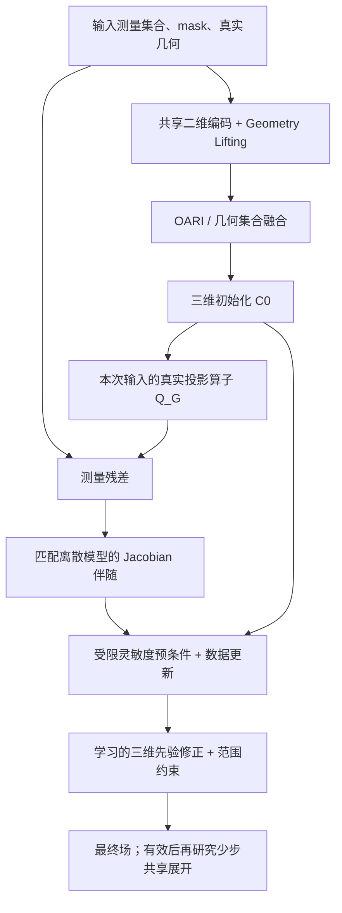

**GeoPhy-Set3D：目标适配性、非 NeRF 方法比较与研究建议**

调研日期：2026-10-15（北京时间）。分析对象为当前冻结的 SelfSup-MRGR v1 / GeoLift-OARI-MRGR-Res3D，而非 Ray-Senseiver 基线。依据现有源码、历史结果及本次在线获取的原论文；本次不启动训练、不读取 checkpoint 或新的 GT、不改模型和实验配置。文献检索为定向检索，不是全部文献的系统综述。

**主要判断**

当前架构的类别选择合适，值得保留。集合输入解决视角顺序和数量的结构限制，显式几何建立测量与统一三维坐标的联系，三维解码器提供空间先验，测量域自监督避免训练时依赖完整三维标签。现有同条件比较也支持它优于已实现的 DeepSets 对照。

但当前结果支持的是“在已研究的几何和羽流分布内有效”，尚未完成“自由站位、严重不良几何、噪声及标定误差、新物理工况下均可靠”的完整论证。最值得优先检验的升级是：**保留集合几何初始化，引入与实际离散投影器一致的 Jacobian 伴随更新；独立检验多尺度三维先验；随后才考虑少步共享展开。** 这是针对当前结构缺口的研究假设，不是已经证实优于现有模型的新结果。

本次不推荐 NeRF、NAF 或 hash-MLP 连续神经场作为替代主线。高斯基函数表示本身不等于 NeRF，另行讨论；但也不建议立即改为高斯重建。

**一、逐项目标：适合到什么程度**

| 目标 | 当前机制与证据 | 判断及剩余缺口 |
| --- | --- | --- |
| 视角顺序自由 | 共享单视图编码、逐体素集合交互、masked pooling，无固定视角序号 | 结构上适合；须保证测量、几何、mask 同步置换，数值上允许浮点微差 |
| 视角数量变化 | masked 集合结构；当前自监督训练 A/B 各 3–5 站，已有冻结 V3/V4/V6 评价 | 已有部分实验支持。V6 是数量外推的有限证据；尚不能外推到任意数量、V1/V2 或所有 V7/V8 条件 |
| 自由站位/非均匀视角 | 真实原点、扫描基、角度和射线几何参与 lifting、融合及投影 | 机制合适，验证范围有限。未见过的组合、未见过的站位、未见过的采集族是不同层级 |
| 视角鲁棒性 | OARI 几何关系、局部方向多样性描述、MRGR 测量反馈 | 比已实现对照更好，但极端 G5 明显退化，不能称已解决 |
| 物理约束 | 已知射线积分、质量分数到摩尔分数转换、可微投影、范围约束 | 测量物理已纳入。当前特征 lifting 不等于物理伴随，未建立完整输运动力学约束 |
| 无监督 | 训练和选模不用完整体积 GT；使用 A/B/H 测量目标 | 更准确名称是“三维标签自由的测量域自监督”。训练需要比单次推理更多的站位测量 |
| 泛化 | 共享网络、显式几何、已有跨 case 和几何压力评价 | 有限范围内支持；独立站位池、全新工况、真实仪器域和标定误差的泛化尚缺充分证据 |
| 直接三维重建 | 统一 64³ 输出、三维卷积、三维评价 | 明确符合，优于把独立二维切片堆叠当作主要建模方式的定位 |

源码还给出两项具体边界。当前几何关系中方位角差采用绝对差除以 180，注释明确针对 [0,180] 度、无跨界接缝的采集族；若以后扩展到跨 0/360 度站位，须处理周期性。当前 lifting 根据扫描角端点映射二维采样位置，依赖相应的规则角度网格假设；变成任意非均匀扫描点时不能仅更换几何数组便认为接口已经完整支持。二者不表示当前限定采集族内存在错误，但会限制“任意几何”的表述。

此外，站位高度历史范围约为 0.25–0.35 m，重建域为 [0,0.6]³ m。几何条件化提供了扩展的基础，不自动证明对更宽高度、不同半径、不同扫描范围、遮挡模式或空间分辨率都有效。

当前测量由 Fluent 三维场生成，模型训练不读体积标签与“真实仪器上无需标签即可工作”仍是不同结论。生成合成观测时使用模拟场应披露；它不等于训练加入体积 loss，但也不能替代真实采集验证。

**二、已有结果说明当前路线有效，但仍有明确不足**

下表均来自同一固定 900 布局评价：36 个 Val case × 5 档几何 × 每档 5 个布局。指标为三维 relative L1，越低越好。它们是已有记录，本次未复跑。

| 方法及标签身份 | G1 | G5 | 如何解读 |
| --- | ---: | ---: | --- |
| 当前自监督 Ours | 0.088386 | 0.298018 | 当前主线 |
| 自监督 GeoLift-DeepSets | 0.135463 | 0.618805 | 同训练标签等级的结构比较；Ours 在 G5 低约 51.84% |
| 监督同结构 MRGR | 0.055386 | 0.374038 | 普通几何精度更好，极端几何并非上界；训练目标和选模权限不同 |
| 监督 Ray-Senseiver 适配 | 0.647051 | 0.739676 | 当前适配、目标及预算下竞争力不足；不是原 Senseiver 能力上限 |

来源：[DeepSets 对照](deepsets_selfsup_v1_zh.md)、[Senseiver 正式冻结报告](ray_senseiver_supervised_v1_zh.md)。旧架构调研报告撰写时 Senseiver 还在独立演进，本报告采用已完成的正式结果。

Ours 的 G5/G1 误差比约为 3.37，说明“相对对照鲁棒”与“自身几何变化不敏感”仍有距离。[C0/C1 诊断](selfsup_v1_c0c1_geometry_diagnostic_zh.md)中，G5 从 C0=0.398727 降到 C1=0.298018，反馈阶段平均仍有帮助。因此，不宜把主要问题直接解释为“劣几何下反馈有害，应关掉 MRGR”。

[几何增强](geometry_augmentation_formal_v1_zh.md)在其独立确认布局上让 G5 改善 39.09%，同时普通组 macro 恶化 11.13%。这与上述固定 900 布局不是同一个评价身份，不能合并排名；它说明应同时报告普通精度和极端几何风险，不能用困难组改善替代整体成功。

最近的 [C0 小适配器](ours_c0_adapter_matched_v1_zh.md)相对同期 Control 没有实质增益，也支持降低“再拼接一组相同局部几何描述”的优先级。当前并无证据支持立即放弃集合几何框架、转向通用 Transformer。

**三、首先要分清：架构兼容性、可观测性和泛化不是一回事**

四站各 64×64 条射线，即使全部有效，也至多有 16,384 个标量观测；64³ 场有 262,144 个变量。以当前场为中心作局部线性化，Jacobian 的秩不可能超过观测数。按这个最宽松计数，局部线性化至少有 245,760 维无法由独立数据方向直接约束；实际有效射线更少、相关性更强。

这不否定重建：若真实羽流分布集中在适当低维集合上，先验可使分布内恢复成为可能。但它意味着，任何方法都需要先验，不能仅凭“几何已输入”或“投影残差很小”承诺任意场的准确恢复。完整 Jacobian 的弱约束方向还与射线路径、网格、噪声及物理变量转换有关。

当前 OARI 的 3×3 方向二阶矩及其特征值描述局部射线方向多样性，不能等同于全体素 Fisher 信息或完整层析可观测性。即使方向张量满秩，沿程积分也可能允许大量三维歧义。这个区别是物理改进的动机，而非否定 OARI 已有的经验价值。

“泛化”建议至少拆为五项分别评价：

1. 同站位池中的新组合、新顺序和新视角数量。
2. 未出现在训练中的独立站位，以及范围外几何。
3. 浓度、源项、流动、入口及边界等新物理工况。
4. 随机噪声、同站增益/零偏、空间相关误差和位姿标定误差。
5. 合成测量到真实 TDLAS 系统的迁移。

一个 checkpoint 在已标定新几何下可用，不代表对错误标定也鲁棒；显式算子对几何输入错误同样敏感。

**四、非 NeRF 候选方法比较**

| 路线 | 与目标的适配性 | 当前不应直接替换的原因 | 建议 |
| --- | --- | --- | --- |
| 几何集合初始化 + 算子一致的学习展开 | 可接收变数量/变几何；显式使用本例投影与伴随；可接原测量域自监督 | 学习展开本身不保证无标签可学、收敛或 OOD；投影/伴随增加成本 | 最高优先，先一步再多步 |
| 几何 lifting + 轻量多尺度 3D U-Net/残差先验 | 保留当前输入优势，强化跨尺度空间整合；不增加标签 | 可能损失峰值/细结构，增益可能只是容量变化 | 与物理更新分开验证，优先级高 |
| Sparse2Inverse / SPLIT 式测量拆分学习 | 直接对应无完整体积标签的层析学习；SPLIT 涉及非线性模型 | 是训练原理/框架，不是直接可用的四站气体重建器；不解决所有零空间歧义 | 强相关方法与基线来源 |
| EI / Equivariant Splitting / ELIPPS | 在适用对称性和覆盖条件下约束未观测信息 | 重力、固定入口和边界破坏任意旋转/翻转不变性；当前集合置换不变性不能替代空间等变性 | 条件满足后再研究 |
| NIO / 几何感知神经算子（如 GAIA） | 有跨采样、跨域映射和快速摊销重建潜力 | 原实验多为成对场监督；域形状泛化不等于 TDLAS 采集几何泛化；普通 FNO 不天然接收不规则射线集合 | 候选先验/空间模块，不直接列为首选替代 |
| PnP / RED + 显式物理求解 | 数据项可随本例几何改变，方便分离先验与物理 | 高质量三维去噪器通常仍需干净场或额外先验训练；迭代成本；非凸非线性下无自动保证 | 有可信无标签先验来源时有价值 |
| 扩散先验 + 数据一致性/后验采样 | 可表达多解与空间不确定性，算子可嵌入采样 | 许多工作虽无配对投影标签，却使用干净图像预训练；3D 少样本训练和推理成本高；医学先验难迁移羽流 | 不作为当前主线 |
| Ambient Diffusion / A-DPS | 确有仅从损坏/不完整数据学习先验的路径 | 受损坏分布与可辨识条件约束；MRI/Fourier 结果不等于非线性 TDLAS 适用 | 长期探索，非直接替换 |
| 显式高斯基函数 / R²-Gaussian / 高斯射线积分 | 非 NeRF；连续、各向异性、可逐例无标签优化 | 原文主要 25/50/75 视图；每例优化与统一网络泛化不同；初始化及观测物理需重做 | 可作独立表示基线，优先级较低 |
| DIP / TV / Tikhonov 等单例求解 | 无训练体积标签，可随几何变化 | 没有同等跨案例学习先验，测试时预算较大，极稀疏时仍欠定 | 必要参考，匹配优化预算 |

**五、本次新文献对方案选择的具体影响**

**1. 学习展开比继续叠注意力更贴合物理缺口。** Learned Primal-Dual [1] 从设计上处理可能非线性的前向算子及其导数伴随；MoDL [2] 说明共享学习先验与显式数据一致性求解可结合。二者原工作采用参考重建训练，不能把原论文精度直接移植为本项目的自监督结论。SSDU [3] 提供了将物理引导网络与测量拆分训练结合的先例，标签条件更接近，但 MRI 与 TDLAS 的算子和噪声不同。

**2. 测量域监督有充分相关工作，单独使用它已不足以成为核心创新。** Sparse2Inverse [4] 明确用投影域目标处理稀疏视图；SPLIT [5] 将拆分学习扩展到非线性层析。特别要注意 SPLIT 正文 Theorem 1：在独立零均值噪声等条件下，其等价关系涉及无噪声的**测量域风险**。这不是任意欠定逆问题的逐体素风险等价，更不能用来证明当前 SmoothL1、relative-L1 和全体积一致性的组合已经具备同样保证。

2026 年的拆分设计比较 [6] 进一步表明，独立噪声和相关噪声下较优拆分方式可能不同，整角度 masking 对相关噪声更稳健。对 TDLAS，站内共用的增益、零偏、漂移可能使不同射线的误差相关，不能默认随机拆像素就得到独立监督。当前按站拆 A/B/H 的方向有理由保留，但跨站也可能有共模误差，仍需仪器依据。

**3. 多算子学习为“随机几何可帮助无标签先验学习”提供了理论方向，但不是自动证明。** 多算子研究 [7] 区分“已知信号模型时某次测量能否唯一恢复”和“能否从多个不完整测量过程识别信号模型”。其结果依赖算子家族、测量数量和信号集合维度等条件，主要线性分析不能直接成为本项目非线性投影器的定理。当前跨 case、跨几何训练有合理性，但 166 个案例和同一站位池不等于这些条件已被验证。

**4. 2025—2026 年的等变自监督值得引用，不能直接套用。** Equivariant Splitting [8] 的 Assumption 1 明确要求真实信号分布对所选变换保持不变。ELIPPS [9] 还要求相应等变性与覆盖条件。甲烷羽流存在特权的重力方向和固定边界，上下翻转、任意三维旋转通常不成立；即使水平旋转，也须检查入口、壁面、横风及域形状。把场、几何、重力和边界同时改写为另一坐标系，是表示一致性，不会增加实际观测信息。

**5. “无配对训练”必须与“无完整三维训练数据”区分。** 最新几何感知扩散工作 [10] 用算子与噪声协方差构造空间度量，使测量修正和随机探索依几何方向调整；这个机制比简单方向特征更接近真实灵敏度。但其方法使用图像扩散先验，本次不能把它列入已经满足本项目零体积标签条件的比较。Ambient Diffusion [11] 和 A-DPS [12] 确实提供从不完整数据训练先验的路径，因此不能一概说“扩散必需干净标签”；问题是其条件、数据量和计算成本在本任务尚未验证。

**6. 神经算子是结构候选，不是泛化保证。** NIO [13] 学习从算子信息到场的映射；2026 年 GAIA [14] 用几何 token 调整积分变换，支持不同输入输出域。GAIA 的主要几何议题包括物理域/边界形状，不能与本项目固定立方域、变化采集射线完全等同。原文的场监督实验也不能直接解决无三维标签训练。较合理的迁移方式是借鉴其几何条件化或粗尺度非局部推理，保留当前物理和集合接口。

**7. 高斯重建可以非 NeRF，但目前不是更有把握的主线。** R²-Gaussian [15] 为体积层析修正普通 splatting 的积分偏差；其主实验为 25/50/75 视图，并从 FDK 体积初始化。当前任务只有约 3–5 个自由站位，不能默认标准圆轨迹 FDK 初始化适用。2026 年高斯射线追踪工作 [16] 使用显式射线和解析高斯积分，更便于匹配自由射线，但仍需要核对本任务物理变量。

若将高斯和表示为质量分数，TDLAS 积分中的摩尔分数转换是非线性的，不能直接把高斯积分相加作为精确测量；若直接表示摩尔分数，须同步定义范围、质量分数转换、评价和离散投影。普通可见光 opacity/alpha-blending 也不能不经推导直接用于气体路径积分。高斯表示的细节自由度可能改善拟合，也可能沿稀疏射线生成长条伪影，原文结果不证明四站更好。

**六、推荐架构：保留有效前端，明确分开数据更新和空间先验**

令 Q_G 为固定归一化后的实际测量算子，输入测量为 y，平方数据项的一个候选更新为：

$$
r_t=Q_G(C_t)-y,\qquad
g_t=J_{Q_G}(C_t)^\top W r_t,
$$

$$
\widetilde C_{t+1}
=\Pi_{[0,1]}\left[C_t-\alpha_t(D_t+\lambda I)^{-1}g_t\right],
$$

$$
C_{t+1}
=\mathcal B\left[\widetilde C_{t+1}
+R_\theta(C_t,\widetilde C_{t+1},g_t,s_G)\right].
$$

这里 W 是有依据的噪声/射线权重，无可信噪声模型时不应虚构最优加权；D 是稳定尺度而非自动等于 Fisher 信息；s_G 可包含真实灵敏度代理；B 是保证输出范围的映射。学习修正器未经约束不等于严格近端，也不保证每步测量误差或三维误差单调下降。若内部对应 SmoothL1 等其他数据项，应将 Wr 替换为该数据项对预测测量的实际导数。

当前 MRGR 实际上是把残差图编码、lifting 到特征空间，再重新融合/解码；没有显式执行以上体积梯度。**当前 lifting 是特征的几何查询，不是 J 的伴随。** 真正的伴随须对应“质量分数插值→摩尔分数转换→沿程求积”的离散顺序，不能简单替换成不匹配变量的线性 Aᵀ。

实现可参考已有 [Jacobian 伴随设计报告](jacobian_adjoint_refinement_implementation_v1_zh.md)：当前三维 grid_sample 路径存在二阶导工程障碍，固定几何 gather/scatter 的小网格路径已作有限数学核验。**该文档是设计与合成小例验证，不是完成的 64³ 展开训练实现，更没有精度收益结果。**

训练可以继续使用允许的 A/B/H 测量目标，学习先验通过投影目标端到端更新，不要求外部干净三维去噪器。内部迭代只访问当前输入 A；B/H 只能作外层训练目标，不能进入推理时数据一致性步骤。

多尺度空间先验建议先在原 decoder 上独立验证，例如 32³→16³→8³→32³→64³ 的轻量 U-Net。其动机是当前 OARI 主要交互同体素的不同视图，显式跨尺度空间推理不足；不是“3D U-Net 本身就是创新”。若物理更新和多尺度各自有效，再检验组合增益，避免一次改动太多无法归因。

**七、物理约束应加强在哪里，哪些约束目前没有依据**

优先加强已知测量物理：离散积分与变量转换一致、真实伴随、非负与合理范围、mask/零测量处理、仪器噪声与标定模型。范围约束能保证物理合法性的一部分，但不保证场形态正确。

目前仅使用一个静态时刻的浓度场，没有足够的速度、密度、源项、扩散系数、时间导数和边界信息，不宜直接强加稳态对流扩散 PDE。可以把流动 PDE 作为未来获取相应物理量后的新路线；现在加入错误或欠识别的动力学约束可能把真实羽流排除。

同样，不能把质量分数体积和直接叫甲烷总质量；后者通常需要密度与体积权重。也不宜把低测量残差、注意力权重或几何分数直接称为校准置信度。多解/ensemble 可提供分歧指标，可信不确定性还需独立验证覆盖率或风险关联。

**八、最有价值的研究顺序与判定方式**

| 顺序 | 最小问题 | 建议对照 | 判断重点 |
| --- | --- | --- | --- |
| 1A | 真实伴随信号是否优于当前特征 lifting 反馈？ | 原模型、一步算子更新、相近容量 learned-only 更新；可另列无学习的 DC-only | G1–G4 与 G5 三维误差、峰值、尾部；不只输入残差 |
| 1B | 多尺度是否优于单尺度增加容量？ | 原 decoder、近似参数/计算匹配的加宽 decoder、多尺度 decoder | C0/C1、细节与峰值、普通非劣及困难改善 |
| 2 | 有效的一步能否推广为少步？ | 同一共享更新器，1/2/3 步 | 改善与额外投影、时延、显存的关系 |
| 3 | 自监督先验有哪些真实作用？ | 原体积一致性有/无、独立阶段目标消融 | 三维指标与测量指标是否同向，是否共同偏差 |
| 贯穿 | 泛化是否超出原站位池/案例家族？ | 冻结后的独立站位与独立物理工况评价 | 分开报告几何、工况、噪声、标定和真实域 |

以上是研究建议，不是本次自动训练队列。结构试验应使用相同测量、几何、mask、训练划分和标签权限，不以增加站位或改站代替架构比较。继续训练须有同期 Control；从头训练另作比较。训练 seed 变异与 case 间统计变异分开报告，不能把多布局的 900 行当 900 个独立案例。

方法比较还应补充与任务直接相关的强基线：优先考虑使用同一三维先验和同一自监督目标的算子展开适配，以及 Sparse2Inverse/SPLIT 思想的三维实现。移植二维 FBP 后处理原模型、改变目标或标签等级后直接排名，都无法单独说明架构优劣；若任务适配改动较大，应清楚称为改编版本。

选模继续使用事先定义的测量指标，冻结预测后再独立看体积 GT。当前 Val 已多次用于方案开发，最终论文泛化论证应依靠封存 test/新家族，不能反复利用同一 Val 后仍称完全未见。评价 OOD 是检测能力，不代表建议改变现有训练信息或增加推理观测。

若只能选择一个新实验，优先 1A；若希望先控制实现风险，可先 1B。相较继续修复当前 Ray-Senseiver、增加同类小几何 adapter、直接训练扩散或整体切换表示，这两项更能回答当前方法为什么仍在困难几何下失效。

**九、论文定位建议**

可将主问题收敛为：**在几何已知、数量可变的稀疏 TDLAS 观测下，如何通过几何集合建模、算子一致的物理更新与三维标签自由训练，实现可验证的跨几何三维羽流重建。**

不建议把“用了 attention”“用了投影 loss”“支持输入集合”分别写成足够独立的新颖贡献。现有论文已覆盖集合学习、几何 lifting、学习展开和测量拆分；更有说服力的是针对 TDLAS 的真实射线交互与物理算子耦合，以及严格的信息公平和跨几何评价。若升级有效，创新应围绕经验证的机制；若只保留现架构，则应准确定位为有效组合并补足强相关基线。

本次没有找到在“3–5 站自由 TDLAS、无训练三维标签、统一跨案例模型、相同观测和预算”全部条件下已被直接证明优于当前模型的现成方法。**更合适的研究方向可以排序，效果是否更好必须在本任务验证。**

**十、原始文献与本次阅读范围**

下列年份以首发时间为主，新近预印本的结论均按作者报告理解，不当作本任务已复现结果。编号与正文对应。

1. [Learned Primal-dual Reconstruction](https://arxiv.org/abs/1707.06474)，2017/2018。原论文摘要本次复核；非线性算子/导数伴随机制亦已在已有架构调研的正文档案中核对。
2. [MoDL: Model Based Deep Learning Architecture for Inverse Problems](https://arxiv.org/abs/1712.02862)，2017/2019。摘要及方法概述。
3. [Self-Supervised Learning of Physics-Guided Reconstruction Neural Networks without Fully-Sampled Reference Data](https://arxiv.org/abs/1912.07669)，2019/2020，SSDU。摘要及方法概述。
4. [Sparse2Inverse: Self-supervised inversion of sparse-view CT data](https://arxiv.org/abs/2402.16921)，2024。读取 HTML 正文的方法及实验设置。
5. [SPLIT: Self-supervised Partitioning for Learned Inversion in Nonlinear Tomography](https://arxiv.org/abs/2604.15651)，2026。读取 HTML 正文，重点为理论分析、噪声条件及测量域风险。
6. [Design Choices in Splitting-Based Self-Supervised Sparse-View CT Reconstruction](https://arxiv.org/abs/2607.10898)，2026。读取 HTML 正文中拆分、噪声、推理设计及实验设置。
7. [Unsupervised Learning From Incomplete Measurements for Inverse Problems](https://arxiv.org/abs/2201.12151)，2022。读取 HTML 正文中单样本恢复与模型识别区别、低维假设及算子条件。
8. [Equivariant Splitting: Self-supervised learning from incomplete data](https://arxiv.org/abs/2510.00929)，2025。读取 v6 HTML 正文，重点为 Assumption 1 和等变训练条件。
9. [ELIPPS: Exact Learning for Inverse Problems from Partial Self-supervision](https://arxiv.org/abs/2609.23683)，2026。读取 HTML 正文的问题设置与条件说明。
10. [Geometry-Aware Diffusion Approximate Posterior Sampling for Sparse-View and Limited-Angle CT](https://arxiv.org/abs/2610.08866)，2026。读取 HTML 正文的方法与先验说明；未复现其采样或不确定性结果。
11. [Ambient Diffusion: Learning Clean Distributions from Corrupted Data](https://arxiv.org/abs/2305.19256)，2023。摘要，结论限于作者描述的损坏过程与条件。
12. [Ambient Diffusion Posterior Sampling: Solving Inverse Problems with Diffusion Models Trained on Corrupted Data](https://arxiv.org/abs/2403.08728)，2024。摘要，未将 MRI 结果外推为本任务保证。
13. [Neural Inverse Operators for Solving PDE Inverse Problems](https://arxiv.org/abs/2301.11167)，2023。读取 HTML 正文中架构、训练损失及预处理。
14. [GAIA: Geometry-Adaptive Operator Learning for Forward and Inverse Problems](https://arxiv.org/abs/2607.01128)，2026。读取 HTML 正文中几何机制、任务范围和场目标训练说明。
15. [R²-Gaussian: Rectifying Radiative Gaussian Splatting for Tomographic Reconstruction](https://arxiv.org/abs/2405.20693)，2024。读取 HTML 正文中积分、初始化、25/50/75 视图设置及局限。
16. [Radioactive 3D Gaussian Ray Tracing for Tomographic Reconstruction](https://arxiv.org/abs/2602.01057)，2026。读取 HTML 正文中射线积分、实现与实验设置。

补充核对：[Noise2Inverse](https://arxiv.org/abs/2001.11801) 的噪声条件、[Equivariant Imaging](https://arxiv.org/abs/2103.14756) 的对称性动机。本次原始响应、提取正文、检索式和获取记录见 [资料归档](artifacts/goal_fit_research_20261015/README.md)。仅实际支持的机制用于分析，未声称所有论文全文逐式审阅、复现，亦未以不同任务的 PSNR 对当前三维 relative L1 作排名。
