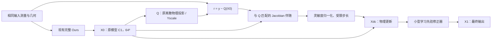

# Jacobian 伴随残差修正：面向当前 Ours 的具体实现设计

日期：2026-10-15（Asia/Shanghai）。本次是设计细化与合成算子数值核验，**未修改生产模型、未读取真实数据或 checkpoint、未启动训练**。前一份[整体架构报告](geophy_set3d_architecture_bottlenecks_and_research_zh.md)给出研究动机，本文给出能据以实现的接口与数学定义。

## 1. 第一版具体接在哪里

建议第一版保留当前完整 Ours，把它的最终输出（原来的 C1）记为 `X0`，在其后接一个新的物理修正块：



这样先检验“在同一初始场上增加算子一致修正是否有用”，避免同时移除旧 MRGR、重训初始化网络和修改解码器。`T=1` 指**新增一个物理修正步**；旧网络内部的一次 MRGR 仍保留，算力统计必须包括它。若该方向成立，再单独研究用新修正器替换旧 MRGR 分支以控制成本。

另一种结构是在原 C0 后直接替换 MRGR，这也是可行方案，但它改变了原有后半网络，不适合作为第一项最小归因验证。本文后续 `X_t` 都指新迭代状态，不与旧模型的 C0/C1 混用。

## 2. 需要实现的数学对象

### 2.1 前向模型必须与当前 P_diff 对应

对一例输入中的有效射线 r，用 K=96 个原中点采样位置；以原三线性权重 `w_rki` 从质量分数字段采样：

`s_rk = Σ_i w_rki X_i`。

记 a=16.043、b=28.965，则质量分数到摩尔分数转换为：

`χ(s) = b s / [a + (b−a)s]`。

归一化投影：

`Q_r(X) = [10^6 length_r / (Yscale K)] × Σ_k χ(clamp(s_rk,0,1))`，

其中 `Yscale=32284.894580078173`。测量端 `y=Yraw/Yscale`。物理域 `[0,0.6]³`、XYZ/y-height、端点对齐、border padding、全部有效射线及有效零测量均保持。

这里“真实算子”指**当前实现所定义的离散物理投影器**，不是宣称完全消除了真实仪器误差或 GT128/K256 与预测64³/K96的离散差异。

### 2.2 Jacobian 伴随是什么

在浓度内点 `0<s<1`：

`χ'(s) = a b / [a+(b−a)s]²`；

`[J_Q(X)]_ri = [10^6 length_r/(Yscale K)] × Σ_k χ'(s_rk) w_rki`。

对任意射线域向量 v：

`[J_Q(X)ᵀ v]_i = Σ_(r,k) [10^6 length_r/(Yscale K)] χ'(s_rk) w_rki v_r`。

它的含义是：一条射线存在误差时，根据这条射线**实际穿过哪些采样位置、影响哪些网格节点、对当前浓度有多敏感**，给这些节点分配更新信号。

相比之下，原 GeometryLifting 是按空间点对应的扫描角从二维特征图取值，并不包含上述离散积分与导数权重。新方法不必存下完整 Jacobian，只要计算它与向量的乘积。对于非线性 Q，应该称为当前状态的 `J_Q(X)ᵀ`，不能把 Q 本身称为一个固定线性伴随算子。

### 2.3 从残差形成更新方向

第一版可选择内部平方数据项作为清晰的更新代理：

`D_input(X) = (1/(2N)) Σ_valid [Q_r(X)−y_r]²`，N 为该例有效射线数。

定义 `r_t=y−Q(X_t)`，则：

`b_t = J_Q(X_t)ᵀ r_t / N = −∇D_input(X_t)`。

**因此更新符号是加号：** `X_t + α b_t`。若残差定义为 `Q−y`，更新应改为减号。正残差不表示沿线每个位置都应同幅增加；J 的权重和空间先验共同决定结果。

内部平方数据项是修正块的算法定义。外层训练仍可保留原 SelfSup 的 SmoothL1/relative-L1/跨子集一致性目标，不需要新增训练 loss；这不等于声称 b 是原 SmoothL1+relative-L1 的精确梯度。

如要求内部也严格对应原观测损失，令 `e=Q−y`，把射线端向量替换为：

`v_r = ψ_beta(e_r)/N + 0.1 sign(e_r)/max(Σ_valid |y|, 1e−6)`，

其中 `ψ_beta(e)=e/beta`（|e|<beta），否则为 `sign(e)`，beta=.01。此时下降方向为 `−J_Q(X)ᵀv`。零点采用所选框架的次梯度约定。两种内部定义应先选定一种，不能看 GT 结果后逐例切换。

## 3. 为什么不能直接把梯度加到场上

未经归一化的 b 大小受单位、射线数、路径长度和网格密度影响。不同体素的被测灵敏度不同，统一步长可能过大或过小。

一个可实现且不依赖标签的第一版预条件，是在固定参考场 `Xref=0` 上构造几何相关的对角尺度：

`Jref = J_Q(Xref)`；

`d0 = Jrefᵀ (Jref 1) / N`；

`δ_t = α_t b_t / (d0 + λ)`。

这里 `1` 是体积域全一向量，`λ>0` 是稳定项。计算 `Jref 1` 也只需要一次 JVP，或直接利用三线性权重和为 1 的性质求射线导数之和。参考场是人为固定的物理状态，不是 GT 均值或监督标签。

`d0` 是参考 Gauss–Newton 矩阵 `JrefᵀJref/N` 的**行和**，不是其精确对角、逆矩阵或完整条件数。在固定线性、非负 J 的平方数据项中，行和对角矩阵可作为该二次项的一个上界；当前非线性修正不能仅凭此宣称全局收敛。

实施时：

- 用事先定义的相对尺度设置 λ，避免它被 ppm·m 或 Yscale 单位改变；定义要对所有方法/案例一致。
- α 用固定保守值或有界可学习标量，限制过大更新；具体数值需要未来的 train/measurement-only 开发确定，本次不指定“最优值”。
- 无灵敏度体素的数据更新为零；低灵敏度体素不得无限放大。这个归一化不可能恢复算子的零空间信息。
- d0 只依赖当前输入几何及固定参考状态，可缓存或按块计算。不要把它称为 Fisher 信息。

## 4. 数据更新与学习先验如何组合

先得到有界的数据更新：

`Xdc = clip(X_t + δ_t, 0, 1)`。

学习先验修正器再读取：

| 输入 | 形状示例 | 用途 |
| --- | --- | --- |
| 当前场 X_t | `[B,1,64,64,64]` | 保留初始估计 |
| 物理更新后场 Xdc | 同上 | 已执行的观测一致性修正 |
| 受限更新 δ_t | 同上 | 带符号三维误差信号 |
| 归一化灵敏度 d0 | 同上 | 区分约束强弱 |

第一版可将四通道送入一个小型 3D 残差 CNN：`4→16` 的 3³ 卷积、两个 16 通道残差块、`16→1` 输出。不要同时加新的空间 attention、U-Net 或高分辨率输出；否则失去最小比较的意义。该 CNN 是示例设计，尚未训练或验证。

为维持范围，可在 logit 域做学习更新：

`zdc = logit(clamp(Xdc, ε, 1−ε))`；

`Δz = R_θ([X_t,Xdc,δ_t,d_norm])`；

`X_(t+1) = sigmoid(zdc + Δz)`。

R 的最后一层零初始化，则初始仅执行物理更新（还包括 ε 边界处理）。**这并不保证初始输出等于原 Ours：只要 α 非零，物理更新已生效。** 若实验需要完全相同初态输出，必须另行定义零启动的分支/步长日程，而不能把零初始化 R 当成整个模块被关闭。

这类 R 只是可学习先验修正器，未经额外结构约束不应宣称它是严格凸近端映射。它可能改善体积但增加部分输入残差；是否接受这种权衡应由事先登记的三维/测量联合评价判断。

第一版不依赖原融合特征以减少耦合；若以后加入 `context`，只能从当前输入分支提取，并独立验证增益。

## 5. PyTorch 工程实现：避开三维 grid_sample 的高阶导障碍

### 5.1 直接使用 autograd 的方法为什么会卡住

数值上，下面能求出一次正确的伴随残差方向：

```python
q = project_input(x, batch) / Y_SCALE
data_loss = squared_valid_residual(q, y)
g = torch.autograd.grad(data_loss, x, create_graph=True)[0]
x_next = x - alpha * g
```

但训练 `x_next` 所在网络时，需要继续对 g 求导，即需要投影器的二阶导。本次对当前 PyTorch 2.11.0+cu128 做了 **CPU 合成小网格**核验，现有 3D grid_sample 路径报：

`derivative for aten::grid_sampler_3d_backward is not implemented`。

所以当前环境不能直接把这一写法作为完整展开训练实现。本次未测试 CUDA 高阶算子，不能把 CPU 核验冒称 CUDA 基准。

把 g `detach()` 可以得到一种停止部分梯度的更新算法，但会忽略更新方向随 X 的变化；它不是与完全展开相同的训练图。生产方案建议先实现支持所需导数的固定几何插值。

### 5.2 固定几何三线性 gather/scatter

几何固定时，每个采样位置只对应八个网格节点。预计算或逐块生成：

- `index[r,k,8]`：XYZ 展平后的八邻点索引；
- `weight[r,k,8]`：三线性权重；
- `coef[r] = 10^6 length[r]/(Yscale K)`。

CPU/GPU 的主体运算都是 gather、逐元素运算、sum 和 scatter_add，不需要显式存储 J：

```python
def project_q(x, plan):
    # 此处省略 batch、ray chunk 和无效射线回填，几何参数均固定。
    s = (x.flatten()[plan.index] * plan.weight).sum(-1)  # [R,K]
    q = plan.coef * chi(s.clamp(0, 1)).sum(-1)          # [R]
    return q, s

def vjp_q(s, v, plan, volume_shape):
    # chi_prime 必须含与原 clamp 一致的导数约定。
    a = plan.coef[:, None] * chi_prime_with_clamp(s)    # [R,K]
    c = a[..., None] * v[:, None, None] * plan.weight  # [R,K,8]
    out = s.new_zeros(numel(volume_shape))
    out = out.scatter_add(0, plan.index.flatten(), c.flatten())
    return out.reshape(volume_shape)

q, samples = project_q(x, plan)
r = y - q
b = vjp_q(samples, r / n_valid, plan, x.shape)
x_dc = (x + alpha * b / (d0 + damping)).clamp(0, 1)
x_next = learned_prior(x, x_dc, x_dc - x, d0)
```

该伪代码只说明算子接口；生产版还需实现掩码、端点/border、batch 及数值策略。`chi_prime_with_clamp` 在 (0,1) 内用解析导数、区间外为零；0/1 边界采用与原框架一致的约定。

**需要保留的梯度路径有两条：** r 随 X 变化，χ'(s) 也随 X 变化。不能在缓存时把 `samples` 或 `chi_prime` detach；只有固定几何索引、权重和参考 d0 可不参与模型梯度。

索引与采样需要精确复用原坐标和积分位置：端点对齐下网格坐标为 `p/0.6×(resolution−1)`，XYZ flatten 为 `(ix×Ny+iy)×Nz+iz`。原 grid_sample 的 ZYX 输入坐标交换只是其 API 约定，新的 XYZ gather 不可再错误交换一次。

### 5.3 显存控制

不能给所有案例或全部站位一次性展开完整的射线×96×8 索引。按当前输入、视图/射线块计算；所有有效射线仍被处理，分块不等于随机子采样。每例先正确累计 N 和归一化，不能将不同大小的 ray chunk 等权平均。

固定索引/权重占用显存，展开训练还要保留所需状态，不能仅根据模型参数少就推断开销小。GPU scatter 的累加顺序也需要纳入精度与可复现性检查。

## 6. 本次已经核验与尚未核验的内容

本次使用 3³ 质量分数字段、3 条合成射线、K7、float64，比较新的固定几何 gather/scatter 与现有 `differentiable_project`：

| 核验 | 实测结果 |
| --- | --- |
| Q 前向最大绝对差 | 4.44×10⁻¹⁶ |
| 显式 Jᵀv 与旧投影器一次 autograd VJP 的最大绝对差 | 1.11×10⁻¹⁶ |
| JVP/VJP 内积恒等式绝对差 | 0.0（本次浮点计算） |
| gather 投影 gradcheck / gradgradcheck | 均通过 |
| 显式 VJP 对场与射线向量的 gradcheck | 通过 |
| 旧 3D grid_sample 二阶导 | 报未实现 |

记录：[synthetic_operator_check.json](artifacts/jacobian_adjoint_design_v1/synthetic_operator_check.json)，复核源码：[verify_synthetic_operator.py](artifacts/jacobian_adjoint_design_v1/verify_synthetic_operator.py)。

这些只验证数学实现路径在合成内点小网格上的可行性，不是四站任务的精度结果，也不是完整实现已通过。边界、无效射线、padding、全空输入、CUDA/FP32、64³/K96、梯度内存和性能仍需未来实现时专门验证。本次没有 optimizer、checkpoint 或真实数据访问。

## 7. 如何沿用原自监督训练

对 A 输入得到 `X_A^(T)`，对 B 输入得到 `X_B^(T)`；每个内部修正只使用各自输入集合。最终输出代入原：

`L_hold + .5 L_cross + .1 L_observed + .05 L_consistency`。

B/H 继续只作为外层测量目标，**不能成为 A 分支内部物理修正的观测**。对 B 分支同理。这条信息边界在训练时和推理时都应一致。原几何采样、站位数量、mask、固定测量尺度、数据划分和三维标签权限均保持。

新投影实现首先作为修正块内部的等价算子；历史外层 P_diff/数值结果保留，不覆盖旧文件。只有经过完整等价核验后，才能讨论统一底层算子实现。

## 8. 一步验证之后，如何展开为两三步

先完成 T=1；如果三维和测量联合结果支持，再构造：

```python
x = original_ours(input_batch)   # 原完整 Ours，只调用一次
d0 = geometry_preconditioner(input_geometry)
for t in range(T):
    q, s = project_q(x, plan)
    b = vjp_q(s, (y - q) / n_valid, plan, x.shape)
    x_dc = bounded_data_step(x, b, d0, alpha[t])
    x = shared_prior(x, x_dc, x_dc - x, d0)
return x
```

每一步都在当前场上重新投影并计算 χ'；不能只求一次 residual/J 然后重复套同一更新。几何 plan 与参考 d0 可以复用。先共享 R_θ，不随 T 成倍增加先验参数；步长可共享或逐步有界，二者需事前定义。

T=1→2→3 是额外物理计算次数的增加，不是额外观测。报告应比较相同权重增加步数的行为，以及固定 T 训练后的结果；不能把单步训练模型直接迭代三次的表现，当作三步训练的能力上限。

训练通常需要保留多步状态，显存和时间都可能明显增加。分块、重计算/checkpointing 可控制内存，但不能省略精确需要的梯度或悄悄减少射线/K。

## 9. 推荐的最小验证顺序

1. **算子正确性。** 完成前向等价、伴随内积、有限差分、高阶梯度、mask/boundary/置换/padding 核验。这里只是工程正确性。
2. **冻结初始场的一步解析更新。** 比较同一 X0 更新前后输入/独立测量和三维结果，先看物理步自身的作用；不看 GT 选择每例步长或停止点。这是后续待授权的科学实验，本次未运行。
3. **一个学习修正块。** 以同一无标签权重、观测、预算和 outer loss，比较同期原模型继续训练控制组与新增块；再用同结构、零 b 保留 d0 的对照检查真实残差信号增量。零 b 对照也要训练，不能只推理置零替代。
4. **有证据再展开。** 保留普通组、G5、L2、峰值、case 尾部、输入/H 测量，以及参数/显存/时延；不能仅因输入 residual 降低就宣布成功。

新增先验和额外物理迭代都可能贡献收益。上述控制只能逐步分离它们，不能把“候选整体变好”自动写成严格伴随这一单一机制的收益。应在单步方向成立后再投入多步与更强先验，不在一次试验中同时堆叠多个改动。
