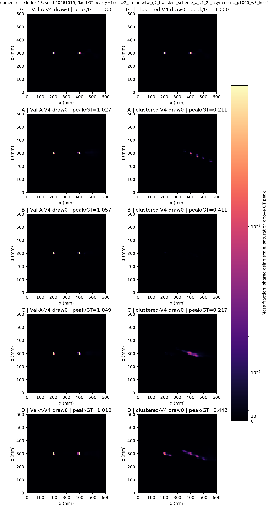

# GCA 均匀融合替换与可观测性描述符结构删除：开发实验 v1

更新：2026-10-19T22:32:14.408854+08:00。独立 worktree：`/home/djc/projects/GeoPhy-Set3D-pruning-v1`；分支 `experiment/gca-uniform-observability-pruning-v1`；基线 `175eaadd624fa2d0812a9a65b903aaf0259f253e`。

**范围：166 训练案例与 36 个已用开发案例；全部比较为探索性结果。原始多尺度主模型及既有 35 例正式测试记录保持冻结。本轮不读取 test 投影、test GT64 或任何 GT128。**

## 预登记与固定协议

检验有效视角均匀融合能否替代 GCA，以及局部方向多样性五维描述符能否真正删除；不预设简化有益。A/B 复用已完成产物，C/D 各两个固定种子完整 300 轮，不能按中期结果提前结束。

固定多尺度编码器、OARI 射线关系和集合交互、掩码、两阶段反馈、P(C)、采样、数据划分及 17 布局；FP32、TF32 关闭、batch2、AdamW 2e-4/wd1e-4、cosine300、梯度裁剪1、4个持久 fork worker。每任务24,900更新。只按验证 H4 相对L1严格最小值选轮。

| 组 | 融合 | 描述符 | 参数 | 训练 |
|---|---|---|---:|---|
| A | GCA | 保留 | 344678 | 复用两种子 |
| B | 有效视角平均 | 保留 | 342725 | 复用两种子 |
| C | GCA | 结构删除 | 344294 | 两种子各300轮 |
| D | 有效视角平均 | 结构删除 | 342341 | 两种子各300轮 |

## 删除边界与初始化

新增 `pruned_models.py`：删除 `observability` 和 `interaction.observability_embedding`；token_projection 输入56→48（删除256权重），pairwise_bias首层输入8→3（删除80权重），嵌入层删除48参数，总计删除384参数。删除方向张量3×3、特征值分解、五维描述符、有效视角分数与8维嵌入拼接；方向向量仍用于余弦绝对值、正弦和归一化方位差三种射线关系。

同种子先构造完整模型，再截取token前48列及偏置首层前三列。保留全部偏置及其他同名张量，逐元素核对；不把零描述符嵌入偏置折叠进投影。因此 C 与“描述符输入置零”是不同结构。新建线性层时恢复CPU RNG，避免改变其他初始化流。

PrunedMRGR 通过 MRO 只替换 stage0；原 MRGR.forward 函数原样继承，C0→原P(C0)→有符号残差→共享融合/解码→C1 不变。均匀融合在C0/C1共享使用，有效特征求和除有效数（下界1），全无效输出与权重精确为零，删除1953个GCA参数。

[初始化完整对应清单](artifacts/gca_pruning_v1/initialization_manifest.json)；[预登记与源码SHA256](artifacts/gca_pruning_v1/design.json)。

## 既有产物复用核查

| 模型 | 轮/更新 | 最佳轮 | 验证H4 L1 | 开发预测 | 初始化/源码/检查点/预测哈希 |
|---|---|---:|---:|---:|---|
| multiscale_seed20261011 | 300/24900 | 278 | 3.1094% | 612 | 通过 |
| multiscale_seed20261019 | 300/24900 | 288 | 3.3852% | 612 | 通过 |
| uniform_fusion_seed20261011 | 300/24900 | 285 | 3.1464% | 612 | 通过 |
| uniform_fusion_seed20261019 | 300/24900 | 286 | 3.2952% | 612 | 通过 |
| no_observability_seed20261011 | 300/24900 | 292 | 3.1506% | 612 | 通过 |
| no_observability_seed20261019 | 300/24900 | 297 | 3.3339% | 612 | 通过 |

六个既有模型均复用，不重复训练。两组no_observability保留参数和描述符计算，仅输入置零，作为诊断对照，不能证明真正删除无损。

[完整复用证据](artifacts/gca_pruning_v1/reuse_audit.json)。

## 验收与队列

训练前检查：均匀融合重排/NaN无效视角/全无效/梯度；真实64³形状与范围；与全宽零通道代数参照逐张量对照；原前向与有符号残差一致；禁止调用eigvalsh；射线关系仍有效；完整自监督损失两步反传；每种新结构独立进程2轮不中断与1+1续训对照。

恢复验收涵盖模型、最佳模型、AdamW、scheduler、Python/NumPy/CPU/CUDA/loader RNG、epoch采样与训练计数；整数/RNG精确相等，浮点rtol1e-4/atol1e-6（CUDA grid_sample backward原子累加非确定性）。失败日志保留并阻断正式任务。

验收：通过。[验收记录](artifacts/gca_pruning_v1/passed.json)；[失败证据](/scratch/djc/GeoPhy-Set3D/mrgr_gca_uniform_observability_pruning_v1/checks/failures.jsonl)。

调度每15秒重新查询UUID、显存、利用率、GPU进程及所属用户、主机内存与磁盘；连续两次无计算进程、显存占用<100MiB、空闲≥20000MiB、利用率≤5%后，启动前再查。每卡仅一项任务，以UUID绑定cuda:0；不对外部进程发信号。可用卡增加时自动并行。CPU线程受限，大数组/权重保存在scratch。

| 新任务 | 状态 | 最佳轮 | 当前轮 | 日志 |
|---|---|---:|---:|---|
| pruned_observability_seed20261011 | complete | 293 | 300/300 | [日志](/scratch/djc/GeoPhy-Set3D/mrgr_gca_uniform_observability_pruning_v1/scheduling/pruned_observability_seed20261011.log) |
| uniform_pruned_observability_seed20261011 | complete | 278 | 300/300 | [日志](/scratch/djc/GeoPhy-Set3D/mrgr_gca_uniform_observability_pruning_v1/scheduling/uniform_pruned_observability_seed20261011.log) |
| pruned_observability_seed20261019 | complete | 300 | 300/300 | [日志](/scratch/djc/GeoPhy-Set3D/mrgr_gca_uniform_observability_pruning_v1/scheduling/pruned_observability_seed20261019.log) |
| uniform_pruned_observability_seed20261019 | complete | 287 | 300/300 | [日志](/scratch/djc/GeoPhy-Set3D/mrgr_gca_uniform_observability_pruning_v1/scheduling/uniform_pruned_observability_seed20261019.log) |

[实时流水线状态](artifacts/gca_pruning_v1/pipeline_status.json)；[实时队列](artifacts/gca_pruning_v1/queue_status.json)；GPU与进程资源轨迹（完整服务器归档：`/scratch/djc/GeoPhy-Set3D/mrgr_gca_uniform_observability_pruning_v1/scheduling/resources.jsonl`）；[启动/退出记录](artifacts/gca_pruning_v1/events.jsonl)。

## 开发结果与配对统计

普通V4为Val-A-V4；聚簇V4先在同案例内平均五draw，再跨36案例汇总。下表为C1三维相对L1。17组逐布局L1/L2、各例中位/P90/最大、峰比及绝对峰比误差、GT峰处比、等权质心mm、Dice10/50和输入/H4投影误差均保存在完整表。物理体积分质心与等权节点形态质心分别保留。

| 组 | 种子 | 普通V4 L1 | 聚簇V4五draw L1 |
|---|---:|---:|---:|
| A 完整 MRGR | 20261011 | 9.3697% | 33.0012% |
| A 完整 MRGR | 20261019 | 9.7761% | 37.7195% |
| B 均匀融合 | 20261011 | 9.5508% | 30.0438% |
| B 均匀融合 | 20261019 | 9.5354% | 31.3328% |
| C 删除描述符 | 20261011 | 9.3615% | 35.4956% |
| C 删除描述符 | 20261019 | 9.6516% | 34.0239% |
| D 双重简化 | 20261011 | 9.2999% | 31.5906% |
| D 双重简化 | 20261019 | 9.5747% | 29.9506% |
| 零输入诊断 | 20261011 | 9.5458% | 35.2983% |
| 零输入诊断 | 20261019 | 9.6005% | 35.4529% |

| 比较 | 布局 | 两种子案例均值差(百分点) | 95%案例区间 | 低/平/高 |
|---|---|---:|---|---|
| B-A | Val-A-V4 | -0.0298 | [-0.1628,+0.0976] | 17/0/19 |
| C-A | Val-A-V4 | -0.0664 | [-0.1853,+0.0592] | 24/0/12 |
| D-B | Val-A-V4 | -0.1058 | [-0.2230,+0.0061] | 22/0/14 |
| D-C | Val-A-V4 | -0.0692 | [-0.1791,+0.0401] | 20/0/16 |
| (D-C)-(B-A) | Val-A-V4 | -0.0394 | [-0.1733,+0.0945] | 19/0/17 |
| C-zero_input | Val-A-V4 | -0.0666 | [-0.1989,+0.0698] | 23/0/13 |
| B-A | clustered-V4 | -4.6721 | [-5.7341,-3.5925] | 34/0/2 |
| C-A | clustered-V4 | -0.6006 | [-1.5837,+0.2843] | 20/0/16 |
| D-B | clustered-V4 | +0.0823 | [-0.5827,+0.7415] | 15/0/21 |
| D-C | clustered-V4 | -3.9891 | [-5.1284,-2.9412] | 32/0/4 |
| (D-C)-(B-A) | clustered-V4 | +0.6829 | [-0.5979,+2.0368] | 16/0/20 |
| C-zero_input | clustered-V4 | -0.6159 | [-1.6627,+0.3310] | 22/0/14 |

差值严格按比较栏中的表达式计算，负值表示L1下降；交互为(D−C)−(B−A)。各单种子与案例严格配对，bootstrap20000次/seed20261019。两种子均值只作描述；案例区间不覆盖训练种子总体方差，未经多重校正，不能据此证明普遍提升或等效。

[逐案例完整CSV](artifacts/gca_pruning_v1/per_case_metrics.csv)；[逐布局与分位统计](artifacts/gca_pruning_v1/summary.json)；[全部配对区间与案例差值](artifacts/gca_pruning_v1/paired_statistics.csv)；[独立重算](artifacts/gca_pruning_v1/independent_verification.json)。

## 实际计算成本

B1 V4 actual64³ end-to-end network C0+C1 including internal P(C0); excludes loader, transfer, external projection and file I/O; synchronized CUDA wall time

executed Conv2d/Conv3d/Linear multiply-accumulates only; excludes attention matmuls, interpolation/lifting, normalization, eigensolver and physics projector; not total FLOPs

| 模型 | 参数 | Conv/Linear MACs | 稳态中位ms | P90 ms | 推理峰MiB |
|---|---:|---:|---:|---:|---:|
| multiscale_seed20261011 | 344678 | 57827966976 | 22.589 | 22.776 | 1104.4 |
| multiscale_seed20261019 | 344678 | 57827966976 | 22.577 | 22.604 | 1104.2 |
| uniform_fusion_seed20261011 | 342725 | 57333039104 | 22.050 | 22.120 | 1104.2 |
| uniform_fusion_seed20261019 | 342725 | 57333039104 | 22.164 | 22.297 | 1104.2 |
| pruned_observability_seed20261011 | 344294 | 57751158784 | 20.374 | 20.461 | 273.3 |
| uniform_pruned_observability_seed20261011 | 342341 | 57256230912 | 19.835 | 20.069 | 273.3 |
| pruned_observability_seed20261019 | 344294 | 57751158784 | 20.357 | 20.416 | 273.3 |
| uniform_pruned_observability_seed20261019 | 342341 | 57256230912 | 19.818 | 19.923 | 273.3 |

历史开发推理计时边界不同，不用于速度排名；上表在同一空闲GPU、相同入口warmup10/重复40重新测量。

| 新任务 | 完整训练小时 | 逐轮最大峰MiB | 最佳轮 |
|---|---:|---:|---:|
| pruned_observability_seed20261011 | 2.771 | 7831.1 | 293 |
| uniform_pruned_observability_seed20261011 | 4.393 | 6839.2 | 278 |
| pruned_observability_seed20261019 | 3.256 | 7836.6 | 300 |
| uniform_pruned_observability_seed20261019 | 2.580 | 6851.0 | 287 |

## 局限与建议

GCA替换：Val-A-V4的L1变化-0.0298个百分点；clustered-V4的L1变化-4.6721个百分点。这些是条件于两种子的开发观察。

描述符结构删除：Val-A-V4的L1变化-0.0664个百分点；clustered-V4的L1变化-0.6006个百分点。这些是条件于两种子的开发观察。

均匀融合基础上的描述符删除：Val-A-V4的L1变化-0.1058个百分点；clustered-V4的L1变化+0.0823个百分点。这些是条件于两种子的开发观察。

推荐仍保留冻结A作为本轮论文主模型。B/C/D是否进入下一阶段，须结合完整峰值/定位和逐例尾部指标；可以进入独立数据上的确认实验，但本轮不支持替换正式主模型或宣称删除无显著损害。尚无预登记非劣界值，两种子与已用开发集不足以证明等效；如指标间有取舍，必须同时报告。

完整失败率、最差五例与全部负结果见summary；可视化固定索引0/18/35，不按新模型表现挑例。聚簇图只显示draw0，不能代表五draw聚合性能。

## 复现与文件管理

解释器：`/scratch/djc/envs/gas-torch/bin/python`。工作目录：`/home/djc/projects/GeoPhy-Set3D-pruning-v1`。启动：`python scripts/pruning_v1/pipeline.py`。现有controller运行时互斥锁会阻止重复启动；失败不会自动重试或覆盖，先检查失败证据。

源码：`scripts/pruning_v1/`。产物根目录：`/scratch/djc/GeoPhy-Set3D/mrgr_gca_uniform_observability_pruning_v1`。权重、预测数组、全部标量与SHA保存在scratch，不提交Git。源码与小型报告留在独立worktree；通过后的小型证据在`docs/reports/artifacts/gca_pruning_v1/`。

## 仓库同步说明

本文件是便于GitHub浏览的报告副本，证据与图片使用仓库相对链接。原始验收时报告逐字保存在同目录证据中的 `source_report.md`；原验收及源码SHA继续指向原执行位置，保留历史溯源含义。大体积权重和预测数组仍在原scratch目录。汇总与导出校验见[本轮结果索引](mrgr_development_results_20261020_zh.md)。
