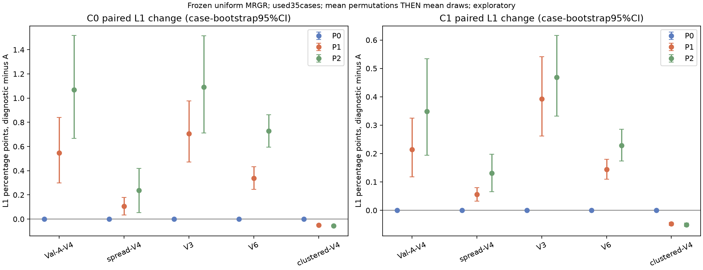
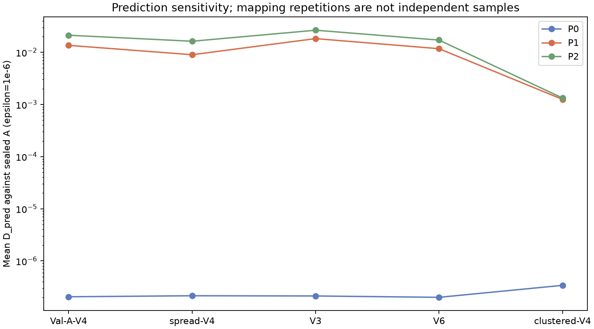

# OARI几何关系利用与视角顺序不变性：冻结模型无训练诊断

完成时间（北京时间）：2026-10-21T14:54:35.012506+08:00。本轮未训练、未反向传播、未更新权重、未变更模块结构，反馈OARI没有重启。
主模型为MRGR-UniformFusion-v1，seed20261011，第285轮，342725参数；SHA256：
`64c1c4a41e66b518e415243be5796b89d36f3c27e5c4165e98b77af49de381fc`。
所有结果来自同一批已使用的35例×17布局补充诊断，不是独立测试确认，也不用于选模型/轮次或后处理。GT128未读。

## 复用与新增推理范围

A完整OARI的595组C0/C1预测和1190行原指标直接复用；uniform_no_ray_relations正式训练消融及描述符结构删除双种子预测/指标也逐文件核验后复用。没有重跑完整A测试套件。
P0/P1/P2缺少干预输出，故对全部595组合进行必要新增诊断；每个布局仅固定案例索引0/17/34各重复两次A前向，校准重复性及历史/当前数值漂移。其余A不重复推理。
V4/V6从所有非恒等排列中固定无放回抽10个；V3总共只有5个不同非恒等排列，全部运行，未以重复排列凑足10。映射种子20261021+视角数；所有35案例、所有布局均保留。

## 代码与干预审计

真实关系张量为[B×XYZ,V,V,3]：abs方向余弦、sqrt(1−cos²)、abs方位差/180；没有按训练均值标准化。自对角关系固定[1,0,0]，局部不可见pair置零。
OARI将3关系通道与5维可观测性描述符拼接，经Linear(8,16)→SiLU→Linear(16,4)产生逐头注意力偏置。描述符另外经嵌入加入token，站点/方向/路径还通过GeometryLifting、geometry embedding和物理残差反馈进入网络；所以显式关系通道不等于整个OARI。
P0在选定原输入集合后同步重排全部input_*及view_mask，其他扫描角网格、H集合不动；射线、lifting、可见性在原前向内重新计算。逐次钩子断言R′=PRPᵀ精确成立，可见性同步、描述符在数值容差内相同。padding仅停留原位。
P1在实际interaction.forward入口只置换关系张量两个视角轴，features、geometry、visibility、view_mask、observability保持原对象。原interaction仍重新施加局部pair mask；错配可能把其他位置的不可见零值带到可见pair，是应保留的分布偏移来源。
P2不声称“物理零角度是中性”。它在第一仿射层输出中去掉W_rel·r，保留W_obs·o+b，再走原SiLU和后续层；这是学习预激活坐标中的零加性贡献。所有权重和真实关系张量原值保留。CPU检查独立证实与仅首3输入通道置零代数等价，从而可和既有no_ray_relations定义对应；仍属推理干预，不能当作重新训练或结构删除。
P2同时移除了self-pair余弦1线索，且可能造成训练分布外激活。它不能证明存在唯一的物理“无关系”状态。每个forward均记录真实钩子调用次数、首仿射输入维度、关系变化或去掉的贡献及最终bias有限性。

## P0：视角顺序不变性

全部P0的C0/C1最大绝对体差为7.27177e-06，最大D_pred为1.3703e-06；超过预登记绝对1e−5或相对1e−4阈值的输出数为0。
在本轮布局及容差下支持视角排列不变性；没有发现超出检查容差的顺序依赖。
浮点求和及特征批量计算的排列可能引入舍入误差。同步置换保持真实几何不变，因此其指标变化不作为几何利用收益。

| 布局 | 阶段 | P0最大绝对差 | P0最大D_pred | 同输入两次重复最大差 | 重复A对历史A最大差 |
|---|---|---:|---:|---:|---:|
| Val-A-V4 | C0 | 7.00355e-07 | 2.86285e-07 | 0 | 0 |
| Val-A-V4 | C1 | 1.04308e-06 | 3.47386e-07 | 0 | 0 |
| spread-V4 | C0 | 8.34465e-07 | 2.77243e-07 | 0 | 0 |
| spread-V4 | C1 | 8.04663e-07 | 4.30228e-07 | 0 | 0 |
| V3 | C0 | 2.04891e-06 | 3.33707e-07 | 0 | 0 |
| V3 | C1 | 3.93391e-06 | 5.29694e-07 | 0 | 0 |
| V6 | C0 | 8.9407e-07 | 3.27434e-07 | 0 | 0 |
| V6 | C1 | 8.64267e-07 | 3.44441e-07 | 0 | 0 |
| clustered-V4 | C0 | 3.48687e-06 | 9.17353e-07 | 0 | 0 |
| clustered-V4 | C1 | 7.27177e-06 | 1.3703e-06 | 0 | 0 |

## P1/P2与正式训练消融：跨布局结果

表为C1三维L1，单位为百分比；差值为“干预−同案例A”，单位为百分点。先在每案例/每draw平均所有置换，再在案例内平均五draw，最后对35案例作配对bootstrap20000次（seed20261020）。
所有本轮诊断区间均为未校正95%探索性案例区间，不另创主要比较族、不修改此前14项Bonferroni分母；置换/布局draw不视为独立样本，不能解释为训练种子总体区间。

| 布局 | A L1% | P0差 | P1差及95%区间 | P2差及95%区间 | 重新训练无关系差及95%区间 |
|---|---:|---:|---|---|---|
| Val-A-V4 | 8.592805 | -0.000000 | 0.213801 [+0.118414, +0.325048] | 0.349002 [+0.194429, +0.533861] | 0.146684 [-0.085482, +0.453542] |
| spread-V4 | 8.109278 | -0.000000 | 0.055469 [+0.031728, +0.080073] | 0.131460 [+0.065822, +0.197673] | 0.054233 [-0.065570, +0.185366] |
| V3 | 9.835159 | -0.000000 | 0.392632 [+0.262151, +0.541019] | 0.468421 [+0.331844, +0.616204] | 0.028776 [-0.262768, +0.256346] |
| V6 | 7.938726 | -0.000000 | 0.144043 [+0.110002, +0.179482] | 0.229049 [+0.173454, +0.285295] | -0.006170 [-0.118791, +0.117254] |
| clustered-V4 | 28.024636 | 0.000000 | -0.048003 [-0.053105, -0.042257] | -0.051557 [-0.056760, -0.045463] | 2.647199 [+1.681090, +3.704508] |

## P1：正确关系对应是否被利用

Val-A-V4：错配平均恶化，支持模型利用正确对应。各固定置换的案例均值差（百分点）：均值0.213801，标准差0.046387，中位数0.219814，范围[0.142731, 0.294250]。

spread-V4：错配平均恶化，支持模型利用正确对应。各固定置换的案例均值差（百分点）：均值0.055469，标准差0.024117，中位数0.061062，范围[0.000513, 0.084552]。

V3：错配平均恶化，支持模型利用正确对应。各固定置换的案例均值差（百分点）：均值0.392632，标准差0.082309，中位数0.334983，范围[0.312325, 0.509102]。

V6：错配平均恶化，支持模型利用正确对应。各固定置换的案例均值差（百分点）：均值0.144043，标准差0.023614，中位数0.146894，范围[0.104463, 0.182562]。

clustered-V4：错配平均改善，不能据此支持正确对应有益。各固定置换的案例均值差（百分点）：均值-0.048003，标准差0.024174，中位数-0.047558，范围[-0.087406, -0.003478]。

关系错配下降是敏感性/利用的诊断证据，不足以证明学到可泛化几何规律；尤其应结合P2的幅度、可见性错配和既有训练消融，不把错配脆弱性等同为模块净收益。

## P2、布局依赖与其他指标

| 布局 | 干预 | 阶段 | L2差 | Dice50差 | 峰比绝对误差差 | 质心差mm |
|---|---|---|---:|---:|---:|---:|
| Val-A-V4 | P1 | C0 | 0.0062269 | -0.00256806 | 0.00715266 | 0.209377 |
| Val-A-V4 | P1 | C1 | 0.00171 | 0.00143757 | 0.00332347 | 0.0631067 |
| Val-A-V4 | P2 | C0 | 0.0145698 | -0.00623446 | 0.0169983 | 0.738196 |
| Val-A-V4 | P2 | C1 | 0.00323106 | 0.00279031 | 0.00801739 | 0.129539 |
| Val-A-V4 | uniform_no_ray_relations_seed20261011 | C0 | -0.00406628 | 0.0131228 | -0.00469629 | -0.458923 |
| Val-A-V4 | uniform_no_ray_relations_seed20261011 | C1 | 0.00279916 | 0.00290898 | -0.00295006 | 0.0232411 |
| spread-V4 | P1 | C0 | 0.000783122 | 0.00110432 | -0.0011884 | 0.0354436 |
| spread-V4 | P1 | C1 | 5.17171e-05 | -0.000516348 | -0.000777943 | 0.0290727 |
| spread-V4 | P2 | C0 | 0.00560787 | -0.00506296 | 0.012332 | 0.459317 |
| spread-V4 | P2 | C1 | 0.00066061 | -0.00079869 | 0.00655646 | 0.101447 |
| spread-V4 | uniform_no_ray_relations_seed20261011 | C0 | -0.00654854 | 0.00871017 | 0.00557107 | -0.596462 |
| spread-V4 | uniform_no_ray_relations_seed20261011 | C1 | -0.0014194 | -0.004393 | -0.00926396 | -0.0601675 |
| V3 | P1 | C0 | 0.0103936 | -0.0093882 | 0.00589245 | 0.327176 |
| V3 | P1 | C1 | 0.00406593 | -0.00314016 | 0.000655662 | 0.120608 |
| V3 | P2 | C0 | 0.0184862 | -0.0146731 | 0.0169657 | 1.22036 |
| V3 | P2 | C1 | 0.00479841 | -0.00202313 | 0.00681386 | 0.232741 |
| V3 | uniform_no_ray_relations_seed20261011 | C0 | -0.00691791 | 0.00843045 | 0.00305838 | -0.284202 |
| V3 | uniform_no_ray_relations_seed20261011 | C1 | -0.00129834 | 0.0016597 | 0.0024666 | 0.0820855 |
| V6 | P1 | C0 | 0.00515493 | -0.00474855 | 0.00677129 | 0.110096 |
| V6 | P1 | C1 | 0.00124517 | 8.84992e-05 | 0.00403192 | 0.0383997 |
| V6 | P2 | C0 | 0.0123128 | -0.0125397 | 0.0147248 | 0.550787 |
| V6 | P2 | C1 | 0.00209565 | 0.00108602 | 0.00788983 | 0.0472566 |
| V6 | uniform_no_ray_relations_seed20261011 | C0 | -0.00899912 | 0.0109068 | -0.01505 | -0.424327 |
| V6 | uniform_no_ray_relations_seed20261011 | C1 | -0.00205859 | 0.00581095 | -0.014114 | 0.0104646 |
| clustered-V4 | P1 | C0 | -0.00056087 | 0.00111666 | -0.000465364 | -0.0293142 |
| clustered-V4 | P1 | C1 | -0.000483303 | 0.00102084 | -0.000319696 | -0.020709 |
| clustered-V4 | P2 | C0 | -0.000608802 | 0.00118068 | -0.000544036 | -0.0341606 |
| clustered-V4 | P2 | C1 | -0.000503753 | 0.0013117 | -0.000348444 | -0.0245024 |
| clustered-V4 | uniform_no_ray_relations_seed20261011 | C0 | 0.0666815 | -0.107447 | 0.0591919 | 2.74929 |
| clustered-V4 | uniform_no_ray_relations_seed20261011 | C1 | 0.0162566 | -0.0463669 | 0.04285 | 1.63942 |

L2为0–1比例差；Dice50越高越好，其余误差越低越好。全部指标置信区间、GT峰坐标比、峰比及C0/C1分布保留在完整统计文件中。

Val-A-V4：P2与重新训练无关系的L1差方向一致；P1/P2分别为0.213801 / 0.349002个百分点。固定模型中删除输入贡献无法模拟训练适应，幅度不同不构成协议冲突。

spread-V4：P2与重新训练无关系的L1差方向一致；P1/P2分别为0.055469 / 0.131460个百分点。固定模型中删除输入贡献无法模拟训练适应，幅度不同不构成协议冲突。

V3：P2与重新训练无关系的L1差方向一致；P1/P2分别为0.392632 / 0.468421个百分点。固定模型中删除输入贡献无法模拟训练适应，幅度不同不构成协议冲突。

V6：P2与重新训练无关系的L1差方向不一致；P1/P2分别为0.144043 / 0.229049个百分点。固定模型中删除输入贡献无法模拟训练适应，幅度不同不构成协议冲突。

clustered-V4：P2与重新训练无关系的L1差方向不一致；P1/P2分别为-0.048003 / -0.051557个百分点。固定模型中删除输入贡献无法模拟训练适应，幅度不同不构成协议冲突。

## 机制解释与下一阶段建议

本轮P0验证集合输入排列性质；P1/P2检验固定模型对显式关系的敏感性。此前uniform_no_ray_relations是完整300轮的单种子重新训练证据，两类实验回答不同问题。描述符结构删除双种子历史结果也保留，不能等同为删除整个OARI。
GeometryLifting、geometry token embedding、可观测性token/逐对偏置和物理残差反馈仍存在，可能补偿显式关系缺失。但本轮并未隔离这些通路，故“补偿”仅是可检验解释，不能作为已识别机制。
当前单冻结权重、已使用35案例的诊断不足以决定整体OARI可被删除，也不足以证明跨新几何泛化。若论文要声称整个OARI交互块的增量收益，后续需单独预登记、匹配容量/其余几何通路及预算的NoOARI训练；本轮不启动。若只说明正确关系对应的敏感性和布局依赖，使用本轮完整分布并结合既有训练消融即可，不能仅凭某个有利置换扩大结论。

## 数值、异常与完整性

所有35案例、17布局、全部固定置换都保留，未按表现筛选；V3不足10的原因已在注册前声明。所有新增C0/C1体积有限、范围[0,1]；逐forward钩子与状态哈希检查通过，所有参数requires_grad=False且无grad。
GT64访问发生在全部新增预测文件及清单校验封存后；GT128始终禁止。每个新增体与独立NumPy公式交叉核对，原A指标也从已有预测独立重算。配对区间经独立索引重采样核验。
原始预测和日志位于 `/scratch/djc/GeoPhy-Set3D/mrgr_geometry_utilization_v1`；大文件不入Git。




[登记](artifacts/mrgr_geometry_utilization_v1/experiment_registry.json) · [复用审计](artifacts/mrgr_geometry_utilization_v1/reuse_audit.json) · [全部映射](artifacts/mrgr_geometry_utilization_v1/permutation_maps.json) · [逐案例指标](artifacts/mrgr_geometry_utilization_v1/per_case_metrics.csv) · [预测体差异](artifacts/mrgr_geometry_utilization_v1/permutation_sensitivity.csv) · [配对差值](artifacts/mrgr_geometry_utilization_v1/paired_metrics.csv) · [完整统计](artifacts/mrgr_geometry_utilization_v1/statistics.json) · [置换内分布](artifacts/mrgr_geometry_utilization_v1/within_case_permutation_distributions.csv) · [独立核验](artifacts/mrgr_geometry_utilization_v1/independent_verification.json) · [验收](artifacts/mrgr_geometry_utilization_v1/acceptance.json)。

可复现入口：
```bash
/scratch/djc/envs/gas-torch/bin/python /home/djc/projects/GeoPhy-Set3D/scripts/geometry_utilization_v1/diagnostic.py controller
```
已存在的注册/封存/评分不覆盖。出现异常先查status.json、scheduling日志与每布局complete.json；无需训练或重选权重。
