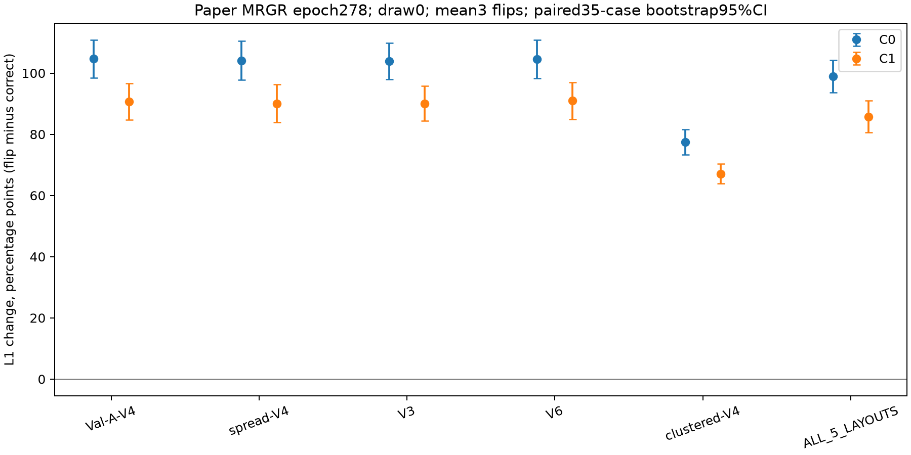

# 正式MRGR：GeometryLifting空间映射利用诊断

完成时间（北京时间）：2026-10-21T15:59:14.890013+08:00。

**模型固定为论文正式MRGR：epoch278、344678参数，保留GCA融合；未使用UniformFusion epoch285。**
检查点SHA256：`650b4f2c0f0ab345b5fd99a7d629e0db388cede0937acb7e3191462cd57898d7`。通过官方`module_models_v2.model_for(config, "multiscale", device)`构造，沿正式evaluation加载流程严格核验权重、配置、轮次、协议和参数量。

## 预登记范围与数据边界

复用正式测试35案例。每类布局只使用历史登记draw0：Val-A-V4、spread-V4、V3、V6、clustered-V4，共175个案例/布局组合。V3/V6/聚簇历史其余draw未纳入本轮，不能把本表当作五draw均值。此选择在当前GT64访问前固定，以严格执行35×5×3=525次正式前向。
历史595个预测文件全部核验哈希，所需175组C0/C1基准直接复用。工程阶段仅3个固定案例/布局各运行identity和3种反转，共12次前向；正式阶段525次前向，同时保存1050个C0/C1体积。全部新增预测封存后才读取GT64，GT128始终禁止。
本轮为已使用测试集上的探索性机制诊断，不是独立测试确认。无训练、反向传播、优化器、调参、选轮或模型替换。

## 干预隔离与工程检查

仅在模型实例第一次GeometryLifting.forward中clone采样网格，对最后一维水平、垂直或两分量取负。原始angular_grid方法及其输出从未修改；visibility逐元素保持相同。grid_sample仍使用bilinear、zeros padding、align_corners=True，特征、通道、shape和dtype保持。
第二次反馈GeometryLifting调用原始绑定forward；工程阶段另外独立grid_sample核对其输出逐元素一致。每次前向检查几何描述符、射线关系和可观测性描述符与不运行基准网络的几何参考完全相同；输入哈希、所有参数/缓冲区状态哈希保持。C0/C1均有限且在[0,1]。
工程检查通过。identity对历史基准最大绝对差：0；最大相对平均绝对差：0。阈值分别为1e-5和1e-4。
注意：第二次反馈的空间映射不变，但第一次干预改变C0，因此预测测量、残差值和最终C1允许随之改变；这是干预的下游效应。

## 主要终点与逐布局结果

差值为干预误差−正确映射误差，正值表示恶化。先平均同案例/布局3种反转，再在同案例内平均5种布局，最后以35案例为单位。固定seed20261022，配对bootstrap20000次，报告未校正95%探索性案例区间；三种反转及布局不作为独立样本。
预登记主要终点：跨布局C1相对L1平均变化 **+0.857842（绝对比例）**，即 **+85.7842个百分点**；95%区间[+0.805739, +0.909445]，即[+80.5739, +90.9445]个百分点。案例中位数变化+87.4034个百分点，误差增加案例35/35。

| 布局（均draw0） | 阶段 | 正确L1% | 干预均值L1% | 差值比例 | 差值百分点及95%区间 | 案例中位差百分点 |
|---|---|---:|---:|---:|---|---:|
| Val-A-V4 | C0 | 11.1366 | 115.7957 | +1.046591 | +104.6591 [+98.5008, +110.7797] | +108.3409 |
| Val-A-V4 | C1 | 8.5159 | 99.2246 | +0.907087 | +90.7087 [+84.7531, +96.5957] | +94.5950 |
| spread-V4 | C0 | 10.8966 | 115.0356 | +1.041390 | +104.1390 [+97.8441, +110.4273] | +107.6504 |
| spread-V4 | C1 | 8.0705 | 98.1651 | +0.900947 | +90.0947 [+83.9132, +96.3157] | +92.4546 |
| V3 | C0 | 13.3360 | 117.2208 | +1.038848 | +103.8848 [+97.9901, +109.7791] | +105.7236 |
| V3 | C1 | 9.9080 | 99.9650 | +0.900570 | +90.0570 [+84.3315, +95.7188] | +92.2366 |
| V6 | C0 | 10.3622 | 114.9731 | +1.046108 | +104.6108 [+98.2908, +110.8239] | +109.3577 |
| V6 | C1 | 7.9140 | 98.9053 | +0.909912 | +90.9912 [+84.8458, +97.0172] | +95.1435 |
| clustered-V4 | C0 | 49.0655 | 126.4598 | +0.773943 | +77.3943 [+73.3600, +81.5104] | +78.1388 |
| clustered-V4 | C1 | 39.7716 | 106.8409 | +0.670693 | +67.0693 [+63.8749, +70.3364] | +64.6375 |
| ALL_5_LAYOUTS | C0 | 18.9594 | 117.8970 | +0.989376 | +98.9376 [+93.6490, +104.2888] | +100.6075 |
| ALL_5_LAYOUTS | C1 | 14.8360 | 100.6202 | +0.857842 | +85.7842 [+80.5739, +90.9445] | +87.4034 |

## 三种干预分别报告（探索性）

| 布局 | 干预 | C1 L1差百分点 | 95%案例区间 |
|---|---|---:|---|
| Val-A-V4 | flip_h | +73.6335 | [+59.6351, +86.6786] |
| Val-A-V4 | flip_v | +94.8002 | [+90.5418, +99.1084] |
| Val-A-V4 | flip_hv | +103.6923 | [+98.5666, +109.3626] |
| spread-V4 | flip_h | +72.9538 | [+58.8309, +86.0171] |
| spread-V4 | flip_v | +93.4523 | [+89.1836, +97.8036] |
| spread-V4 | flip_hv | +103.8779 | [+98.3512, +109.8710] |
| V3 | flip_h | +72.3290 | [+58.9137, +84.8137] |
| V3 | flip_v | +94.4660 | [+89.7920, +99.0998] |
| V3 | flip_hv | +103.3759 | [+98.4650, +108.6628] |
| V6 | flip_h | +74.2491 | [+60.1781, +87.2451] |
| V6 | flip_v | +94.3806 | [+90.1760, +98.5573] |
| V6 | flip_hv | +104.3441 | [+98.9855, +110.2588] |
| clustered-V4 | flip_h | +47.5160 | [+39.2946, +55.3645] |
| clustered-V4 | flip_v | +76.1138 | [+71.5153, +80.5024] |
| clustered-V4 | flip_hv | +77.5780 | [+74.3802, +80.5375] |
| ALL_5_LAYOUTS | flip_h | +68.1363 | [+55.6016, +79.7058] |
| ALL_5_LAYOUTS | flip_v | +90.6426 | [+86.5021, +94.7290] |
| ALL_5_LAYOUTS | flip_hv | +98.5737 | [+94.1508, +103.4248] |

## 机制与辅助指标（探索性）

| 布局 | C1 L2差 | Dice50差 | 峰比绝对误差差 | 质心距离差mm | 预测体平均绝对变化 | 预测体相对变化 |
|---|---:|---:|---:|---:|---:|---:|
| Val-A-V4 | +0.712381 | -0.672188 | +0.323949 | +151.479 | +0.00372539 | +0.996042 |
| spread-V4 | +0.710413 | -0.665296 | +0.298379 | +145.883 | +0.00370978 | +0.985326 |
| V3 | +0.698596 | -0.637939 | +0.327067 | +148.353 | +0.00374941 | +1.0026 |
| V6 | +0.710156 | -0.672387 | +0.341638 | +146.076 | +0.0037037 | +0.993615 |
| clustered-V4 | +0.377666 | -0.255564 | +0.55481 | +158.924 | +0.00366529 | +1.05587 |
| ALL_5_LAYOUTS | +0.641842 | -0.580675 | +0.369168 | +150.143 | +0.00371071 | +1.00669 |

## 解释、异常与局限

结果支持当前冻结模型依赖正确的二维到三维空间映射：在其余已检查几何通路不变时，预登记反转导致跨布局C1重建误差增加。
该结论仅针对当前冻结权重、所选draw0布局和3种确定性反转。反转使特征与仍然正确的几何描述符/物理射线不再对应，可能产生分布偏移；不能把干预差值等同为重新训练删除GeometryLifting的净收益，也不能单独证明学到了可泛化几何规律。
所有案例和负变化均保留，未按结果追加干预或选择布局。正式525次前向全部完成；工程门槛、数值范围、输入/权重/掩码/其他几何通路审计均通过，无数值失败。工程及正式预测均封存；GT128访问为0。
全部1400个基准/干预体积的5项指标经独立NumPy公式核对；350个基准体积同时与历史正式指标核对。240组配对统计及96组预测变化统计经独立分组与重采样权重核验。
资源调度复用仓库UUID锁、间隔15秒两次空闲检查、锁FD继承和主机内存/磁盘门槛，串行使用空闲GPU，未终止其他任务。原始资源快照、任务日志和每次前向GPU UUID均保留。

[不可变协议](artifacts/mrgr_lifting_mapping_v1/protocol.json) · [工程检查](artifacts/mrgr_lifting_mapping_v1/engineering_checks.json) · [基准清单](artifacts/mrgr_lifting_mapping_v1/baseline_manifest.json) · [逐案例指标](artifacts/mrgr_lifting_mapping_v1/per_case_metrics.csv) · [逐案例配对差值](artifacts/mrgr_lifting_mapping_v1/paired_case_metrics.csv) · [案例聚合](artifacts/mrgr_lifting_mapping_v1/case_aggregates.csv) · [完整统计](artifacts/mrgr_lifting_mapping_v1/statistics.json) · [独立统计核验](artifacts/mrgr_lifting_mapping_v1/independent_statistics_verification.json) · [验收](artifacts/mrgr_lifting_mapping_v1/acceptance.json)。

原始预测及日志目录：`/scratch/djc/GeoPhy-Set3D/mrgr_lifting_mapping_v1`。大型数组保留服务器，不覆盖历史输出。
复现入口：`scripts/lifting_mapping_v1/diagnostic.py register`及`controller`。已存在目录/产物不覆盖，不自动重试失败任务。
