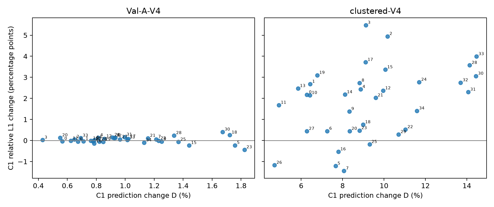

# OARI 可观测性描述符：冻结干预与真实重建误差配对验证

本阶段为已使用的35个测试案例上的探索性机制分析，不是独立测试确认。所有完整对照与结构删除模型均采用 **Multi-scale MRGR + Uniform Fusion**。

## 主要判断

**A．冻结模型依赖是否有益：** `obs_token` 在聚簇V4使C1相对L1平均增加1.8151个百分点，30/35案例增加，案例bootstrap区间完全在零以上；普通V4平均仅增加0.0217个百分点，区间跨零，未建立清晰平均恶化。不能把普通V4区间跨零解释为严格等效。
**B．预测变化与误差变化：** 聚簇V4的预测变化更大，且与L1恶化具有中等案例级正相关；仍有6个案例D≥5%而|ΔL1|≤0.5个百分点。D和ΔE不是同一量，也不能由D直接判断性能。
**C．冻结与重新训练：** 普通V4结构删除的两个种子平均均略差；聚簇V4结构删除在两个种子方向仍相反。冻结seed20261011的明显恶化不能外推为描述符结构在重新训练后必有稳定独立收益。
**D．机制解释：** 证据支持“该冻结模型确实使用描述符token输入，且该路径对聚簇V4的L1有益”；对于跨训练模型的独立性能贡献，现有证据仍不稳定。剩余路径可补偿是相容解释，但训练随机性、移除结构改变优化以及冻结置零造成分布偏移也相容，尚不能区分。不能断言信息难以替代。
**E．是否需下一实验：** 回答本轮限定问题不需要新训练。若要排除“当前冻结依赖仅限seed20261011”，可另行登记在已有seed20261019完整模型上做相同obs_token探针（两布局各35案例，至多70次冻结前向）。这只能检查第二种子是否同向，仍不能独自证明补偿机制；本轮没有执行该追加实验。

## 审计、授权与执行边界

审计前工作树干净，HEAD为`450a4ecf4ef24702d0db2113fe69b4c01a138661`。真实路径从正式登记与历史验收定位，未根据模型config名称猜构造器。4个checkpoint均核验文件SHA256、epoch、config、训练protocol哈希、参数量、无体GT训练标记，并通过官方模型工厂strict load，实际fusion为UniformFusion，eval且参数无梯度；模型不执行forward。
现有授权是阶段限定的：OARI v2不可变protocol明确GT64_read=false；历史结构消融与正式评估授权不能自动扩展。本轮先停止GT评分并完成无GT审计，用户随后明确回复“授权本阶段限定的 GT64 离线评分”。授权单独记入GT64_authorization.json，未改写旧协议。
随后固定本阶段protocol、输入与预测清单并封存，才读取35份授权GT64，每份只加载一次（另做文件SHA256读取）。GT哈希与历史授权记录逐一一致；GT128未读。新增训练、反传、优化器更新、检查点选择、调参、模型前向均为0；CPU两线程，不占用GPU。
覆盖70个输入（35案例×两布局×draw0），复用490份不同预测文件、980份C0/C1字段：A/B/C/D共280份，加full seed19与pruned两种子210份；full seed11即A，不重复计数。全部文件哈希、输出shape/有限性/[0,1]、checkpoint封存链、案例、站点顺序与draw一致。CPU重新构造70个测量输入，哈希与原OARI记录完全一致，未读目标数组。
全部预测及4个checkpoint可直接复用，无输入/预测/指标缺失；预计及实际新增推理均为0。

| 模型 | 种子 | epoch | 参数 | checkpoint SHA256 |
|---|---:|---:|---:|---|
| uniform_fusion_seed20261011 | 20261011 | 285 | 342725 | `64c1c4a41e66b518e415243be5796b89d36f3c27e5c4165e98b77af49de381fc` |
| uniform_fusion_seed20261019 | 20261019 | 286 | 342725 | `19bb5f698349c976358be782e9d43301afa9e1eec4a89ddb4e1ceeb8d9bd1424` |
| uniform_pruned_observability_seed20261011 | 20261011 | 278 | 342341 | `5561bb5056dc79cfe72e40c1e2e6a022bc3310f37be3850c020dc7e79b960a35` |
| uniform_pruned_observability_seed20261019 | 20261019 | 287 | 342341 | `35c40040518e164b32b80e1419f0a009048f311fceeb0b80f195d012090fba7e` |

完整模型官方工厂为`scripts/uniform_final_v1/uniform_models.py:model_for(config,"uniform","cpu")`；删除模型使用登记的`scripts/pruning_v1/pruned_models.py:model_for(config,"uniform_pruned_observability","cpu")`。完整权重路径、配置、封存链见models.json及provenance_chain.json。

## 干预及指标定义

严格复用OARI v2已保存的干预输出与实现：B=obs_token仅移除observability_embedding首线性层五维输入贡献，保留learned bias和SiLU；C=obs_bias仅去掉pairwise_bias首仿射中描述符列3..7的贡献，保留偏置；D=obs_both同时执行。A为原始完整模型。原特征、几何、visibility、view_mask和观测性输入张量身份全部相同。token路径还直接进入token残差，不能将其全部作用称为attention改变。
冻结B保留结构与全部参数；重新训练的结构消融同时删除描述符模块和两处相关输入结构，少384参数，二者不是完全相同的操作。结构删除可能改变优化过程，冻结输入屏蔽也可能形成训练外组合。
指标直接调用正式`scripts/paper_final_v1/evaluation.py`导入的volume_metrics与safe_shape；按原float64、原始[0,1]浓度质量分数计算，不按每案例重新归一化。

| 指标 | 正式定义及单位 |
|---|---|
| 相对L1 | Σabs(p−g) / max(Σabs(g),1e−6)，无量纲 |
| 相对L2 | sqrt(Σ(p−g)² / max(Σg²,1e−12))，无量纲 |
| 峰幅比/绝对比例误差 | max(p)/max(g)，以及abs(该比值−1)；无量纲 |
| 峰值绝对误差 | abs(max(p)−max(g))，质量分数；并非mm或相对比例 |
| 峰位置误差 | 两argmax的欧氏距离×600/63 mm；并列用XYZ字典序首点 |
| centroid_error_mm | 正式volume_metrics按0..0.6m XYZ端点网格的梯形积分权重求质心，再取距离mm |
| centroid_distance_mm | 正式形态学metrics按普通节点浓度权重求质心，距离mm；与上一指标分开保存 |
| Dice50 | 双方共用0.5×GT最大值阈值；不是volume的固定绝对阈值Dice |
| 预测变化D | Σabs(B−A)/(Σabs(A)+1e−6)，无量纲。另保留历史max分母约定的D_legacy，逐份重算吻合 |

ΔE=干预或结构删除误差−匹配完整模型误差。误差指标正值表示恶化；Dice差值正值表示改善；峰幅比本身无单调优劣方向。绝对比例差乘100即百分点。所有结构删除D使用匹配种子的完整模型为分母。

## 配对统计方案

主分析全用draw0，两布局各35案例。历史聚簇五draw均值没有混入本轮。每个指标在同案例内先配对，以案例为单位bootstrap20,000次，种子20261025，百分位95%区间估计平均配对差；标准差为样本SD(ddof=1)。区间均为未经多重比较校正的探索性案例区间，不是训练种子总体区间。
数值“基本不变”为|Δ|≤1e−8，沿用既有配对计数约定；不是临床或实用等效界限。两个训练种子分别报告，不扩充n。相关性使用35个案例的Pearson与Spearman，仅作探索性描述；差值恒定时相关无定义，输出null和原因，不伪造0。

## 主要终点：obs_token的C1相对L1

| 布局 | A均值 | B均值 | 平均Δ绝对比例 | 平均Δ(pp)与95%区间 | Δ中位数(pp) | ΔSD(pp) | 增加/降低/不变 |
|---|---:|---:|---:|---|---:|---:|---|
| Val-A-V4 | 0.08592805 | 0.08614488 | +0.00021683 | +0.0217 [-0.0284, +0.0713] | +0.0242 | 0.1522 | 19/16/0 |
| clustered-V4 | 0.32831603 | 0.34646744 | +0.01815141 | +1.8151 [+1.2628, +2.3596] | +2.1723 | 1.6850 | 30/5/0 |

普通A/B均值分别为8.5928%/8.6145%，聚簇为32.8316%/34.6467%。另作明确标记的评分后探索性布局配对对比：聚簇Δ减普通Δ=+1.7935pp，95%区间[+1.2615, +2.3205]pp；这是同案例差的差，不由两个区间是否重叠推断布局差异。

## 预测变化、真实误差及案例分布

| 布局 | C1 D均值/中位数/SD(%) | D最小/25%/75%/最大(%) | D与ΔL1 Pearson / Spearman |
|---|---|---|---|
| Val-A-V4 | 1.0058/0.9232/0.3623 | 0.4285/0.7702/1.2216/1.8235 | -0.1116 / -0.0227 |
| clustered-V4 | 9.1960/8.8644/2.6801 | 4.7126/7.4577/10.4370/14.4659 | 0.3786 / 0.4342 |

D≥5%且|ΔL1|≤0.5pp的描述性标记在读取GT前固定，普通0例、聚簇6例。它不是正式等效性检验。全部35案例及其编号、指标、差值保存在paired_case_metrics.csv，不只保留这些案例。聚簇6例如下：

| 案例 | D(%) | ΔL1(pp) |
|---|---:|---:|
| case2_1_g2_transient_scheme_a_v1_2s_asymmetric_p1500_w3_inlet2_half | 7.2558 | +0.4471 |
| case2_streamwise_g2_transient_scheme_a_v1_2s_p1500_w1_equal | 8.3375 | +0.4423 |
| case3_crosswind_g3_transient_scheme_a_v1_2s_asymmetric_p1000_w3_inlet1_half | 8.8135 | +0.4723 |
| case3_crosswind_g3_transient_scheme_a_v1_2s_asymmetric_p1500_w3_inlet1_half | 9.3016 | -0.1841 |
| case3_crosswind_g3_transient_scheme_a_v1_2s_p0300_w2_equal | 6.2764 | +0.4413 |
| case3_streamwise_g3_transient_scheme_a_v1_2s_asymmetric_p0300_w1_inlet2_half | 10.7050 | +0.2877 |

在主C1的两布局中，按预设D≤1%、峰比例绝对误差增加≥0.1或峰位置误差增加≥一网格步(9.5238mm)的标记，没有对应案例。这不排除较小幅度变化，也不是对所有潜在峰值风险的否定。C0和辅助干预的全部标记见case_patterns.json。

## C0与辅助指标：有益作用不是所有指标一致改善

| 布局 | 阶段 | 指标 | A均值→B均值 | 平均差(原单位) | 95%区间 |
|---|---|---|---:|---:|---|
| Val-A-V4 | C0 | relative_l1 | 0.113762→0.113582 | -0.000179 | [-0.0012, +0.0009] |
| Val-A-V4 | C0 | relative_l2 | 0.166994→0.167845 | +0.000851 | [+0.0000, +0.0016] |
| Val-A-V4 | C0 | peak_ratio | 1.166835→1.168035 | +0.001200 | [-0.0028, +0.0056] |
| Val-A-V4 | C0 | absolute_peak_ratio_error | 0.188009→0.191408 | +0.003399 | [-0.0004, +0.0077] |
| Val-A-V4 | C0 | peak_absolute_error | 0.112581→0.114405 | +0.001824 | [-0.0004, +0.0043] |
| Val-A-V4 | C0 | peak_location_error_mm | 69.385500→75.689014 | +6.303514 | [+0.0050, +18.1161] |
| Val-A-V4 | C0 | centroid_error_mm | 3.279464→2.902260 | -0.377204 | [-0.5532, -0.1953] |
| Val-A-V4 | C0 | centroid_distance_mm | 3.451457→3.044050 | -0.407407 | [-0.5816, -0.2257] |
| Val-A-V4 | C0 | Dice50 | 0.821413→0.819416 | -0.001997 | [-0.0055, +0.0014] |
| Val-A-V4 | C1 | relative_l1 | 0.085928→0.086145 | +0.000217 | [-0.0003, +0.0007] |
| Val-A-V4 | C1 | relative_l2 | 0.157314→0.157662 | +0.000347 | [-0.0003, +0.0011] |
| Val-A-V4 | C1 | peak_ratio | 1.173953→1.173291 | -0.000662 | [-0.0032, +0.0018] |
| Val-A-V4 | C1 | absolute_peak_ratio_error | 0.201320→0.203247 | +0.001927 | [-0.0005, +0.0044] |
| Val-A-V4 | C1 | peak_absolute_error | 0.120536→0.121641 | +0.001105 | [-0.0004, +0.0027] |
| Val-A-V4 | C1 | peak_location_error_mm | 67.568955→67.296847 | -0.272109 | [-0.8163, +0.0000] |
| Val-A-V4 | C1 | centroid_error_mm | 1.429295→1.439196 | +0.009901 | [-0.0683, +0.0809] |
| Val-A-V4 | C1 | centroid_distance_mm | 1.617395→1.623360 | +0.005965 | [-0.0740, +0.0794] |
| Val-A-V4 | C1 | Dice50 | 0.820338→0.819774 | -0.000564 | [-0.0029, +0.0020] |
| clustered-V4 | C0 | relative_l1 | 0.396765→0.439096 | +0.042331 | [+0.0327, +0.0524] |
| clustered-V4 | C0 | relative_l2 | 0.568319→0.585432 | +0.017113 | [+0.0084, +0.0257] |
| clustered-V4 | C0 | peak_ratio | 0.865758→0.844644 | -0.021115 | [-0.0449, -0.0016] |
| clustered-V4 | C0 | absolute_peak_ratio_error | 0.197897→0.216400 | +0.018503 | [-0.0003, +0.0420] |
| clustered-V4 | C0 | peak_absolute_error | 0.117784→0.128416 | +0.010633 | [-0.0009, +0.0256] |
| clustered-V4 | C0 | peak_location_error_mm | 121.683882→114.047093 | -7.636789 | [-21.6302, +0.0551] |
| clustered-V4 | C0 | centroid_error_mm | 16.346618→14.331329 | -2.015289 | [-3.5007, -0.4665] |
| clustered-V4 | C0 | centroid_distance_mm | 16.569914→14.407106 | -2.162807 | [-3.6820, -0.5800] |
| clustered-V4 | C0 | Dice50 | 0.294281→0.305498 | +0.011217 | [-0.0014, +0.0257] |
| clustered-V4 | C1 | relative_l1 | 0.328316→0.346467 | +0.018151 | [+0.0126, +0.0236] |
| clustered-V4 | C1 | relative_l2 | 0.500036→0.504732 | +0.004697 | [-0.0001, +0.0097] |
| clustered-V4 | C1 | peak_ratio | 0.806027→0.797134 | -0.008893 | [-0.0348, +0.0254] |
| clustered-V4 | C1 | absolute_peak_ratio_error | 0.234753→0.239391 | +0.004638 | [-0.0293, +0.0301] |
| clustered-V4 | C1 | peak_absolute_error | 0.139727→0.143756 | +0.004029 | [-0.0136, +0.0179] |
| clustered-V4 | C1 | peak_location_error_mm | 111.175341→127.767917 | +16.592576 | [-6.7110, +39.9759] |
| clustered-V4 | C1 | centroid_error_mm | 12.645216→11.721103 | -0.924113 | [-1.6070, -0.2497] |
| clustered-V4 | C1 | centroid_distance_mm | 12.988187→12.019550 | -0.968637 | [-1.6548, -0.2905] |
| clustered-V4 | C1 | Dice50 | 0.316040→0.312261 | -0.003778 | [-0.0159, +0.0086] |

聚簇C0相对L1差为+4.2331pp，C1为+1.8151pp，与下游步骤减轻输出扰动相容；这不能单独把减轻归因为反馈的因果补偿。聚簇C1质心距离反而平均降低约0.9241mm，L2与Dice50的差区间跨零，峰位置均值变化受少数离散argmax跳转影响。因此本报告限定“L1有益”，不称描述符对所有重建质量都有净收益。

## 辅助路径与重新训练结构删除

| 布局 | 比较 | C1 ΔL1(pp) | 95%区间(pp) | 增加/降低/不变 |
|---|---|---:|---|---|
| Val-A-V4 | obs_bias | +0.0135 | [-0.0136, +0.0414] | 22/13/0 |
| Val-A-V4 | obs_both | +0.0385 | [-0.0238, +0.1020] | 20/15/0 |
| Val-A-V4 | uniform_pruned_observability_seed20261011 | +0.1299 | [+0.0080, +0.2687] | 20/15/0 |
| Val-A-V4 | uniform_pruned_observability_seed20261019 | +0.1691 | [-0.0095, +0.3649] | 22/13/0 |
| clustered-V4 | obs_bias | -0.0272 | [-0.0307, -0.0238] | 0/35/0 |
| clustered-V4 | obs_both | +1.7881 | [+1.2345, +2.3332] | 30/5/0 |
| clustered-V4 | uniform_pruned_observability_seed20261011 | +0.6554 | [-0.9381, +2.1923] | 20/15/0 |
| clustered-V4 | uniform_pruned_observability_seed20261019 | -1.6975 | [-3.2766, -0.0854] | 13/22/0 |

聚簇obs_bias的L1平均变化为−0.0272pp，35案例均降低，幅度很小；obs_both约+1.7881pp，与obs_token接近。两路径可非线性相互作用，不能将差值直接当成可加的独立贡献或把token全部归因于注意力。
结构删除的普通V4两个种子分别+0.1299/+0.1691pp；聚簇draw0分别+0.6554/−1.6975pp。此处不是历史五draw平均+1.6902/−0.9806pp，后者未纳入本轮统计。不能根据某一个种子案例区间不跨零推断跨训练种子的稳定贡献。

## 核验、异常与产物

独立核验通过：用重采样案例计数矩阵乘配对差，以及独立排序插值计算bootstrap均值区间；与主结果最大绝对差2.13e-14。独立向量L1范数重算全部D，最大差0。560份正式历史输出的全部所需指标重算差为0。全部预测在评分前及核验时分别复核SHA256。
异常保留两项：首次审计发现仓库导出的reuse_methods.json没有SHA侧文件，改从有侧文件的scratch权威原件验证，日志保存在同级mrgr_observability_error_pairing_v1_attempt01；统计首次JSON导出遇到恒定差导致相关NaN，保留原始脚本、CSV与日志，登记statistics_export_amendment.json，仅改成无定义null。未变更指标、假设、干预、随机种子、重采样方案，未追加GT读取或模型前向。
复现入口和产物目录：`scripts/observability_error_pairing_v1/README.md`、`docs/reports/artifacts/mrgr_observability_error_pairing_v1/`。protocol.json、GT64_authorization.json、prediction_manifest.json、predictions_sealed.json、checkpoint_audit.json、case_metrics.csv、paired_case_metrics.csv、summary.csv、statistics.json、correlations.csv、GT64_access.json、independent_verification.json、acceptance.json共同构成证据链。原预测不复制，不覆盖旧实验。
本诊断仅说明当前冻结模型在这两种输入配置下对可观测性描述符输入的依赖及其对应L1影响；不能单独证明模型学到可泛化的几何规律，也不能证明结构不可替代。
