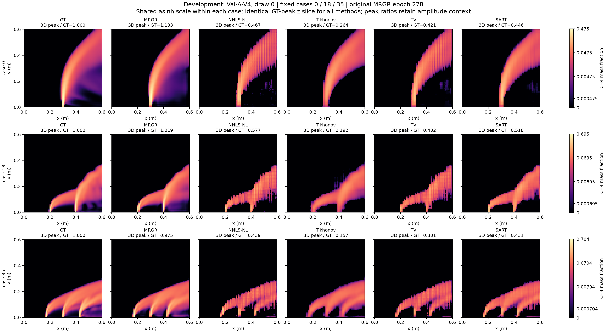
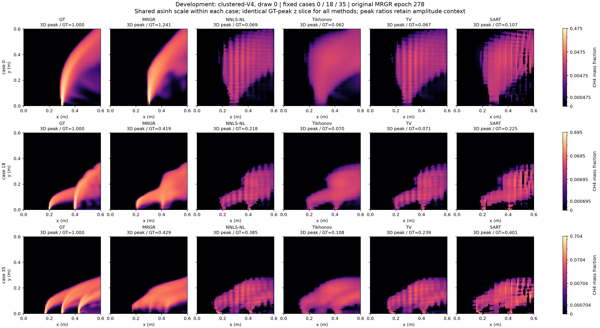
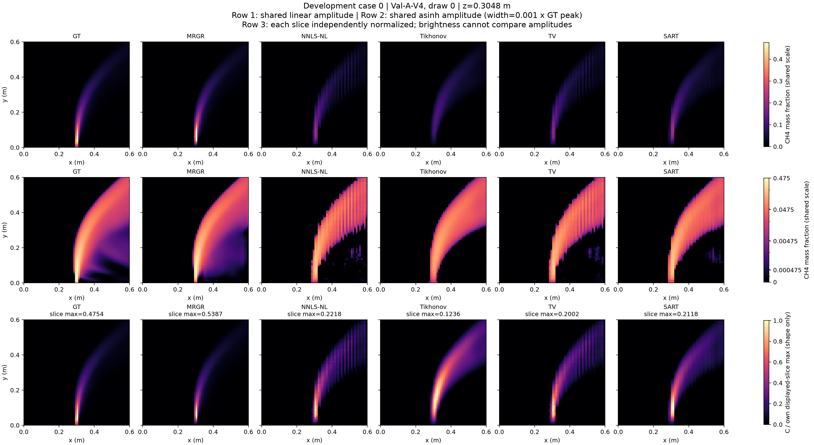
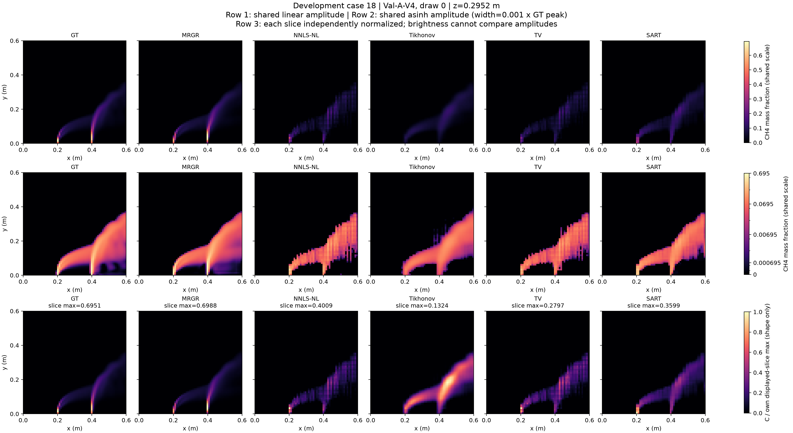
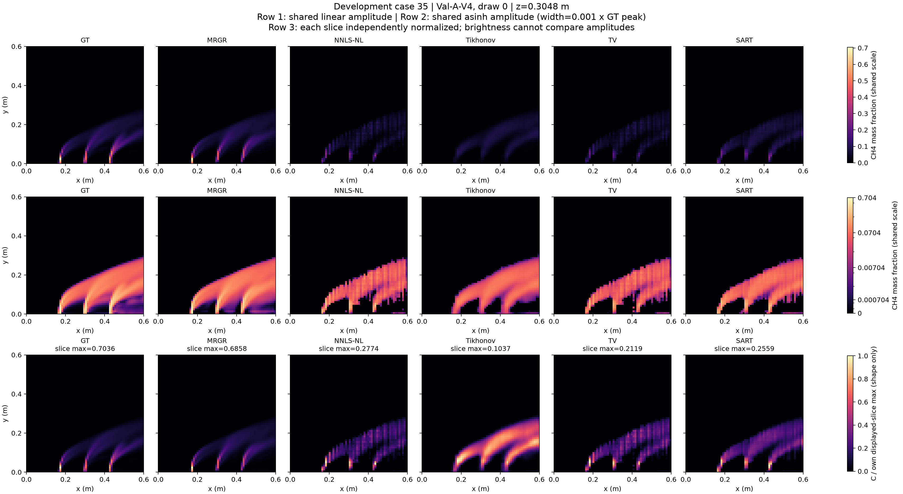
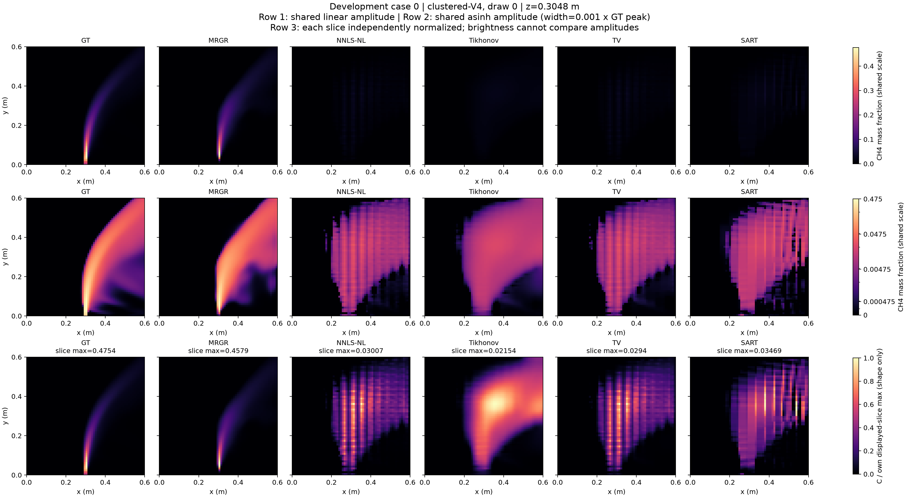
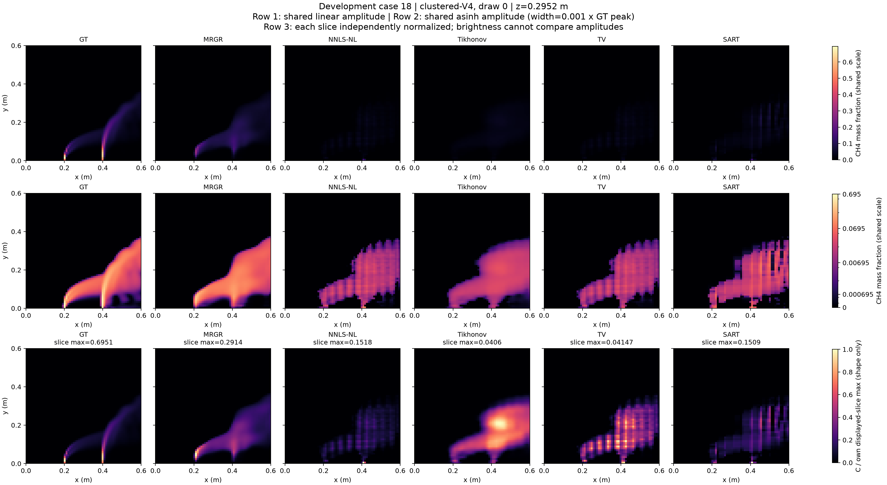
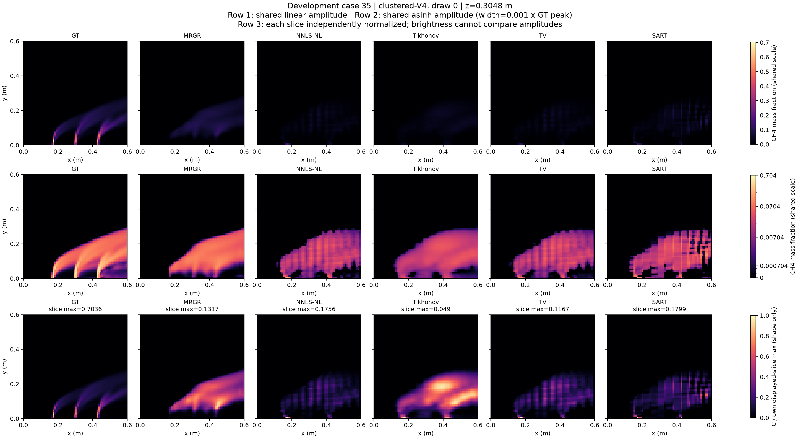

# 原始 MRGR 与四种经典算法：开发验证切面对比

生成时间：2026-10-18T16:53:57.381004+08:00（北京时间）。仅使用开发验证案例，未读取35例最终测试GT。

每图按 GT、原始 MRGR（epoch 278，C1）、NNLS-NL、Tikhonov、TV、SART 排列。普通固定V4与聚簇V4 draw0使用相同冻结输入站位和观测顺序。案例固定为清单索引0/18/35，切面为各案例GT三维峰所在z，所有方法共用同一物理切面，未按结果挑选案例或切面。

## 为什么旧图很暗

旧图采用[0,GT峰值]的统一线性色标。经典方法的预测峰值较低、羽流更分散，聚簇观测下尤其明显，因此低浓度羽流接近色图黑端。暗不代表数组为空；也不能仅靠增亮认定其恢复良好。下图保留峰值比和实际浓度色标，帮助区分幅值偏低与结构差异。

## 六方法同图：统一 asinh 色标

同一案例的六列共用同一个非线性色标，色条仍标实际质量分数；asinh线性宽度固定为GT峰值的0.001倍，对全部案例和方法使用同一规则。它让低浓度结构更可见，同时保留跨方法幅值可比性。每列标注三维峰值/GT峰值。

### Val-A-V4，draw0

### clustered-V4，draw0

## 三种显示方式逐案例核对

每张详细图有三行：第一行保留统一线性绝对浓度；第二行采用统一asinh绝对浓度；第三行各显示切面除以自身最大值，仅比较切面形状。第三行每列会显示自己的切面峰值，不能将同样明亮理解为同样浓度。零切面保持零，不人为制造结构。超出GT峰值的区域在前两行饱和，实际峰比与饱和数量另存元数据。

### Val-A-V4，案例0

[下载PDF](../../outputs/research/mrgr_paper_final_v1/evaluation/classical_slices_v2/Val-A-V4_case00_three_scales.pdf)

### Val-A-V4，案例18

[下载PDF](../../outputs/research/mrgr_paper_final_v1/evaluation/classical_slices_v2/Val-A-V4_case18_three_scales.pdf)

### Val-A-V4，案例35

[下载PDF](../../outputs/research/mrgr_paper_final_v1/evaluation/classical_slices_v2/Val-A-V4_case35_three_scales.pdf)

### clustered-V4，案例0

[下载PDF](../../outputs/research/mrgr_paper_final_v1/evaluation/classical_slices_v2/clustered-V4_case00_three_scales.pdf)

### clustered-V4，案例18

[下载PDF](../../outputs/research/mrgr_paper_final_v1/evaluation/classical_slices_v2/clustered-V4_case18_three_scales.pdf)

### clustered-V4，案例35

[下载PDF](../../outputs/research/mrgr_paper_final_v1/evaluation/classical_slices_v2/clustered-V4_case35_three_scales.pdf)

## 幅值诊断

| 布局 | 案例 | 方法 | 三维峰/GT峰 | 当前切面峰值 | 当前切面峰/GT切面峰 |
|---|---:|---|---:|---:|---:|
| Val-A-V4 | 0 | MRGR | 1.1332 | 0.538679 | 1.1332 |
| Val-A-V4 | 0 | NNLS-NL | 0.4666 | 0.221814 | 0.4666 |
| Val-A-V4 | 0 | Tikhonov | 0.2639 | 0.12358 | 0.2600 |
| Val-A-V4 | 0 | TV | 0.4211 | 0.200199 | 0.4211 |
| Val-A-V4 | 0 | SART | 0.4456 | 0.211827 | 0.4456 |
| Val-A-V4 | 18 | MRGR | 1.0191 | 0.698783 | 1.0054 |
| Val-A-V4 | 18 | NNLS-NL | 0.5768 | 0.400907 | 0.5768 |
| Val-A-V4 | 18 | Tikhonov | 0.1916 | 0.132375 | 0.1905 |
| Val-A-V4 | 18 | TV | 0.4025 | 0.27975 | 0.4025 |
| Val-A-V4 | 18 | SART | 0.5178 | 0.359888 | 0.5178 |
| Val-A-V4 | 35 | MRGR | 0.9748 | 0.685846 | 0.9748 |
| Val-A-V4 | 35 | NNLS-NL | 0.4390 | 0.277413 | 0.3943 |
| Val-A-V4 | 35 | Tikhonov | 0.1570 | 0.103732 | 0.1474 |
| Val-A-V4 | 35 | TV | 0.3011 | 0.211869 | 0.3011 |
| Val-A-V4 | 35 | SART | 0.4310 | 0.255874 | 0.3637 |
| clustered-V4 | 0 | MRGR | 1.2408 | 0.457858 | 0.9631 |
| clustered-V4 | 0 | NNLS-NL | 0.0694 | 0.0300674 | 0.0632 |
| clustered-V4 | 0 | Tikhonov | 0.0625 | 0.0215437 | 0.0453 |
| clustered-V4 | 0 | TV | 0.0673 | 0.0293996 | 0.0618 |
| clustered-V4 | 0 | SART | 0.1067 | 0.0346944 | 0.0730 |
| clustered-V4 | 18 | MRGR | 0.4192 | 0.291367 | 0.4192 |
| clustered-V4 | 18 | NNLS-NL | 0.2185 | 0.151844 | 0.2185 |
| clustered-V4 | 18 | Tikhonov | 0.0698 | 0.0405976 | 0.0584 |
| clustered-V4 | 18 | TV | 0.0709 | 0.0414674 | 0.0597 |
| clustered-V4 | 18 | SART | 0.2254 | 0.15089 | 0.2171 |
| clustered-V4 | 35 | MRGR | 0.4293 | 0.13174 | 0.1872 |
| clustered-V4 | 35 | NNLS-NL | 0.3848 | 0.175569 | 0.2495 |
| clustered-V4 | 35 | Tikhonov | 0.1075 | 0.0489976 | 0.0696 |
| clustered-V4 | 35 | TV | 0.2394 | 0.116727 | 0.1659 |
| clustered-V4 | 35 | SART | 0.4013 | 0.179921 | 0.2557 |

## 预测身份、SART进度与解释边界

原始MRGR与前三种经典方法复用已有预测，并核对manifest中的哈希与站位。SART采用已冻结松弛系数0.5、200轮预算；为了立即补齐固定图像，另生成预定的6个案例—布局预测，先保存并与其余24个方法预测一起单独封存，再读取开发GT绘图。该图像子集不替代612次完整SART开发验证，不根据切面调参。

SART完整开发曾在101次预测后因站位缓存淘汰触发KeyError。修复只保留本次重建已取到的矩阵引用；矩阵、求解器、选择规则与参数源码均核实未改变，原101份预测哈希保持一致，失败日志保留，完整开发已恢复。

SART采用节点摩尔分数离散，与MRGR前向存在已披露的插值/转换顺序差异。切面对比不能替代三维误差、峰值、定位和投影指标。增加显示动态范围不改变预测数组、评分或冻结模型。

[图像审计](../../outputs/research/mrgr_paper_final_v1/evaluation/classical_slices_v2/figure_audit.json)；[图像输入封存](../../outputs/research/mrgr_paper_final_v1/evaluation/classical_slices_v2/visualization_predictions_sealed.json)；[幅值逐项记录](../../outputs/research/mrgr_paper_final_v1/evaluation/classical_slices_v2/slice_amplitude_metadata.jsonl)；[经典开发报告](mrgr_paper_final_classical_development_v1_zh.md)；[SART补充协议](mrgr_paper_final_sart_supplement_v1_zh.md)。
