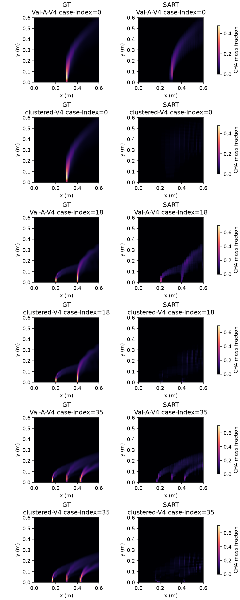

# GeoPhy-Set3D：SART 补充经典算法开发结果

生成时间：2026-10-18T17:16:48.643073+08:00（北京时间）。以下仅为训练校准和36例开发验证，不是35例最终测试。

[方法、注册与测试前扩展协议](mrgr_paper_final_sart_supplement_v1_zh.md)。主模型身份与主要终点保持冻结，SART无论开发成绩如何均保留进入正式测试。

## 参数选择与正确性

预登记松弛系数0.5、1.0，各在6个训练案例和2个布局上运行，共24次。所有预测封存后才读取训练GT64。选中候选0，配置：`{"iterations": 200, "minimum_iterations": 40, "tolerance": 1e-05, "patience": 8, "resolution": 64, "samples": 96, "relaxation": 0.5}`。

| 候选 | 松弛系数 | 训练校准平均三维L1 |
|---|---:|---:|
| 0 | 0.5 | 83.3663% |
| 1 | 1.0 | 88.4734% |

前向/转置、单位、恢复和更新检查通过；phantom线性投影相对L2=4.41106e-06。这不构成真实测量数据或三维重建误差的精度保证。

## 离散前向差异（训练GT64，仅诊断）

对同一训练浓度场分别计算冻结P(C)与A·g(C)。这是非线性转换和插值顺序的离散差异，不作为SART调参指标。

| 布局 | 平均相对L1 | 最大案例相对L1 | 平均相对L2 | 最大绝对差 ppm·m |
|---|---:|---:|---:|---:|
| Val-A-V4 | 0.382176% | 0.414805% | 0.989925% | 1599.249023 |
| clustered-V4 | 0.397830% | 0.424003% | 0.990917% | 1251.933594 |

SART使用节点摩尔分数表示，不能把它称为P(C)的精确线性解。下列输入及额外H4投影指标统一使用P(C)，不使用求解器自己的线性残差替代。

[原始MRGR与全部四种经典方法的同切面对比：统一绝对色标及形状归一化](mrgr_paper_final_classical_slices_v2_zh.md)。

## 36例全布局结果

| 布局（逐例聚合） | 方法 | 阶段 | 三维L1 | 三维L2 | L1中位数 | L1 P90 | L1最大 |
|---|---|---|---:|---:|---:|---:|---:|
| Val-A-V4 | LR4E4 | C1 | 9.3062% | 16.2272% | 8.8480% | 15.6355% | 22.7001% |
| Val-A-V4 | MRGR | C1 | 9.3697% | 15.8220% | 8.5659% | 15.0126% | 24.1151% |
| Val-A-V4 | SART | C1 | 40.9470% | 45.8347% | 37.2484% | 64.3964% | 98.3223% |
| spread-V4 | LR4E4 | C1 | 8.7011% | 15.9314% | 8.1270% | 14.5251% | 20.1869% |
| spread-V4 | MRGR | C1 | 8.6390% | 15.3909% | 7.8732% | 14.0006% | 20.9205% |
| spread-V4 | SART | C1 | 27.8111% | 38.0403% | 27.7240% | 35.8159% | 39.3140% |
| V3 | LR4E4 | C1 | 10.7949% | 17.8277% | 10.1442% | 17.5444% | 20.7705% |
| V3 | MRGR | C1 | 10.8834% | 17.5979% | 10.5236% | 16.9859% | 21.6685% |
| V3 | SART | C1 | 58.7448% | 57.6623% | 59.2054% | 69.8808% | 88.4525% |
| V6 | LR4E4 | C1 | 8.6283% | 15.7811% | 8.1274% | 14.2544% | 19.0460% |
| V6 | MRGR | C1 | 8.6337% | 15.3514% | 8.1223% | 13.7390% | 19.9551% |
| V6 | SART | C1 | 28.6481% | 36.1695% | 27.2118% | 40.8239% | 51.3761% |
| clustered-V4 | LR4E4 | C1 | 28.7335% | 44.2596% | 26.6352% | 41.2350% | 62.5222% |
| clustered-V4 | MRGR | C1 | 33.0012% | 48.2534% | 28.4419% | 48.0011% | 67.8745% |
| clustered-V4 | SART | C1 | 130.1554% | 90.7852% | 130.8050% | 144.9776% | 150.5154% |

### 次要形态与峰值（探索性）

| 布局 | 方法 | 质心mm | 峰比 | 峰比绝对误差 | GT峰处比 | Dice10 | Dice50 | 背景占比 |
|---|---|---:|---:|---:|---:|---:|---:|---:|
| Val-A-V4 | LR4E4 | 1.4533 | 1.1621 | 0.1984 | 0.9962 | 0.9369 | 0.8281 | 0.0161 |
| Val-A-V4 | MRGR | 1.5098 | 1.1365 | 0.1803 | 1.0332 | 0.9384 | 0.8355 | 0.0165 |
| Val-A-V4 | SART | 1.8345 | 0.5217 | 0.4783 | 0.3116 | 0.6816 | 0.0864 | 0.1318 |
| clustered-V4 | LR4E4 | 9.5937 | 0.8727 | 0.1835 | 0.3245 | 0.7656 | 0.4122 | 0.0555 |
| clustered-V4 | MRGR | 11.2375 | 0.8189 | 0.2391 | 0.2744 | 0.7167 | 0.3439 | 0.0727 |
| clustered-V4 | SART | 34.4719 | 0.4461 | 0.6175 | 0.0575 | 0.0171 | 0.0055 | 0.6313 |

### 输入/额外H4投影与成本

| 布局 | 方法 | 输入L1 | 输入L2 | H4 L1 | H4 L2 | 重建秒中位数 | 峰Torch显存MiB（最大） |
|---|---|---:|---:|---:|---:|---:|---:|
| Val-A-V4 | LR4E4 | 2.3621% | 3.3493% | 3.0179% | 3.9669% | 0.02410 | 历史未记录 |
| Val-A-V4 | MRGR | 2.4348% | 3.3968% | 3.1140% | 4.0413% | 0.02419 | 历史未记录 |
| Val-A-V4 | SART | 1.8403% | 1.6129% | 15.4847% | 16.2586% | 1.95369 | 0.0 |
| clustered-V4 | LR4E4 | 8.5684% | 12.1342% | 14.2650% | 17.8219% | 0.02453 | 历史未记录 |
| clustered-V4 | MRGR | 9.8677% | 14.0773% | 16.7392% | 20.5007% | 0.02435 | 历史未记录 |
| clustered-V4 | SART | 3.1875% | 3.7678% | 72.4098% | 57.2622% | 2.11012 | 0.0 |

五draw面板的计时/显存先按案例平均再汇总；逐次真实最大显存和冷启动成本请见逐例manifest。历史神经模型开发计时与新经典计时边界不同，不作严格速度排名；最终测试使用同一新入口重新计时。

### 聚簇五draw分别报告（C1三维L1）

| 方法 | draw0 | draw1 | draw2 | draw3 | draw4 |
|---|---:|---:|---:|---:|---:|
| LR4E4 | 32.3418% | 28.0696% | 29.6902% | 30.3520% | 23.2139% |
| MRGR | 42.0271% | 30.5993% | 31.9996% | 34.0136% | 26.3663% |
| SART | 125.3117% | 130.7250% | 132.7157% | 132.6465% | 129.3781% |

## 与此前三种经典方法统一查看

以下表格并列此前已封存复核的开发结果与新增SART。方法共享案例、布局和评分公式；SART的离散算子及CPU执行设备不同。全方法配对区间将在完整开发汇总中统一计算，不能把分别开发的同时区间当作同一个比较族。

| 布局（逐例聚合） | 方法 | 阶段 | 三维L1 | 三维L2 | L1中位数 | L1 P90 | L1最大 |
|---|---|---|---:|---:|---:|---:|---:|
| Val-A-V4 | LR4E4 | C1 | 9.3062% | 16.2272% | 8.8480% | 15.6355% | 22.7001% |
| Val-A-V4 | MRGR | C1 | 9.3697% | 15.8220% | 8.5659% | 15.0126% | 24.1151% |
| Val-A-V4 | NNLS-NL | C1 | 54.9920% | 54.8559% | 48.5204% | 78.6570% | 107.3896% |
| Val-A-V4 | TV | C1 | 53.5136% | 54.1332% | 49.0810% | 80.8144% | 105.2362% |
| Val-A-V4 | Tikhonov | C1 | 43.7260% | 50.7095% | 42.8056% | 66.3681% | 87.2338% |
| spread-V4 | LR4E4 | C1 | 8.7011% | 15.9314% | 8.1270% | 14.5251% | 20.1869% |
| spread-V4 | MRGR | C1 | 8.6390% | 15.3909% | 7.8732% | 14.0006% | 20.9205% |
| spread-V4 | NNLS-NL | C1 | 40.6638% | 46.6388% | 40.3701% | 47.1249% | 50.1067% |
| spread-V4 | TV | C1 | 38.3968% | 45.7928% | 36.9581% | 47.6628% | 49.7256% |
| spread-V4 | Tikhonov | C1 | 31.4336% | 44.2872% | 30.2674% | 42.4230% | 44.5197% |
| V3 | LR4E4 | C1 | 10.7949% | 17.8277% | 10.1442% | 17.5444% | 20.7705% |
| V3 | MRGR | C1 | 10.8834% | 17.5979% | 10.5236% | 16.9859% | 21.6685% |
| V3 | NNLS-NL | C1 | 71.5284% | 65.5744% | 71.6044% | 84.2413% | 97.4910% |
| V3 | TV | C1 | 70.8652% | 65.0527% | 70.5070% | 83.9733% | 102.6737% |
| V3 | Tikhonov | C1 | 57.5630% | 58.4460% | 56.7550% | 70.6470% | 90.9645% |
| V6 | LR4E4 | C1 | 8.6283% | 15.7811% | 8.1274% | 14.2544% | 19.0460% |
| V6 | MRGR | C1 | 8.6337% | 15.3514% | 8.1223% | 13.7390% | 19.9551% |
| V6 | NNLS-NL | C1 | 42.2278% | 44.2729% | 39.9526% | 53.4587% | 70.6909% |
| V6 | TV | C1 | 40.2420% | 43.6629% | 37.4085% | 56.1445% | 66.6063% |
| V6 | Tikhonov | C1 | 34.5011% | 45.0908% | 31.1622% | 48.5527% | 55.6078% |
| clustered-V4 | LR4E4 | C1 | 28.7335% | 44.2596% | 26.6352% | 41.2350% | 62.5222% |
| clustered-V4 | MRGR | C1 | 33.0012% | 48.2534% | 28.4419% | 48.0011% | 67.8745% |
| clustered-V4 | NNLS-NL | C1 | 129.0199% | 89.7741% | 129.6161% | 143.8369% | 150.8636% |
| clustered-V4 | TV | C1 | 129.4444% | 89.6408% | 129.9636% | 144.5683% | 151.6677% |
| clustered-V4 | Tikhonov | C1 | 119.9784% | 85.5991% | 118.4327% | 138.3201% | 146.9711% |
| Val-A-V4 | SART | C1 | 40.9470% | 45.8347% | 37.2484% | 64.3964% | 98.3223% |
| spread-V4 | SART | C1 | 27.8111% | 38.0403% | 27.7240% | 35.8159% | 39.3140% |
| V3 | SART | C1 | 58.7448% | 57.6623% | 59.2054% | 69.8808% | 88.4525% |
| V6 | SART | C1 | 28.6481% | 36.1695% | 27.2118% | 40.8239% | 51.3761% |
| clustered-V4 | SART | C1 | 130.1554% | 90.7852% | 130.8050% | 144.9776% | 150.5154% |

## 配对统计、有限预算与失败

| 对照 | 普通V4 MRGR−对照L1（百分点） | 案例95%CI（百分点） |
|---|---:|---|
| LR4E4 | 0.0635 | [-0.1148, 0.2372] |
| SART | -31.5773 | [-37.6115, -26.3016] |

SART共612次开发重建：数值失败0，预算耗尽612，稳定停止0。停止判据是目标值稳定，不是全局最优证明。
CPU求解时间中位数2.0975秒；几何准备中位数0.4317秒；进程累计峰RSS 855.7 MiB。求解时间含周期恢复写盘及摩尔分数到质量分数转换，不含最终预测压缩写盘和几何准备。CPU与GPU计时不作未限定设备的倍数比较。

独立复核重算612个数组，验证20组配对区间；L1/L2最大绝对差2e-15。

重建误差超过100%是保留的科学结果，不等价数值失败。稀疏欠定问题、零初始化、固定扫描预算、离散表示与先验差异都会影响结果，不能将全部差异归因于神经结构。

[逐例CSV](../../outputs/research/mrgr_paper_final_v1/evaluation/sart_dev/per_case_metrics.csv)；[完整统计](../../outputs/research/mrgr_paper_final_v1/evaluation/sart_dev/summary.json)；[独立复核](../../outputs/research/mrgr_paper_final_v1/evaluation/sart_dev/independent_verification.json)；[最高误差案例](../../outputs/research/mrgr_paper_final_v1/evaluation/sart_dev/worst_cases.csv)。

