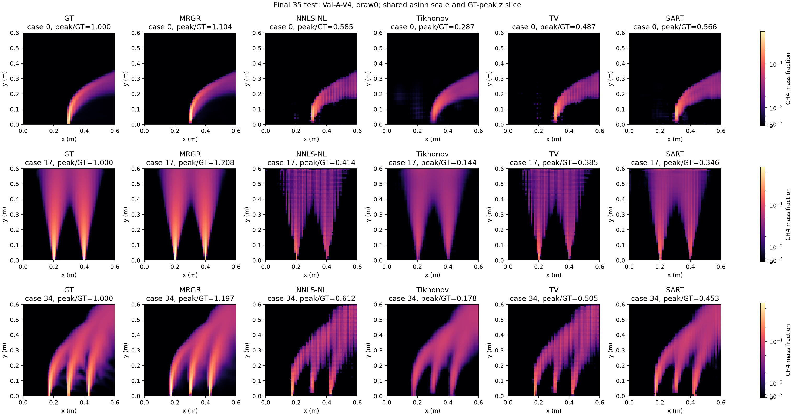
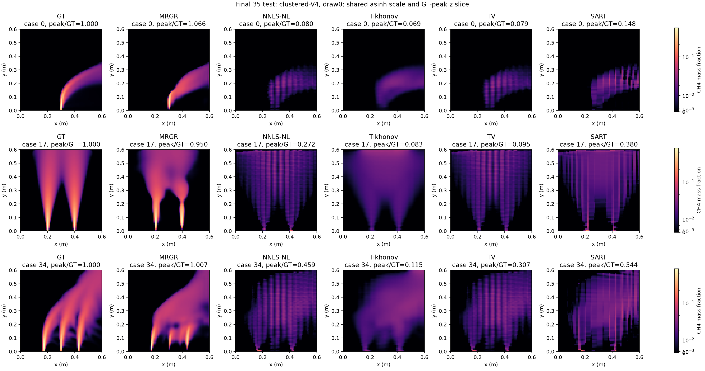

# MRGR：35 例最终测试与论文结果入口

更新时间：2026-10-19T14:51:20.669383+08:00（北京时间）。全部 21 方法、35 案例、17 布局已完成：12,495 次重建、22,610 个阶段场，独立评分和验收通过。

原始第278轮 MRGR 始终作为主模型；全部新增训练在测试评分前结束。测试预测全体封存后才读取本轮35份GT64，GT128未读取，评分后未重新训练或选模型。

## 主结果

| 方法 | 普通固定V4三维L1 | 聚簇V4五draw三维L1 |
|---|---:|---:|
| MRGR | 8.5159% | 31.6583% |
| LR4E4 | 8.4108% | 28.1320% |
| single_scale_seed20261011 | 8.4878% | 33.7855% |
| single_scale_seed20261019 | 8.5919% | 38.1649% |
| no_feedback_seed20261011 | 12.1364% | 39.4787% |
| no_feedback_seed20261019 | 12.6397% | 48.2179% |
| no_consistency_seed20261011 | 8.6227% | 35.4185% |
| no_consistency_seed20261019 | 8.8421% | 39.7034% |
| multiscale_seed20261019 | 8.6411% | 35.7544% |
| no_ray_relations_seed20261011 | 8.6607% | 38.2294% |
| no_observability_seed20261011 | 8.6253% | 33.1366% |
| uniform_fusion_seed20261011 | 8.5928% | 28.0246% |
| zero_residual_seed20261011 | 12.1446% | 42.3926% |
| no_ray_relations_seed20261019 | 8.8394% | 37.6114% |
| no_observability_seed20261019 | 8.8084% | 33.8507% |
| uniform_fusion_seed20261019 | 8.5527% | 29.9165% |
| zero_residual_seed20261019 | 12.5763% | 45.8565% |
| NNLS-NL | 54.9351% | 126.6958% |
| Tikhonov | 42.9134% | 118.5867% |
| TV | 53.3124% | 127.0949% |
| SART | 40.5899% | 128.5465% |

唯一主要终点为普通固定V4 C1三维相对L1。聚簇先按每案例平均五draw，再跨35案例汇总。全部20个主要终点对照均提供Bonferroni同时区间，完整判断见[预登记规则结果判读](mrgr_paper_final_interpretation_zh.md)。

## 同种子独立消融

| 因素 | 普通V4两种子平均差值（百分点） | 案例95%区间（百分点） | 聚簇五draw差值（百分点） |
|---|---:|---|---:|
| single_scale | -0.0386 | [-0.2267, +0.1326] | +2.2689 |
| no_feedback | +3.8095 | [+3.2893, +4.3748] | +10.1419 |
| no_consistency | +0.1539 | [-0.0366, +0.3502] | +3.8546 |
| no_ray_relations | +0.1715 | [+0.0233, +0.3381] | +4.2140 |
| no_observability | +0.1383 | [-0.0453, +0.3437] | -0.2127 |
| uniform_fusion | -0.0058 | [-0.1643, +0.1345] | -4.7358 |
| zero_residual | +3.7819 | [+3.2630, +4.3459] | +10.4182 |

差值为消融−完整，正值有利于完整模型。这里是探索性的同种子配对，两种子均值仅为描述性结果，案例区间不覆盖训练种子方差。各因素的容量与计算差异见[消融协议](mrgr_paper_final_module_ablations_v2_zh.md)。

## 原始MRGR与四种经典算法的固定切面

案例固定取索引0/17/34，均使用该案例GT峰的z切面；同一案例全部方法共享[0,GT峰值]色标。asinh只改变显示映射，浓度幅度未归一化；标题另列全体积峰值比。线性图和PDF也保留于同一结果目录。

[同色标线性图](../../outputs/research/mrgr_paper_final_v1/evaluation/test/classical_test35_Val-A-V4_linear.png) · [asinh PDF](../../outputs/research/mrgr_paper_final_v1/evaluation/test/classical_test35_Val-A-V4_asinh.pdf)

[同色标线性图](../../outputs/research/mrgr_paper_final_v1/evaluation/test/classical_test35_clustered-V4_linear.png) · [asinh PDF](../../outputs/research/mrgr_paper_final_v1/evaluation/test/classical_test35_clustered-V4_asinh.pdf)

## 结果、复现与同步范围

[总报告](mrgr_paper_final_experiments_zh.md) · [唯一主要终点与限制](mrgr_paper_final_interpretation_zh.md) · [封存恢复说明](mrgr_paper_final_seal_recovery_v2_zh.md)

[逐例指标CSV](../../outputs/research/mrgr_paper_final_v1/evaluation/test/per_case_metrics.csv) · [统计JSON](../../outputs/research/mrgr_paper_final_v1/evaluation/test/summary.json) · [独立复核](../../outputs/research/mrgr_paper_final_v1/evaluation/test/independent_verification.json) · [最终验收](../../outputs/research/mrgr_paper_final_v1/final_acceptance.json)

GitHub同步实验实现、预登记协议、逐例指标、图表、文件身份和恢复记录；数据集、权重、预测数组、恢复张量与原始进程资源快照保留本地。SHA256及绝对路径记录执行来源，跨机器复现需自行配置本地数据和权重。机器发布清单为`outputs/research/mrgr_paper_final_v1/github_publication_manifest.json`。

测试时同时报告经典有限迭代预算、SART离散算子差异及CPU/GPU计时边界。两种子不足以估计种子总体不确定性；没有额外噪声、标定误差或全新几何域实验。
