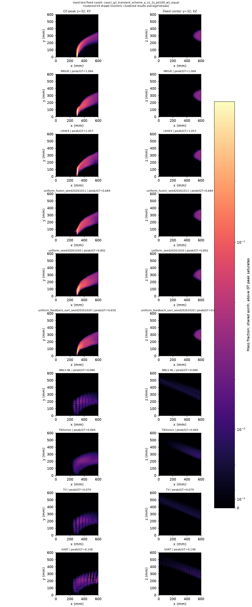
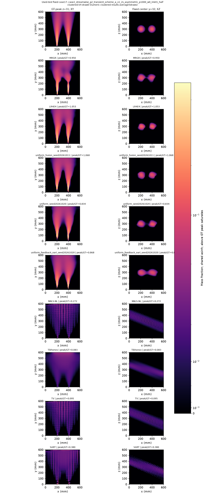
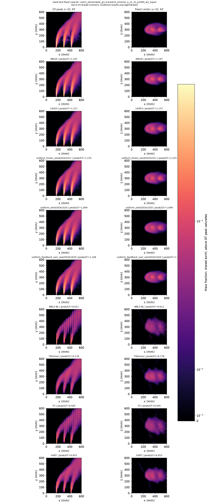
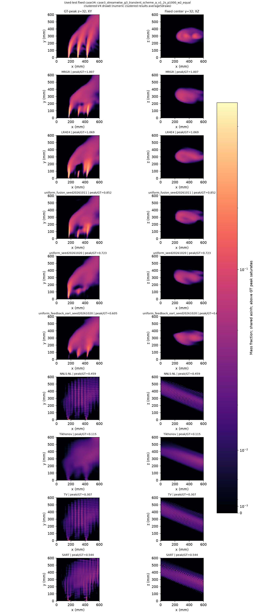

# MRGR-UniformFusion：四项训练的三维配对评价（最终模型待定）

本阶段按用户要求，先完成两种子均匀融合与两种子反馈OARI的三维配对评价；7个尚未启动的骨干消融暂缓，3个第二种子此前取消。暂缓任务不自动恢复，反馈OARI是否作为最终模型等待用户审阅，本报告不作自动晋级。

[本阶段范围及暂缓清单](artifacts/mrgr_uniform_final_v1/evaluation_stage_amendment_v1.json)

本阶段评价完成时间：2026-10-20T19:32:47.879472+08:00（北京时间）。

**数据边界：本轮沿用此前多次使用的35例，属于补充评价。数据审计未发现额外独立案例；均匀融合方向是在已用测试结果之后确定，不能称为新独立确认。原始MRGR、历史测试及报告均保留。**

部署候选固定为MRGR-UniformFusion、seed20261011、第285轮、342725参数；检查点SHA256为`64c1c4a41e66b518e415243be5796b89d36f3c27e5c4165e98b77af49de381fc`。该身份在新训练前指定，不根据本轮测试排名调整；四种子均单独报告，种子均值不代表集成。

## 主模型与经典算法

| 模型 | 普通V4 L1 | 聚簇V4 L1 | 聚簇L2 | 聚簇质心mm | 聚簇GT峰处比 | 聚簇峰比绝对误差 | 聚簇Dice50 |
|---|---:|---:|---:|---:|---:|---:|---:|
| uniform_fusion_seed20261011 | 8.5928% | 28.0246% | 45.0057% | 8.9787 | 0.3322 | 0.1752 | 0.4136 |
| uniform_fusion_seed20261019 | 8.5527% | 29.9165% | 44.1267% | 10.1516 | 0.3716 | 0.2145 | 0.4104 |
| uniform_seed20261020 | 8.5957% | 30.5898% | 46.9908% | 9.6076 | 0.3292 | 0.2164 | 0.3728 |
| uniform_seed20261021 | 8.8406% | 33.1448% | 49.2777% | 10.9030 | 0.2880 | 0.2292 | 0.3476 |
| MRGR | 8.5159% | 31.6583% | 47.9077% | 10.6727 | 0.3398 | 0.2000 | 0.3861 |
| LR4E4 | 8.4108% | 28.1320% | 44.9474% | 9.8760 | 0.3752 | 0.1630 | 0.4316 |
| NNLS-NL | 54.9351% | 126.6958% | 89.2971% | 49.5704 | 0.0259 | 0.7410 | 0.0041 |
| Tikhonov | 42.9134% | 118.5867% | 85.3364% | 29.0021 | 0.0233 | 0.9177 | 0.0000 |
| TV | 53.3124% | 127.0949% | 89.1463% | 50.3319 | 0.0238 | 0.8482 | 0.0000 |
| SART | 40.5899% | 128.5465% | 90.6856% | 33.1385 | 0.0615 | 0.6095 | 0.0067 |

## 唯一主要终点与同时区间

普通固定V4的C1三维相对L1为唯一主要终点。下面差值按比较名称方向计算，单位为百分点，区间为预登记14项Bonferroni同时案例bootstrap区间；即使个别OARI未晋级，也不缩小校正项数。方向选择及数据复用限制仍使结果具有补充、探索性性质。

| 比较 | L1差百分点 | 同时区间 |
|---|---:|---|
| uniform4seed_case_mean-minus-MRGR | +0.1295 | [-0.1015, +0.4032] |
| uniform4seed_case_mean-minus-LR4E4 | +0.2346 | [-0.0294, +0.5186] |
| uniform4seed_case_mean-minus-NNLS-NL | -46.2897 | [-56.4118, -38.4606] |
| uniform4seed_case_mean-minus-Tikhonov | -34.2679 | [-41.6850, -27.8315] |
| uniform4seed_case_mean-minus-TV | -44.6669 | [-54.8379, -36.2467] |
| uniform4seed_case_mean-minus-SART | -31.9445 | [-41.7028, -24.3196] |
| uniform2seed-minus-matchedGCA2seed | -0.0058 | [-0.2519, +0.1975] |
| pruned_descriptor-minus-uniform2seed | +0.1495 | [-0.0083, +0.3634] |
| feedbackOARI2seed-minus-matchedUniform2seed | -0.0196 | [-0.2210, +0.1597] |

## C0到C1：共享解码器的阶段轨迹

| 模型 | 普通C0 L1 | 普通C1 L1 | 聚簇C0 L1 | 聚簇C1 L1 |
|---|---:|---:|---:|---:|
| uniform_fusion_seed20261011 | 11.3762% | 8.5928% | 33.0008% | 28.0246% |
| uniform_fusion_seed20261019 | 11.5614% | 8.5527% | 35.5517% | 29.9165% |
| uniform_seed20261020 | 11.3132% | 8.5957% | 35.5304% | 30.5898% |
| uniform_seed20261021 | 11.7628% | 8.8406% | 39.8036% | 33.1448% |

四种子主模型的普通/聚簇均值分别为8.6454%/30.4189%；四个种子均值间的样本标准差分别为0.1316个百分点/2.1170个百分点。这只是四个已登记种子的描述性离散程度，不是训练种子总体置信区间。

## 证据、复现及结论边界

历史复用：原始MRGR两种子、LR4E4、均匀融合两种子、四种经典算法，以及均匀融合＋描述符结构删除两种子。本阶段新增训练数为4，实际纳入清单见范围修订与训练审计。所有复用预测按595条布局清单逐文件校验，新增预测全部封存后才读取本轮GT64；GT128未读。

经典算法使用历史固定预算和参数，NNLS-NL/TV/SART多为200步预算耗尽，不能当作精确最优解。SART采用节点摩尔分数的线性离散算子，统一投影评分仍使用原非线性P(C)。不对异设备历史计时作严格速度排名。

本阶段五项新骨干消融全部暂缓，没有对应三维结论；只保留已核验的GCA/均匀融合和描述符结构删除历史证据。原14项主要比较的校正分母不变，五项骨干消融比较缺失。

反馈OARI为独立支线，不合并主模型。缺少全新案例确认，也没有匹配新增容量的非OARI模块对照，即使多种子同向改善，也不足以将全部收益归因于OARI注意力机制或自动晋级。峰值、质心、Dice与全场L1均完整报告。

下一步等待用户根据完整L1、峰值、定位和种子间差异讨论最终候选；不自动将OARI设为最终模型，不自动恢复暂缓实验。当前35例已使用，候选选择不能当作新的独立确认。

[模型身份与配置](mrgr_uniform_final_model_v1_zh.md) · [测试协议](../mrgr_uniform_final_v1_protocol_zh.md) · [消融报告](mrgr_uniform_final_ablations_v1_zh.md) · [OARI支线](mrgr_uniform_oari_v1_zh.md) · [资源调度](mrgr_uniform_final_resources_v1_zh.md)

[完整统计](artifacts/mrgr_uniform_final_v1/summary.json) · [逐案例CSV](artifacts/mrgr_uniform_final_v1/per_case_metrics.csv) · [失败/高误差案例](artifacts/mrgr_uniform_final_v1/worst_cases.csv) · [全部原始指标gzip](artifacts/mrgr_uniform_final_v1/all_metrics.jsonl.gz) · [独立重算](artifacts/mrgr_uniform_final_v1/independent_verification.json) · [验收](artifacts/mrgr_uniform_final_v1/acceptance.json)

## 预登记固定切面

XY位于GT峰的z；XZ固定y索引32。全方法共用GT浓度幅度和asinh色标，不逐模型归一化；线性PNG与asinh PDF完整保留。聚簇图为draw0，表中为五draw案例内均值。

## 经典算法停止状态

| 方法 | 数值失败 | 预算耗尽 | 稳定停止 |
|---|---:|---:|---:|
| NNLS-NL | 0 | 595 | 0 |
| Tikhonov | 0 | 142 | 453 |
| TV | 0 | 595 | 0 |
| SART | 0 | 595 | 0 |

[全部方法的完整性与停止统计](artifacts/mrgr_uniform_final_v1/failure_rates.json)。未按误差或是否预算耗尽删除案例。

