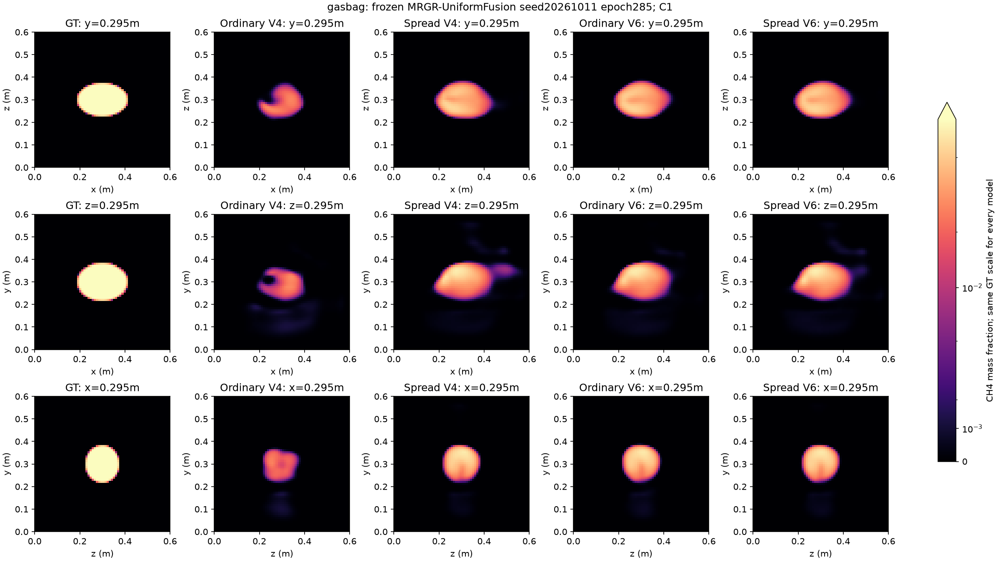

# 实心气袋测试解读

已完成一个实心椭球气袋、四种固定布局的冻结均匀融合MRGR小测试。结果显示实心气袋比同权重圆环的全场误差低，但普通四视角明显失败，扩大角度覆盖后仍未实现准确浓度恢复。

| 布局 | 气袋L1 | 同权重圆环L1 | 气袋Dice50 | 气袋质心mm | 预测/GT总浓度积分 |
|---|---:|---:|---:|---:|---:|
| Ordinary V4 | 86.75% | 97.30% | 0.000 | 20.55 | 0.166 |
| Spread V4 | 60.67% | 82.62% | 0.535 | 12.75 | 0.522 |
| Ordinary V6 | 59.20% | 84.90% | 0.525 | 8.48 | 0.508 |
| Spread V6 | 59.26% | 81.39% | 0.534 | 9.47 | 0.513 |

普通V4的预测峰值仅为GT的44.4%，所以共同50%GT阈值下Dice50为0、3D占据图为空；这不表示模型输出全零。切面可见局部凹陷和形变，未恢复均匀内部。分散V4和六视角可恢复较接近实心团块的外形，但中心浓度约为GT峰值的一半，且总浓度积分仅恢复约51%～52%。

普通V4→分散V4在视角数不变时L1由86.75%降至60.67%，说明当前站位覆盖影响较大。分散V4→分散V6的L1降至59.26%，额外两视角的增益较小。两者布局预先固定，未按本次得分选站；不能把普通V4与六视角间全部差异归因于视角数。

气袋64³表示重投影的全64站L1基线为1.82%，远低于模型输入重投影约53%～85%的误差；连续解析积分256/512点差异约0.0021%。这批数据不支持把主要失败归因于前向积分分辨率。输入最大值约为训练固定归一化尺度的0.71～0.92，也不是明显超过该尺度。

该结果与训练分布对羽流形态/浓度分布的偏好相容，但尚未隔离形状、边缘陡峭度、空间占据率和总浓度相对训练分布的差异，不能单独证明失败机制。气袋和圆环同峰值、同中心、总浓度积分相差约2.9%，仍不是只改变“有无空洞”的严格因果消融。

因此，圆环中空确实可能增加难度，但本次实心目标仍有较大误差，空洞不是解释历史失败的充分原因。不能根据单个合成目标宣称已经具备通用非羽流或真实气袋重建能力。当前模型仍按用户决定暂定为均匀融合MRGR，不继续研究反馈OARI、不自动启动7个暂缓消融。

[完整报告与图](mrgr_uniform_nonplume_gasbag_v1_zh.md) · [当前模型决定](../mrgr_model_status_20261020_zh.md)

