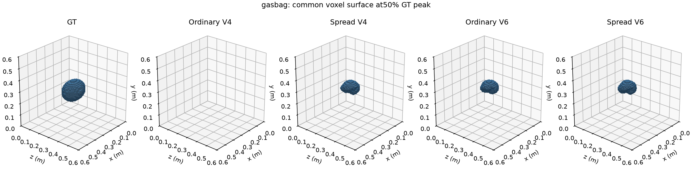
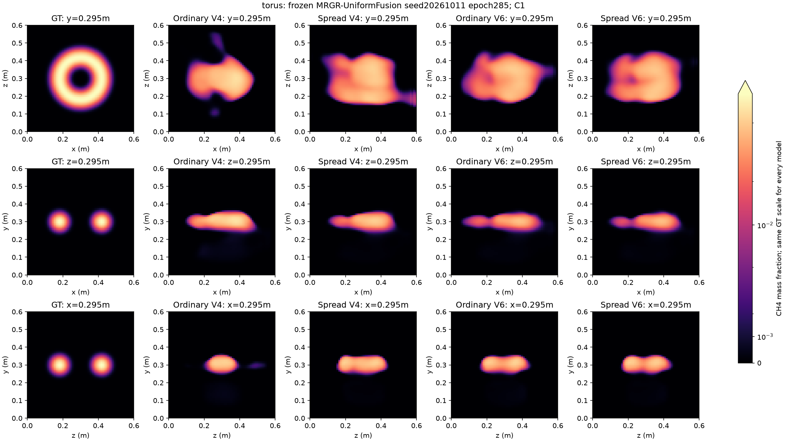
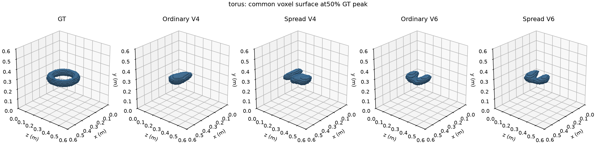

# 均匀融合MRGR：实心气袋目标小测试

完成时间：2026-10-20T20:04:10.360638+08:00（北京时间）。

当前暂定主模型为均匀融合MRGR；停止反馈OARI后续研究，7个消融任务继续暂缓。本次只作冻结权重推理，不训练、不优化、不按本次目标修改权重或参数。

主模型：MRGR-UniformFusion-v1，seed20261011，第285轮，342725参数。权重SHA256：`64c1c4a41e66b518e415243be5796b89d36f3c27e5c4165e98b77af49de381fc`。

## 目标和比较设计

气袋为实心椭球，中心(0.3,0.3,0.3)m，XYZ半轴(0.12,0.09,0.08)m，内部质量分数0.08。归一化椭球半径r≤0.85为均匀平台，0.85<r<1用半余弦降至零，r≥1为零；无空洞。它是静态合成标量场，未模拟袋膜光学效应、真实气袋或流体过程。

同时用本次同一均匀融合权重重算原参数圆环作为形态参照：中心相同、大半径0.12m、管高斯标准差0.025m、峰值0.08。两个目标同幅值，总浓度积分接近但并非严格匹配；形状、边界陡峭度与空间占据率仍同时不同。历史圆环使用不同权重，其指标不直接作为本次配对基线。

沿用历史圆环实验登记的普通V4、分散V4、普通V6(draw0)、分散V6四组站位，未按目标或模型结果选布局。每种目标只算一个案例，四组布局不是四个独立案例。普通V4为预先指定的主要展示，其他布局全部保留。

测量由独立NumPy float64连续解析场生成：先按原分子量做非线性质量分数→摩尔分数转换，再沿原Pool A射线做512点梯形积分，单位ppm·m；256/512点收敛核验。没有读取或生成任何128³标签，不读取已有案例GT/投影。模型使用原训练固定归一化，64³场仅用于本次合成评分；全部8组C0/C1预测保存并哈希封存后再计算指标。

| 目标 | 64³峰值 | 浓度积分(m³) | 平均质量分数 |
|---|---:|---:|---:|
| gasbag | 0.080000 | 0.00023003 | 0.001016 |
| torus | 0.078561 | 0.00023687 | 0.001046 |

## 全部三维结果

| 目标/布局/阶段 | L1 | L2 | Dice50 | 峰值比 | 峰比绝对误差 | 质心mm | 输入投影L1 | 共同未输入投影L1 |
|---|---:|---:|---:|---:|---:|---:|---:|---:|
| gasbag/ordinary_V4/C0 | 100.26% | 99.57% | 0.000 | 0.126 | 0.874 | 106.02 | 100.23% | 100.23% |
| gasbag/ordinary_V4/C1 | 86.75% | 85.51% | 0.000 | 0.444 | 0.556 | 20.55 | 85.27% | 85.40% |
| gasbag/spread_V4/C0 | 86.36% | 84.30% | 0.007 | 0.521 | 0.479 | 28.04 | 82.82% | 83.23% |
| gasbag/spread_V4/C1 | 60.67% | 57.68% | 0.535 | 0.861 | 0.139 | 12.75 | 52.64% | 53.13% |
| gasbag/ordinary_V6/C0 | 86.27% | 85.30% | 0.001 | 0.505 | 0.495 | 14.67 | 84.83% | 84.68% |
| gasbag/ordinary_V6/C1 | 59.20% | 57.33% | 0.525 | 0.853 | 0.147 | 8.48 | 53.10% | 53.06% |
| gasbag/spread_V6/C0 | 86.82% | 85.58% | 0.000 | 0.485 | 0.515 | 23.37 | 85.00% | 84.87% |
| gasbag/spread_V6/C1 | 59.26% | 57.07% | 0.534 | 0.865 | 0.135 | 9.47 | 52.89% | 53.06% |
| torus/ordinary_V4/C0 | 103.28% | 96.12% | 0.026 | 0.622 | 0.378 | 35.90 | 77.97% | 78.05% |
| torus/ordinary_V4/C1 | 97.30% | 90.03% | 0.152 | 0.786 | 0.214 | 16.80 | 47.30% | 53.86% |
| torus/spread_V4/C0 | 94.41% | 85.28% | 0.037 | 0.576 | 0.424 | 37.92 | 63.18% | 63.94% |
| torus/spread_V4/C1 | 82.62% | 73.05% | 0.332 | 0.707 | 0.293 | 29.12 | 37.85% | 40.92% |
| torus/ordinary_V6/C0 | 98.83% | 90.67% | 0.017 | 0.578 | 0.422 | 28.46 | 64.53% | 64.57% |
| torus/ordinary_V6/C1 | 84.90% | 76.13% | 0.263 | 0.696 | 0.304 | 27.04 | 42.15% | 43.48% |
| torus/spread_V6/C0 | 97.85% | 89.82% | 0.013 | 0.557 | 0.443 | 30.20 | 66.90% | 67.11% |
| torus/spread_V6/C1 | 81.39% | 73.81% | 0.263 | 0.679 | 0.321 | 26.21 | 41.37% | 41.80% |

L1/L2以GT范数归一化；Dice50以同一目标GT峰值50%作共同阈值；峰比=max(pred)/max(GT)，质心按梯形积分。平台峰值没有唯一位置，不解释单个argmax坐标误差。C0/C1为同一训练模型的两阶段，不能作为独立训练消融。

## C1气袋与同权重圆环参照

| 布局 | 气袋L1 | 圆环L1 | 气袋Dice50 | 圆环Dice50 |
|---|---:|---:|---:|---:|
| Ordinary V4 | 86.75% | 97.30% | 0.000 | 0.152 |
| Spread V4 | 60.67% | 82.62% | 0.535 | 0.332 |
| Ordinary V6 | 59.20% | 84.90% | 0.525 | 0.263 |
| Spread V6 | 59.26% | 81.39% | 0.534 | 0.263 |

## 共同色标和固定切面

同一目标的GT与所有布局使用GT峰值固定色标，不逐模型归一化；线性和asinh图均保存，超过GT峰值的部分饱和。切面固定索引31，3D使用共同50%GT峰值阈值的体素表面。








## 数值核验及边界

GT64表示基线的投影误差单列于summary.json，用来区分64³插值/96点中点积分误差与模型误差。全部预测范围/有限性、权重不变、输入无GT、独立NumPy L1/L2重算及参考积分收敛检查通过；详见验收记录。

本次只说明一个合成实心气袋和四组固定布局上的表现，不代表所有非羽流目标、实际气袋或独立泛化能力确认。不据此搜索形状、浓度、checkpoint或最佳布局；所有正负结果完整保存。

[完整汇总](artifacts/mrgr_uniform_nonplume_gasbag_v1/summary.json) · [登记](artifacts/mrgr_uniform_nonplume_gasbag_v1/registration.json) · [验收](artifacts/mrgr_uniform_nonplume_gasbag_v1/acceptance.json) · [可复现脚本](../../scripts/test_uniform_nonplume_gasbag_v1.py)

大型测量、目标、预测和重投影保存于服务器`/scratch/djc/GeoPhy-Set3D/mrgr_uniform_nonplume_gasbag_v1`，不提交Git。

复现（新输出目录；自动检查并锁定空闲GPU，亦可用--device cpu）：

```bash
/scratch/djc/envs/gas-torch/bin/python scripts/test_uniform_nonplume_gasbag_v1.py --out /scratch/djc/GeoPhy-Set3D/mrgr_uniform_nonplume_gasbag_v1_repeat --no-publish
```
