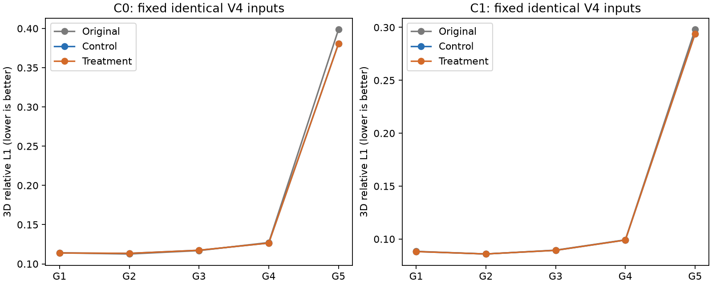
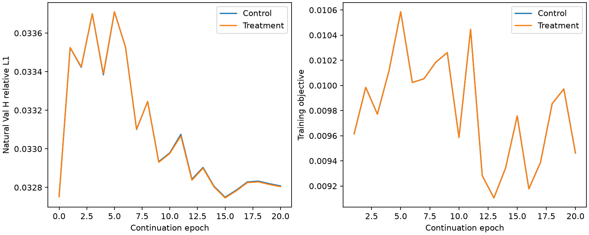

# Ours C0局部方向描述适配：固定输入有限对照

**判定：NO_GO。** 两组均实际完成20轮/1,660次更新，从同一无三维标签v1权重继续训练；没有调整视角分布。

**没有确认新增模块的实质收益，不替换原v1。** G5 C1 L1的Treatment−Control为−2.3405e−5，95%CI=[−6.6906e−5,+1.0888e−5]，相对仅降低0.00796%，18例改善、18例恶化。Treatment相对原v1的均值降低1.365%，Control也降低1.357%，两者相对原v1的L1区间均跨零，不能将继续训练变化归功于适配器。普通macro的模块增量约0.00568%，即使其逐项区间低于零，也不等于实质性能提升。

新增C0适配器1,152参数（332,070→333,222，+0.347%），只将已有局部方向描述直接提供给C0融合特征。末层零初始化；真实数据C0/C1及反馈输出逐元素一致，实际原测量loss反传梯度有限非零。原模型/loss/projector保持原文件，独立实现以零适配输出逐stage等价验证。

## 固定观测条件与预算

两臂原166 train/36 Val、原natural sampler epoch0–19、相同case顺序及A/B/H站位；所有20轮训练与Val的case/station digest相同。评价复用原900条V4布局，含全部36case、每组5draw、相同H4。两臂完整输入tensor与H hash逐条相同，并与原冻结评价核验measurement/geometry/mask身份。没有新观测、监督初始化或三维标签训练。

AdamW lr2e−5/wd1e−4、cosine20、FP32、batch2、clip1，原loss全部权重不变。两组均重置optimizer/scheduler；epoch0也参与自然Val held-out L1选模。不是fresh300轮比较；不能据此次继续训练宣称超过所有经典/深度学习基线。

| arm | epochs / steps | best continuation epoch | natural Val selector |
| --- | --- | --- | --- |
| Control | 20 / 1660 | 15 | 0.03274921 |
| Treatment | 20 / 1660 | 15 | 0.03274561 |

## C1主终点：Treatment与同期Control

先每case/group平均5layout，以36case配对bootstrap10,000次。Δ=Treatment−Control；区间为逐项95%，无多重覆盖或跨seed保证。

| group | Control L1 | Treatment L1 | Δ | Δ95%CI | 相对降低 | 胜/负/平 |
| --- | --- | --- | --- | --- | --- | --- |
| G1 | 0.088174 | 0.088168 | -0.000005 | [-0.000009, -0.000002] | 0.01% | 26/9/1 |
| G2 | 0.085929 | 0.085921 | -0.000007 | [-0.000012, -0.000003] | 0.01% | 26/10/0 |
| G3 | 0.089336 | 0.089332 | -0.000004 | [-0.000007, -0.000002] | 0.00% | 26/10/0 |
| G4 | 0.099066 | 0.099063 | -0.000004 | [-0.000007, -0.000000] | 0.00% | 23/13/0 |
| G5 | 0.293973 | 0.293950 | -0.000023 | [-0.000067, +0.000011] | 0.01% | 18/18/0 |
| ordinary_macro | 0.090626 | 0.090621 | -0.000005 | [-0.000008, -0.000002] | 0.01% | 26/10/0 |

## 原冻结v1与模块增量分开

| comparison | group | before L1 | after L1 | Δ95%CI |
| --- | --- | --- | --- | --- |
| Treatment-Original | ordinary_macro | 0.090760 | 0.090621 | [-0.000415, +0.000167] |
| Treatment-Original | G5 | 0.298018 | 0.293950 | [-0.008205, +0.001386] |
| Control-Original | ordinary_macro | 0.090760 | 0.090626 | [-0.000411, +0.000174] |
| Control-Original | G5 | 0.298018 | 0.293973 | [-0.008199, +0.001429] |

全部C0/C1、10项指标与三组配对见 [paired_statistics.csv](artifacts/ours_c0_adapter_matched_v1/paired_statistics.csv)；case组均值与最坏案例见 [case_group_540.csv](artifacts/ours_c0_adapter_matched_v1/case_group_540.csv)、[tails.csv](artifacts/ours_c0_adapter_matched_v1/tails.csv)。L2/peak和H指标不因与L1不同向而删除。

## C0、辅助指标与尾部风险

| 指标 | 原冻结v1 | Control继续训练 | Treatment适配器 |
| --- | --- | --- | --- |
| G5 C0 L1 | 0.398727 | 0.380531 | 0.380480 |
| G5 C0 L2 | 0.482608 | 0.470917 | 0.470907 |
| G5 C1 L2 | 0.423080 | 0.416906 | 0.416934 |
| G5 C1 H L1 | 0.145207 | 0.144575 | 0.144578 |
| G5 C1峰值绝对误差 | 0.108955 | 0.110531 | 0.110497 |
| 普通macro C1 L2 | 0.161080 | 0.161603 | 0.161604 |
| G5 case均值L1 p95 | 0.545705 | 0.599166 | 0.599069 |
| G5 case均值L1最大值 | 0.641913 | 0.662640 | 0.662058 |

C0在G5的改善主要也出现在Control中，不能由C0相对原v1降低约4.58%推断模块有效。G5 C1 L2相对原v1两组均改善，逐项区间低于零，但Treatment−Control L2均值略高、区间跨零；普通macro C1 L2相对原v1两组均略恶化，逐项区间低于零的L1微小增量并不代表各指标一致改善。普通macro C1峰值误差的Treatment−Control为+4.9032e−5，逐项95%CI=[+2.1277e−5,+7.6978e−5]，数值很小但方向不利；精确区间见CSV。

G5最坏案例仍为 `case2_1_g2_transient_scheme_a_v1_2s_asymmetric_p0300_w3_inlet2_half`。Treatment的p95和最大L1均高于原v1，均值略降不能解释成整体鲁棒性提高。这里的p95/max先按case平均五layout，不是单layout尾部，也未做跨seed确认。





## 预登记判据与结论边界

要求Treatment相对同期Control和原冻结v1均：G5 L1至少下降5%且差值CI上界<0；普通macro L1、G5 H L1均不恶化超过3%。全部检查保留：

```json
{
  "Control": {
    "g5_at_least_5pct": false,
    "g5_ci_below_zero": false,
    "ordinary_within_3pct": true,
    "g5_heldout_within_3pct": true
  },
  "Original": {
    "g5_at_least_5pct": false,
    "g5_ci_below_zero": false,
    "ordinary_within_3pct": true,
    "g5_heldout_within_3pct": true
  }
}
```

单seed、有限继续训练、已研究过的Val只支持这次探索；不构成最终test、新物理域或完整三维标签依赖曲线。未改gate、采样、loss或继续搜索第二模块；保留原v1作为基准。

本实验只否定“这一种C0适配器在本次有限继续训练下有足够收益”，不证明所有几何信息利用方案无效，也不构成fresh训练的能力上限。新增模块同时增加少量容量；缺少描述移除/容量匹配消融，不能独立归因描述信息。原CUDA grid_sample backward非严格确定性，单配对seed未估计训练轨迹变异，不能把极小增量解释为可复现模块收益。现有结果不足以推进本方案，也不足以据此挑选另一模块；若后续研究新方案，仍须保持相同观测条件并独立登记。所有本轮权重作为探索归档，不覆盖原模型。

## 工程事件与访问

首次新增单元测试误用了缺少ray_direction/t_near的简化fixture，3项错误发生在旧MRGR投影调用；修复为完整measurement-only fixture后5项新测试通过。原MRGR/selfsup共37项原测试在首次运行通过。原失败日志保留，预更新修订记录保留原登记及源码hash链，科学模型/输入/预算未改。

另5项独立评价测试通过，覆盖预测NPZ精确白名单、GT/测量/checkpoint边界、源数据写阻断和配对差方向。合计10项新增检查及37项原模型/训练检查通过；首次失败不从日志中删除。[最终完整性审计](artifacts/ours_c0_adapter_matched_v1/final_integrity_audit.json)核验全部checkpoint、模型初态、逐参数optimizer step=1660、900×2输入配对、全部输出及行hash。适配器末层weight L2由0变为0.0086933，确有更新。两臂epoch时间合计分别1019.85/1027.91秒，PyTorch训练峰值约7.67/7.71GiB；共享RTX4090，非独占速度benchmark。

真实smoke仅forward/backward，0 optimizer steps，权重不变；正式两臂均重新加载唯一登记的GT-free源。历史DiagnosticReadGuard只允许旧case_images目录，本轮独立评价入口额外精确白名单1,800个自身预测NPZ路径，未修改历史guard；执行器hash在推理/GT前封存。

两组训练结束、best冻结且selector重放通过后，先保存并封存全部1,800份C0/C1，再由独立进程读36 Val GT64评价。训练/推理GT64/128、Pool B/test禁止；GT评价不加载checkpoint/测量。实际计数与异常session见归档access及complete，不将旧报告的测试结果冒称本轮重跑。

[协议](../ours_c0_adapter_matched_v1_protocol_zh.md)；[完整归档](artifacts/ours_c0_adapter_matched_v1/)。
