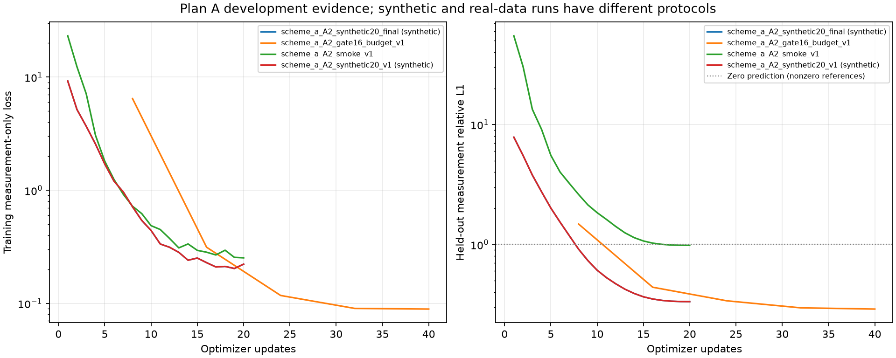

# 方案 A 实施与验收记录

生成时间：2026-10-15T17:13:17.735360+08:00（Asia/Shanghai）。

方案 A 的显式算子、集合初始化与物理展开、独立自监督训练和受限评价入口已实现。当前归档包含真实数据 smoke 通过 1 次、16 案例 gate 通过 1 次、完整正式运行 0 次。这些开发证据不能替代 300 epochs、三个随机种子的公平比较，也不能据此宣称三维重建优于历史基线。

## 代码与协议

- 新增 `physics/explicit_ray_operator.py`：显式三线性 stencil、质量分数插值后转摩尔分数、96 个中点积分、Jv/Jᵀu 与几何预条件。
- 新增 `models/set_unrolled3d.py`：A0 集合初始化、A1 物理展开、A2 共享三维先验、A3 OARI 初始化和独立 A-control。
- 新增 `training/research_selfsup.py` 与 `scripts/train_research_selfsup.py`：复用无标签数据、拼批与冻结外层损失；保留历史 selfsup 配置验证器。
- 训练采用有效案例 batch=2、FP32、AdamW、cosine、固定 A/B/H 互斥采样；H 从不进入重建网络。每案例先算损失，再按实际案例数平均，尾组保留。
- 仅以固定测量验证的 held-out relative L1 选择 best；保存 last、完整随机状态、scheduler、采样清单以及代码/配置/数据哈希。已验证 epoch 边界恢复与不中断运行逐位一致。
- 正式训练前检查同模型、同代码和相同数据内容的真实 smoke 与 gate 通过证据；模板 YAML、合成 smoke、失败或预算未完成的 gate 均不能替代。

## 资产与数值检查

资产审计：passed=True；分割 {'train': 166, 'val': 36, 'test': 35}；历史源码未变=True；数据元信息未变=True。

历史 MRGR 的固定 36 案例测量重放 relative L1=0.03275178736，与记录差值=5.85033e-10，容差=3.37518e-07。这是复现检查；当前开发 smoke/gate 使用不同案例子集和训练预算，不能据此进行方法排名。

| 数值环境 | 前向对齐相对 L2 | Jv 差分相对 L2 | 转置恒等式误差 | 二阶差分误差 | 通过 |
|---|---:|---:|---:|---:|---|
| cpu torch.float64 | 8.56212e-17 | 5.71234e-11 | 1.23291e-16 | 2.81177e-10 | True |
| cuda torch.float32 | 7.65566e-08 | 6.3834e-05 | 0 | 0.000178624 | True |

数值对照使用合成解析场，CPU FP64 与部署 GPU FP32 的容差分别保存。小网格与有限几何通过不等于任意输入均已验证。

自动测试：70 项通过；warnings=5；记录到失败=False。完整输出见 [pytest.log](artifacts/plan_a_v1/pytest.log)。

## 运行证据与失败保留

| 运行 | 阶段 | train/val 案例 | 已记录/计划 epochs | 更新数 | 初始 H L1 | 最佳 H L1 | 零场 H L1 | 状态 |
|---|---|---:|---:|---:|---:|---:|---:|---|
| scheme_a_A2_synthetic20_final | synthetic_smoke | 2/2 | 20/20 | 20 | 14.0129 | 0.333521 | 1 | 已完成，所列验收通过 |
| scheme_a_A2_gate16_budget_v1 | gate | 16/8 | 5/5 | 40 | 71.1186 | 0.289196 | 1 | 已完成，所列验收通过 |
| scheme_a_A2_smoke_v1 | smoke | 2/2 | 20/20 | 20 | 103.448 | 0.982465 | 1 | 已完成，所列验收通过 |
| scheme_a_A2_synthetic20_v1 | synthetic_smoke | 2/2 | 20/20 | 20 | 14.0129 | 0.333521 | 1 | 已完成，所列验收通过 |

### scheme_a_A2_synthetic20_final

状态：已完成，所列验收通过。seed=20261011，device=cpu，variant=A2，K=2，Q=8，输出网格=8³。

训练 loss：9.24407 → 0.222142；已记录训练+测量验证耗时=5.37795 秒；峰值 GPU allocated=0 GiB。耗时包括当时共享 GPU 负载，不能直接外推正式训练成本。

访问边界：解析合成测量，不读取外部三维标签；不能代替真实数据访问审计。 当前源码与训练源码哈希一致=False。

训练源码 SHA256：`378da71d9930b00a57b5db64c4807bc20f953bd89dc0ad847fb3729974786f6e`；当前对应源码 SHA256：`4ed9405a94874a7e9cdd1e36b0750b3eb37d8ef2db9ea5b9e796f6b524bfff51`。

标量记录：[归档目录](artifacts/plan_a_v1/run_scalars/scheme_a_A2_synthetic20_final)；原始运行目录：`docs/reports/artifacts/plan_a_v1/training/scheme_a_A2_synthetic20_final`。

训练后发生变化的源码：`src/geophy_set3d/evaluation/research.py`。

此运行是解析合成测量上的工程烟雾检查，使用显式缩小的网格和积分设置；它不读取 CFD 测量，也不构成真实 G6/G7 通过证据。

验收未通过项：无；只代表本次所列开发检查通过。

同几何测量 ×1.2 干预：体场平均绝对变化=0.00142461，passed=True。

### scheme_a_A2_gate16_budget_v1

状态：已完成，所列验收通过。seed=20261011，device=cuda:0，variant=A2，K=4，Q=96，输出网格=64³。

训练 loss：6.45979 → 0.0890506；已记录训练+测量验证耗时=1359.99 秒；峰值 GPU allocated=4.143 GiB。耗时包括当时共享 GPU 负载，不能直接外推正式训练成本。

访问边界：三个违规访问计数均为零。 当前源码与训练源码哈希一致=True。

训练源码 SHA256：`4ed9405a94874a7e9cdd1e36b0750b3eb37d8ef2db9ea5b9e796f6b524bfff51`；当前对应源码 SHA256：`4ed9405a94874a7e9cdd1e36b0750b3eb37d8ef2db9ea5b9e796f6b524bfff51`。

标量记录：[归档目录](artifacts/plan_a_v1/run_scalars/scheme_a_A2_gate16_budget_v1)；原始运行目录：`outputs/research/scheme_a_A2_gate16_budget_v1`。

预算：{'max_updates': 2000, 'max_seconds': 1800}。在 optimizer 组边界及验证 batch 边界检查时间；未完整完成的 epoch/验证不保存为可恢复边界，不产生通过证明。

验收未通过项：无；只代表本次所列开发检查通过。

同几何测量 ×1.2 干预：体场平均绝对变化=0.000441741，passed=True。

### scheme_a_A2_smoke_v1

状态：已完成，所列验收通过。seed=20261011，device=cuda:0，variant=A2，K=4，Q=96，输出网格=64³。

训练 loss：23.2051 → 0.25265；已记录训练+测量验证耗时=893.884 秒；峰值 GPU allocated=4.184 GiB。耗时包括当时共享 GPU 负载，不能直接外推正式训练成本。

访问边界：三个违规访问计数均为零。 当前源码与训练源码哈希一致=True。

训练源码 SHA256：`4ed9405a94874a7e9cdd1e36b0750b3eb37d8ef2db9ea5b9e796f6b524bfff51`；当前对应源码 SHA256：`4ed9405a94874a7e9cdd1e36b0750b3eb37d8ef2db9ea5b9e796f6b524bfff51`。

标量记录：[归档目录](artifacts/plan_a_v1/run_scalars/scheme_a_A2_smoke_v1)；原始运行目录：`outputs/research/scheme_a_A2_smoke_v1`。

验收未通过项：无；只代表本次所列开发检查通过。

同几何测量 ×1.2 干预：体场平均绝对变化=0.000485443，passed=True。

### scheme_a_A2_synthetic20_v1

状态：已完成，所列验收通过。seed=20261011，device=cpu，variant=A2，K=2，Q=8，输出网格=8³。

训练 loss：9.24407 → 0.222142；已记录训练+测量验证耗时=5.79044 秒；峰值 GPU allocated=0 GiB。耗时包括当时共享 GPU 负载，不能直接外推正式训练成本。

访问边界：解析合成测量，不读取外部三维标签；不能代替真实数据访问审计。 当前源码与训练源码哈希一致=True。

训练源码 SHA256：`4ed9405a94874a7e9cdd1e36b0750b3eb37d8ef2db9ea5b9e796f6b524bfff51`；当前对应源码 SHA256：`4ed9405a94874a7e9cdd1e36b0750b3eb37d8ef2db9ea5b9e796f6b524bfff51`。

标量记录：[归档目录](artifacts/plan_a_v1/run_scalars/scheme_a_A2_synthetic20_v1)；原始运行目录：`outputs/research/scheme_a_A2_synthetic20_v1`。

此运行是解析合成测量上的工程烟雾检查，使用显式缩小的网格和积分设置；它不读取 CFD 测量，也不构成真实 G6/G7 通过证据。

验收未通过项：无；只代表本次所列开发检查通过。

同几何测量 ×1.2 干预：体场平均绝对变化=0.00142461，passed=True。



各曲线对应不同数据子集/阶段；图用于检查数值轨迹，不作为跨阶段优劣比较。另提供同名 PDF。

## 外部输入与环境

实际完成 measurement-only NPZ 推理：输出形状 `[1, 1, 64, 64, 64]`，finite=True，工程检查点=True，GT 体场读取=False。

单次共享 GPU 重建 2.1125 秒，另行重投影 0.159736 秒；此调用不构成稳定吞吐基准。详见 [external_inference.json](artifacts/plan_a_v1/external_inference.json)。

[环境与依赖快照](artifacts/plan_a_v1/environment_snapshot.json)记录实际版本与 GPU；未进行全新环境安装验证。

## 正式比较与 GT 边界

用户已确认本轮仅完成实现与小规模验收，保留正式训练配置；本轮未启动正式训练。

三份正式配置的结构验证记录见 [formal_config_validation.json](artifacts/plan_a_v1/formal_config_validation.json)；当前源码、完整数据内容和真实 smoke/gate 的只读预检记录见 [formal_acceptance_preflight.json](artifacts/plan_a_v1/formal_acceptance_preflight.json)。这些预检不执行模型更新。

正式运行采用全量 train=166、val=36、300 epochs。预注册种子为 20261011、20261012、20261013；目前完整三个种子=False。

```bash
python scripts/train_research_selfsup.py --config configs/research/scheme_a_a2_formal_v1_seed20261011.yaml
python scripts/train_research_selfsup.py --config configs/research/scheme_a_a2_formal_v1_seed20261012.yaml
python scripts/train_research_selfsup.py --config configs/research/scheme_a_a2_formal_v1_seed20261013.yaml
```

以上是实现后的可执行入口，运行前需有配置指向的真实 smoke/gate 通过记录，并完成实测成本核对；列出命令不表示已经执行。A0/A1/A3/A-control 有各自独立 formal 配置，同样受验收限制。

训练与检查点选择只读取测量。`GTReadGuard` 审计 GT64/GT128、非白名单 NPY 和外来检查点；最终审计必须三个违规计数均为零。合成数据的无文件读取声明不能替代真实训练审计。

独立三维评价仅接收冻结且完成 300 epochs 的 formal 检查点，拒绝 synthetic/smoke/gate；先保存全部预测，再访问 GT64。当前未由本报告读取任何三维 GT，未产生新三维精度、测试集排名或三个种子统计。

## 复现本报告

```bash
python scripts/report_plan_a.py --discover
```

机器可读证据：[evidence_summary.json](artifacts/plan_a_v1/evidence_summary.json)。脚本仅读取训练产物，复制标量与配置；不加载、不归档权重或大体场张量。
