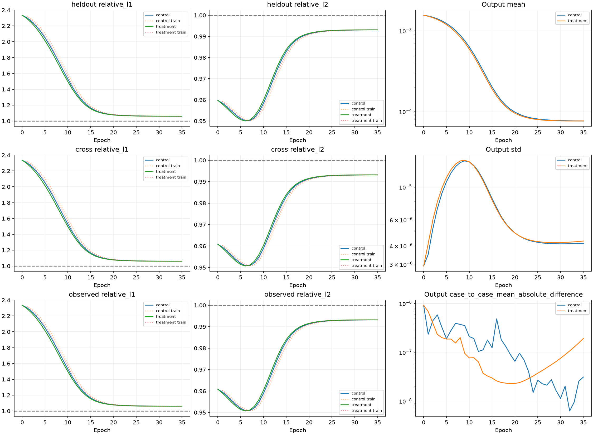
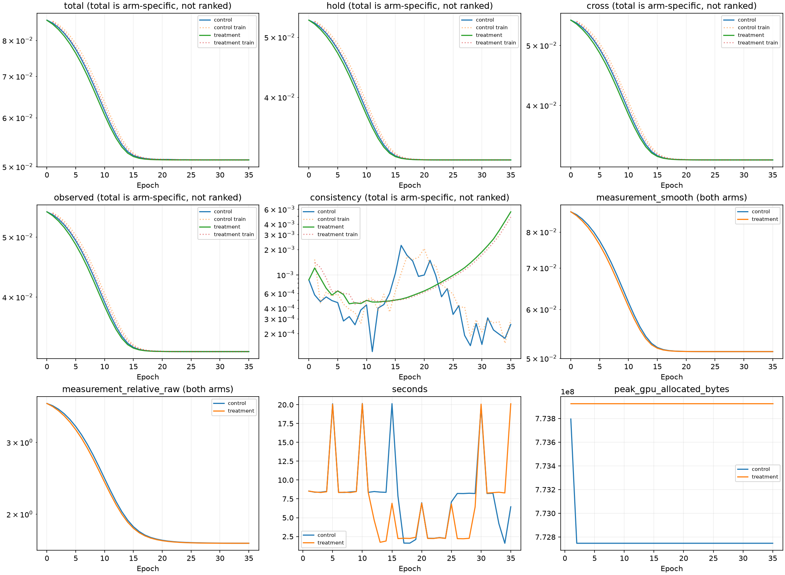
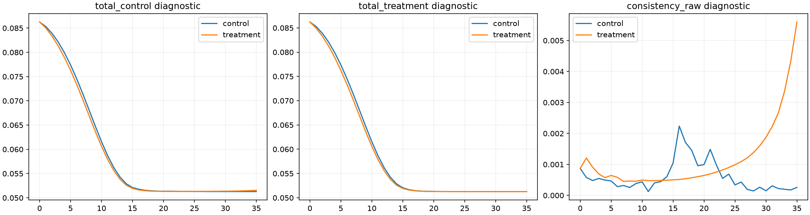
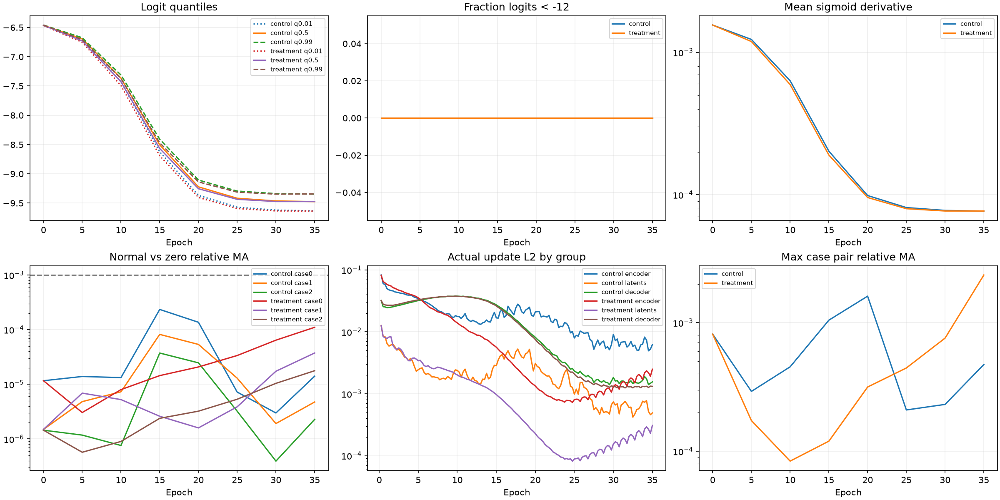
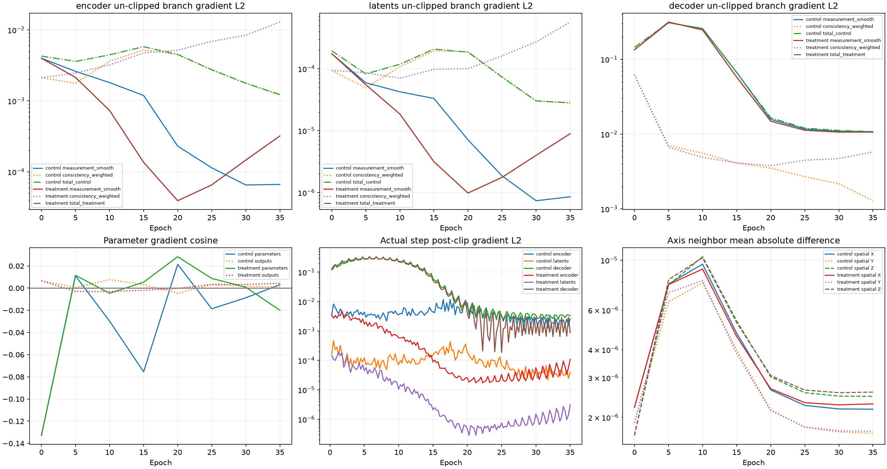

# Ray-Senseiver consistency开/关最后一次小预算对照：PARTIAL_LEARNING_EVIDENCE

**正式训练决策：NO-GO。** 描述标签 `PARTIAL_LEARNING_EVIDENCE`。本轮实际执行全部预登记工作，H参与训练loss，仅固定8例训练子集可学习性，不是独立泛化验证。没有读取GT64/128、Val、Pool B或test，没有训练/重新评价Ours/DeepSets，没有启动长训练或新增搜索。

实际结果：在共同epoch35，Treatment H L1/L2=1.0605742/0.99305826，Control=1.0606262/0.9930802。关闭consistency后，固定3例有效测量依赖数=0（Control=0），最大case-pair相对差=0.0023482845（Control=0.00047274805）。共同终点输出mean为7.690787e-05（Control=7.6763738e-05）。这些数字同时约束指标变化、整体幅度变化和输入依赖的解释。

## 唯一差异、初态和历史保护

[训练前协议](../ray_senseiver_consistency_probe_v1_protocol_zh.md)、[配置](../../configs/ray_senseiver_consistency_probe_v1.yaml)、[独立objective](../../src/geophy_set3d/training/senseiver_consistency_probe.py)、[入口](../../scripts/run_senseiver_consistency_probe.py)、[注册](artifacts/ray_senseiver_consistency_probe_v1/registration.json)。注册commit `9574f8e`，诊断与smoke确认commit `a811e17`，先提交后科学训练。两臂relative固定0，Control的原consistency权重.05、Treatment为0；hold1/cross.5/observed.1、SmoothL1 beta.01、epsilon、尺度、mask/归约、网络和几何全相同。Treatment仍计算relative与原consistency及两种total作诊断，但训练梯度只来自measurement SmoothL1。没有改原selfsup函数、FROZEN_LOSS或旧validator。沿用日志字段measurement_relative_weighted仅指名义.1×原relative诊断，不是本轮实际梯度系数（actual_relative_weight始终0）。

固定source-index train前8例、Pool A、seed20261011、sampler epoch0、A3–5/B3–5/H2不交、连续2例batch。直接复用C_init=0.0015582415568457682、weight×.01、bias=-6.462637843768738，无重估/训练权重读取；全部参数逐元素一致，fresh state SHA `a51ae38bb2d67202a4766de25c0e01bc9832fb8887756d2f7ebbee41a38fc5be`，与原登记一致。历史失败记录和GO/NO-GO结论保留，历史源码/数据/报告hash复核通过。

## 零更新诊断与等价性

全部8例同一fresh预测图；只forward/autograd，optimizer未创建，0 step，model state不变，.grad全None，耗时37.723556秒。[完整诊断JSON](artifacts/ray_senseiver_consistency_probe_v1/gradient_diagnosis.json.gz)、[梯度CSV](artifacts/ray_senseiver_consistency_probe_v1/fresh_branch_gradients.csv)、[dot/cosine及组内重构CSV](artifacts/ray_senseiver_consistency_probe_v1/branch_interactions.csv)。

新Control与上轮relative关闭Treatment的同预测loss各分量bitwise相等；对全部模型参数及预测体素梯度一致。8例最大参考梯度差L2=1.0216827e-08；Control−Treatment−.05consistency最大loss余量=3.434252e-09，参数梯度余量L2=3.7173507e-08，输出梯度余量L2=8.4332084e-09。

| fresh分支，8例均值 | loss | encoder梯度L2 | latents梯度L2 | decoder梯度L2 | 共同输出平移dL/dc |
| --- | --- | --- | --- | --- | --- |
| measurement_smooth | 0.086210866 | 0.0034702694 | 0.00014041806 | 0.12692875 | 27.457231 |
| consistency_weighted | 4.3499909e-05 | 0.0028962568 | 0.00012102159 | 0.08867457 | -0.027901649 |
| total_control | 0.086254366 | 0.0046402525 | 0.0001962461 | 0.15388436 | 27.42933 |
| total_treatment | 0.086210866 | 0.0034702694 | 0.00014041806 | 0.12692875 | 27.457231 |

| fresh梯度空间 | dot均值 | cosine均值/min/max |
| --- | --- | --- |
| parameters | -0.002185623 | -0.15771737 / -0.35426357 / 0.023564508 |
| outputs | 2.5544199e-05 | 0.0058796102 / -0.0019378625 / 0.015706885 |
| encoder | -5.8582535e-07 | -0.063379101 / -0.34108218 / 0.40135279 |
| latents | 1.9372964e-09 | 0.044051277 / -0.57576955 / 0.75771929 |
| decoder | -0.0021850392 | -0.15783464 / -0.35543399 / 0.023982102 |

参数空间与输出空间cosine是不同问题：前者包含当前网络Jacobian的映射与参数共享，后者描述独立体素变化。不能把参数cosine套用于输出空间，也不能相加范数。每组向量dot和||g_m+g_c||、平方范数重构已保存，支持观察贡献与抵消。正共同输出平移导数表示梯度下降倾向降低浓度，但不代表任意参数更新等价于均匀平移。

## 共同幅度探针

[逐case幅度CSV](artifacts/ray_senseiver_consistency_probe_v1/common_amplitude.csv)。同一C_A/C_B同时乘固定α，不训练、不搜索，下面为8例均值。正dL/dα表示局部梯度下降降低共同幅度。

| α | 分支 | loss | dL/dα |
| --- | --- | --- | --- |
| 1 | measurement_smooth | 0.086210866 | 0.042775959 |
| 1 | consistency_weighted | 4.3499909e-05 | 2.6193447e-08 |
| 1 | total_control | 0.086254366 | 0.042775987 |
| 1 | total_treatment | 0.086210866 | 0.042775959 |
| 0.1 | measurement_smooth | 0.051594796 | 0.012292131 |
| 0.1 | consistency_weighted | 4.3250233e-05 | 2.7548522e-06 |
| 0.1 | total_control | 0.051638045 | 0.012294858 |
| 0.1 | total_treatment | 0.051594796 | 0.012292131 |
| 0.01 | measurement_smooth | 0.051453195 | -0.0091250635 |
| 0.01 | consistency_weighted | 4.0902612e-05 | 0.00024671853 |
| 0.01 | total_control | 0.051494098 | -0.0088784248 |
| 0.01 | total_treatment | 0.051453195 | -0.0091250634 |

原consistency = αd/(αm+1e−6)，d为未缩放A/B meanabs差、m为两预测meanabs均值。导数为d×1e−6/(αm+1e−6)²；.05加权解析值逐例随JSON保留，FP32 autograd数值有减法抵消。epsilon使共同缩小也可降低该项（正导数），而减小A/B差异是另一种变化方向；α=1附近近似尺度不变也不等于严格不变。该有限探针不证明训练失败的完整因果。

## 实际预算、统一指标和退出

每臂fresh重训，FP32、batch2/accum1、每轮4更新、AdamW2e−4/wd1e−4/clip1/cosine T_max300；query chunk16384/checkpoint开启，完整64³全部query/valid rays（含零）与原K96。未发生OOM工程降配，未终止其他进程。epoch0完整保存，工程smoke每臂独立1step不计科学预算，无warm start。

| 臂 | epoch | updates | 终止 | H L1 | H L2 | weighted SmoothL1 | raw consistency | mean |
| --- | --- | --- | --- | --- | --- | --- | --- | --- |
| control | 35 | 140 | FAILED_TO_LEARN | 1.0606262 | 0.9930802 | 0.05127435 | 0.0002572489 | 7.6763738e-05 |
| treatment | 35 | 140 | FAILED_TO_LEARN | 1.0605742 | 0.99305826 | 0.051272777 | 0.0055963135 | 7.690787e-05 |

共同可比终点epoch35/updates140；只对统一指标配对，不横排两种训练total。共同终点T−C：H L1=-5.1997026e-05，H L2=-2.1938797e-05。[全epoch配对JSON](artifacts/ray_senseiver_consistency_probe_v1/matched_comparison.json)、[所有轮末标量CSV](artifacts/ray_senseiver_consistency_probe_v1/epoch_scalars.csv)。各臂压缩history保留每轮train聚合、轮末指标和每step梯度/更新，health/events保留全部检查和计数。

Treatment在共同终点相对自身epoch0：H L2改善=-0.034724591；weighted SmoothL1改善=0.40526317（相对改善，负值为恶化）。辅助改善不能覆盖测量依赖与case区分要求。

| 臂 | 检查epoch | 最近5轮H L1 | L1改善比例 | L2改善比例 | 依赖case数 | failure连续 | collapse连续 | 原因 |
| --- | --- | --- | --- | --- | --- | --- | --- | --- |
| control | 30 | 1.062188 | 0.0055981792 | -0.00063472555 | 0 | 1 | 0 | None |
| control | 35 | 1.0608356 | 0.0012731841 | -0.00014054796 | 0 | 2 | 0 | FAILED_TO_LEARN |
| treatment | 30 | 1.0612976 | 0.0049074561 | -0.00055373569 | 0 | 1 | 0 | None |
| treatment | 35 | 1.0605011 | 0.00075046176 | -7.4399664e-05 | 0 | 2 | 0 | FAILED_TO_LEARN |

退出严格复用第20轮后连续两次L1≥.98、L1和L2改善均<1%、有效依赖不足2例；不是只因L1慢停止。工程完整性与真实更新核验正常。所有事件在最终审计中逐项重放一致。

## 梯度方向、输出与测量依赖

| 臂 | epoch | 参数组 | cons/Smooth梯度范数比 | dot均值 | cosine均值 | 梯度和L2均值 |
| --- | --- | --- | --- | --- | --- | --- |
| control | 0 | encoder | 0.59876196 | -1.7630535e-06 | -0.12900125 | 0.0042799506 |
| control | 0 | latents | 0.55154981 | -1.2154379e-09 | -0.0090119563 | 0.00019539951 |
| control | 0 | decoder | 0.51631482 | -0.0010625962 | -0.13279816 | 0.14459655 |
| control | 35 | encoder | 18.686348 | 2.0132033e-08 | 0.13911166 | 0.0012280417 |
| control | 35 | latents | 37.902511 | 6.3721089e-12 | 0.12006708 | 2.8220598e-05 |
| control | 35 | decoder | 0.1261551 | -4.2075921e-07 | 1.1444457e-05 | 0.010794143 |
| treatment | 0 | encoder | 0.59876195 | -1.7630538e-06 | -0.1290013 | 0.0042799506 |
| treatment | 0 | latents | 0.55154981 | -1.2154392e-09 | -0.0090120231 | 0.00019539951 |
| treatment | 0 | decoder | 0.51631482 | -0.0010625962 | -0.13279816 | 0.14459655 |
| treatment | 35 | encoder | 40.617503 | -7.5084651e-07 | 0.080868583 | 0.01293785 |
| treatment | 35 | latents | 70.710034 | -8.5518872e-13 | 0.058809361 | 0.0005702088 |
| treatment | 35 | decoder | 0.56566078 | 6.4374781e-06 | -0.060226952 | 0.012467695 |

范数比为逐case比值的均值，dot/cosine同图同参数组计算。Treatment中cons梯度仅诊断，不参与更新；不能因为该诊断范数大就声称它实际支配Treatment更新。全健康检查曲线同时给出两种空间cosine、三组实际更新和空间变化。

| 臂 | min | max | std | logit中位数 | logit<−12比例 | sigmoid导数均值 | 最大case-pair relMA |
| --- | --- | --- | --- | --- | --- | --- | --- |
| control | 5.6027289e-05 | 9.951846e-05 | 4.1564718e-06 | -9.4742918 | 0 | 7.6757828e-05 | 0.00047274805 |
| treatment | 5.4806005e-05 | 0.0001006303 | 4.310801e-06 | -9.4723148 | 0 | 7.6901937e-05 | 0.0023482845 |

| 臂 | 固定case | normal-zero绝对MA | normal-zero相对MA | 空间邻点X MA | Y MA | Z MA |
| --- | --- | --- | --- | --- | --- | --- |
| control | 0 | 1.0811237e-09 | 1.4086971e-05 | 2.1740947e-06 | 1.6975168e-06 | 2.4783779e-06 |
| control | 1 | 3.6483716e-10 | 4.751558e-06 | 2.1748744e-06 | 1.6977518e-06 | 2.4795044e-06 |
| control | 2 | 1.7516323e-10 | 2.2822695e-06 | 2.1739349e-06 | 1.6971828e-06 | 2.4781716e-06 |
| treatment | 0 | 8.4770744e-09 | 0.00011051963 | 2.2947198e-06 | 1.7339589e-06 | 2.5898798e-06 |
| treatment | 1 | 2.8772175e-09 | 3.745395e-05 | 2.2980627e-06 | 1.7366975e-06 | 2.5946837e-06 |
| treatment | 2 | 1.3591357e-09 | 1.7734085e-05 | 2.2922968e-06 | 1.7321727e-06 | 2.587575e-06 |

normal-zero仅置零测量，geometry/path/mask逐tensor完全相等。relative MA分母normal meanabs+1e−12，有效阈值1e−3；相对误差必须结合绝对差阅读。空间纹理不自动意味着case或测量信息被利用。

## GO判定、访问与checkpoint身份

| 预登记GO条件 | 结果 |
| --- | --- |
| last3_H_L1_below090 | 未通过 |
| no_engineering_or_collapse | 通过 |
| case_variation | 通过 |
| measurement_dependence | 未通过 |
| gradients_updates_valid | 通过 |

Treatment最后3次健康H L1：[{'epoch': 25, 'H_L1': 1.0630448525062242}, {'epoch': 30, 'H_L1': 1.0606594666600395}, {'epoch': 35, 'H_L1': 1.0605742131244011}]。条件仅工程可学习性，不证明三维重建正确，也不要求达到Ours精度。

| 臂 | epoch总秒 | 进程总秒 | 峰值分配GiB |
| --- | --- | --- | --- |
| control | 279.22602 | 297.44895 | 0.72065306 |
| treatment | 249.54223 | 266.83621 | 0.72077513 |

共享GPU环境，时间仅实际预算记录，不作受控性能比较。阶段一无更新，最终审计只读本轮epoch0/last。所有阶段实际仅8例Pool A projection，无GT/禁用NPY/外来checkpoint访问；TrainEightGuard继承summary文字含train/val，但实际allowlist已收紧到固定8例train。边界负测试是主动拒绝模拟访问，与科学run零违规分开。[smoke](artifacts/ray_senseiver_consistency_probe_v1/engineering_smoke.json)、[最终完整性审计](artifacts/ray_senseiver_consistency_probe_v1/final_integrity.json)、[测试记录](artifacts/ray_senseiver_consistency_probe_v1/verification.txt)。每次完整262144-query输出形状与XYZ轴序，以及固定259个覆盖端点的query在chunk259/37下输出和全部参数/query梯度一致性通过；这是有限数值核验，不冒称对全部262144个query逐点作双份梯度比较。全valid rays、所有组有限梯度/真实更新、自身状态恢复、退出计数与历史hash均通过。

| 臂 | 外部last checkpoint | last SHA256 | epoch0 SHA256 |
| --- | --- | --- | --- |
| control | /data/djc/GeoPhy-Set3D/outputs/checkpoints/ray_senseiver_consistency_probe_v1/control/last.pt | 9fc726dce275dbe444c5ed2750d44c8a1612e30bafc0e28b3cb14e826cd7d16c | 2a4d2a9729cc39a8075b6e79bac432e801164981285d69c8b462fb4122c50410 |
| treatment | /data/djc/GeoPhy-Set3D/outputs/checkpoints/ray_senseiver_consistency_probe_v1/treatment/last.pt | 448ef11e82b0b29e26be2ecc0d10909f575b649cb30c1b00a4142e18219bec71 | 950cb7be68e20bdccda7c9f8e002c71410a44b8ff3416c6384310730130b982a |

Git只保存代码/协议/配置/hash/标量/图表/报告，大checkpoint保留上述独立外部目录。

## 结论与唯一后续任务

本轮没有达到有效学习GO，正式训练NO-GO。Treatment相对初态SmoothL1改善40.526%，H L2却恶化3.472%；相对本轮Control，两种H误差几乎相同。关闭后case间差异达到既定操作阈值（最大relative MA=.002348），normal-zero差也有增长（case0从1.41e−5升至1.11e−4），但3例都不足1e−3，绝对MA最高仅8.48e−9；不能把case差异直接归因于测量信息利用。两臂输出均仅约.049×C_init，无logit<−12，未触发严格塌缩条件，但持续整体压低。描述标签PARTIAL仅保留有限指标改善，不能认定形成有效测量相关输出。关闭consistency不足以解决当前适配的学习失败，也不能证明该分支没有任何间接作用。结束当前逐项loss排查；不再扫描beta/lr/relative/consistency，不延长预算，不启动300轮，不把失败Senseiver列入成功强基线主表。这是固定适配、数据与预算的局部结果，不能归为原Senseiver能力上限，也不能外推consistency对其他结构有害。唯一后续任务：独立登记输入表征与结构可学习性检查，判断测量信息能否通过当前ray-token编码和latent bottleneck被有效利用；本轮不实现任何该改动。

关于梯度机制：Control末轮固定3例consistency/Smooth梯度范数比，encoder=18.686348、latents=37.902511；这说明该分支在这些参数组占较大范数，不代表方向一定相反。末轮encoder/latents cosine均值分别=0.13911166/0.12006708，输出空间cosine均值=0.0012357261。fresh α=1处consistency对共同幅度的导数均值仅约2.62e−8，measurement约.04278；α=.01处measurement约−.009125，consistency约+.0002467，未改变total导数符号。因此本有限探针不能把较大参数梯度直接解释为主要共同缩幅力，更不能宣称consistency是唯一失败原因。

独立fresh Control对上轮相同科学配置的标量重放：共同35轮，H L1最大绝对差=0.00012707053，H L2最大绝对差=1.334569e-05。同图objective等价核验与独立训练数值重放是不同证据；后者存在FP32 CUDA归约及后续优化轨迹微差，历史标量保持原样，未用旧结果充当本轮Control。
