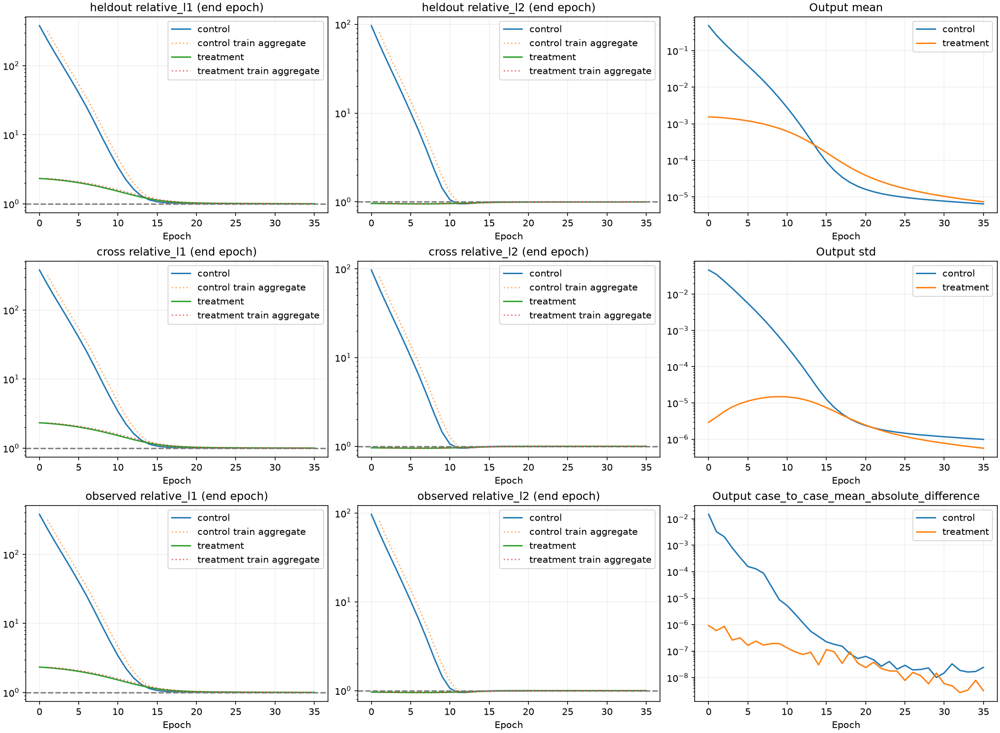
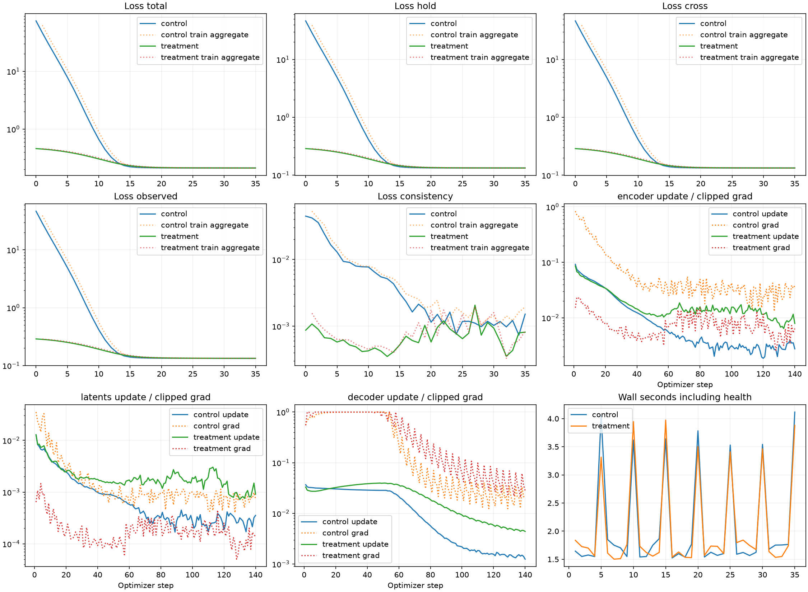
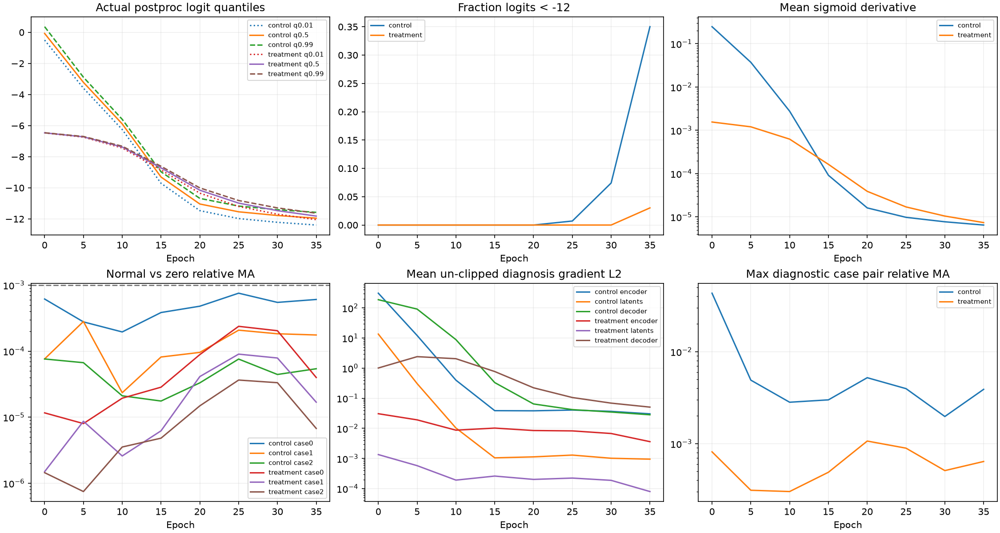

# Ray-Senseiver 输出初始化两臂探针：NO-GO

**结论：NO-GO。** 本轮实际训练与预登记退出规则已执行。没有读取三维GT、Pool B、test或外部权重，未启动新的300轮。判定只针对固定8个训练case的任务适配可学习性，不代表原Senseiver能力上限，不证明三维重建正确。

## 原失败 run 安全停止与历史边界

原run在第113轮完整保存边界停止，9379 updates；FAILED_LEARNING / NEAR_ZERO_COLLAPSE / EARLY_TERMINATED。last/best保留，末轮Val H L1=1.000000950284751，后续900条GT评价取消。终止仅涉及该训练PID和loader子进程，未终止其他实验。第68轮独立诊断及原协议保留为历史记录；其当时“继续300轮”说明由本轮授权覆盖。

[完整停止归档](artifacts/ray_senseiver_selfsup_v1/early_termination_archive.json)；[原独立诊断](ray_senseiver_learning_diagnostic_zh.md)。

## 预登记、尺度与初态

[中文协议](../ray_senseiver_init_probe_v1_protocol_zh.md)，[配置](../../configs/ray_senseiver_init_probe_v1.yaml)，[固定case/station/ray清单](artifacts/ray_senseiver_init_probe_v1/fixed_inputs.json.gz)。登记commit 8b74618，smoke commit 550ab56，均早于科学训练。两臂顺序前8例、相同A/B/H和batch，sampler始终epoch0，H仍用于原loss，不称泛化验证。

有效A/B射线144475条（包括有效零）；float64分子Σlength*y=1.0045928e+08 ppm·m²、分母1e6Σlength²=3.5752965e+10 1e6·m²。χ_init=0.0028098167，调用原mole_to_mass后C_init=0.0015582416，bias=-6.4626378；clamp=False。原projector全8例A/B常量场最大绝对偏差=0.00048828125 ppm·m。

Treatment仅postproc weight乘0.01及bias设置；其余参数逐元素相等，64个输出权重全部非零。Control fresh SHA=1fd1e876755be64371fa85c584410063b8f3b7f135f9ab7630e495ededf8e1e1；Treatment SHA=a51ae38bb2d67202a4766de25c0e01bc9832fb8887756d2f7ebbee41a38fc5be。工程smoke各独立1步，不计科学预算，正式初态重新构建且hash完全吻合，无smoke/失败权重warm start。

## 实际预算与退出

| 臂 | 完成epochs | updates | 终止原因 | epoch墙钟秒 | 峰值GiB |
| --- | --- | --- | --- | --- | --- |
| control | 35 | 140 | FAILED_TO_LEARN | 72.291655 | 0.71065331 |
| treatment | 35 | 140 | FAILED_TO_LEARN | 71.606734 | 0.71065331 |

每轮4次真实更新，FP32/AdamW2e−4/wd1e−4/clip1/cosine T_max300，完整64³、all valid rays、K96和原loss。CUDA event与墙钟完整记录；GPU共享，含健康检查/host间隙的event时间不是独占kernel性能。epoch0健康检查不计epoch墙钟，完整进程墙钟另存。

严格“第5/20轮后”从10/25检查开始，连续两次才退出；[逐事件与窗口证据](artifacts/ray_senseiver_init_probe_v1/control/events.json.gz)及[Treatment事件](artifacts/ray_senseiver_init_probe_v1/treatment/events.json.gz)保留。

## 同预算比较与终点

两臂共同完成到epoch35/update140；下表只比较共同位置，各自最终状态另列。轮末评价是同一权重，训练中指标跨4次更新另存，不能相混。

| epoch/updates | Control H L1 | Treatment H L1 | T−C |
| --- | --- | --- | --- |
| 0/0 | 380.43971 | 2.3343054 | -378.10541 |
| 5/20 | 40.281858 | 2.025983 | -38.255875 |
| 10/40 | 3.4058033 | 1.5236077 | -1.8821956 |
| 15/60 | 1.0722419 | 1.1320065 | 0.059764588 |
| 20/80 | 1.0121792 | 1.0301906 | 0.018011403 |
| 25/100 | 1.0073106 | 1.0129059 | 0.0055953648 |
| 30/120 | 1.0057467 | 1.0078842 | 0.0021374769 |
| 35/140 | 1.0048195 | 1.0055393 | 0.00071975495 |

| 臂/终点 | H L1/L2 | cross L1/L2 | obs L1/L2 | mean/std | case MA |
| --- | --- | --- | --- | --- | --- |
| control/35 | 1.0048195/0.99937208 | 1.0048003/0.99937775 | 1.0048002/0.99937773 | 6.4940224e-06/9.904225e-07 | 2.4428068e-08 |
| treatment/35 | 1.0055393/0.99930457 | 1.005525/0.9993127 | 1.0055249/0.9993127 | 7.3972525e-06/5.654037e-07 | 3.2166115e-09 |

| 臂/轮 | total | hold | cross | observed | consistency |
| --- | --- | --- | --- | --- | --- |
| control/0 | 74.465127 | 46.502374 | 46.600307 | 46.603685 | 0.044625772 |
| control/35 | 0.21235479 | 0.13231373 | 0.13327547 | 0.13327547 | 0.0015154547 |
| treatment/0 | 0.45979118 | 0.2866919 | 0.28842628 | 0.28842631 | 0.00086999816 |
| treatment/35 | 0.21242977 | 0.13238236 | 0.13334464 | 0.13334463 | 0.00081251492 |

完整各loss值及L1/L2/输出曲线见[标量CSV](artifacts/ray_senseiver_init_probe_v1/epoch_scalars.csv)、[共同位置JSON](artifacts/ray_senseiver_init_probe_v1/matched_comparison.json)。

## 健康诊断与GO条件

| 臂/轮 | logit P01/P50/P99 | <-12比例 | sigmoid导数均值 | 诊断case最大relative MA |
| --- | --- | --- | --- | --- |
| control/0 | -0.49921095/-0.070289396/0.36211708 | 0 | 0.24754127 | 0.043258182 |
| control/35 | -12.391272/-11.950384/-11.575515 | 0.35019088 | 6.4939792e-06 | 0.0038949735 |
| treatment/0 | -6.4670982/-6.4628091/-6.4584851 | 0 | 0.0015555603 | 0.00081467878 |
| treatment/35 | -12.04713/-11.814419/-11.630373 | 0.030268431 | 7.3971975e-06 | 0.00063973165 |

| 臂/终点case | encoder/latents/decoder未clip梯度L2 | normal−zero绝对MA | normal meanabs | relative MA |
| --- | --- | --- | --- | --- |
| control/0 | 0.022691336/0.00067614252/0.0091883069 | 3.9322492e-09 | 6.4840144e-06 | 0.00060645278 |
| control/1 | 0.031189347/0.0012404312/0.01799755 | 1.143344e-09 | 6.500701e-06 | 0.00017588008 |
| control/2 | 0.037512825/0.00093833643/0.057778034 | 3.5086483e-10 | 6.4753809e-06 | 5.4184422e-05 |
| treatment/0 | 0.0057359107/0.00012240847/0.0071835016 | 2.9547039e-10 | 7.3999482e-06 | 3.9928706e-05 |
| treatment/1 | 0.0031725528/7.9036717e-05/0.032752537 | 1.2487399e-10 | 7.396175e-06 | 1.6883589e-05 |
| treatment/2 | 0.0019708849/3.8357044e-05/0.11273707 | 4.997687e-11 | 7.3952142e-06 | 6.7580007e-06 |

normal/zero只置零测量，几何/path/mask逐tensor一致；relative MA=绝对MA/(normal meanabs+1e−12)。空间XYZ邻点变化、min/max/mean/std、case间绝对及相对差均存health。每step真实参数更新三组L2均非零；query259/37分块检查与全参数梯度检查全部通过，实际输出仍262144 query。原纯相对检查返回值原样保留，工程判断采用预登记的绝对+相对容差。

Treatment最后三次健康H：epoch25=1.0129059, epoch30=1.0078842, epoch35=1.0055393。

| 最低GO条件 | 通过 |
| --- | --- |
| last3_H_below_090 | False |
| no_engineering_or_collapse | True |
| identifiable_case_changes | False |
| dependence_at_least_two_cases | False |
| valid_gradients_and_updates | True |

## 证据解释与下一阶段

初始化尺度被纠正仅是初态事实；是否避免饱和、产生空间/case变化与测量依赖，必须同时看终点与全部轨迹。不同预算的终点不作为matched胜负。训练H含在loss里，下降只说明这8例的测量拟合；没有三维结构/跨观测泛化证据，也没有GT评价。consistency损失小不能解释为梯度小，本轮保持权重不变，不能宣称其唯一导致失败。

Treatment初始mean从Control的0.482742纠正到0.00155799，但末轮mean仅7.39725e−6（约0.004747×C_init）；H误差趋近零场基准，case差与测量依赖不足。末轮仅3.03% logits<−12，中位数−11.8144，**尚未触发>95%的严格塌缩规则**；分类是FAILED_TO_LEARN并有趋零/弱依赖迹象，不改写为NEAR_ZERO_COLLAPSE，也不是已观察到有效学习但缓慢。原run第68轮的严重负饱和证据不移植为本探针终点状态。结合原近零常量方向测量分支推低背景的证据，唯一下一阶段建议：单独登记原measurement discrepancy中relative-L1项开/关的有限归约对照，保持初始化与其余loss不变，检验极小/零射线的背景压低机制；本轮不执行，不认定因果已证实。

## 审计与复现

6项新增测试及9项Ray-Senseiver相关回归通过，覆盖物理单位/含零拟合、仅输出层变化、严格协议、退出边界/窗口、完整last恢复后下一步逐元素一致、访问保护；smoke覆盖原projector、有效ray计数/XYZ/完整输出、首步三组梯度非零、实际更新、自身状态恢复及query分块。边界拒绝测试触发的禁止尝试仅在测试进程，实际科学训练全部为0。

| 阶段 | unique Pool A projections | GT尝试 | 禁止NPY尝试 | foreign权重尝试 |
| --- | --- | --- | --- | --- |
| scale | 8 | 0 | 0 | 0 |
| control | 8 | 0 | 0 | 0 |
| treatment | 8 | 0 | 0 | 0 |

TrainEightGuard在原guard上进一步限制为注册8个train NPY；继承summary里的train/val文字描述基础guard，实际allowed只有8例。没有Val/test/Pool B访问。元数据和8例projection/source hashes封存且每臂启动核验；原数值源码未改。冻结Ours/DeepSets未调用、未训练、未改写。大checkpoint外部存放，Git只含清单、标量、图和报告。报告入口只读取已存JSON，不打开checkpoint或数据。

[最终独立完整性核验](artifacts/ray_senseiver_init_probe_v1/final_integrity.json)确认各臂last全部AdamW state steps=140、scheduler epoch=35、checkpoint hash一致、原v1和探针冻结源码未变；全部8例A/B valid-ray数=实际packed-ray数，输入tensor hash与注册清单完全一致，几何有限且entry/exit在域内，禁止访问尝试0。该核验只读各臂自身last与固定8例train测量，零optimizer step。

| 臂 | last checkpoint SHA256 | 外部目录 |
| --- | --- | --- |
| control | 1460397932563c497d56a2e3155500c438c7383e3e15cb82c22fc01ed11280fe | /data/djc/GeoPhy-Set3D/outputs/checkpoints/ray_senseiver_init_probe_v1/control/last.pt |
| treatment | b554a2a1cda0009950ae546c16dedb75ad09132aa3a010e8e734bf045ca44374 | /data/djc/GeoPhy-Set3D/outputs/checkpoints/ray_senseiver_init_probe_v1/treatment/last.pt |

复现入口：`python scripts/run_senseiver_init_probe.py --phase ...`；已有注册/科学完成目录拒绝覆盖，恢复仅`--phase train --arm ... --resume`读取本臂last。生成报告：`python scripts/report_senseiver_init_probe.py`。本轮到此停止，无额外超参数搜索或正式300轮。
