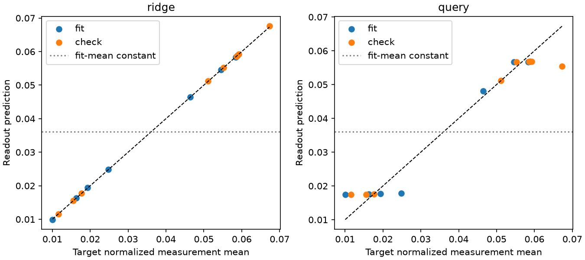
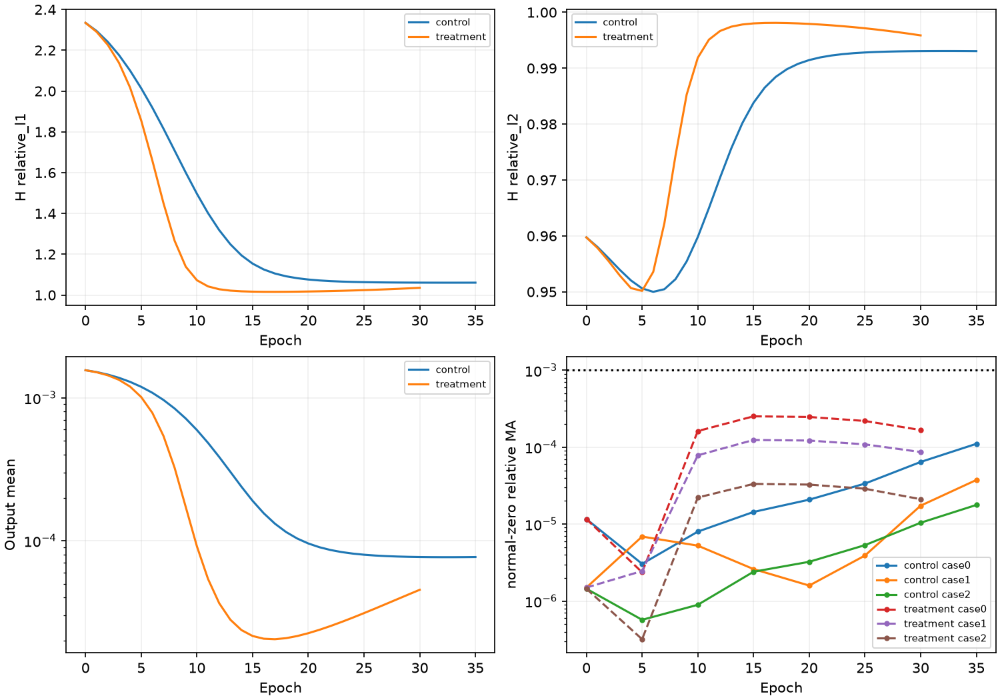

# Ray-Senseiver 快速定位与单次修复闭环：修复失败，NO-GO

**问题未得到实质缓解，不进入正式训练。本轮已完成读出、一个最小修复和实际重建对照，现归档 `REPAIR_FAILED_NO_GO`，不再追加搜索。** 冻结latent中确有可读测量幅度信息，原query结构在标准化标量任务上也能学习；新增全局latent解码残差没有形成有效重建测量依赖。共同第30轮，Treatment H L1从Control的1.0606595降为1.0352792，但H L2由.99306390恶化为.99587191，输出整体幅度更低，不能视为有效修复。

实际预算：阶段A encoder只提取16次、0更新，query头200更新；阶段C Control35轮/140更新、Treatment30轮/120更新，均按原条件触发 `FAILED_TO_LEARN`。另有独立工程smoke各1步。没有使用阶段A/smoke/历史失败权重warm start，没有启动80轮之外的训练、300轮或第二个修复。完成日期2026-10-14，时间记录采用Asia/Shanghai。

## 1. 阶段A：测量信息可读，不能据此宣布三维可学

开始HEAD `a844efd`，工作区干净；仓库/祖先无适用AGENTS.md，`/home/djc/.codex/AGENTS.md`为空。已阅读signal-path、consistency、relative、初始化报告，原RaySenseiverSS/core、objective/监控/退出及checkpoint/固定输入登记。历史源码、数据、结果和Ours/DeepSets冻结。

读出协议及源码先提交于 `86c2293`：[协议](../ray_senseiver_quick_repair_v1_protocol_zh.md)、[配置](../../configs/ray_senseiver_quick_repair_v1.yaml)、[登记](artifacts/ray_senseiver_quick_repair_v1/readout_registration.json)。使用consistency Treatment last35/140更新、relative=consistency=0、FAILED_TO_LEARN，SHA256 `448ef11e82b0b29e26be2ecc0d10909f575b649cb30c1b00a4142e18219bec71`。独立eval模型，encoder参数/buffers冻结，全部模型参数/buffers初末hash一致、.grad全None。

固定source-index 0–7拟合、8–15独立检查，全部train/Pool A；同一历史V4-G1-d0布局 **[26,27,45,42]**，由既有geometry_layouts提取，不按测量/误差选站。16例站位顺序、origin/direction/near/path/valid masks等几何tensor identity完全一致；全部有效射线保留，精确零不删除，invalid不计目标。目标是输入raw/Y_SCALE的有效射线均值；normalized字段独立求均值作为oracle，误差仅浮点舍入。此任务不涉及三维GT，也不预测域中心局部浓度。

16份完整64×64 latents一次提取，头训练不再运行encoder。仅前8例估计逐元素latent均值和centered全局RMS=.0033949796566396834；目标均值=.03608864919575966、population std=.019174219255700668。两头使用相同冻结统计，检查集不重新估计尺度；无退化fallback。完整统计tensor及latents留外部，hash见[读出结果](artifacts/ray_senseiver_quick_repair_v1/readout_complete.json)。

A头用完整flatten latent、FP64闭式岭回归，λ=.001×trace(ZZᵀ)/8=4.096000000000001；条件数7973.62049，线性解相对残差1.17495e−15。B头fresh原Decoder结构、固定物理域中心(.3,.3,.3) Fourier query、线性scalar输出，标准化MSE，FP32 AdamW lr2e−4/wd.01、fit8全批次，共200更新。只按拟合MSE选best，实际best=step200；选定后才统一计算检查集指标，未用检查集反向、选epoch或调参。

| 读出（normalized测量单位） | 拟合MSE | 拟合MAE | 检查MSE | 检查MAE |
| --- | --- | --- | --- | --- |
| 直接输入均值oracle | 3.69571e−21 | 4.94191e−11 | 7.23950e−21 | 6.90854e−11 |
| fit目标均值常量 | 3.67651e−4 | .0184686 | 4.96934e−4 | .0218268 |
| 完整latent岭回归 | 3.97773e−9 | 4.82712e−5 | 1.31629e−8 | 7.28657e−5 |
| 原query结构scalar头 | 1.53108e−5 | .00309688 | 2.38860e−5 | .00319754 |

检查MSE/常量分别为2.64882e−5和.0480666，两头都达到“低于基准50%”的本轮操作参考。线性头高维、仅8例拟合，故同时报告8例检查；两头不同容量/优化过程也不作普遍结构排名。结论限于固定几何、这16例及测量均值标量；不能证明完整测量场信息可恢复或三维重建泛化。

## 2. 阶段B：只实现一个解码侧残差

两头均有效，因此读出测试不能唯一定位三维失败；尤其不能再说原query decoder无法读取任何latent信息。结合历史同几何干预中latent有响应、最终重建输出近乎不变，选择**全局latent条件残差**作为一次有不确定性的最小尝试。设计、源码、配置和初态登记于 `1337bb4`，早于重建smoke及训练：[设计依据](../ray_senseiver_quick_repair_v1_design_zh.md)、[独立模型](../../src/geophy_set3d/models/ray_senseiver_latent_residual.py)、[训练配置](../../configs/ray_senseiver_single_repair_v1.yaml)、[重建登记](artifacts/ray_senseiver_quick_repair_v1/reconstruction_registration.json)。

唯一结构改变：原query cross层（含residual/MLP）输出F后增加 `W_cond × mean_tokens(latents)`，再进入原postproc和sigmoid。W_cond为64×64无bias线性层，全零初始化；保留坐标查询、encoder、attention、原64个latents、输入尺度/编码、投影器和loss。没有加入GeoPhy的lifting、OARI/GCA/MRGR、3D卷积decoder或其它修复。

参数254,913→259,009，增加4096（约1.61%）；新增FP32权重16KiB，每原chunk约4096额外MAC及每query64个相加，原16块约65536 MAC、16777216个相加/样本。原共享参数逐元素相等，新增权重为0；smoke完整64³初态预测逐位相等，epoch0 loss/测量/输出统计一致。

Control fresh state hash `a51ae38bb2d67202a4766de25c0e01bc9832fb8887756d2f7ebbee41a38fc5be`，复现历史尺度初态；Treatment `5ba2648d5311be7d4237560e11989454b23c9d0b58a95f30194b028bddf91f8c`。原C_init=.0015582415568457682、输出weight×.01、bias=−6.462637843768738不变；没有将阶段A的latent中心化/尺度、目标统计或头权重带入重建。

原重建loss仍为hold + .5cross + .1observed SmoothL1，relative=consistency=0；原relative及consistency只作诊断。beta=.01、epsilon1e−6、Y_SCALE、mask/归约不变。原前8例/Pool A/sampler epoch0、A3–5/B3–5/H2两两不交、原case顺序及连续2例batch、seed20261011、FP32、AdamW lr2e−4/wd1e−4、clip1、cosine T_max300、所有有效射线/完整64³ XYZ/yheight、P_diff/K96不变。H参与训练loss，仅固定子集可学习性，不是独立泛化Val。

## 3. 阶段C：实际配对结果与停止证据

| 共同epoch / updates | Control H L1 | Treatment H L1 | Control H L2 | Treatment H L2 |
| --- | --- | --- | --- | --- |
| 0 / 0 | 2.3343054 | 2.3343054 | .95973196 | .95973196 |
| 5 / 20 | 2.0135676 | 1.8556998 | .95060622 | .95015951 |
| 10 / 40 | 1.4964852 | 1.0724533 | .95980411 | .99187134 |
| 15 / 60 | 1.1538571 | 1.0164687 | .98381127 | .99801862 |
| 20 / 80 | 1.0759523 | 1.0172454 | .99146173 | .99792718 |
| 25 / 100 | 1.0630449 | 1.0240085 | .99281691 | .99714692 |
| 30 / 120 | 1.0606595 | 1.0352792 | .99306390 | .99587191 |

两臂只能配对到30轮/120更新；[完整逐epoch配对](artifacts/ray_senseiver_quick_repair_v1/paired_epochs.csv)保留所有共同位置。共同30轮，Treatment−Control H L1=−.02538022、H L2=+.00280801；measurement SmoothL1=.05132010（Control=.05127369），没有同向改善。输出mean为4.53664e−5（Control=7.69118e−5），整体幅度更低。不同任务的读出MSE与重建loss不横向排名。

| 各自终点（不作等预算排名） | epochs / updates | H L1 / L2 | 输出mean / 全子集std | 原因 |
| --- | --- | --- | --- | --- |
| Control | 35 / 140 | 1.0605742 / .99305826 | 7.69079e−5 / 4.31080e−6 | FAILED_TO_LEARN |
| Treatment | 30 / 120 | 1.0352792 / .99587191 | 4.53664e−5 / 1.44848e−6 | FAILED_TO_LEARN |

输出std为所有固定case、A/B完整预测的整体统计，不能单独当作每个case空间差异。终点min/max为Control5.48060e−5/1.00630e−4、Treatment3.86101e−5/5.30949e−5；logits<-12比例两臂均0，未触发严格近零塌缩。

| 连续停止检查 | 最近5轮H L1 | 相对前5轮L1改善 | 相对前5轮L2改善 | 达标依赖case数 |
| --- | --- | --- | --- | --- |
| Control e30 | 1.0612976 | .490746% | −.055374% | 0 |
| Control e35 | 1.0605011 | .075046% | −.007440% | 0 |
| Treatment e25 | 1.0209464 | −.467973% | .055256% | 0 |
| Treatment e30 | 1.0304131 | −.927241% | .108158% | 0 |

严格epoch>20后的连续两次health均满足最近5轮L1≥.98、L1与L2各改善<1%、不足两个依赖case；实现/更新正常后科学停止。Treatment的L2虽局部缓慢改善，两个窗口均远低于预登记1%条件，同时L1恶化、无达标依赖，因此按具体规则停止，不延长预算。新实验上限是80轮/320步，退出函数只在新包装中扩展上限，没有修改历史40轮validator/退出规则；两臂停止后未续跑。

每轮完整train/eval测量L1/L2、SmoothL1、各分支、输出、梯度/真实更新、时间显存，以及每5轮logit分位数/sigmoid导数、空间统计、case差异、normal-zero及query分块梯度记录保留在[训练标量](artifacts/ray_senseiver_quick_repair_v1/epoch_scalars.csv)及两臂完整压缩JSON中。没有按total下降判断成功。

## 4. 测量依赖、更新与GO条件

| Treatment e30 固定case | normal meanabs | normal-zero绝对MA | relative MA |
| --- | --- | --- | --- |
| 0 | 4.56713e−5 | 7.63345e−9 | 1.67139e−4 |
| 1 | 4.46354e−5 | 3.86218e−9 | 8.65273e−5 |
| 2 | 4.51674e−5 | 9.52868e−10 | 2.10964e−5 |

relative MA分母为normal meanabs+1e−12，仅测量置零，geometry/path/mask对象不变。共同e30 Control对应relative MA为6.42465e−5/1.73602e−5/1.04208e−5。修复后响应有所增大，但三例仍均低于1e−3，不能说形成了有效依赖。Treatment终点最大case-pair relative MA=.0226826（Control共同e30=.000759268）；不同case几何不同，case差异增加不是测量依赖成立的替代证据，也不证明空间纹理正确。

所有科学更新均有限且真实，每轮4步；完整64³ query及全部valid rays保持，XYZ轴序/几何检查、固定259-query的原分块梯度检查通过，H不输入网络。Treatment新增W从0变为L2=.51666137，确认路径实际参与优化。所有训练step中三组最小post-clip梯度/最小更新L2：

| 臂 / 组 | encoder | learned latents | decoder |
| --- | --- | --- | --- |
| Control最小梯度 | 1.72010e−5 | 2.83150e−7 | 1.85581e−4 |
| Control最小更新 | .000724412 | 8.16719e−5 | .00124303 |
| Treatment最小梯度 | 5.54196e−5 | 3.73562e−7 | .00149474 |
| Treatment最小更新 | .00322632 | .000110415 | .000858759 |

Treatment最后三次health为e20/e25/e30，H L1=1.0172454/1.0240085/1.0352792，均未低于.90。无工程异常/塌缩、case可辨、梯度/更新有效，但关键H L1和两例测量依赖条件失败。最终[决策](artifacts/ray_senseiver_quick_repair_v1/decision.json)：**REPAIR_FAILED_NO_GO**。不冻结为可继续正式训练候选，不列为成功强基线。

## 5. 身份、预算、保护与测试局限

| checkpoint（外部独立目录） | SHA256 |
| --- | --- |
| Control epoch0.pt | `ffd6d6d0b2f9607dfb1adeb03622869c1e5aa17dc75b9245a311a805ce025c5f` |
| Control last.pt | `3461163f791db3ecd7aef64a3c45710b1d2967d7942567f8edf0d67560251dfe` |
| Treatment epoch0.pt | `7faec598adfbd6b3aa7f03d5ec3de47c95f136a8cb78f9fdb140be3a706d48cc` |
| Treatment last.pt | `5dba494333e1edd9a91a96573fe5cdb5e12ce2ac9f1175f8dfd918a45819bef9` |

目录前缀 `/data/djc/GeoPhy-Set3D/outputs/checkpoints/ray_senseiver_quick_repair_v1/{control,treatment}/`。两臂last均保存完整optimizer/scheduler/RNG/历史/health/退出计数，posthoc回读核验Adam每参数step=实际updates，scheduler=实际epoch，初态及末态hash、记录与checkpoint一致，按规则重算每个退出事件完全相同，已科学终止checkpoint恢复被拒绝。工程smoke单独模型各1步及状态roundtrip通过；正式训练未发生中断/OOM/恢复，没有杀他人进程。

A耗时9.1833s；C Control进程83.2295s、Treatment75.9385s（epoch内75.9693/70.0204s，进程还含epoch0健康检查等），峰值PyTorch allocated约.720/.717GiB。GPU共享环境下不作严格速度排名。科学预算仅260次重建更新，另有A标量头200步、独立smoke2步，不混计。

访问保护继承原GTReadGuard、显式收紧：A仅前16train/Pool A+精确last35，C仅前8+本臂checkpoint。A实际触及16个projection，C各8个；prepare、run、smoke、posthoc的访问计数分别保存，不伪造合并次数。科学进程GT/违规NPY/非登记权重尝试均0，未读GT64/128、Val、Pool B、test或Ours/DeepSets权重。登记源码/历史报告/数据/来源checkpoint hash最终复核不变；[最终完整性审计](artifacts/ray_senseiver_quick_repair_v1/final_integrity_audit.json)包括共享初态、全query、真实更新及停止边界。

新增读出3项、单修复/数据/冻结/退出/恢复/访问边界4项，以及原Ray-Senseiver模型回归4项均通过。**旧consistency回归2项中1项失败，不能报告全部回归通过。** 同图objective等价/梯度检查在旧测试中通过，但随后FP32共同幅度dL/dα与解析值比较失败；保留[原失败](artifacts/ray_senseiver_quick_repair_v1/legacy_consistency_unseeded_failure.txt)，使用预先已有seed20261011单次复核仍失败，[复核日志](artifacts/ray_senseiver_quick_repair_v1/legacy_consistency_seeded_failure.txt)也保留，没有反复换seed寻求通过。

有限合成标量核验（无模型、无数据、无optimizer，固定原α=1/.1/.01）在原consistency函数下显示FP32抵消：例如C_A=.001、C_B=C_A+1e−5，α=.01的AD=.00409317017、解析=.00409490356，绝对差1.73339e−6；float64对应绝对差1.67e−15。[原始数值](artifacts/ray_senseiver_quick_repair_v1/legacy_consistency_numeric_check.json)支持数值精度解释，未证明历史随机fixture每个误差都只有同一原因。该分支本轮系数固定0且不进入训练梯度，未据此修改旧函数/容差或科学run。历史signal-path的logit FD局限继续保留，本轮不以它精确定量decoder增益。

科学训练没有工程错误。posthoc汇总器曾误将初态评估的seconds也纳入相等断言；逐字段查出只有耗时不同，后处理修正为排除seconds，其余指标精确相等，保留[异常日志](artifacts/ray_senseiver_quick_repair_v1/posthoc_timing_assertion.log)。未重跑encoder、重建forward或任何科学训练来生成报告。

## 6. 归档与一个后续选择

这次闭环已实际执行到修复验证，结果是失败。它证明在限定数据下latent测量均值可读，并证明**这一种**轻量全局latent残差不足以解决当前重建适配；不能将结论外推为原Senseiver能力上限，也不能把标量成功解释为三维成功。新增适配仍用measurement SmoothL1、relative/consistency均0，与历史Ours和原Senseiver任务/训练目标有差异；本轮没有做有效基线性能比较。

**唯一后续选择：暂停当前Ray-Senseiver适配路线，将本次修复保留为失败探索，继续使用已冻结且已验证可学习的Ours/DeepSets作为当前研究比较对象。** 本轮不实现第二修复，不继续loss/增益/latent数量/其它结构搜索，不延长已终止run，不启动300轮。

复核入口：[阶段A](../../scripts/run_senseiver_quick_readout.py)、[重建入口](../../scripts/run_senseiver_single_repair.py)、[独立80轮退出/恢复包装](../../src/geophy_set3d/training/senseiver_single_repair.py)、[只读汇总](../../scripts/summarize_senseiver_quick_repair.py)。Git保存协议/配置/源hash/标量/两张必要图/中文报告；原始latent、统计tensor、读出head及大checkpoint留外部 `outputs/comparisons/ray_senseiver_quick_repair_v1` 和上述独立checkpoint目录，历史文件不变。不要删除完成标记后重跑已科学终止的臂。
