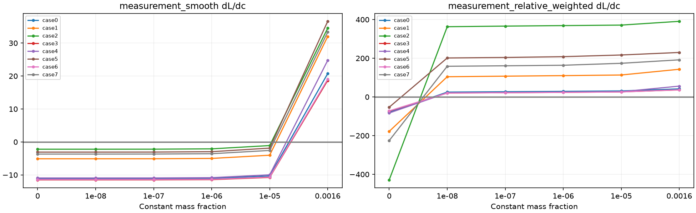
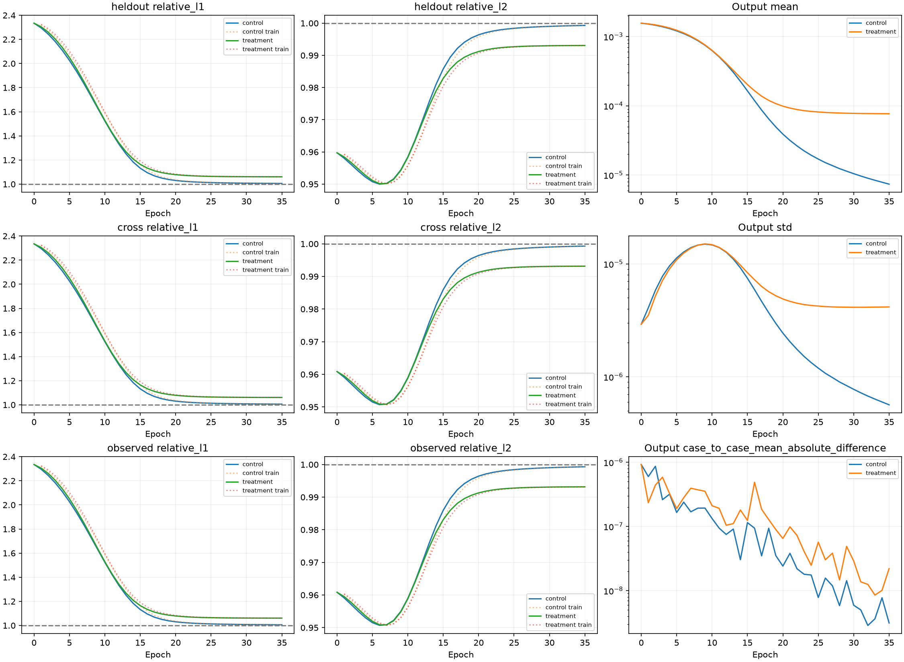
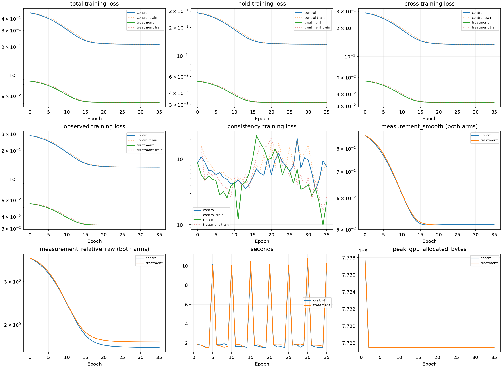
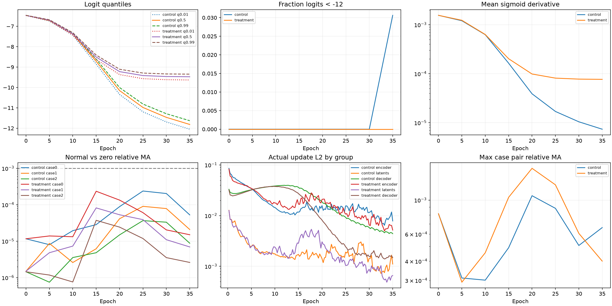
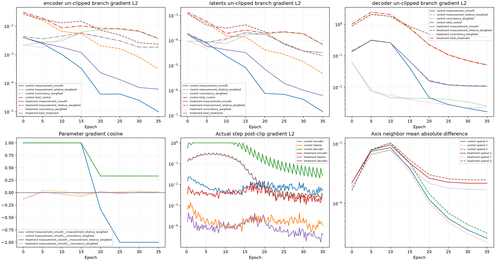

# Ray-Senseiver 测量梯度拆分与relative-L1开/关：PARTIAL_LEARNING_EVIDENCE

**实验标签：PARTIAL_LEARNING_EVIDENCE；正式训练决策：NO-GO。** 本轮只执行预登记的两臂固定8例可学习性探针。H参与loss，不是独立泛化Val；没有GT/Val/Pool B/test或外部权重读取，没有新300轮或系数搜索。

## 唯一干预和历史保护

[协议](../ray_senseiver_relative_probe_v1_protocol_zh.md)、[配置](../../configs/ray_senseiver_relative_probe_v1.yaml)、[注册清单](artifacts/ray_senseiver_relative_probe_v1/registration.json)。训练前登记commit `73b4ed4`。Control内部λ_rel=.1，Treatment=0；外层hold1/cross.5/observed.1/consistency.05全不变。内部relative=.1和外层observed=.1是不同系数。beta=.01、epsilon1e−6、Y_SCALE、mask/reduction、consistency公式及所有网络/输入/几何未变。relative是逐case sum(abs residual)/clamp(sum(abs target))，不是逐射线相除。Treatment的relative诊断不加入训练total梯度。

复用前8例/seed20261011/sampler epoch0/A-B-H/case顺序/连续2例batch；原C_init=0.0015582416、输出weight×.01与bias=-6.4626378直接复制，无重估。两臂全部参数逐元素一致，fresh state SHA=`a51ae38bb2d67202a4766de25c0e01bc9832fb8887756d2f7ebbee41a38fc5be`，与上轮注册Treatment一致；不读取其训练checkpoint。历史源码/报告/数据hash受保护，原失败run和初始化探针不续跑，不重训/评价Ours或DeepSets。

## 训练前零更新梯度诊断

全部8例，各1个fresh网络完整预测和6个常量场，只forward/autograd，optimizer未创建，0 step，model state hash不变，.grad buffers全None；耗时55.586729秒。完整[梯度JSON](artifacts/ray_senseiver_relative_probe_v1/gradient_diagnosis.json.gz)、[fresh各分支CSV](artifacts/ray_senseiver_relative_probe_v1/fresh_branch_gradients.csv)、[常量导数CSV](artifacts/ray_senseiver_relative_probe_v1/constant_derivatives.csv)。

同一预测图核验Control与原objective所有loss项bitwise相等，输出/全部模型参数梯度一致（数值容差内）；两臂差正好是被移除的加权relative项。8例最大原梯度差L2=7.271199e-08；唯一差异梯度最大余量L2=2.5658113e-07。同预测dL/dC差也单独保存核验。

| fresh分支（8例均值） | loss | encoder grad L2 | latents grad L2 | decoder grad L2 | 输出均匀平移dL/dc |
| --- | --- | --- | --- | --- | --- |
| measurement_smooth | 0.086210866 | 0.0034702694 | 0.00014041806 | 0.12692875 | 27.457231 |
| measurement_relative_weighted | 0.37353681 | 0.018338039 | 0.00075507094 | 0.65435626 | 140.91525 |
| hold_control | 0.2866919 | 0.013619754 | 0.0005591863 | 0.48808028 | 105.14453 |
| cross_control_weighted | 0.14421315 | 0.0068226735 | 0.00028011206 | 0.24442655 | 52.690029 |
| observed_control_weighted | 0.028842633 | 0.0013660942 | 5.6198282e-05 | 0.048824979 | 10.537926 |
| consistency_weighted | 4.3499909e-05 | 0.0028962568 | 0.00012102159 | 0.08867457 | -0.027901649 |
| total_control | 0.45979118 | 0.022071116 | 0.0009222573 | 0.77882775 | 168.34458 |
| total_treatment | 0.086254366 | 0.0046402525 | 0.0001962461 | 0.15388436 | 27.42933 |

上述范数是逐例计算后平均，不能相加。总梯度由向量相加决定；cosine/dot报告同一向量空间的夹角，零向量cosine为null。常量探针没有encoder等网络参数，参数梯度记null；完整dL/dC的min/max/mean/sum/正负比例及scalar dL/dc全部保留。

| fresh梯度对 | 参数cosine均值/min/max | 输出cosine均值/min/max |
| --- | --- | --- |
| measurement_smooth__measurement_relative_weighted | 0.99998371 / 0.9999178 / 0.99999838 | 0.9985675 / 0.99794875 / 0.99918498 |
| measurement_smooth__consistency_weighted | -0.15771737 / -0.35426358 / 0.023564502 | 0.0058796102 / -0.0019378625 / 0.015706885 |
| measurement_relative_weighted__consistency_weighted | -0.16031325 / -0.35241734 / 0.022721956 | -0.00029938224 / -0.0059852397 / 0.0038343931 |

## 近零常量方向和测量幅度贡献

正dL/dc表示梯度下降压低常量质量分数，负值表示提高。以下为全部8例均值；逐case与hold/cross/observed分支全部在CSV/JSON，不用残差正负数量代替浓度梯度。

| C | Smooth dL/dc | 0.1×relative dL/dc | consistency dL/dc | Control total | Treatment total |
| --- | --- | --- | --- | --- | --- |
| 0 | -7.3789112 | -149.00948 | 0 | -156.38839 | -7.3789113 |
| 1e-08 | -7.3779351 | 114.32016 | 0 | 106.94223 | -7.3779351 |
| 1e-07 | -7.3691483 | 116.52435 | 0 | 109.15521 | -7.3691483 |
| 1e-06 | -7.2812816 | 119.01027 | 0 | 111.72899 | -7.2812816 |
| 1e-05 | -6.4022865 | 123.23191 | 0 | 116.82963 | -6.4022865 |
| 0.0015582416 | 27.457585 | 140.91309 | 0 | 168.37067 | 27.457585 |

分组仅按观测幅度target/Y_SCALE：精确0、(0,1e−6]、>1e−6，不是已知真实背景/羽流区域，也不是训练ray筛选或物理噪声界限。A/B/H各自不交；下表按8例相加。逐case/subset数量和分位数见[幅度CSV](artifacts/ray_senseiver_relative_probe_v1/amplitude_inventory.csv)，包含q0/q01/q50/q99/q100；不会把分位数平均冒充全局分位数。

| subset | 精确0 | (0,1e−6] | >1e−6 |
| --- | --- | --- | --- |
| A | 12557 | 43045 | 12100 |
| B | 7495 | 54916 | 14362 |
| H | 4097 | 25536 | 6150 |

每组贡献保留原完整case的valid数和sum target分母，经**真实P_diff/K96→scalar**链式autograd求导；分组导数之和等于全分支（数值容差内）。[完整分组贡献CSV](artifacts/ray_senseiver_relative_probe_v1/amplitude_gradient_contributions.csv)。下表是C=1e−7时外层加权measurement的8例均值。

| 观测组 | Smooth dL/dc | 0.1×relative dL/dc |
| --- | --- | --- |
| exact_zero | 0.00143612 | 27.387656 |
| positive_le_1e_6 | 0.007373051 | 118.51671 |
| above_1e_6 | -7.3779576 | -29.380007 |

精确C=0时abs的零残差子梯度为0；正近零场会使许多精确零/极小目标ray变为正残差，因此符号可与零点不同。这是不可微点的方向/子梯度差异，不是梯度断开。float64标量只核验均匀场的y=1e6 length mass_to_mole(c)及原归约，FP32真实projector/训练未改；所有逐例float64导数随JSON保留。

实际机制证据：在C=1e−7，精确零/(0,1e−6]/>1e−6三组的加权relative导数约+27.39/+118.52/−29.38，合计+116.52；Smooth对应约+.001436/+.007373/−7.37796，合计−7.36915。全部8例在1e−8至1e−5的正近零常量方向呈Smooth向上、relative向下（逐例详见CSV）；在C_init，两者平均均向下。fresh参数Smooth-vs-relative cosine约.9999，relative加权decoder范数均值.65436约为Smooth .12693的5.16倍；consistency .08867仍不可忽略。因此初态不是Smooth和relative互相抵消，近零常量方向才出现明显相反推动。float64与FP32总导数最大绝对差约5.40e−5，符号解释一致。

## 实际训练预算与终止

| 臂 | λ_rel | epochs | updates | 终止原因 | epoch墙钟秒 | 峰值GiB |
| --- | --- | --- | --- | --- | --- | --- |
| control | 0.1 | 35 | 140 | FAILED_TO_LEARN | 118.21216 | 0.72065163 |
| treatment | 0 | 35 | 140 | FAILED_TO_LEARN | 120.56926 | 0.72065163 |

各臂epoch0完整保存；每轮4次更新，最多40/160，FP32/AdamW2e−4/wd1e−4/clip1/cosine T_max300/完整64³/all rays/K96。smoke每臂1次独立更新不算科学预算，随后重新fresh构建并核对hash。共享GPU墙钟及event含健康检查/host间隙，不是独占kernel性能。

停止事件保留完整L1/L2最近/前5轮均值、相对改善、依赖case数和连续计数：[Control](artifacts/ray_senseiver_relative_probe_v1/control/events.json.gz) / [Treatment](artifacts/ray_senseiver_relative_probe_v1/treatment/events.json.gz)。第5/20轮后从10/25检查起，不因L1单独缓慢误停。

## 共同预算比较

共同完成至epoch35/update140；下表只在相同预算比较，各自终点另列。H/cross/obs指标对两臂统一计算，不随训练loss改变；train聚合跨更新、eval为轮末同一权重，曲线分别标出。

| epoch/update | Control H L1/L2 | Treatment H L1/L2 | T−C L1/L2 |
| --- | --- | --- | --- |
| 0/0 | 2.3343054/0.95973196 | 2.3343054/0.95973196 | 0/0 |
| 5/20 | 2.025983/0.95074172 | 2.0498786/0.95112564 | 0.023895623/0.00038391216 |
| 10/40 | 1.5236077/0.95846436 | 1.5289339/0.95832145 | 0.0053262243/-0.00014290498 |
| 15/60 | 1.1320065/0.98580891 | 1.1641069/0.98288781 | 0.032100437/-0.0029210993 |
| 20/80 | 1.0301906/0.99640315 | 1.0785677/0.9912043 | 0.048377079/-0.0051988543 |
| 25/100 | 1.012906/0.99841177 | 1.0644414/0.99268336 | 0.051535342/-0.0057284087 |
| 30/120 | 1.0078839/0.99901774 | 1.0614136/0.99300004 | 0.053529795/-0.0060177038 |
| 35/140 | 1.0055352/0.99930506 | 1.0606962/0.99307336 | 0.055161007/-0.0062317005 |

| 臂/最终epoch | H L1/L2 | cross L1/L2 | obs L1/L2 | smooth / relative(raw) | mean/std |
| --- | --- | --- | --- | --- | --- |
| control/35 | 1.0055352/0.99930506 | 1.0055209/0.99931319 | 1.0055209/0.99931318 | 0.05150374/1.6088478 | 7.3920301e-06/5.6500103e-07 |
| treatment/35 | 1.0606962/0.99307336 | 1.0608731/0.99316267 | 1.060873/0.99316265 | 0.0512744/1.6972201 | 7.6843732e-05/4.1592272e-06 |

## 输出、梯度与测量依赖

| 臂/轮 | logit P01/P50/P99 | <-12比例 | sigmoid导数均值 | 最大case间relative MA |
| --- | --- | --- | --- | --- |
| control/0 | -6.4670982/-6.4628091/-6.4584851 | 0 | 0.0015555603 | 0.00081467878 |
| control/35 | -12.047827/-11.815125/-11.631086 | 0.030632019 | 7.3919752e-06 | 0.00066200965 |
| treatment/0 | -6.4670982/-6.4628091/-6.4584851 | 0 | 0.0015555603 | 0.00081467878 |
| treatment/35 | -9.6318722/-9.4732494/-9.3454695 | 0 | 7.683781e-05 | 0.00040074507 |

| 臂/终点case | normal−zero绝对MA | normal meanabs | relative MA |
| --- | --- | --- | --- |
| control/0 | 3.8952375e-10 | 7.3946453e-06 | 5.2676455e-05 |
| control/1 | 1.5441727e-10 | 7.3926684e-06 | 2.088789e-05 |
| control/2 | 6.4979758e-11 | 7.38975e-06 | 8.793227e-06 |
| treatment/0 | 1.1536403e-09 | 7.6831044e-05 | 1.5015288e-05 |
| treatment/1 | 5.3397947e-10 | 7.6861834e-05 | 6.9472642e-06 |
| treatment/2 | 2.0036968e-10 | 7.6840206e-05 | 2.607615e-06 |

仅将raw/normalized测量置零，geometry/path/mask等逐tensor一致；分母normal meanabs+1e−12。空间XYZ邻点、完整min/max/mean/std、case间绝对差及三组未clip梯度、所有真实step的postclip梯度/更新L2均在health/history归档。下表为终点3诊断case的分支梯度范数均值（counterfactual relative项在Treatment仅诊断，未加入训练）。

| 臂/分支 | encoder grad L2 | latents grad L2 | decoder grad L2 |
| --- | --- | --- | --- |
| control/measurement_smooth | 1.001475e-05 | 1.4253462e-07 | 0.0016742839 |
| control/measurement_relative_weighted | 0.00031896419 | 4.8413314e-06 | 0.052198876 |
| control/consistency_weighted | 0.0036393001 | 6.9724528e-05 | 0.0025143201 |
| control/total_control | 0.0036957271 | 6.9264424e-05 | 0.050936553 |
| treatment/measurement_smooth | 6.164558e-05 | 6.3066139e-07 | 0.010750381 |
| treatment/measurement_relative_weighted | 0.002346012 | 2.476727e-05 | 0.40311379 |
| treatment/consistency_weighted | 0.0018312596 | 3.3103762e-05 | 0.0023155062 |
| treatment/total_treatment | 0.0018388128 | 3.3136991e-05 | 0.011073926 |

| 臂/终点梯度对 | 参数cosine（3例均值） | 输出cosine（3例均值） |
| --- | --- | --- |
| control/measurement_smooth__measurement_relative_weighted | -0.99985786 | 0.27800133 |
| control/measurement_smooth__consistency_weighted | 0.00031909968 | 0.0023910382 |
| control/measurement_relative_weighted__consistency_weighted | 5.1451606e-05 | -0.0012249686 |
| treatment/measurement_smooth__measurement_relative_weighted | 0.3333994 | 0.74934016 |
| treatment/measurement_smooth__consistency_weighted | 0.015094377 | -0.0034883015 |
| treatment/measurement_relative_weighted__consistency_weighted | -0.0023222857 | -0.0015517479 |

所有dot/cosine原始向量证据保留；参数空间和输出空间的夹角含义不同，不把范数相加。完整query输出和健康检查的259/37分块全部参数/每query梯度核验保持，不改正式query数量。

## 判定与证据边界

| 最低GO条件 | 通过 |
| --- | --- |
| last3_H_L1_below090 | 0 |
| no_engineering_or_collapse | 1 |
| case_variation | 0 |
| measurement_dependence | 0 |
| gradients_updates_valid | 1 |

Treatment最后三次健康H L1：epoch25=1.0644414, epoch30=1.0614136, epoch35=1.0606962。共同预算相对自身epoch0，H L2改善=-3.4740327%、measurement SmoothL1改善=40.524434%；预登记≥1%的辅助改善只产生PARTIAL标签，不能替代GO或有效测量依赖。

本轮实际回答：关闭relative后末轮mean为7.68437e−5，约Control的10.40倍，但仍仅0.04931×C_init；logit中位数从Control −11.8151变为−9.47325，<-12比例从3.063%变0。两臂均未触发严格NEAR_ZERO_COLLAPSE，Treatment仍出现明显输出压低及近乎case无关、测量无关的空间先验。共同终点T−C：H L1约+0.0551610、H L2约−0.00623170，二者胜负方向相反；相对自身初态，Treatment H L2反而恶化3.474%，只有SmoothL1下降40.524%。因此PARTIAL在这里是有限指标证据，不是已产生非平凡有效学习。Control终点Smooth-vs-relative参数cosine约−.99986，显示当前参数方向发生抵消；不能把fresh的近同向关系套用至训练终点，输出空间cosine也不同。

relative-L1的常量方向机制只在本8例、该Senseiver适配、固定初始化/预算下成立；不能外推其对所有模型有害。关闭后若只是L2/Smooth改善、没有case/测量依赖，就属于指标偏好或局部拟合改变；后续即使成功也必须明确训练目标已与冻结Ours/DeepSets不同。

当前未达到GO；辅助指标改善只能说明目标/误差偏好变化或有限训练拟合证据，不能证明非平凡重建。Treatment终点consistency的encoder梯度范数均值约为Smooth的29.7倍，latents约52.5倍；其参数cosine与Smooth平均约.015，不证明两者方向相反。唯一下一阶段建议：独立登记固定初始化与λ_rel=0下consistency开/关有限对照，检验该分支在encoder/latents占主导是否影响测量依赖形成；本轮不执行，不预设其唯一因果。

## 访问审计、历史保护与交付

| 阶段 | unique train8 projection | GT尝试 | 禁止NPY尝试 | foreign权重尝试 |
| --- | --- | --- | --- | --- |
| stage1 | 8 | 0 | 0 | 0 |
| control | 8 | 0 | 0 | 0 |
| treatment | 8 | 0 | 0 | 0 |

TrainEightGuard仅开放注册8个train NPY；基础summary中train/val字样不扩大该allowlist。没有Val/test/PoolB读取。边界拒绝测试在独立测试进程，不计为科学run违规。5项新增与15项相关回归通过，覆盖原Control、系数差值/输出梯度、valid零、真实projector分组导数、L1/L2/依赖退出窗口、own-last完整恢复和禁止读取边界；每臂独立smoke验证H不入网、首步梯度/真实更新/自身状态恢复、ray与分块。

[最终完整性](artifacts/ray_senseiver_relative_probe_v1/final_integrity.json)核验历史/新冻结源码hash、全部固定输入tensor身份、valid-ray数量/geometry、last的AdamW steps/scheduler/参数有限性及checkpoint SHA；不执行step。大checkpoint留外部，Git保存全部标量、清单、曲线、诊断、协议与中文报告。

| 臂 | last SHA256 | 外部last |
| --- | --- | --- |
| control | 36e6c1b935a44d0b1e7f678503661ad2119c0495db018340ea6b717b13a51b1f | /data/djc/GeoPhy-Set3D/outputs/checkpoints/ray_senseiver_relative_probe_v1/control/last.pt |
| treatment | c32fd6f57413eb56988bc7c1765d136a47ea0ec4884b78f5edb285b0bf09c019 | /data/djc/GeoPhy-Set3D/outputs/checkpoints/ray_senseiver_relative_probe_v1/treatment/last.pt |

复现：`scripts/run_senseiver_relative_probe.py --phase prepare/diagnose/smoke/train`；已有注册/诊断/科学终止拒绝覆盖，仅中断允许本臂`--resume`。报告入口只读已存JSON。原近零塌缩和上轮NO-GO保留，本轮不自动300轮、不再搜索。
