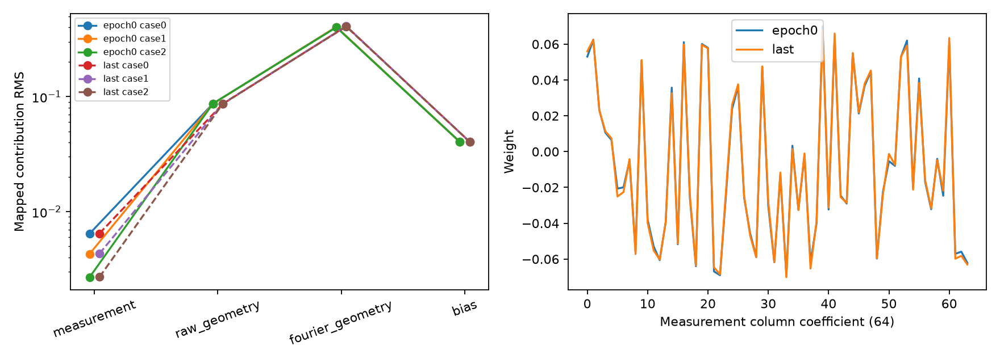
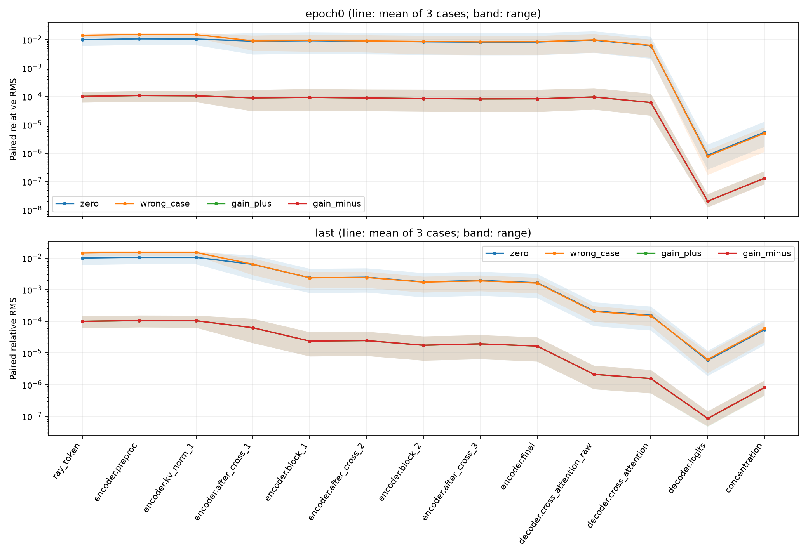
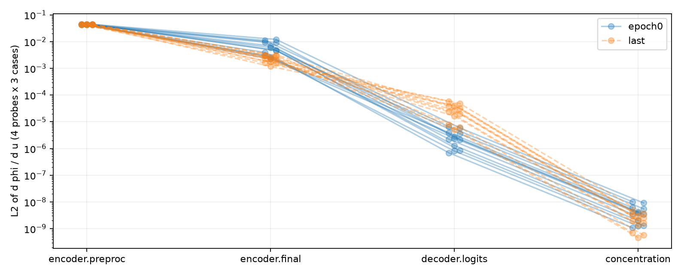
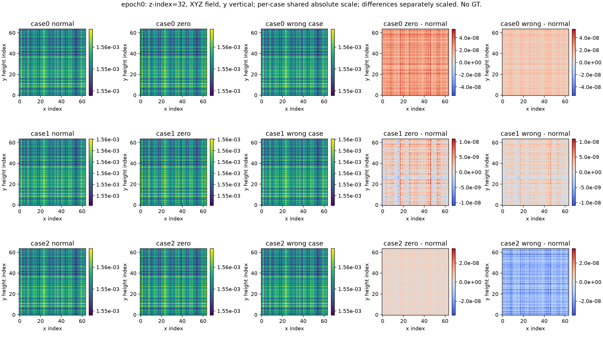
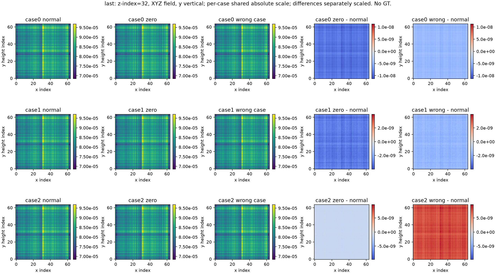
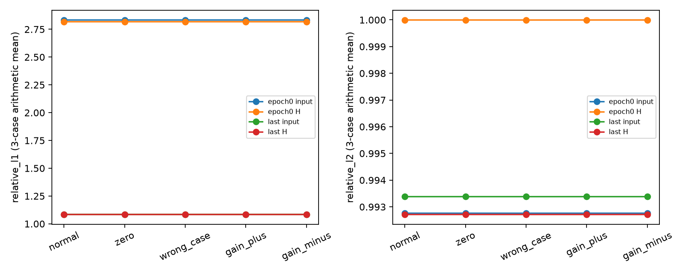

# Ray-Senseiver 测量信号通路独立诊断 v1

完成日期：2026-10-14（Asia/Shanghai）。**本轮没有训练；正式训练决策仍为 NO-GO。**

测量正确进入 ray token，线性预处理及 encoder latents 均保留非零测量响应；没有发现冻结模型的明确字段接线、几何或梯度断开错误。失败末态在相同几何下将测量置零或错配，浓度变化很小，且主要是极小的整体幅度偏移，原 A/H 测量拟合几乎不变。现有证据支持“测量被弱利用”，但不足以将失败唯一归因于预处理、latent bottleneck、decoder 或 sigmoid。

本报告保留两次诊断执行器工程错误、版本化修复及一个中止的局部图；不是一次无异常执行。logit 有限差分仅 2/24 通过，其余 22 项按预定容差保留失败，不据此声称 logit 梯度数值已全部验证。

## 1. 身份、边界与实际执行

已读取历史学习状态、初始化、relative-L1、consistency 报告及协议，原模型/core/官方来源、measurement-only dataset、projector 和 TrainEightGuard。仓库及祖先目录无适用 AGENTS.md；工作区开始干净。官方源为 [OrchardLANL/Senseiver](https://github.com/OrchardLANL/Senseiver)，登记 commit `e443eb0ca188b5e83a0e6ce5afb8db7d90393de1`；本轮没有修改它或适配模型。

仅使用最新 consistency Treatment 的两个 checkpoint，均为 relative=0、consistency=0：

| 身份 | epoch / 历史 updates | 文件 SHA256 |
| --- | --- | --- |
| epoch0.pt | 0 / 0 | `950cb7be68e20bdccda7c9f8e002c71410a44b8ff3416c6384310730130b982a` |
| last.pt | 35 / 140，FAILED_TO_LEARN | `448ef11e82b0b29e26be2ecc0d10909f575b649cb30c1b00a4142e18219bec71` |

路径前缀为 `/data/djc/GeoPhy-Set3D/outputs/checkpoints/ray_senseiver_consistency_probe_v1/treatment/`。checkpoint 的 config、原登记/source manifest、初态及科学退出身份均核验。原尺度初态 state hash 为 `a51ae38bb2d67202a4766de25c0e01bc9832fb8887756d2f7ebbee41a38fc5be`，C_init=0.0015582415568457682，未重新估计尺度。

原 train source-index 0/1/2、Pool A、sampler epoch0、原 A/B/H 身份固定。A 站位顺序分别为 `[10,17,40]`、`[43,23,25,14]`、`[28,24,53]`；有效射线分别 6007/8199/6168，normal 中精确零分别 0/16/0，全部保留。wrong_case 固定 0←1、1←2、2←3，通过原 `_views` 从 source 的 **target 站位**取测量；不是滚动各自原 A 数组。共享 Pool A 几何及每个干预的射线身份逐字段相同。只允许这 4 个 projection 文件和精确两个 checkpoint。

五种模式为 normal、zero、wrong_case、gain_plus×1.01、gain_minus×0.99。只改模型输入副本的 raw/normalized 测量；station IDs、origin、direction、near、path、valid/view masks、query 及其它输入对象保持。H 不进入 network，A/B/H 两两不交；H 仅在本轮固定评价使用（历史训练中 H 曾参与 loss，不能称独立泛化验证）。所有投影评价始终使用 target 原 A/H 测量，wrong_case 不替换评价目标。

| 项目 | 预登记 | 实际账本 |
| --- | --- | --- |
| 完整 64³ 模型前向 | 30 | started=returned=saved=30；成功项无重复 |
| 固定 259-query 局部图 | 6 | started=7、aborted=1、returned=saved=6 |
| 原 P_diff/K96 投影调用 | 60 | 60（每个完整预测 A/H 各一次） |
| optimizer / steps / 新训练 epochs | 不创建 / 0 / 0 | 不创建 / 0 / 0 |

30 个预测均覆盖 262144 个 query，XYZ 轴序、y 为高度，原 chunk16384 共16块，无丢 query 或有效射线。hook 观察真实 forward，不改 attention 设置/need_weights/计算顺序，不保存 attention 矩阵。共享 encoder layer_n 的两次调用单独记录，实际次序为 cross1→block1→cross2→block2→cross3→block3。

账本首个 started 为 20:09:25，最后 saved 为 20:18:15（含两次修复、测试、提交间隔）；30 条完整记录 seconds 合计128.813s，含 hook统计/投影/保存。最终 v1.2 续跑进程76.732s只是该进程时间，不是累计耗时。局部图未单独计时。完整前向最大 PyTorch allocated 显存174,369,280 bytes，不能当整个机器或所有局部 autograd 的峰值。没有 OOM，没有终止他人进程。

## 2. 预登记与工程事件

初始登记 commit `08a7fc1` 先于诊断，包含 [协议](../ray_senseiver_signal_path_v1_protocol_zh.md)、[配置](../../configs/ray_senseiver_signal_path_v1.yaml)、checkpoint/固定输入/30+6 清单及源码 hash。原 registration、source_manifest、历史科学源码与结果未重写。后续两个 amendment 只登记执行器和对应测试的 hash 变化，严格验证旧→新链及已保存记录/账本前缀。

1. **v1→v1.1，`dc2882a`**：已有 normal/zero 两次完整结果；wrong_case 在 started 之前触发 CPU/GPU 输入身份断言。无前向独立核验表明，差异只在模型未使用的 normalized 字段的 CPU/GPU 除法末位，最大5.9604645e−8；实际 raw、几何等相同。修复为把登记时 CPU 的两个测量字段原样传至 GPU，保留 GPU 几何对象，未放宽 hash 容差或改变模型数值函数。两份已保存结果继续复用。
2. **v1.1→v1.2，`ee23807`**：case0 的五个完整结果已保存；首个259-query局部图构建后，phi 归一化因执行器遗漏 `import math` 抛 NameError，发生在第一个 autograd.grad 之前。补 import、增加实际局部入口回归、登记唯一中止图的一次重试，账本追加 aborted，保留已有五个完整结果。成功科学图仍为6个，但实际启动7个，不能报告成只执行6次。

这两次错误属于新诊断工具，不是冻结 Ray-Senseiver 的已证实实现错误；不影响历史训练结论。两次早期异常退出时 guard 计数未落盘，不能补造累计访问次数。已有 guard 当时有效且未捕获/绕过违规异常，保存结果显示参数/buffers未变；v1.2 增加 finally 保存每个访问 session。该审计缺口在 [complete.json](artifacts/ray_senseiver_signal_path_v1/complete.json)、amendments 和原异常日志中明确保留。无前向 device 核验访问计数及 v1.2 完整计数可查。

结果汇总工具曾因 CSV 行重复 `calls` 关键字报错；只读取已保存结果、没有构造模型或触发新前向，修复后重新生成汇总，访问 session 保留。它未改变登记的执行器、原始记录或科学预算。

## 3. 测量是否进入 token，预处理是否保留响应？

实际 token203 通道为：`[0:1]`=raw/Y_SCALE；`[1:11]`=entry3/exit3/direction3/normalized length1；`[11:203]`=entry Fourier96/exit Fourier96。模型读取 **raw/Y_SCALE**，不是独立 normalized 字段；Y_SCALE=32284.894580078173。hook 对测量通道与真实 raw/Y_SCALE 做逐元素精确核验，并排除 invalid/padding。干预中几何 token 的202通道与 normal 逐元素相同。

preproc 为203→64线性映射，分别计算 W 分块乘输入、bias，再重构真实输出。6个 normal 全部通过原定 FP32 atol2e−6/rtol2e−5；例如 epoch0/case0 最大绝对重构差1.3113e−6。没有将此线性拆分延伸到 LayerNorm 后。

| 项目（case0/1/2） | epoch0 | last |
| --- | --- | --- |
| 测量输入 RMS | .144982 / .0966231 / .0605239 | 相同 |
| 测量映射贡献 RMS | .00643729 / .00429013 / .00268730 | .00646686 / .00430984 / .00269964 |
| 原始几何输入 RMS | .676426 / .676870 / .675112 | 相同 |
| 原始几何映射贡献 RMS | .0869967 / .0868787 / .0870947 | .0865627 / .0869088 / .0869826 |
| Fourier输入 RMS | 各约.707107 | 相同 |
| Fourier映射贡献 RMS | .404190 / .404213 / .401144 | .410141 / .410621 / .407397 |
| bias贡献 RMS | .0405105 | .0405872 |
| 测量 / 原始几何 / Fourier 权重块 Frobenius | .355205 / 1.011840 / 4.512024 | .356837 / 1.012601 / 4.532347 |

权重块维数不同，范数不能直接当作重要性排序。真实输入与映射贡献共同表明测量分量比 Fourier贡献小，但它没有消失。测量64个权重系数的初末差L2=.0138103，相对初态L2=3.88797%，cosine=.999258；列范数约增长0.459%，没有被学成零。同一列在三个案例重复出现不是3个独立权重样本。完整分布、分位数及64系数见原记录和 [贡献CSV](artifacts/ray_senseiver_signal_path_v1/contributions.csv)。

**回答1、2：测量送入正确，preprocessing有可重复、可求导的响应；不能从1/203或较小贡献直接断言根因。**

## 4. encoder→decoder 的实际干预响应

下表均为同 checkpoint、同 case、同几何 normal 配对的 `RMS(diff)/RMS(normal)`；每格为3个固定案例范围。全部逐 case、逐模式、逐 stage 的形状、元素数、统计、差MAE/RMS/max、cosine/相关及null计数见 [stages.csv](artifacts/ray_senseiver_signal_path_v1/stages.csv)。分母≤1e−12导出null，保留绝对差。置零后的零向量 cosine/相关可为null，不能解释成强变化或完美相关。

| stage | epoch0 zero | last zero | epoch0 wrong_case | last wrong_case |
| --- | --- | --- | --- | --- |
| ray token | .00604–.0145 | 相同 | .0113–.0162 | 相同 |
| encoder preproc | .00649–.0154 | .00641–.0153 | .0120–.0173 | .0118–.0172 |
| 第一次 KV LayerNorm | .00636–.0152 | .00635–.0152 | .0118–.0171 | .0117–.0171 |
| 第一次 cross 后 | .00299–.0170 | .00207–.0121 | .00406–.0139 | .00287–.00963 |
| block1 后 | .00320–.0183 | .000784–.00458 | .00376–.0150 | .00109–.00361 |
| block2 后 | .00292–.0174 | .000576–.00336 | .00303–.0137 | .000814–.00259 |
| block3 / encoder final | .00284–.0173 | .000542–.00315 | .00290–.0135 | .000764–.00239 |
| decoder纯cross-attention | .00344–.0197 | .0000702–.000401 | .00350–.0159 | .0000974–.000300 |
| decoder cross层（含residual/MLP） | .00211–.0126 | .0000514–.000293 | .00228–.00996 | .0000710–.000219 |
| logits | 2.63e−7–2.00e−6 | 1.87e−6–1.17e−5 | 1.71e−7–1.27e−6 | 2.32e−6–1.02e−5 |
| 浓度 | 1.69e−6–1.29e−5 | 1.78e−5–1.11e−4 | 1.10e−6–8.17e−6 | 2.20e−5–9.68e−5 |

原96维 query encoding、64维 learned query及query preprocessing对四种测量干预均 hash完全相同；它们是预期固定项，不能当作信息丢失。16个 decoder chunks全部统计，元素加权归约；另以非等长合成chunk测试防止等权平均错误。

初态至last，在同一stage的比较中，preproc响应相近而encoder final的zero响应下降约4–5.5倍，wrong响应也下降。最后模型latents并非完全不响应测量。decoder纯cross输出仍有非零响应，最终logit变化则很小。不同stage尺度、维数、LayerNorm/残差以及logit大负bias均不同，表内数值不是信息量或统一传输率，不能仅用跨stage比值断定哪个模块丢失最多信息。

gain±1%全程亦有响应；末态浓度relative RMS约4.44e−7–1.36e−6，见图与完整表，不增加其它gain或挑方向。局部梯度在下一节交叉检查。

**回答3、4：末态encoder响应比初态弱，latents与decoder均有测量通路，但有效输出响应极弱；尚不能区分“latent可读信息不足”和“decoder没有利用好已有信息”。**

图中线为3例算术均值，带为范围，仅用于显示；不是置信区间，也不是跨stage信息排序。

## 5. 局部敏感性、有限差分与 sigmoid

6个独立局部图均用原固定259 query（原torch.linspace转long；索引hash核验），每stage4个预登记Rademacher探针，phi=sum(sign*x)/sqrt(numel)，seed20261015派生。以u=raw/Y_SCALE为leaf，实际raw=u×Y_SCALE；对真正读取的字段求导。使用autograd.grad，无optimizer，参数.grad和u.grad均未写入；所有invalid测量梯度计数为0，有限且非零。

| stage | epoch0 dphi/du 的L2范围（3例×4探针） | last 范围 | FD通过 epoch0 / last |
| --- | --- | --- | --- |
| preproc | .0436799–.0443343 | .0438780–.0445386 | 12/12；12/12 |
| final latent | .00224566–.0121059 | .00118463–.00319959 | 12/12；12/12 |
| sampled logits | 6.90913e−7–6.54244e−6 | 5.11664e−6–5.78485e−5 | 0/12；2/12 |
| sampled concentration | 1.07717e−9–1.01636e−8 | 4.67269e−10–4.45173e−9 | 12/12；12/12 |

不同stage probe的shape/归一化不同，以上是固定随机投影的局部响应，不能作为完整Jacobian奇异谱或可恢复性证明。尤其末态logit梯度比初态更大，并不支持“所有阶段都逐步失去测量依赖”的简单解释。

FD只使用已存gain±1%结果：(phi+−phi−)/.02 对照 grad_phi_u·u。预定标准 `abs_error ≤ 1e−7 + .05×max(|AD|,|FD|)` 未更改；总74/96通过，22个失败全在logits，完整结果含反向符号及零FD保留于 [finite_difference.csv](artifacts/ray_senseiver_signal_path_v1/finite_difference.csv)。

例如epoch0/case0/probe0 AD=−2.23512e−5、FD=−3.40736e−5，误差1.17224e−5大于容差1.80368e−6；last/case0/probe0 AD=2.37798e−4、FD=3.34810e−4，误差9.70123e−5大于容差1.68405e−5。不能隐藏这些失败。初态logit probe还出现AD非零而FD=0。

完整场no_grad/16384块与局部autograd/259点采用既有计算路径，未强制统一attention kernel；FP32 logit量化、求和抵消、不同计算路径及有限步长均可能影响小差分。local-vs-full normal phi最大差：初态logit9.36205e−7、末态1.22549e−6，与部分gain差分信号相当。这个观察能解释精度风险，**没有证明全部失败仅由舍入造成**；当前logit方向导数验证受限，不据它们宣称工程错误或精确定量decoder增益。

浓度FD全通过也不意味着相对精度充分：其最大AD/FD绝对误差约1.68e−8/7.36e−9，固定atol1e−7对该小尺度较宽松。因此主要定位证据仍是有限干预结果、preproc/latent核验和非零梯度，而非把C的pass率当高精度认证。

logit和C使用相同probe符号，可比较激活链：初态 ||dphi_C/du|| / ||dphi_z/du||=.00155349–.00156192；末态=7.68599e−5–9.13234e−5。完整场sigmoid导数均值初态约.00155503，末态约7.67147e−5。**绝对浓度灵敏度受小输出尺度缩小**，这一点成立。

但 `d log(C)/dz = 1−C` 初态约.998443、末态约.999923；相对浓度变化约等于绝对logit变化。末态zero的logit绝对RMS仅1.78e−5–1.11e−4，已经很小；不能把sigmoid对绝对单位的缩放等同于额外压灭相对信息。所有normal logits初态约−6.47、末态−9.81至−9.22，未出现<-12。这里只是冻结状态，也不能重新判定历史run已学会。

**回答5：sigmoid进一步压小绝对响应，但没有证据证明它是相对测量依赖不足的唯一或主要原因。**

## 6. 输出、案例差异与功能性测量评价

| normal | C min–max（三例总范围） | 三例mean范围 | 三例空间std范围 |
| --- | --- | --- | --- |
| epoch0 | .00154660–.00156887 | .00155697–.00155823 | 2.76177e−6–2.80518e−6 |
| last | 5.50161e−5–9.91970e−5 | 7.66397e−5–7.68201e−5 | 4.27869e−6–4.29050e−6 |

末态平均浓度约初态的4.93%，空间std/mean约5.6%，因此既有非恒定纹理又整体幅度下降；有纹理不意味着正确羽流。

| last：只改测量 | case0 | case1 | case2 |
| --- | --- | --- | --- |
| zero 浓度绝对MAE | 8.47707e−9 | 2.87722e−9 | 1.35914e−9 |
| zero 旧relative MA | 1.10520e−4 | 3.74540e−5 | 1.77341e−5 |
| wrong 浓度relative RMS | 5.93064e−5 | 2.19506e−5 | 9.68071e−5 |

旧relative MA=MAE/(normal meanabs+1e−12)，不同于relative RMS。三例zero均未达此前1e−3测量依赖阈值。初态zero旧relative MA为1.45e−6–1.16e−5，末态虽增加仍很弱。

只用已存预测增加一个描述性空间统计（未改变登记判定）：去除差值体素均值后的RMS / 原差值RMS，末态zero为.0672/.0742/.0736，wrong为.0689/.0755/.0636。即变化的RMS能量主要由整体偏移解释，仍有很小空间差异。此统计不当作因果证明或新GO门槛，见 [spatial_response.csv](artifacts/ray_senseiver_signal_path_v1/spatial_response.csv)。

不同case原A几何不同；cross-case纹理或mean差异可以来自几何和固定query响应，不能冒充测量依赖。相同几何下去掉/错配测量后纹理几乎不变的证据支持“其主要部分不依赖当前测量”，但没有独立分离几何、learned latents和query各自贡献。

原projector功能评价如下，三例分列（不是原8例训练均值）：

| checkpoint/case | A relative L1 | A relative L2 | H relative L1 | H relative L2 |
| --- | --- | --- | --- | --- |
| epoch0 / 0 | 1.392401 | .899131 | 1.366128 | .885173 |
| epoch0 / 1 | 2.336700 | .969217 | 2.365709 | .970561 |
| epoch0 / 2 | 4.771559 | 1.109938 | 4.721848 | 1.144251 |
| last / 0 | 1.016403 | .992845 | 1.014951 | .992303 |
| last / 1 | 1.058838 | .993222 | 1.060096 | .993344 |
| last / 2 | 1.180257 | .994078 | 1.177037 | .992494 |

末态zero相对normal的H L1变化为−3.16e−6至−1.74e−6，H L2变化+1.18e−7至+8.41e−7；wrong的H L1变化−1.40e−6至+1.72e−5，H L2变化−6.48e−7至+4.51e−7。A同样变化很小。方向并非统一改善；没有形成“正确测量明显优于置零/错配”的功能性证据。gain±1%的H变化也极小，完整30条见 [measurement.csv](artifacts/ray_senseiver_signal_path_v1/measurement.csv)。这些非负测量的零/错配/gain干预检验幅度和内容，**没有做符号反转，不能声称已证明符号信息利用能力**。

**回答6：训练后浓度幅度明显下降，latent响应减弱，logit局部敏感性增加而绝对C敏感性未同步增加；既有指标改善不能替代测量相关的非平凡输出。**

两图均取 `C[:,:,32].T`，x横轴、y高度纵轴。每例normal/zero/wrong共享绝对色标，差值图另用明确的小尺度色标，不把视觉放大解释为强依赖；无GT。图中纹理不能认定为正确气体分布。

## 7. 完整性、访问及测试

[最终审计](artifacts/ray_senseiver_signal_path_v1/final_integrity_audit.json)重新核验100个登记源码项及其显式amendment链、历史报告/协议/登记文件、4个projection及元数据hash；两个checkpoint身份不变。36份科学scalar记录与saved账本SHA完全一致，30个预测NPZ和6个normal baseline NPZ共36个大文件hash核验，约2.366GB全部留外部。参数和全部buffers分开hash初末一致，所有.grad为None，所有hooks移除，0步更新。报告汇总不构造模型、不调用forward、不重新投影，不修改科学记录。

v1.2完整进程记录：4个唯一Pool A projection、38次projection读取（含hash核验/重复合法读取），GT/违规NPY/非登记checkpoint尝试均0；checkpoint open仅两个允许路径。准备阶段、无前向device核验、v1.2和后处理各自有计数，**不将这些数相加伪称含两次早期异常进程的完整累计审计**。两次原始异常进程guard计数未持久化的局限如第2节所述。未读取GT64/GT128、Val、Pool B或test，没有训练/评价冻结Ours、DeepSets或加载其权重。

必要诊断测试8项通过：测量字段干预/其它tensor身份、有效零保留、wrong射线错配拒绝及source在target站位抽取、真正raw链的u梯度与unused normalized副本、非等长chunk归约/近零null、实际共享hook顺序/贡献重构/清理、四例及精确checkpoint边界、登记字段CPU→GPU精确传输、实际259-query局部入口四stage四探针（部分测试内包含多个核验）。原Ray-Senseiver适配回归4项通过，总12项；日志随交付保存。测试仅合成小模型/少量query及允许的train输入核验，不增补冻结checkpoint科学前向。历史loss、模型、数据、失败记录及GO/NO-GO结论保留。

## 8. 定位结论与唯一下一阶段任务

**回答7：没有新发现冻结模型的明确实现错误。** 两次执行器错误已先报告、单独登记修复且保留影响范围；FD失败是明确数值局限，尚不足以诊断冻结模型断梯度。没有将小梯度等同于不可学习，也没有将当前适配的失败外推为原Senseiver能力上限。

当前六种可能性的判断：测量未正确送入token不受支持；预处理测量贡献相对几何较小但确实保留响应；encoder后续及末态latent响应较初态弱；decoder最终输出只弱利用测量，但latent是否含足够可读信息未证明；sigmoid绝对缩放存在，相对响应额外消失不受支持。**因此可定位到端到端测量利用不足，无法唯一定位一个应修改的模块。**

**回答8／唯一优先任务：预登记“固定同几何、真实测量均值的 latent→标量读出可学习性对照”。** 保持现有ray-token/encoder冻结，使用同射线身份的真实训练测量，以有效normalized测量均值作为一个无GT、可识别目标，只比较简单线性latent读出与原query解码路径对同一标量目标的利用。待检验假设是：latent已有可读的幅度信息，但现有query解码没有有效利用；如果简单读出也不能可靠区分目标，则该假设被削弱。它针对本轮“latent非零响应而功能性输出近乎不变”的证据，仍须独立协议，不是已经证明换读出头能改善三维重建。本轮**未实现或执行该任务**，不同时建议embedding、激活或其它结构改动。

仅3例、两个失败适配checkpoint、有限5种干预和4个随机探针；无GT，无完整Jacobian或attention权重、无训练因果对照，FD又有局限，不能确认全部信息可恢复或任何新结构可成功。正式训练继续NO-GO；本轮结束，不启动300轮、不调loss、不扫描增益/其它超参数、不增加latent，不把失败Senseiver列为成功强基线。

## 9. 交付与复核入口

- 冻结执行器：[diagnose_senseiver_signal_path.py](../../scripts/diagnose_senseiver_signal_path.py)、[只读hooks与guard](../../src/geophy_set3d/diagnostics/senseiver_signal_path.py)、[测试](../../tests/test_senseiver_signal_path.py)。
- 后处理：[summarize_senseiver_signal_path.py](../../scripts/summarize_senseiver_signal_path.py)，只审计/汇总已有记录和画图；不额外运行模型。
- [训练前登记与全部scalar/图表](artifacts/ray_senseiver_signal_path_v1/)、[完整账本](artifacts/ray_senseiver_signal_path_v1/forward_ledger.jsonl)、[汇总JSON](artifacts/ray_senseiver_signal_path_v1/summary.json)、[局部梯度CSV](artifacts/ray_senseiver_signal_path_v1/local_gradients.csv)、[外部大文件manifest](artifacts/ray_senseiver_signal_path_v1/external_arrays_manifest.json)。两次amendments、异常日志及device身份核验同目录保留。
- 外部大数组根目录：`/data/djc/GeoPhy-Set3D/outputs/comparisons/ray_senseiver_signal_path_v1`。checkpoint仍在原consistency Treatment目录，没有复制入Git或改写。

科学run已完成，勿删除账本或输出后重跑。`--phase run`依身份跳过全部已成功记录；若需复核，优先使用后处理入口。源码/协议原始hash与amendment链必须共同核验，不能把当前执行器伪称初次登记的原始版本。
