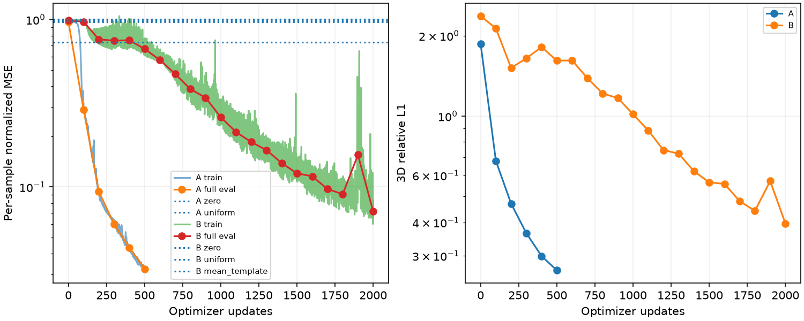
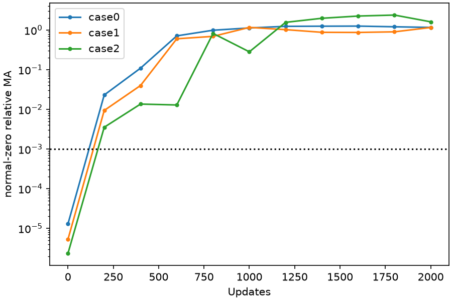
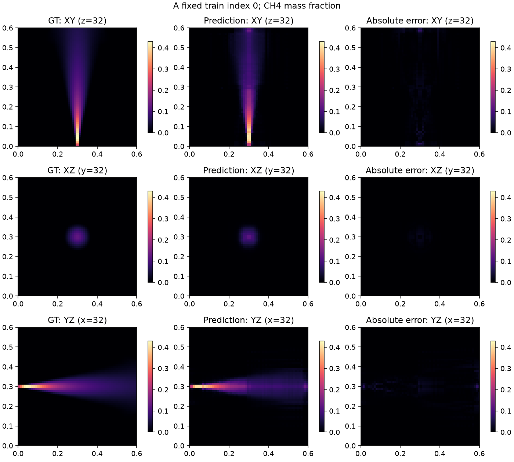
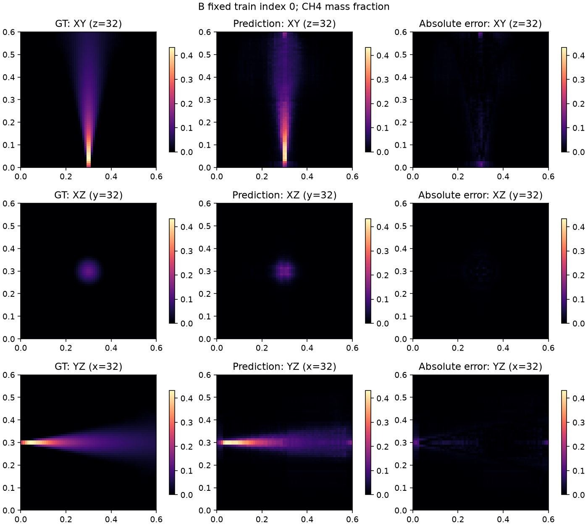
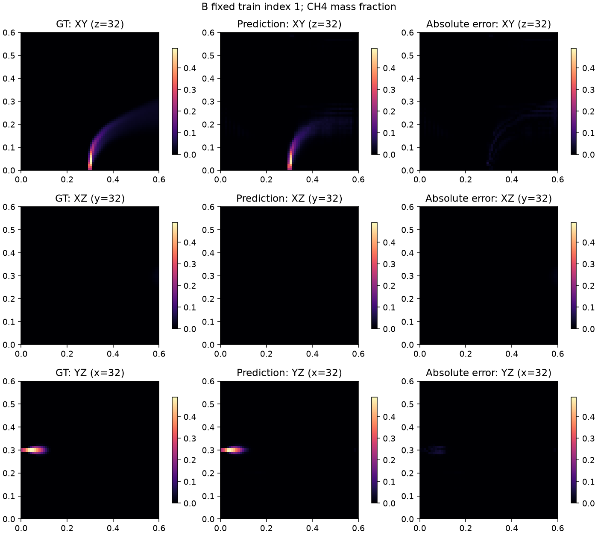
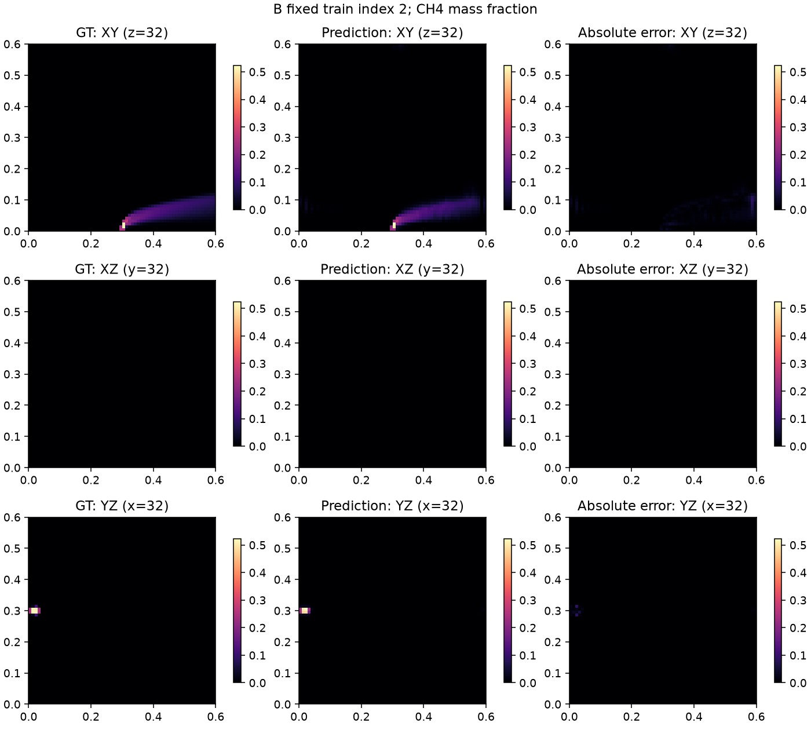

# Ray-Senseiver 训练集 GT64 有监督可学性诊断：单场通过，八例终点达标一次但未连续通过

**已经证明原始 Ray-Senseiver 能直接监督拟合一个羽流；八例重建也出现实质空间学习和强测量依赖，但未满足连续两次通过，因此本轮不进入正式 Senseiver 训练。** A用500次更新通过；B用完2000次预算，最后一次平均NMSE=0.07147351、三维relative L1=0.3962665，全部点条件首次满足，但1900步L1=.5710483未达标，归档 **BUDGET_EXHAUSTED_UNRESOLVED**。这不是架构不可学的证据。按本轮边界，下一步暂停当前Senseiver路线，以已经冻结、验证可学习的DeepSets作为当前研究的独立学习基线；不追加局部修复、补步或启动全量训练。

本轮属于**训练集GT64有监督诊断**，不进入纯自监督榜单，其权重不得用于之后标称“无GT”的训练。历史自监督适配`REPAIR_FAILED_NO_GO`保持不变。完成日期2026-10-14（UTC）。

## 1. 训练前登记与实验边界

起始HEAD `a3741bb2e0c971f1832832270033c24423b7e133`，初始工作区干净，仓库及祖先无适用AGENTS；`/home/djc/.codex/AGENTS.md`为空。已核对快速修复报告、原RaySenseiverSS/core、数据、监督与自监督代码。此前latent/query标量可读及全局latent残差修复失败的结论完整保留。

代码、配置、协议、数据/初态hash在训练前提交于 **`357e5ae`**：[协议](../ray_senseiver_supervised_probe_v1_protocol_zh.md)、[独立配置](../../configs/ray_senseiver_supervised_probe_v1.yaml)、[入口](../../scripts/run_senseiver_supervised_probe.py)、[监督目标/白名单/退出规则](../../src/geophy_set3d/training/senseiver_supervised_probe.py)、[完整登记](artifacts/ray_senseiver_supervised_probe_v1/registration.json)。先独立smoke A/B各1更新，科学阶段随后均重新fresh初始化。没有加载历史失败、Ours、DeepSets、读出头或A阶段训练权重。

使用**原始254913参数RaySenseiverSS**，保留原ray token、几何编码、64个learned latents、coordinate-query、sigmoid及完整64³输出；没有上轮4096参数残差，没有lifting/OARI/GCA/MRGR/3D卷积。网络输入不含GT：复用`ProjectionPoolDataset`原GT64读取验证后，将GT单独交给监督损失，原模型`assert_no_gt`保持不变。

独立`SupervisedProbeGuard`仅放行登记训练projection及当前阶段GT64，A只允许0、B只允许0–7；prepare/最终完整性审计可核验全部登记8例。历史GTReadGuard未修改，测试验证它仍拒绝GT。全程没有读取GT128、Val/test数组、Pool B或外来权重；来源GT128的路径/hash只从登记JSON引用，没有打开其内容或重新计算hash。

## 2. 样本身份、配对、单位及坐标

历史“source-index 0–7”实际是**过滤train后的序号0–7**，其原始`source_index.jsonl`行号为0,1,2,3,4,5,6,8（从0计）；原始第7行属于其他split，已跳过，未读取其GT。沿用历史8例而不是将该行误当训练样本。

全部case共有ID前缀`case1_g1_transient_scheme_a_v1_2s_asymmetric_`，后缀及身份如下；完整sample_id/case_id、路径/hash见登记。所有例固定同一历史四站 **[26,27,45,42]**，几何tensor identity完全相同，8359条valid rays/例，invalid由原mask排除，有效精确零全部保留。

| train序号 | source_index原始行 | case ID后缀 | GT均值 | GT峰值 | valid零测量数 |
| --- | --- | --- | --- | --- | --- |
| 0 | 0 | p0300_w0_inlet1_half | 0.002085084 | 0.4298524 | 0 |
| 1 | 1 | p0300_w1_inlet1_half | 0.0009619301 | 0.4914223 | 49 |
| 2 | 2 | p0300_w3_inlet1_half | 0.0004002119 | 0.5152055 | 1 |
| 3 | 3 | p1000_w0_inlet1_half | 0.002231593 | 0.4364964 | 24 |
| 4 | 4 | p1000_w1_inlet1_half | 0.001778761 | 0.4780806 | 975 |
| 5 | 5 | p1000_w3_inlet1_half | 0.0006384257 | 0.5037856 | 6959 |
| 6 | 6 | p1500_w0_inlet1_half | 0.002249594 | 0.438097 | 44 |
| 7 | 8 | p1500_w3_inlet1_half | 0.0007549386 | 0.4895418 | 104 |

逐例核对source index、sample_meta、frame_manifest及源metadata JSON：实例/sample/case一致、frame60/2.0s一致、源GT路径/hash一致，GT64及Pool A projection文件SHA256均与生成记录一致。复用原数据读取检查FP32、64³、有限、[0,1]范围；8例均非退化且有空间变化，GT空间std=.00658949–.01246533。

GT为**无量纲CH₄质量分数**，XYZ轴序，**y为高度**，物理域[0,.6]³；原model的`meshgrid(indexing='ij')`、`[B,1,X,Y,Z]` reshape及端点坐标逐轴检查一致。GT64是仓库已冻结的端点对齐三线性采样，直接读取，没有新缩放、裁剪或插值。

生成的ppm·m射线测量来自同一128³源场、256点积分；GT64降采样及历史P_diff/K96是不同离散精度，不能期待重投影数值完全相等。本轮只以GT64监督，不新增投影loss，也未读取128³重算配对。配对依据限定在已冻结的生成元数据与GT64/投影文件hash，未发现需修复的工程错误。

## 3. 唯一监督目标与初始化

`L = mean_i(mean_voxel((C_pred-C_gt)^2) / max(mean_voxel(C_gt^2), 1e-12))`。

非退化样本零预测NMSE=1。训练不含measurement、relative或consistency项；三维relative L1/L2仅评价，不参与梯度。均值指标为逐case算指标后平均，平均relative L2不等于平均NMSE的平方根。

FP32 AdamW lr2e−4/wd1e−4，clip_grad_norm=1，固定学习率、无scheduler、seed20261011；A batch1，B固定(0,1),(2,3),(4,5),(6,7)循环、batch2。全valid rays和完整262144查询始终保留，chunk16384、原activation checkpoint开启，没有OOM或降batch。

只将末层weight乘.01；bias=logit(该阶段拟合GT全部体素的算术均值)，仅bias输入允许clamp[1e−6,1−1e−6]，本轮均未触发。A GT0均值=.002085084321581366，bias=−6.1708587214073605；B GT0–7均值=.0013875673876921429，bias=−6.578814614866246。没有使用拟合范围外GT统计或历史测量C_init；测量输入归一化仍为原Y_SCALE=32284.894580078173。

A初态state hash `695a6f3d6d834cd12088fedda583f9154b6ee52503af8a0e6b6dfcee2b0313cf`；B `5e75616da51e5bdb699e795d42049083380d11fa376b49cd919855cf7f11e7d8`。科学epoch0均与训练前fresh登记逐tensor身份一致，B未继承A训练结果。

## 4. 实际结果与停止决定

| 阶段 | 更新数 / 允许上限 | 实际墙钟秒 | NMSE | relative L1 | relative L2 | 停止 |
| --- | --- | --- | --- | --- | --- | --- |
| A单例 | 500 / 1000 | 116.464 / 900 | 0.03243462 | 0.2646416 | 0.1800962 | PASSED |
| B八例 | 2000 / 2000 | 451.391 / 1800 | 0.07147351 | 0.3962665 | 0.2653197 | BUDGET_EXHAUSTED_UNRESOLVED |

实际科学预算2500次更新，另有smoke共2次，分别记账。时间包括加载/核验、训练、评估和保存；GPU1为共享RTX4090，峰值PyTorch allocated A=209.22MiB、B=307.29MiB，不作严格速度排名。科学训练没有NaN/Inf、梯度断开、无更新、配对错误、OOM、资源暂停或恢复，没有终止他人进程。

A第400/500步分别NMSE=.04341442/.03243462、L1=.29918890/.26464159，连续两次通过。终点预测峰值=.415046（GT=.429852），空间std=.0112867（GT=.0119618），总量比=.965385；GT≥峰值10%区域L1=.0881098、NMSE=.0125506，证明学习到有空间变化的羽流，而非仅压低背景。单例没有测量干预或条件泛化结论。

B终点相对平均模板NMSE降低 **90.1921%**，3例测量依赖全部达标，但**不能因此忽略连续性要求**：

| B更新 | 平均NMSE | 平均relative L1 | 全部点条件 |
| --- | --- | --- | --- |
| 1800 | .09055821 | .44188490 | 未通过 |
| 1900 | .15552818 | .57104829 | 未通过 |
| 2000 | .07147351 | .39626651 | 首次通过，streak=1 |

B联合通过检查按预登记在有当前测量干预的200步位置判定，未使用旧干预选时刻；即使按每100步的场指标检查，1900步也未通过，因此不改变“尚未连续两次通过”的结论。2000步强制预算退出，未用末点接近门槛为理由增加1步，也没有用最优历史点代替最后状态。

平台退出使用互不重叠的最近/前200步训练NMSE均值。A/B各从600/1000步起检查，连续两次改善<2%且未通过才停。B1900步改善14.307%，未满足平台条件；2000步窗口变化−3.408%，但点条件首次满足且已达预算，按预算退出。未将未用足时间预算当成延长更新上限的许可。

| 参考预测 | NMSE | relative L1 | relative L2 |
| --- | --- | --- | --- |
| A / zero | 1 | 1 | 1 |
| A / uniform | 0.9705114 | 1.863839 | 0.9851454 |
| B / zero | 1 | 1 | 1 |
| B / uniform | 0.9807779 | 1.912271 | 0.9903263 |
| B / mean_template | 0.7287349 | 1.801428 | 0.8295609 |

均匀场为该样本GT均值，是已知幅度的oracle参照；B逐体素平均模板由训练8例GT构成，不依赖输入。A单例模板等于GT本身，仅保存作身份参照，不用于A通过判断。

## 5. 八例逐样本空间拟合与测量干预

| 固定train序号 | NMSE | relative L1 | relative L2 | pred均值 | pred峰值 | pred空间std | pred/GT总量 | 峰值10%区域L1 |
| --- | --- | --- | --- | --- | --- | --- | --- | --- |
| 0 | 0.0752926 | 0.4730027 | 0.274395 | 0.002475382 | 0.4330219 | 0.0123045 | 1.187185 | 0.1193034 |
| 1 | 0.08790506 | 0.4355493 | 0.2964879 | 0.0009712915 | 0.4884741 | 0.007811503 | 1.009732 | 0.1331636 |
| 2 | 0.04773894 | 0.2696271 | 0.2184924 | 0.0003836607 | 0.5234832 | 0.006083773 | 0.9586438 | 0.129862 |
| 3 | 0.07197442 | 0.4401218 | 0.2682805 | 0.002459089 | 0.4299344 | 0.0122887 | 1.101943 | 0.1150177 |
| 4 | 0.1056429 | 0.486008 | 0.3250275 | 0.001794849 | 0.5137548 | 0.009991542 | 1.009045 | 0.1227676 |
| 5 | 0.05466216 | 0.307214 | 0.2337994 | 0.0006616172 | 0.4768133 | 0.007007757 | 1.036326 | 0.1356845 |
| 6 | 0.07241519 | 0.4382081 | 0.2691007 | 0.002457597 | 0.4296154 | 0.01228657 | 1.092462 | 0.1147302 |
| 7 | 0.05615684 | 0.3204011 | 0.2369743 | 0.0007842351 | 0.5093533 | 0.007456938 | 1.038806 | 0.1282108 |

所有GT峰值10%区域的NMSE/L1/L2、计数和逐例GT均值/峰值/std完整保留在[evaluation CSV](artifacts/ray_senseiver_supervised_probe_v1/evaluation_scalars.csv)；没有只按背景误差判定。终点B的三例干预只置换测量字段，geometry/path/mask保持同一对象；donor也是同布局登记训练例。

| case→错配donor | normal-zero绝对MA | relative MA | 正常输入NMSE | 错配输入NMSE | NMSE增量 |
| --- | --- | --- | --- | --- | --- |
| 0→1 | 0.002879971 | 1.163445 | 0.0752926 | 1.16445 | 1.089158 |
| 1→2 | 0.001126181 | 1.159468 | 0.08790506 | 1.377926 | 1.290021 |
| 2→0 | 0.0006176332 | 1.609842 | 0.04773894 | 4.411234 | 4.363495 |

relative MA分母为normal meanabs+1e−12，3例均超过1e−3；错配均显著增大目标GT误差。固定几何下的这些干预支持模型**实际利用测量并重建不同空间场**，不是仅凭不同case输出不一样推断。置零是训练分布之外的干预，relative MA>1本身不代表空间正确，仍须共同看GT误差和连续通过要求。

固定展示A case0、B case0/1/2；都用XY(z=32)、XZ(y=32)、YZ(x=32)，坐标0–.6m，同一个case的GT/预测/绝对误差共享色标，不挑最佳case或切片。B case2的固定y=32平面羽流几乎为空是实际位置，不另外挑截面。

## 6. 梯度、饱和、恢复与访问完整性

每步保存encoder/learned latents/decoder梯度和真实更新，所有组三者有限且非零。下列为全程最小L2（gradient_l2为clip前，完整记录另含clip后及总范数）：

| 阶段 / 项 | encoder | learned latents | decoder |
| --- | --- | --- | --- |
| A / gradient_l2 | 0.0001989719 | 6.125946e-06 | 0.03617728 |
| A / update_l2 | 0.001339001 | 8.173228e-05 | 0.002726931 |
| B / gradient_l2 | 9.709029e-05 | 3.922686e-06 | 0.01468291 |
| B / update_l2 | 0.005174158 | 0.0006218135 | 0.004450644 |

A终点logit min/中位/max=−11.8404/−10.4492/−.343146，<-12比例0；B为−28.6810/−15.3025/.0940018，<-12比例70.0441%。平均sigmoid导数A=.00188147、B=.00140102。B大量低背景输出伴随.43–.52峰值、显著空间std和较小GT误差，不能单凭负logit比例将其称为近零塌缩；所有组梯度和更新一直有效。没有据此改变激活/初始化或搜索新配置。

[最终审计](artifacts/ray_senseiver_supervised_probe_v1/final_integrity_audit.json)回读**本实验自己**的checkpoint：初态登记、末态hash、Adam每参数step、固定case/站位/每步LR、完整查询、原始标量与压缩记录一致；逐个重算退出事件一致，科学终止checkpoint被恢复接口拒绝。epoch0/last均有完整optimizer/RNG/更新计数/已用时间/退出计数。smoke对完整64³监督forward/backward/step和自身状态roundtrip通过。没有发生实际工程恢复，不把接口测试冒充真实中断恢复实验。

各阶段访问记录独立保存：prepare只读登记8例，A只读0，B只读0–7，最终审计仅登记8例及自身派生结果/checkpoint，实际训练无禁用访问尝试。GT/投影及元数据hash、已冻结历史报告和源码hash最终核验不变；没有重新加载或评价Ours/DeepSets。后处理0次model forward、0次optimizer step。

本轮新增5项测试及原Ray-Senseiver模型4项回归通过，涵盖监督loss/梯度、零场基准、GT隔离/白名单、固定布局/XYZ、初始化、退出窗口/预算/依赖和完整恢复状态边界；原模型回归验证259-query分块梯度一致和官方core。日志：[新增](artifacts/ray_senseiver_supervised_probe_v1/tests.txt)、[原模型](artifacts/ray_senseiver_supervised_probe_v1/model_regression.txt)。**历史consistency共同幅度FP32回归有1项失败**（见[上一轮报告](ray_senseiver_quick_repair_v1_zh.md)及原日志）；本轮未重跑、修正或放宽该测试/函数，不宣称历史全部回归均通过，该consistency分支也未进入本轮训练。

## 7. Checkpoint、交付与路线决定

checkpoint目录：`/data/djc/GeoPhy-Set3D/outputs/comparisons/ray_senseiver_supervised_probe_v1/checkpoints/{A,B}/`；epoch0与last身份：

| checkpoint | SHA256 |
| --- | --- |
| A/epoch0.pt | `13248f13f8490d0a67a93d68b0a49f7444fe958fe6cdf79b2abe137f5cf35ea7` |
| A/last.pt | `1cab951a59c9d8afe3ec09b066a1fcacee159551c1bb0edae60227297097e9d1` |
| B/epoch0.pt | `81f73df1400c6645b6502dfd7bdb5ece64273a0d5bda88ed4ce3a2a7f5f9c26d` |
| B/last.pt | `79b1e9e01597bd965e20c5e9c16dcaf499a4947503ccefd2ec0a30d3d51c85f8` |

训练代码版本均为`357e5aed2cf1f24aa090da6fde9fcbe31f7ce2a6`，完整config/seed/样本身份及source hash见登记。原始体素GT/预测、fresh初态和大checkpoint留外部独立目录`/data/djc/GeoPhy-Set3D/outputs/comparisons/ray_senseiver_supervised_probe_v1`；Git保存代码、配置、协议、必要标量/完整压缩记录、图和本报告。[只读汇总入口](../../scripts/summarize_senseiver_supervised_probe.py)、[逐步训练CSV](artifacts/ray_senseiver_supervised_probe_v1/train_scalars.csv)、[测量干预CSV](artifacts/ray_senseiver_supervised_probe_v1/measurement_interventions.csv)、[最终决策](artifacts/ray_senseiver_supervised_probe_v1/decision.json)。

按用户预设分类，本轮属于**第2类：单样本通过，八样本尚未连续通过**，同时保留八样本终点的积极证据。直接监督已使原结构学到空间形态和测量条件变化，不能继续把历史自监督失败简单解释为结构不能读出或原Senseiver原理不可用；本轮也没有唯一定位自监督失败根因。仅8例、同一四站、单seed、训练集GT，不能证明独立泛化或优于Ours。

**本轮决定：不登记正式训练候选，暂停当前Senseiver路线；唯一下一步采用已冻结DeepSets作为独立学习基线继续当前研究比较。** 不追加第三次局部修复，不扫描loss/学习率/latent数，不延长科学终止run，不启动全量或300轮。监督诊断权重永久保留GT标识，不能流入后续标称无GT的训练；历史自监督失败结论不被覆盖。
