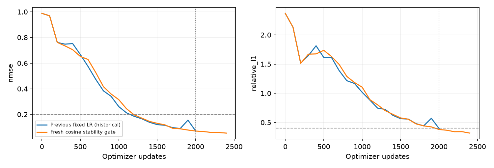
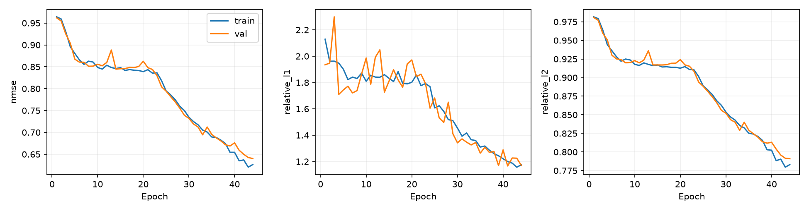

# 有监督Ray-Senseiver稳定性、正式训练与冻结评价

八样本监督稳定性已经验证，原始254913参数结构在2000/2200/2400步连续通过联合门槛。正式训练进行中，尚不能宣称独立基线已完成。 尚未完成冻结900条评价，不报告成功基线排名。 下一步按已登记配置继续正式训练，完成后条件冻结评价。历史纯自监督REPAIR_FAILED_NO_GO保持，不将本轮监督结果纳入纯自监督榜单。

## 实际执行与阶段A

起始HEAD 33c5785；协议先提交c952ef9；正式训练源码及完整train/Val登记ce5e6e2。协议见[训练前协议](../ray_senseiver_supervised_v1_protocol_zh.md)，原始记录见[阶段A](artifacts/ray_senseiver_supervised_stability_v1/)与[正式阶段](artifacts/ray_senseiver_supervised_v1/)。

阶段A使用过滤train序号0–7，原manifest行0/1/2/3/4/5/6/8，同一四站[26,27,45,42]，seed20261011，fresh初态hash `5e75616da51e5bdb699e795d42049083380d11fa376b49cd919855cf7f11e7d8`。沿用历史GT均值.0013875673876921429及weight×.01，原sigmoid、NMSE、AdamW2e-4/wd1e-4/clip1/FP32/有效batch2不变，仅预设cosine和预算相对历史变化。实际2400更新、487.67秒，停止STABLE_PASSED；最大4000更新/1200秒未用尽。平均模板NMSE=0.728734916。

|更新|NMSE|3D relative L1|3D relative L2|测量依赖达标例数|错配误差增大例数|
|---:|---:|---:|---:|---:|---:|
|2000|0.07064142|0.37932456|0.26303491|3/3|3/3|
|2200|0.06003362|0.34138229|0.24304925|3/3|3/3|
|2400|0.05454486|0.31746402|0.23172742|3/3|3/3|

新旧仅共同前2000步可作历史对照；后续点预算不同，不能将差异单独归因学习率调度。固定8例拟合不是独立泛化证据。

## 正式监督实验

使用官方166train/36Val、Pool A，原ViewSampler训练3–6站并逐epoch变化，Val固定4站/epoch0；GT64质量分数、XYZ/y-height、[0,.6]³及原预处理不变。全valid rays含精确零、完整262144 query，单进程可审计加载。GT仅用于监督loss与评价，不进入网络。原始RaySenseiverSS，没有全局残差/lifting/OARI/GCA/MRGR/3D卷积。与监督MRGR的输入采样一致，但本轮逐样本归一化voxel MSE不同于其SmoothL1+.1relative-L1，不能称全部训练条件相同或纯架构因果。

初始化只用完整train GT均值0.0038658324178017971，bias=-5.55170492277，weight×.01；无截断，初态hash `9cdee82420d22adc449f4a641a1ec66cc7d0d829cddcafb166b862278376eee1`。从fresh开始，不使用稳定性、smoke、历史失败或其他模型权重。

预算固定300epoch/7200秒；FP32 AdamW lr2e-4/wd1e-4/clip1，有效batch2，epoch cosine T_max300/eta_min2e-5。唯一selector=Val平均逐case NMSE，实际最低值保存best；独立0.5%显著改善计数至少50轮/30轮patience。每20轮固定train0/1/2同几何normal/zero/wrong干预；不使用900条结果选模。完整optimizer/scheduler/RNG/游标/退出计数和last保存在外部。

当前完整44轮／3652次更新，末轮train/Val NMSE=0.62656/0.640165。

每20轮固定训练三例的同几何干预（不用于选择best；最低依赖要求至少2例≥.001）。

|epoch|case|normal NMSE|zero relative MA|absolute MA|wrong-normal NMSE|
|---:|---:|---:|---:|---:|---:|
|20|0|0.687715|0.00141196|5.46284e-06|-0.000166387|
|20|1|1.00479|0.000347276|1.34222e-06|-0.000192132|
|20|2|1.98252|0.000144489|5.58338e-07|0.00214036|
|40|0|0.47348|1.46382|0.00304779|0.565831|
|40|1|0.542229|0.303119|0.000600435|0.0820986|
|40|2|1.18513|0.0599233|9.85157e-05|0.646479|

## 冻结比较、访问与局限

|方法|训练GT|选模GT／selector|训练目标|训练输入|预算与停止|
|---|---|---|---|---|---|
|监督Ray-Senseiver|166 train GT64|36 Val GT64／平均逐case NMSE|归一化voxel MSE|Pool A自然3–6站、epoch变化|本轮实际预算见上，预登记早停／300轮／2h|
|冻结监督MRGR|166 train GT64|36 Val GT64／C1监督loss|SmoothL1(beta1)+.1relative L1|Pool A自然3–6站、epoch变化|300轮／24900更新，预算结束；best295|
|冻结自监督Ours|无训练GT|无选模GT／Val held-out relative L1|原hold/cross/obs/consistency|A3–5/B3–5/H2，H不输入|300轮／24900更新，预算结束|
|冻结自监督DeepSets|无训练GT|无选模GT／Val held-out relative L1|同冻结自监督Ours|A3–5/B3–5/H2，H不输入|300轮／24900更新，预算结束；best292|

监督Senseiver和监督MRGR使用训练GT及Val GT选模；Ours/DeepSets为冻结自监督参考，不能混为同标签排名。本轮900预测全部先落盘并hash封存，再独立GT64步骤沿用原VolumeMetrics及P_diff/K96观测指标；五档×五layout×36Val不变，case内先平均5draw，36case配对bootstrap10000次/seed2026101801。900条仍来自同一官方Val split，不是额外test集。新训练不读取test、Pool B、GT128，不改划分及冻结历史结果。GT128来源hash仅引用元数据。已知GT64与历史GT128投影离散化差异保留，不新增缩放、插值或重投影标签。

监督相关13项检查、原Ray-Senseiver4项、数据12项、采样3项、独立评价边界2项，共34项适用检查通过；原始测试日志保留。历史FP32 consistency回归仍有1项失败，本轮未修改其函数/容差，不能称历史全部测试通过。共享GPU且仅单seed，计时不是独占设备基准；监督可学不证明原纯测量loss失败的唯一根因。

下一步：按当前已登记配置完成正式训练及条件冻结评价；未完成前保留运行状态，不据小样本拟合宣称成功独立基线。
