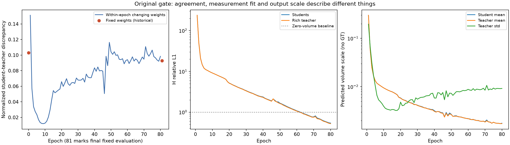
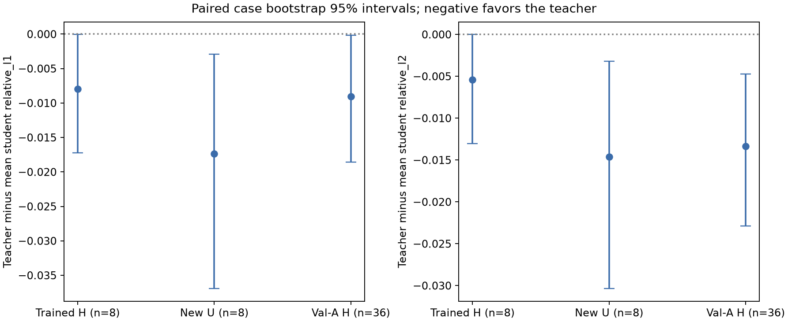
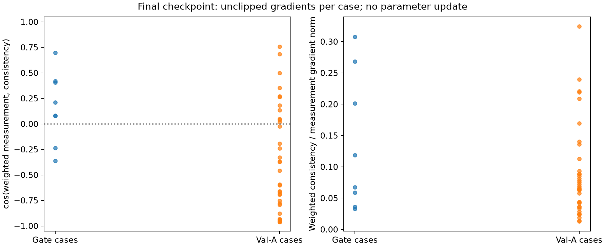

# SelfSup-MRGR v2（RVTC）失败原因诊断

**原 v2 工程 gate NO-GO 保持不变。** 本轮仅做无GT、无参数更新的诊断，未重训gate、未启动正式300轮、未创建v3。本报告与原门槛、原结果报告相互独立，不追溯改判。

审阅基准与开始时远端/本地HEAD均为 `52fab4fc6f40b60992e44386e81d304ed51a010d`，无更新差异需要合并。使用实际现有checkpoint `/data/djc/GeoPhy-Set3D/outputs/checkpoints/selfsup_oari_mrgr_v2_rvtc_gate/gate.pt`；SHA256：`df4eef28c5008f45cb4216c453f4785c08d9520ef94c97eef091e9c589487a30`。模型仍为332,070参数。诊断完成时间：2026-10-12T13:49:42.369983+08:00（Asia/Shanghai）。

## 1. 判断与证据分级

- **已确认事实：** 未定位到v2的联合构造、measurement配对、detach或学生输出梯度方向实现错误。原门槛确实失败，但它检验的是动态归一化师生差异的窗口趋势，不是数值可运行性，也不是独立测量或三维有效性。最确定的问题是门槛解释范围过宽；这不改变按原协议得到的NO-GO。
- **已确认事实：** 新U和Val-A上教师有小幅平均测量优势。Val-A的L1胜率仅20/36（55.56%），16个案例更差，L1均值CI上界非常接近0；不能称逐案例稳定可靠的教师。L2平均优势相对更清楚。
- **已确认事实：** 在最终checkpoint，gate总体测量/一致性平均梯度同向，Val-A总体明显反向；一致性权重虽仅0.1，其梯度并非零，但没有范数支配测量项的证据。
- **解释假设：** 共享权重与持续变化的目标可能使一致性项阻碍部分未见案例的测量拟合，是需要A/B对照检验的风险。Val-A从未参与参数更新，不能把验证集梯度冲突直接当作历史gate训练失败的原因。
- **尚未验证：** 蒸馏相对于“仅增加富视角测量训练”的额外收益、实际三维体积准确性、整个训练期的梯度冲突轨迹及跨seed/视角稳定性。无法将本次证据唯一归因为教师不足或优化冲突。

## 2. 历史失败判据独立复核

完整读取并交叉核对80条 `gate_metrics.jsonl`、原 `gate_summary.json` 和80条 `teacher_training_diagnostics.csv`；CSV每项都与对应JSON一致。

| 统计口径 | 师生差异 D | 学生 H relative L1 | 教师 H relative L1 |
|---|---:|---:|---:|
| 轮内前10轮均值 | 0.03606436 | 38.64724608 | 38.62703003 |
| 轮内后10轮均值 | 0.09986418 | 0.63994430 | 0.62232280 |
| 初始固定参数（历史记录） | 0.10301754 | 377.35615548 | 379.08376567 |
| 第9轮轮内统计（D最低） | 0.01200820 | 9.56607946 | 9.56455231 |
| 第80轮轮内统计 | 0.09843498 | 0.54027388 | 0.52366459 |
| 最终固定参数（历史记录） | 0.09283933 | 0.51934925 | 0.51135635 |


**已确认事实：** `run_epoch(..., optimizer)`在每个sample前向后记录loss/预测，并每两sample执行一次优化（batch1/accumulation2）。每轮8个sample，包含4次更新；轮内均值混合多个不同参数状态，且同一共享网络的教师也在改变。`initial`/`final`来自无optimizer的固定参数整组评估。两者不能混用，第80轮0.098435/0.540274不是轮末checkpoint的0.092839/0.519349。

原门槛精确实现为“末10轮轮内D均值小于首10轮轮内D均值”，现为0.099864>0.036064，因此**预设工程判据未通过**。它不能证明detach失败、优化不收敛、教师泛化失败或体积更差。固定参数D从0.103018降至0.092839仅提供另一种诊断视角，不替换原判据。第9轮D极低而H误差9.566079远高于零体积基线1，说明单独追求低D可能奖励共同的测量不正确解。

**尚未验证/缺失：** 初始和中间checkpoint未被原gate入口保存。初始固定参数值是可信历史日志，本轮没有伪造/重新初始化一个“初始checkpoint”；只能复评实际存在的最终 `gate.pt`。本轮最终重放D=0.09283933、学生H L1=0.51934925、教师H L1=0.51135635，与原fixed-final记录一致（rtol1e-5、atol1e-7）。

## 3. 分母和输出尺度

D_i=mean|C_student−C_T| / (mean|C_T|+1e-6)，先按sample归一化再平均。历史教师mean从初始固定参数0.48025152变为最终0.00166664；第9轮为0.00997882，第80轮为0.00173849。第9/80轮教师std为0.00449823/0.00922668，反映体积尺度与空间变化同时改变。完整每轮学生/教师H L1/L2、mean/std和教师max保存于 `historical_epoch_metrics.csv`。

**解释假设：** 早期背景量级降低、后来空间结构变化与共享教师移动，都可能影响归一化D趋势；没有保存逐案例体积，不能唯一拆分历史变化的来源。

**不可恢复：** 历史日志只有平均比值和平均输出矩，不能恢复逐案例分母与绝对差异的配对或它们的协方差。E[r]E[d]一般不等于E[rd]，不能用“平均比值×平均分母”补算初始或第9轮的绝对体积差异。本轮只在真实最终checkpoint逐case直接计算了分子/分母：gate8平均绝对师生差异0.0001655789、平均教师分母0.0016676397，并在CSV保存每个sample的原始量。这不是GT体积误差。



## 4. 富视角教师独立测量检验

**本轮实际执行：** gate8使用原冻结A/B/H/T，每case增加U4。U由按ID排序的Pool A剩余站位，以case-ID blake2b与seed2026101201构成SeedSequence，无放回确定性抽取；排除A∪B∪H，不按结果选站。Val-A使用全部36例，原sampler固定seed20261011/epoch0、A4/B4/H4/T8；与gate8 case IDs无交集。A/B/T是唯一网络输入，H/U仅投影目标。本轮没有将U、Val-A或其梯度用于更新参数。

“学生”是两个预测误差的平均 .5(error(C_A)+error(C_B))，不是对体积或投影做ensemble。三者针对完全相同的目标有效射线。relativeL1/L2沿用冻结实现，K96、all rays、view_chunk2。教师−学生为负表示教师更好。

| 评估域 | n | 指标 | 平均学生 | 教师 | 教师−学生均值 | 中位数 | 教师胜率 | 配对均值95%CI |
|---|---:|---|---:|---:|---:|---:|---:|---|
| 原 gate H（训练使用过） | 8 | relative_l1 | 0.519349 | 0.511356 | -0.007993 | -0.004507 | 62.5% | [-0.017234, -0.000062] |
| 原 gate H（训练使用过） | 8 | relative_l2 | 0.159873 | 0.154439 | -0.005434 | -0.000963 | 62.5% | [-0.013044, -0.000011] |
| gate 新站位 U（已见案例） | 8 | relative_l1 | 0.531875 | 0.514506 | -0.017369 | -0.009006 | 62.5% | [-0.036911, -0.002927] |
| gate 新站位 U（已见案例） | 8 | relative_l2 | 0.166464 | 0.151856 | -0.014608 | -0.006655 | 75.0% | [-0.030343, -0.003208] |
| Val-A H（未见案例） | 36 | relative_l1 | 0.336399 | 0.327346 | -0.009053 | -0.005176 | 55.6% | [-0.018566, -0.000137] |
| Val-A H（未见案例） | 36 | relative_l2 | 0.251328 | 0.237964 | -0.013364 | -0.009961 | 66.7% | [-0.022868, -0.004701] |


区间使用10,000次配对case bootstrap，seed2026101202；同一个case整行重采样，不把射线或多视角当独立样本。未作多重比较校正；这些是单checkpoint探索性区间，不能当最终显著性/跨seed确认，也未处理同一物理工况家族的额外相关性。

| 评估域 | 较差案例（L1排序，最多列3个；全量在summary/CSV） | 教师−学生 L1 |
|---|---|---:|
| 原 gate H（训练使用过） | case1_g1_transient_scheme_a_v1_2s_asymmetric_p0300_w1_inlet1_half | +0.004963 |
| 原 gate H（训练使用过） | case1_g1_transient_scheme_a_v1_2s_asymmetric_p1500_w3_inlet1_half | +0.003875 |
| 原 gate H（训练使用过） | case1_g1_transient_scheme_a_v1_2s_asymmetric_p0300_w0_inlet1_half | +0.000704 |
| gate 新站位 U（已见案例） | case1_g1_transient_scheme_a_v1_2s_asymmetric_p0300_w1_inlet1_half | +0.003354 |
| gate 新站位 U（已见案例） | case1_g1_transient_scheme_a_v1_2s_asymmetric_p1500_w3_inlet1_half | +0.002735 |
| gate 新站位 U（已见案例） | case1_g1_transient_scheme_a_v1_2s_asymmetric_p0300_w0_inlet1_half | +0.000224 |
| Val-A H（未见案例） | case2_1_g2_transient_scheme_a_v1_2s_asymmetric_p0300_w3_inlet2_half | +0.053174 |
| Val-A H（未见案例） | case2_crosswind_g2_transient_scheme_a_v1_2s_asymmetric_p0300_w3_inlet1_half | +0.028196 |
| Val-A H（未见案例） | case3_streamwise_g3_transient_scheme_a_v1_2s_p0100_w0_equal | +0.023439 |


完整52条域×case测量结果、A/B各自误差、每case分子/分母与输出统计均在 `measurement_per_case.csv`；全部44个case的A/B/H/T/U站位、seed、checkpoint哈希在 `case_station_protocol.json`。L1/L2的全部较差case均列于 `summary.json`。

**解释边界：** 原gate H已经参与训练loss，是样本内拟合证据；U是已见案例的新站位证据；Val-A才是未见案例证据。U与Val-A均有平均优势，但Val-A逐case优势弱且不普遍。即使独立测量改善，也不能证明富视角教师三维更准确。本轮没有读取任何GT。



## 5. 共享参数梯度：与detach检验分开

按原权重计算S=L_hold+.5L_cross+.1L_obs，T=L_hold_teacher+.1L_obs_teacher，D=.1L_teacher；M=S+T。每case通过 `autograd.grad` 计算全部共享参数的梯度向量；无optimizer、无`.backward()`累积、无裁剪、无参数/缓冲区更新。所有范数使用应用原权重后的原始梯度，余弦用双精度累积。Gate8与Val-A36全部计算，没有按梯度结果筛案例。

下两表是**先平均case梯度向量，再计算范数/余弦**，不是平均单case范数或平均余弦。

| 案例组 | ||平均g学生|| | ||平均g教师|| | ||平均g一致性|| | ||平均g测量合计|| | 一致性/测量合计 |
|---|---:|---:|---:|---:|---:|
| gate | 1.163914 | 0.945653 | 0.207762 | 2.093722 | 9.92% |
| Val-A | 2.254381 | 2.391908 | 0.195316 | 4.642517 | 4.21% |


| 案例组 | cos(学生,教师) | cos(学生,一致性) | cos(教师,一致性) | cos(测量合计,一致性) |
|---|---:|---:|---:|---:|
| gate | +0.969744 | +0.374374 | +0.420748 | +0.398152 |
| Val-A | +0.996751 | -0.847866 | -0.862826 | -0.856263 |


再单独给出逐case分布，避免总体平均掩盖局部冲突：

| 案例组 | cos(测量,一致性)均值 / 中位数 | 负余弦案例 | 一致性/测量范数比中位数 / 最大值 |
|---|---|---|---|
| gate | +0.162147 / +0.147615 | 2/8 | 9.29% / 30.75% |
| Val-A | -0.373169 / -0.526779 | 25/36 | 6.79% / 32.42% |


**已确认事实：** 全44例教师输出对一致性loss的梯度为零，学生输出梯度与(student−detached_teacher)的内积为正，教师measurement输出梯度非零。前两项只证明detach及输出方向正确；本次共享参数检查进一步发现Val-A上25/36例一致性与测量负余弦。Gate仅2/8例负余弦，总体向量同向。完整S/T/D两两余弦、范数、相对大小及branch检查在 `gradient_per_case.csv`。

**解释假设：** 最终共享网络在已见/未见案例上的梯度几何不同，可能存在蒸馏泛化风险。没有证据支持“一致性梯度过强并支配测量项”：总体一致性/测量范数为gate9.92%、Val-A4.21%，逐case最大约30.75%/32.42%。小范数反向项仍可能有影响，但影响强度不能由一个余弦直接推出。作为原始欧氏梯度的一阶方向计算，Val-A总体g_D在g_M上的投影/||g_M||为-3.60%，且所有case的||g_D||/||g_M||<1；因此不能声称当前一致性项使合梯度整体反转测量下降方向。这个几何计算没有执行更新，也不等同于带矩估计/预条件的实际AdamW步。原gate checkpoint未保存optimizer矩状态，实际更新方向无法由现有权重恢复。

**尚未验证：** 这些只是最终checkpoint的局部一阶性质。Val-A梯度本轮未、历史gate也未用于更新；不能将其等同为实际训练冲突。缺失中间checkpoint，无法追溯冲突是否在训练期出现或造成什么后果；本轮也未做扰动参数/optimizer.step来声称因果机制。



## 6. 下一步建议：仅一个有限对照，待登记、未执行

**结论：** 保留v1和原v2 NO-GO；目前没有充分证据启动正式训练或冻结RVTC为候选。独立教师存在小幅平均优势，却不逐case稳定；一致性存在未见案例局部冲突风险，却无全训练期因果证据。值得补充的唯一最小证据是“相同富视角测量loss下，关/开原一致性”的匹配A/B对照，不增加任何模块或搜索权重。

- 对照A：同一富视角分支与1.0 heldout/.1 observed教师测量loss，teacher consistency=0。
- 对照B：完全相同的富视角测量loss，开启原teacher consistency=.1。
- 两组均fresh random，seed20261011，验证初始state哈希一致；相同原gate8、固定epoch0 A/B/H/T、顺序无shuffle、80epochs×4steps=320updates、FP32、batch1/accumulation2、AdamW lr2e-4/wd1e-4、clip1、无scheduler（匹配原gate）；其余loss、projector和网络完全冻结。
- 使用同一预登记U和Val-A清单，固定epoch80最终checkpoint；不挑best epoch、不按结果重抽站位。该对照区分“富视角测量训练的收益”与“体积一致性项的额外收益”。它只能检验额外独立测量收益，仍不能单独确认三维蒸馏准确性。

新门槛建议拆开：**工程可运行性**检查有限数值、访问审计、正确gradient分支、既有集合安全/非塌缩检查，沿用原数值容差；D窗口变化仅记录诊断。**方法有效性**用同一Val-A case上B−A的稀疏H relativeL1作为主量，relativeL2/U为辅助，配对case95%CI表达不确定性；零为“无额外收益”的自然参照，未拟合本次数据的容易通过幅度阈值。负效应且区间整体小于0提供有限测量增益支持；区间含0应记不确定，明确反向则停止蒸馏路线。任何后续体积结论仍需另行预登记完整正式训练、measurement-only选模和冻结后GT边界。

完整待执行草案在 `proposed_control_protocol.yaml`，status为DRAFT/NOT EXECUTED。所有新规则与ID/source/config哈希必须在下一次优化前登记；不追溯替换旧门槛。本轮没有执行A/B任一组。

## 7. 审计、测试和不可变性

**本轮实际执行：** 9项针对性测试，覆盖历史口径、U的确定性排除、配对case重采样、冻结权重分解、零范数与反向余弦、精确checkpoint白名单/禁写、GT/Pool B阻断、输出detach与共享冲突的区别、H/U不输入网络及不可恢复量的防误算。单元测试使用明确fixture，不代替本轮44例真实实验。历史179项测试仅引用，未冒称本轮重跑。完整本轮日志 `targeted_tests.log`。

初版诊断入口把独立YAML误交给训练专用config loader，在加载checkpoint前即因缺少model键退出；已改为独立YAML解析，原错误日志保存在外部 `entry_config_error.log`。这是本轮诊断入口的问题，不是原v2实现问题；没有训练或权重操作。成功诊断的源码SHA256另存 `diagnostic_source_manifest.json`。

```json
{
  "gt_file_opened": false,
  "gt_open_attempts": 0,
  "forbidden_npy_attempts": 0,
  "supervised_checkpoint_open_attempts": 0,
  "projection_open_count": 264,
  "unique_pool_a_projection_files": 44,
  "policy": "Only Pool A train/val projection NPY; GT64/GT128 and foreign checkpoints denied",
  "audit_hook_inherited_by_workers": true,
  "Pool_B_access_attempts": 0,
  "forbidden_projection_attempts": 0,
  "external_checkpoint_attempts": 0,
  "allowed_checkpoint": "/data/djc/GeoPhy-Set3D/outputs/checkpoints/selfsup_oari_mrgr_v2_rvtc_gate/gate.pt",
  "allowed_checkpoint_open_count": 3,
  "checkpoint_writes_permitted": false
}
```

诊断使用0个worker，继承原V2ReadGuard所有限制并进一步把checkpoint限制为精确 `gate.pt` 且禁止写。`audit_hook_inherited_by_workers`为继承字段，当前不表示使用了worker。实际允许投影文件44个，全部Pool A；checkpoint打开计数包括前后hash与一次torch.load。

```json
{
  "checkpoint_sha256_unchanged": true,
  "parameters_and_buffers_unchanged": true,
  "historical_files_unchanged": true,
  "dataset_metadata_unchanged": true,
  "original_numerical_sources_unchanged": true,
  "original_no_go_retained": true,
  "optimizer_created": false,
  "optimizer_steps": 0,
  "gradient_clipping_applied": false,
  "parameter_grad_accumulation": false
}
```

原v2比较目录/仓库归档/gate日志逐文件SHA256未变，checkpoint SHA256前后未变，所有参数与缓冲区逐tensor相等，数据集仅做metadata完整性对比（不打开GT作hash）。模型、projector和原训练源码hash均保持冻结。没有有监督checkpoint、Pool B或最终test访问。

## 8. 复现与归档

```bash
OMP_NUM_THREADS=2 MKL_NUM_THREADS=2 PYTHONPATH=src:tests \
  /scratch/djc/envs/gas-torch/bin/python -m unittest discover -s tests -p 'test_rvtc_failure_diagnostics.py' -v
OMP_NUM_THREADS=2 MKL_NUM_THREADS=2 \
  /scratch/djc/envs/gas-torch/bin/python scripts/diagnose_selfsup_mrgr_v2_failure.py --config configs/diagnose_selfsup_mrgr_v2_failure.yaml
/scratch/djc/envs/gas-torch/bin/python scripts/report_selfsup_mrgr_v2_diagnosis.py
```

复评必须把独立config的output改为新的目录，保留现有诊断证据；缺失gate checkpoint会明确报错，不用合成数据替代，也不训练来补齐。渲染入口只读取结果。归档目录为 `docs/reports/artifacts/selfsup_mrgr_v2_failure_diagnosis/`，包含SHA256清单；不提交模型权重或数据。
