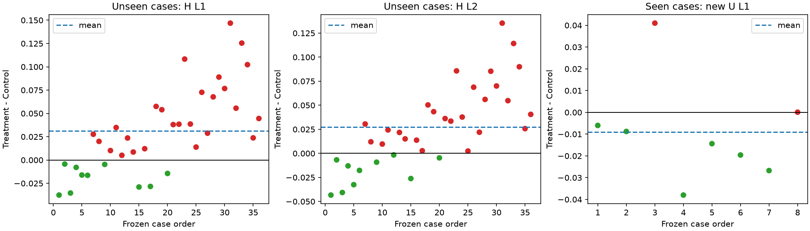
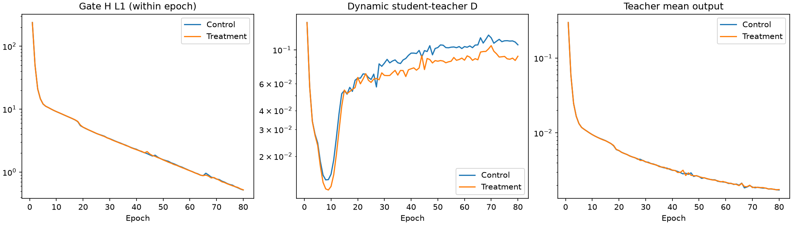
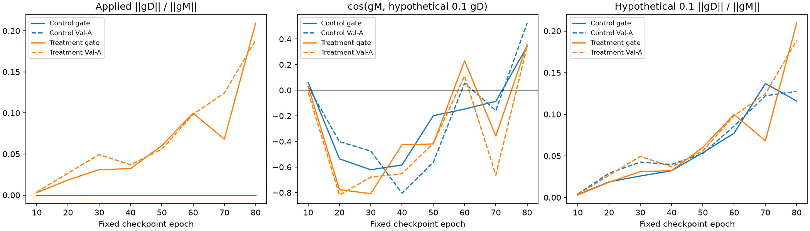

# RVTC 严格匹配 Control / Treatment 有限对照

**按优化前登记规则，主指标结论：支持本次有限实验的测量性能受损。** Val-A36 稀疏 H relative L1 的 Treatment−Control 均值为 +0.03139504，95% 配对 case bootstrap 区间 [+0.01683308, +0.04647491]。本结论限定于一次单seed、gate8/80轮训练后的独立测量，不是三维准确性结论。保留 SelfSup v1 和原 v2 NO-GO；本轮结束后停止，无正式300轮或后续自动实验。

## 1. 实际执行与匹配证据（已确认事实）

开始时远端/本地均为 `39a65fd22efb0de0e1c721f6a679dcbda35c5900`，读取原v2报告、失败诊断、草案、原配置/入口/目标和归档；未找到适用 AGENTS.md 或同协议完整/未完成实验。已有无关未跟踪 v1 绘图脚本未修改或提交。用户本次明确授权这一项有限训练，原暂停自动实验边界不扩展。

独立入口 `scripts/run_selfsup_rvtc_matched.py` 和两组新配置，未改原v1/v2数值代码、模型、projector或全局 FROZEN_LOSS。模型为原 GeoLift-OARI-MRGR-Res3D，332,070参数，共享 F(A)/F(B)/F(T)，T=A∪B。复用原 objective 产生各项损失，由独立入口组成 L_measure=hold+.5cross+.1observed+hold_teacher+.1observed_teacher。Control仅优化L_measure，Treatment加原 .1teacher；Control诊断一致性不进入训练图。原教师目标与分母均detach，测量归一化/mask/projector保持原实现。

正式协议 `protocol.json` 在零更新时登记，SHA256 `f3b9f3ae73db6f4f3c2c78ff17b36416230452756062f2287b921f319f94da07`；登记代码和协议提前提交为 `a2484c3`，之后才开始实验优化。两组分别fresh random，seed20261011，初始tensor逐项相等；canonical state SHA256 `af76bbf4afd36c0d34fa3407dce4e7497a3a57b5b4b2ca837b95afc7a2311a3c`。没有加载监督、v1、原gate或其他实验权重。初始checkpoint由两次独立构造保存，不作为warm start。

两组初始固定测量指标、学生/教师输出统计及全部未加权loss项也逐项完全相等；初始total仅有规定的一致性贡献（FP32求和存在舍入）。

两组均 **80/80 epochs、320/320 optimizer更新**。固定原gate8/epoch0站位与顺序；batch1/accum2，每轮4更新；FP32、AdamW lr2e-4/wd1e-4、clip1，无scheduler、shuffle、early stop或best选择。K96/all rays/view_chunk2。相同初始化、站位、每轮顺序、预算、checkpoint内optimizer step/RNG均核对于 `matching_verification.json`。组间唯一训练差别是0/.1一致性权重。新目录 `/data/djc/GeoPhy-Set3D/outputs/experiments/selfsup_rvtc_matched_80` 保留完整权重和恢复状态，Git归档不含它们。

初始state与注册hash、站位、源码、配置已冻结；固定epoch80权重各自哈希在 `checkpoint_manifest.json`。每轮last用于自身恢复，每10轮固定checkpoint保存optimizer/RNG/累计更新数；本轮两组均首次连续完成，未恢复、未重复训练。两组使用同一GPU顺序训练，Treatment是新训练而非复用历史gate。

训练前本轮运行35项独立入口/原RVTC/前次诊断针对性测试，审计日志补充后复跑9项新增测试，全部通过（35个不同测试，44次测试执行）。真实数据显存smoke各组2次microbatch反传、裁剪与AdamW状态缓冲，**零step，权重未变化**；注册最大T10，峰值约8.03GB。mask/padding/permutation/all-invalid与GT/Pool B/外部checkpoint/test阻断有测试证据，真实case集合检查亦通过。历史179项完整测试未冒称本轮重跑。

## 2. 配对测量增量（已确认事实）

学生始终为0.5×[error(C_A)+error(C_B)]，不做体积ensemble。H/U仅投影目标；训练损失使用原gate H，U和Val-A及其梯度没有参与参数更新。所有36例Val-A、8例gate U4完整评价，站位沿用前次诊断冻结清单，不按结果选择。gate H为样本内证据；U为已见案例新站位；Val-A为未见案例。

| 域 | 指标 | n | Control | Treatment | T−C均值 | 中位数 | 胜/负/平 | 配对95%CI | 规则结论 |
|---|---|---|---|---|---|---|---|---|---|
| Val-A H（未见案例） | relative_l1 | 36 | 0.29695430 | 0.32834934 | +0.03139504 | +0.02571267 | 10/26/0 | [+0.01683308, +0.04647491] | 支持本次有限实验的测量性能受损 |
| Val-A H（未见案例） | relative_l2 | 36 | 0.21648008 | 0.24387039 | +0.02739031 | +0.02313968 | 10/26/0 | [+0.01415912, +0.04151170] | 支持本次有限实验的测量性能受损 |
| gate U4（已见案例新站位） | relative_l1 | 8 | 0.53087151 | 0.52181563 | -0.00905588 | -0.01158284 | 6/2/0 | [-0.02285650, +0.00739736] | 结果不确定 |
| gate U4（已见案例新站位） | relative_l2 | 8 | 0.17014187 | 0.15792331 | -0.01221856 | -0.01267122 | 7/1/0 | [-0.02180593, -0.00226458] | 支持本次有限实验的额外测量收益 |
| gate H（训练使用过） | relative_l1 | 8 | 0.51315362 | 0.50976264 | -0.00339098 | -0.00642193 | 6/2/0 | [-0.01394833, +0.00846506] | 结果不确定 |
| gate H（训练使用过） | relative_l2 | 8 | 0.16413260 | 0.15099576 | -0.01313684 | -0.01175263 | 7/1/0 | [-0.02321421, -0.00423637] | 支持本次有限实验的额外测量收益 |

Val-A L2：支持本次有限实验的测量性能受损；U L1：结果不确定；U L2：支持本次有限实验的额外测量收益。辅助判据与主指标并非全部一致，不能合并成统一有效性结论。

胜/负/平指Treatment稀疏误差相对于Control逐case更低/更高/相等。完整52条域×case配对结果在 `paired_per_case.csv`，104条组×域×case测量在 `measurement_per_case.csv`，包含A/B/T各自误差、师生绝对差异、教师分母/相对差异和体积尺度。各case、站位和checkpoint哈希均可追溯。输出mean/std等详细字段在原始CSV和固定最终训练summary中。

配对case bootstrap 10,000次，seed2026101202，percentile95%；同一case成对重采样，射线和视角不作为独立样本。主规则优化前登记：均值负且区间全负支持额外测量收益；区间含0不确定；均值正且区间全正支持测量受损。L2/U为辅助，不替代主L1。未做多重比较校正，单seed探索性区间不覆盖跨seed或工况家族相关性。



## 3. 富视角教师优势与一致性增量分开（已确认事实）

| 组 | 域 | 指标 | 稀疏学生 | 富视角教师 | 教师−学生 | 教师胜率 | 配对95%CI |
|---|---|---|---|---|---|---|---|
| Control | Val-A_H | relative_l1 | 0.29695430 | 0.24214604 | -0.05480826 | 100.0% | [-0.06648952, -0.04387497] |
| Control | Val-A_H | relative_l2 | 0.21648008 | 0.16165810 | -0.05482198 | 100.0% | [-0.06680190, -0.04365727] |
| Control | gate_U | relative_l1 | 0.53087151 | 0.49863795 | -0.03223356 | 100.0% | [-0.05964314, -0.01115904] |
| Control | gate_U | relative_l2 | 0.17014187 | 0.14880806 | -0.02133381 | 100.0% | [-0.04051616, -0.00822905] |
| Control | gate_H | relative_l1 | 0.51315362 | 0.49558961 | -0.01756401 | 100.0% | [-0.02800828, -0.00838213] |
| Control | gate_H | relative_l2 | 0.16413260 | 0.15200284 | -0.01212977 | 87.5% | [-0.02239197, -0.00273780] |
| Treatment | Val-A_H | relative_l1 | 0.32834934 | 0.31444334 | -0.01390600 | 66.7% | [-0.02296207, -0.00523513] |
| Treatment | Val-A_H | relative_l2 | 0.24387039 | 0.22684257 | -0.01702783 | 69.4% | [-0.02633427, -0.00855577] |
| Treatment | gate_U | relative_l1 | 0.52181563 | 0.50332473 | -0.01849089 | 87.5% | [-0.03831727, -0.00384045] |
| Treatment | gate_U | relative_l2 | 0.15792331 | 0.14372667 | -0.01419664 | 87.5% | [-0.02915465, -0.00347793] |
| Treatment | gate_H | relative_l1 | 0.50976264 | 0.49887603 | -0.01088661 | 75.0% | [-0.02176175, -0.00161035] |
| Treatment | gate_H | relative_l2 | 0.15099576 | 0.14508725 | -0.00590851 | 75.0% | [-0.01328160, -0.00109022] |

教师−学生为负只表示同一组内富视角输入的测量优势，不能当作Treatment−Control的训练增量收益。两类差值分别保存，不因教师平均更好就推断蒸馏有效。独立测量改善也不能证明三维更准。

本次Control教师在全部36例Val-A的L1/L2上均优于稀疏学生，但开启一致性并未带来主指标增益；共享网络的教师自身也随训练改变，Treatment的Val-A教师L1为0.31444334，Control为0.24214604。因此富视角输入的可靠测量优势，不能替代对体积蒸馏训练增量的检验。教师测量变差是本次配对结果的一部分，不等于已定位造成它的优化机制。

## 4. 训练统计与固定checkpoint（已确认事实）

| 组 | 前10轮动态D | 后10轮动态D | 最终固定D | 最终学生H L1 | 最终教师H L1 |
|---|---|---|---|---|---|
| Control | 0.03715859 | 0.11336899 | 0.11184401 | 0.51315362 | 0.49558961 |
| Treatment | 0.03606436 | 0.09007577 | 0.08501648 | 0.50976264 | 0.49887603 |

轮内统计混合每轮4次更新前后的参数状态；固定最终评价保持第80轮参数不动，二者不混用。前/后10轮D仅诊断，没有据此通过/否决新实验或追溯改判原v2。原v2历史日志/门槛/checkpoint均未覆盖。

| 组 | 稀疏mean / std | 教师mean / std | 非塌缩 | 集合检查 |
|---|---|---|---|---|
| Control | 0.00172360 / 0.00936503 | 0.00171633 / 0.00960074 | True | True |
| Treatment | 0.00170689 / 0.00857889 | 0.00170940 / 0.00881392 | True | True |

非塌缩采用冻结原output_collapsed定义，集合采用原1e-5容差。工程正确性不等于方法有效性。每轮loss、测量、输出尺度，以及全部640个更新的原始梯度范数、裁剪后范数/系数在metrics.jsonl和optimizer_steps.csv；没有用裁剪后的范数替代原始诊断。



## 5. 梯度轨迹（事实与解释边界）

预登记全部gate8加固定顺序前4例Val-A，共12例，每10轮和最终固定checkpoint计算加权学生measurement、教师measurement及一致性共享参数梯度；总计192条真实梯度记录。Val子集仅用于轨迹诊断，主评价仍为全36例。统计为**逐case余弦/范数比的算术平均**，不与前次报告的总体平均向量余弦混用。全部原始范数、S/T/D两两余弦在 `gradient_trajectory.jsonl`；以下为epoch80摘要：

| 组 | 域 | n | 余弦均值 | 中位数 | 负余弦数 | 假设0.1范数比均值 | 实际范数比均值 |
|---|---|---|---|---|---|---|---|
| Control | gate | 8 | +0.34159 | +0.41131 | 1 | 11.59% | 0.00% |
| Control | Val-A | 4 | +0.52421 | +0.75776 | 1 | 12.75% | 0.00% |
| Treatment | gate | 8 | +0.35632 | +0.46617 | 2 | 20.94% | 20.94% |
| Treatment | Val-A | 4 | +0.34403 | +0.31332 | 0 | 18.86% | 18.86% |

Control gate：假设原0.1梯度的逐case平均余弦由epoch10的+0.06034变为epoch80的+0.34159，负余弦共39/64条；逐case范数比范围0.05%–43.84%。

Control Val-A：假设原0.1梯度的逐case平均余弦由epoch10的+0.02642变为epoch80的+0.52421，负余弦共20/32条；逐case范数比范围0.18%–20.84%。

Treatment gate：假设原0.1梯度的逐case平均余弦由epoch10的+0.02953变为epoch80的+0.35632，负余弦共39/64条；逐case范数比范围0.04%–66.70%。

Treatment Val-A：假设原0.1梯度的逐case平均余弦由epoch10的-0.01676变为epoch80的+0.34403，负余弦共26/32条；逐case范数比范围0.15%–29.65%。

**已确认事实：** Control实际一致性训练梯度所有记录均为零；其hypothetical_0p1字段是仅诊断的假设原0.1梯度，未用于更新。Treatment应用0.1后的原始梯度与测量项比较。两组教师detach及学生输出方向检查通过；它们不能替代共享参数冲突检查。诊断逐次验证参数/缓冲区、.grad、RNG与训练模式未改变，不执行额外step，不改变采样或顺序。

**解释假设：** 反向余弦和范数比可描述局部优化竞争及其随训练变化，配对实验可识别这次协议下一致性开关的测量净效果，但不能把净效果唯一归因于某个梯度轨迹。原始欧氏梯度不是AdamW矩估计/预条件后的真实方向；未执行反事实优化扰动或做整个路径的机制证明。

**尚未验证：** 全Val-A梯度轨迹、跨seed复现、训练样本之外的集中视角退化、任何GT体积指标。周期梯度仅12例，不能把局部梯度统计扩展为所有物理场景的因果规律。



## 6. 审计、不可变性与结论范围

全部实际实验session均成功，GT64/GT128、Pool B、外部checkpoint、禁止投影/test访问尝试均为0；允许的checkpoint仅本实验各组精确自身谱系。审计包括登记、smoke、训练、评价与产物核验；完整 `access_sessions.jsonl` 与各阶段日志保留。单元测试fixture的预期阻断计数不混入真实实验审计。独立评价打开本实验最终checkpoint用于前向，未加载其他权重。worker=0，原审计继承worker字段仅为兼容字段。

`integrity.json` 确认数据及源GT128仅metadata核对、所有历史实验文件metadata、原模型/projector/训练源码hash未变；没有打开GT或监督checkpoint进行hash。历史文件内容的既有审计hash继续原样保留。所有新权重仅外部保存，Git结果归档附SHA256清单，不提交模型或测量数据。

**结论：支持本次有限实验的测量性能受损。** 这是相同富视角测量训练下开启原三维一致性项的测量增量结论，辅助指标结论见第2节。不是论文级最终有效性或三维质量确认，也不改变原v2 NO-GO。**三维准确性、集中视角退化、跨seed稳定性均未评价**。本次有限授权工作结束，保留v1，不自动启动正式训练、v3、模块、先验或更多实验。

本次结果不支持一致性提供未见案例的额外测量收益；建议暂停原体积一致性蒸馏的推进，保留v1。

## 7. 复现入口

```bash
OMP_NUM_THREADS=2 MKL_NUM_THREADS=2 PYTHONPATH=src:tests \
  /scratch/djc/envs/gas-torch/bin/python -m unittest test_rvtc_matched test_selfsup_mrgr_v2 test_rvtc_failure_diagnostics -v
# 已登记/完成时核对并退出；未完成时仅允许自身last恢复，不重新初始化。
/scratch/djc/envs/gas-torch/bin/python scripts/run_selfsup_rvtc_matched.py register
/scratch/djc/envs/gas-torch/bin/python scripts/run_selfsup_rvtc_matched.py smoke
/scratch/djc/envs/gas-torch/bin/python scripts/run_selfsup_rvtc_matched.py train --arm Control
/scratch/djc/envs/gas-torch/bin/python scripts/run_selfsup_rvtc_matched.py train --arm Treatment
/scratch/djc/envs/gas-torch/bin/python scripts/run_selfsup_rvtc_matched.py evaluate
/scratch/djc/envs/gas-torch/bin/python scripts/report_selfsup_rvtc_matched.py
```

现有完整结果无需重训；缺失输入/不匹配/非有限/访问违规直接报错停止，不合成结果、不搜索参数重试。协议/source/站位文件已有hash；任何结果后的变更不能覆盖此次登记。
