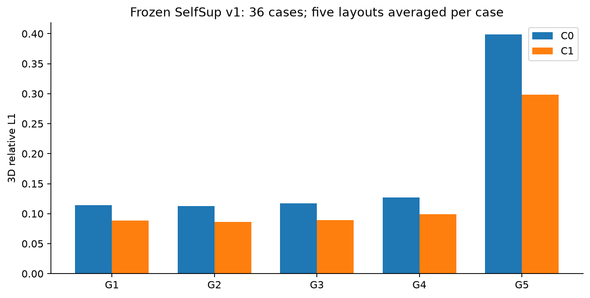
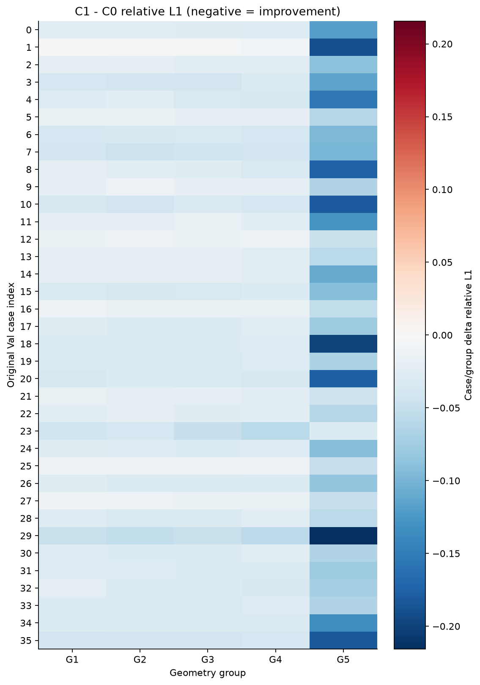
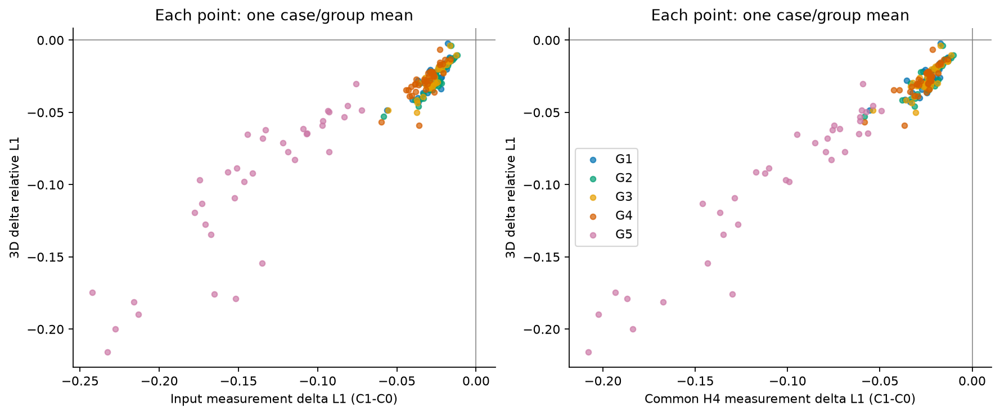
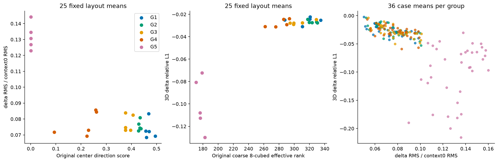
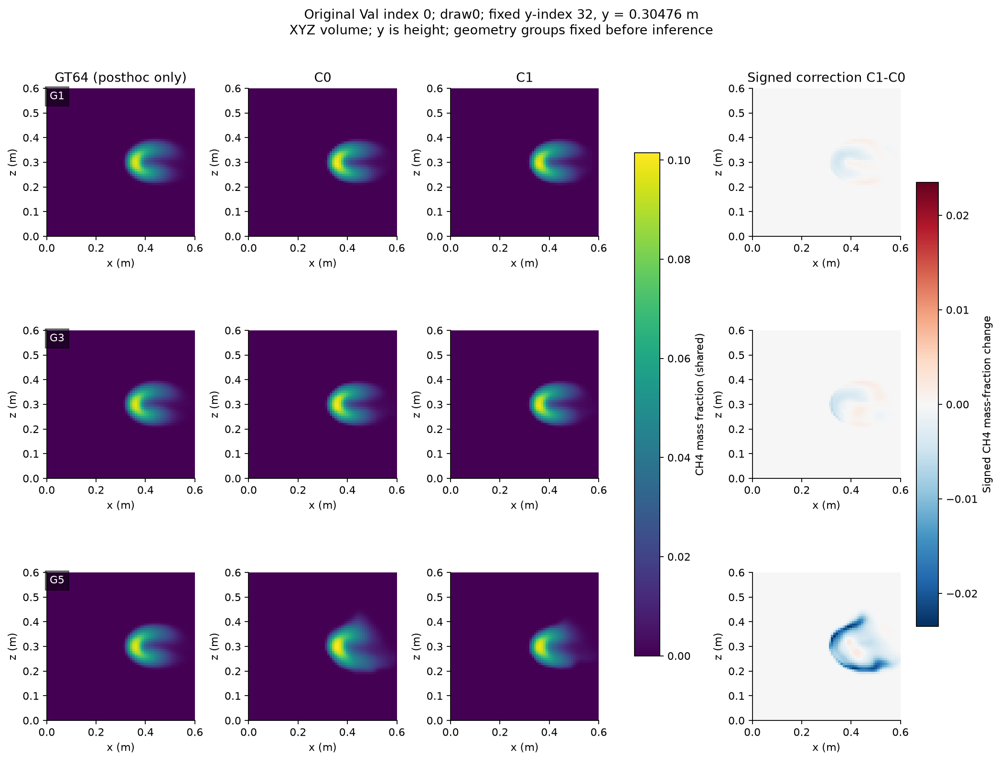
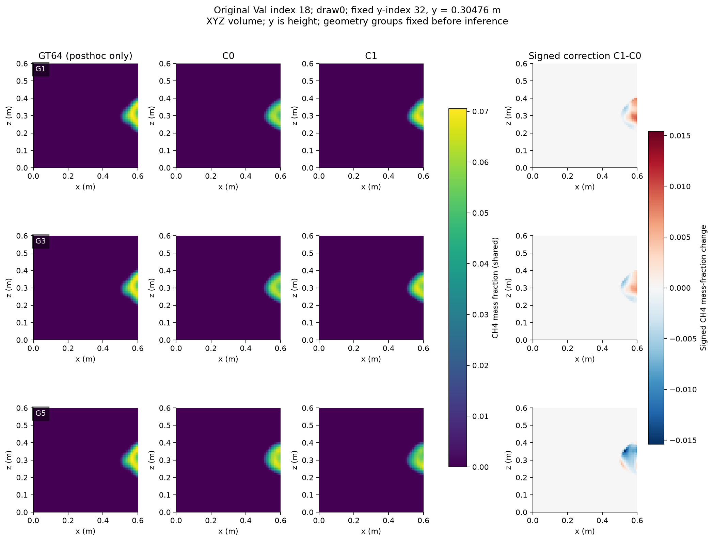
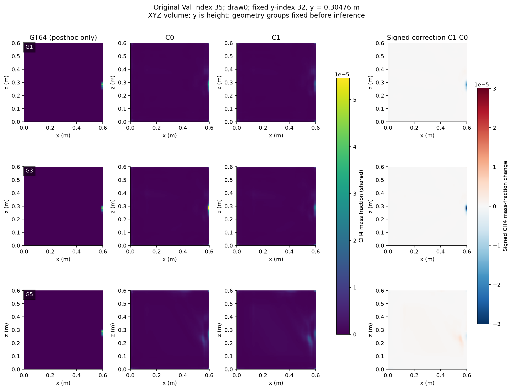
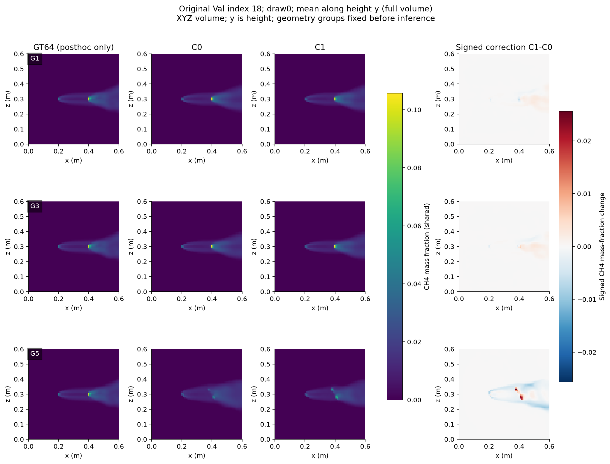
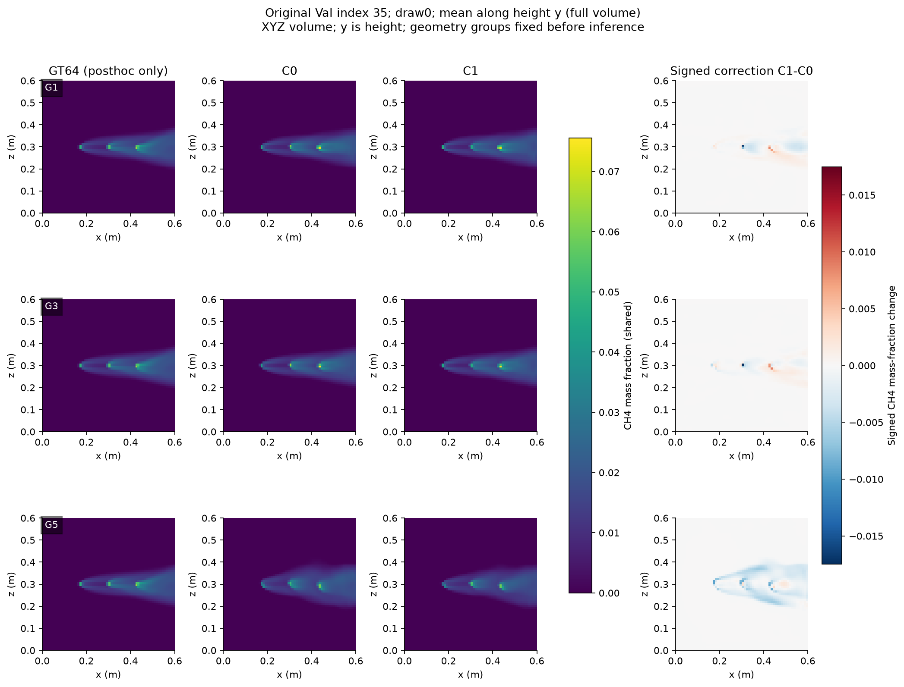

# 冻结 SelfSup-MRGR v1：C0/C1 五档几何配对诊断

**G5 高误差主要符合“C0 初始重建已经较差，MRGR 修正仍有帮助”**。
五档36个case的三维relative L1均改善，G5由0.398727降至0.298018（相对25.26%，Δ95%CI=[−0.118003,−0.084900]）。
不存在case/group层面的G5集中修正失败；逐布局仍有少量失败，且L2/峰值并非逐case一致改善。
现有证据支持模型利用signed residual，**不足以把“困难几何下MRGR普遍有害”作为实现几何门控的依据**。
几何条件残差修正可以保留为待检验假设，本轮不选择门控函数、阈值或超参数。
唯一优先下一阶段建议是：**保持V4和冻结模型，独立预注册并确认几何互补单站替换**。

本轮1,818次真实前向：normal900（smoke5+续跑895）、zero900、signflip9、wrong_pairing9。
原v1、same-q NO-GO、显式增强39.09% G5改善但natural macro恶化11.13%的NO-GO均保留。
没有训练、optimizer step、新模块或新baseline。历史clustered V4、原25布局G5与增强确认G5不混用。

## 评价身份、预登记与统计

协议见[中文冻结协议](../selfsup_v1_c0c1_geometry_protocol_zh.md)、[协议hash与清单](artifacts/selfsup_v1_c0c1_geometry/protocol.json)。
开始时main HEAD=4735d7d，工作区干净，无适用AGENTS.md。读取指定模型、报告、几何协议/入口/config及原归档后，
协议18b4dec先提交；d83f480在首次新推理前将shortcut算术预算从误写的27/模式更正为9/模式，子集不变。
实际数值实现及统计源码541613c在首次前向前提交并登记SHA。

只使用original frozen SelfSup-MRGR v1：
`/data/djc/GeoPhy-Set3D/outputs/checkpoints/selfsup_oari_mrgr_v1/best.pt`，路径从原freeze记录解析。
SHA256=`1573cd84dffeabeb58fbbfb1afec9c9dc865a0a674e21229711bb25b22e3c026`；332,070参数，
原完整config逐项一致，300epochs完成、best epoch278，仅measurement训练、无volumetric GT。
训练/source/config/原冻结记录在[provenance](artifacts/selfsup_v1_c0c1_geometry/checkpoint_provenance.json)中核验。

复用全部36 Val case、25 V4布局、G1–G5各5draw、input IDs及顺序、同case/draw组间共同H4，
站位没有重抽，分层没有修改。H4和GT不参与网络输入。沿用冻结valid-ray/view masks、p99.5尺度
32284.894580078173 ppm·m、P_diff/K96、XYZ64³端点对齐点网格；y是高度。
所有模型eval/no_grad/FP32，RTX4090 cuda:2，PyTorch2.11.0+cu128，TF32关闭、cudnn benchmark=false、
原deterministic设置false，CPU threads2、batch1、view chunk2，没有AMP或optimizer。

推理只读measurement，先全部保存C0/C1及prediction hash，再由独立进程读取Val GT64做评价。
先normal900保存/独立GT评价/全部C1复现，再zero及固定shortcut保存/独立GT评价。
正常C1旧900行十指标共9,000项通过abs1e−8+rel1e−5复现容差：
input/H4四指标差为0，relative L1/L2最大差2.22e−16，峰值差0，最大积分proxy差5.97e−16。
另外九个历史代表案例C1数组逐元素精确一致。未修改预测或放宽容差。

统计先对同case/group五布局均值，再以36case配对。PCG64 seed2026101701，10,000次case bootstrap，
同一case重采样索引、percentile95%CI。主终点为五组3D relative L1的C1−C0；五个Wilcoxon跨组Holm，
其余95个组×比较×指标构成单独secondary Holm family；CI均为逐项未校正，不是同时置信区间。
所有几何/幅度相关为探索性，报告Pearson/Spearman和case-bootstrap CI，不给相关p值或按结果筛选。
持平阈值|Δ|≤1e−8，另导出exact sign计数。900行、180case/group和voxel/ray均不当独立样本。

**C0是联合训练模型中通过C1目标间接监督的中间输出，不是独立训练的无MRGR模型**。
C0→C1只描述当前网络内部修正，不能替代有无MRGR的训练消融或认定模块因果收益。

## 1. G1–G5中的C0/C1有多准确？

| 组 | C0 L1 | C1 L1 | Δ均值 | Δ中位数 | Δ95%CI | 相对改善 | 改善/恶化/持平 case |
| --- | --- | --- | --- | --- | --- | --- | --- |
| G1 | 0.113980 | 0.088386 | -0.025594 | -0.026153 | [-0.028763, -0.022467] | 22.45% | 36/0/0 |
| G2 | 0.112577 | 0.085894 | -0.026683 | -0.028778 | [-0.030154, -0.023268] | 23.70% | 36/0/0 |
| G3 | 0.116896 | 0.089508 | -0.027388 | -0.029632 | [-0.030696, -0.024119] | 23.43% | 36/0/0 |
| G4 | 0.127159 | 0.099251 | -0.027908 | -0.027600 | [-0.031409, -0.024713] | 21.95% | 36/0/0 |
| G5 | 0.398727 | 0.298018 | -0.100709 | -0.085535 | [-0.118003, -0.084900] | 25.26% | 36/0/0 |

五组主要L1的Holm p均为1.455e−10。所有组的均值改善不等于所有指标/布局均改善。
完整[900配对明细](artifacts/selfsup_v1_c0c1_geometry/paired_900.csv)、
[180 case/group均值](artifacts/selfsup_v1_c0c1_geometry/case_group_180.csv)与
[100项配对统计](artifacts/selfsup_v1_c0c1_geometry/paired_statistics.csv)保留全部指标和身份hash。



| 组 | C0/C1 L2 | C0/C1 MAE | C0/C1 RMSE | L2恶化 case |
| --- | --- | --- | --- | --- |
| G1 | 0.166580/0.159404 | 0.00036765/0.00027850 | 0.00254931/0.00245201 | 12 |
| G2 | 0.167774/0.158286 | 0.00036365/0.00027001 | 0.00256775/0.00243506 | 11 |
| G3 | 0.170013/0.160967 | 0.00038044/0.00028387 | 0.00260096/0.00247395 | 8 |
| G4 | 0.176423/0.165662 | 0.00041832/0.00032205 | 0.00271623/0.00255201 | 6 |
| G5 | 0.482608/0.423080 | 0.00125569/0.00095356 | 0.00751425/0.00662136 | 0 |

MAE/RMSE及峰值为无量纲CH4质量分数原尺度；integral是冻结voxel sum相对proxy，不称实际气体质量。
L2均值均下降，但G1/G2/G3/G4有12/11/8/6个case的L2变差。G1 L2的secondary Holm p=0.146；
其逐项CI低于0不应误写为多重校正后的显著性。峰值平均变化G3/G4/G5为正，五组peak的secondary
Holm p均不低于0.30；不能称峰值已改善。积分proxy均值G1–G5从0.015893/0.016295/0.017855/0.018763/0.129188
降至0.006937/0.006841/0.006929/0.007535/0.025719，但仍有个别case恶化。

## 2. 每档MRGR均改善吗？失败是否集中G5？

case/group主L1：每组36改善、0恶化、0持平。逐case/layout：895改善、5恶化、0持平；
G1–G5恶化行数1/0/0/1/3，G5为3/180=1.67%，G1–G4为2/720=0.28%。这些原行比例仅描述，
不进行900独立样本检验。局部失败更常出现于G5，幅度也较大，但不能据此称G5组修正普遍失效。

| Val索引 | geometry ID | C0 L1 | C1 L1 | 3D ΔL1 | 输入ΔL1 | H4 ΔL1 |
| --- | --- | --- | --- | --- | --- | --- |
| 1 | V4-G4-d2 | 0.086450 | 0.088228 | 0.001777 | -0.026404 | -0.024505 |
| 1 | V4-G1-d3 | 0.083337 | 0.083954 | 0.000618 | -0.018051 | -0.019142 |
| 4 | V4-G5-d0 | 0.551751 | 0.605059 | 0.053308 | -0.123611 | -0.093124 |
| 23 | V4-G5-d0 | 0.655728 | 0.722036 | 0.066308 | 0.010694 | 0.016021 |
| 23 | V4-G5-d2 | 0.704901 | 0.739191 | 0.034290 | -0.060561 | -0.069728 |

case索引1、4、23出现这些局部失败；同case/group先平均五布局后仍改善。
不能按这些GT失败行更换shortcut子集、案例或参数，也不能据此设定下一阶段最佳门控阈值。



## 3. G5高误差来自初始重建，还是修正进一步恶化？

总体更符合前者：C0的G5 L1=0.398727，已经显著高于G1的0.113980；
修正减少G5均值0.100709、相对25.26%，G5的36case L2也全部改善。
内部G5−G1误差差距从0.284748减至0.209632，缩小0.075116，
但C1 G5仍是G1的3.372倍。
这只是同模型误差的描述性分解，不是可识别的C0/模块因果占比；坏几何未被解决。

逐布局证据呈少量混合：G5三行修正反而增加L1，最大+0.066308；其余177行改善。
因此合理判断为“主要初始重建困难，当前修正平均有帮助，同时存在局部修正失败”。
不能由G5最终误差高直接断言MRGR有害，也不能由总体C1优于C0宣称几何歧义已经消失。

## 4. 是否有输入拟合改善但三维或H4恶化？

| 组 | C0 输入L1 | C1 输入L1 | 输入Δ | C0 H4 L1 | C1 H4 L1 | H4 Δ |
| --- | --- | --- | --- | --- | --- | --- |
| G1 | 0.049914 | 0.023448 | -0.026466 | 0.051538 | 0.027729 | -0.023808 |
| G2 | 0.050807 | 0.025171 | -0.025636 | 0.051099 | 0.027664 | -0.023434 |
| G3 | 0.052866 | 0.025406 | -0.027460 | 0.053437 | 0.029006 | -0.024431 |
| G4 | 0.056358 | 0.024610 | -0.031748 | 0.061033 | 0.034750 | -0.026283 |
| G5 | 0.223925 | 0.083052 | -0.140873 | 0.252234 | 0.145207 | -0.107027 |

主L1定义下，case/group级：各组输入及H4均36/36改善，输入改善但3D/H4恶化均0/36。
逐case/layout：输入L1改善但3D L1恶化共4/900=0.44%（G1=1、G4=1、G5=2）；
G1/G4幅度+0.000618/+0.001777，G5两条的3D恶化均值+0.043799、最大+0.053308，
对应输入改善均值0.092086。G5原行事件频率2/180=1.11%，整case重采样95%区间[0,2.78%]，
G1/G4各0.56%、区间[0,1.67%]，不是独立layout二项式区间。
输入改善但H4 L1恶化为0/900；第五条3D恶化行（case23/G5/draw0）输入及H4也都恶化。
观察到0事件不证明总体风险为0，尤其布局固定且bootstrap无法产生未出现过的新事件。

**辅助L2有更明显的方向不一致**：输入L1改善但3D L2恶化的case/group数为G1–G5的12/11/8/6/0，
G1–G4合计37/144=25.69%（144不是独立样本量）。这是已登记辅助L2的补充探索性事件汇总，
没有更改主终点或扩展模型评估；细节及相应幅度见[independent_scalar_audit.json](artifacts/selfsup_v1_c0c1_geometry/independent_scalar_audit.json)。
因此“输入改善可保证所有三维指标改善”不成立。H4只是有限测量，不是唯一三维恢复证据。



## 5. 几何、修正幅度与实际改善有什么关系？

context0通过原fusion第一次调用的只读pre-hook取得；return_stages取得精确delta/context1。
逐前向验证context1=masked(context0+delta)，不重新计算、不修改forward或tensor。
context RMS只在visibility_base AND real view_mask的(view,channel,32³voxel)上double归约；
本数据的25布局每条可见view×voxel为131072、有效标量数4194304，当前真实布局均覆盖整个lifting网格，
但实现和测试仍排除padding/invalid。feature RMS没有浓度单位；ratio无量纲。
分母≤1e−12或空有效域导出null并计数，本轮normal异常数0，不通过epsilon制造大比值。
voxel变化为完整64³的MAE/RMS；signed residual在valid-ray AND view_mask上归约，raw ppm·m及固定尺度均保留。
shortcut行所记measurement_residual/residual_scaled是干预前原R；实际分支输入由已有residual_mode定义。

| 组 | context0 RMS | delta RMS | ratio均值 | C1−C0 voxel MAE | C1−C0 voxel RMS | signed R RMS (ppm·m) |
| --- | --- | --- | --- | --- | --- | --- |
| G1 | 0.922181 | 0.067289 | 0.073123 | 0.00020037 | 0.001214 | 362.446 |
| G2 | 0.923402 | 0.069784 | 0.075714 | 0.00019785 | 0.001188 | 376.927 |
| G3 | 0.918208 | 0.070915 | 0.077374 | 0.00021145 | 0.001278 | 397.145 |
| G4 | 0.918578 | 0.070424 | 0.076820 | 0.00023379 | 0.001426 | 409.261 |
| G5 | 0.895300 | 0.117769 | 0.131839 | 0.00078485 | 0.004041 | 1575.607 |

G5 ratio=0.131839明显较G1–G4的0.073–0.077大，signed R也更大；这是修正需求的诊断，
不自动说明过修正。G5 context0 RMS仍约0.895，较大ratio并非近零分母假象。

几何相关先在每布局平均36case，case bootstrap时重算固定布局均值；不对900重复行作显著性检验。
完整10描述量×3响应×7范围×Pearson/Spearman及幅度相关共672项见[相关CSV](artifacts/selfsup_v1_c0c1_geometry/correlations.csv)。
下表均为Spearman，完整Pearson、各组内五布局区间和constant null均保留。

| 范围 | 原描述量 | 响应 | Spearman | case-bootstrap95%CI |
| --- | --- | --- | --- | --- |
| all_G1_G5 | center_direction_score | delta_relative_l1 | 0.632308 | [+0.522308, +0.699231] |
| G1_G4 | center_direction_score | delta_relative_l1 | 0.296241 | [+0.081203, +0.425564] |
| all_G1_G5 | coarse_effective_rank | delta_relative_l1 | 0.671538 | [+0.525385, +0.756154] |
| G1_G4 | coarse_effective_rank | delta_relative_l1 | 0.378947 | [+0.093233, +0.544361] |
| all_G1_G5 | center_direction_score | delta_rms | -0.507692 | [-0.590769, -0.485385] |
| G1_G4 | center_direction_score | delta_rms | -0.052632 | [-0.215038, -0.009023] |
| all_G1_G5 | coarse_effective_rank | delta_rms | -0.534615 | [-0.630000, -0.498462] |
| G1_G4 | coarse_effective_rank | delta_rms | -0.111278 | [-0.297744, -0.040602] |
| all_G1_G5 | center_direction_score | delta_context_ratio | -0.571538 | [-0.620769, -0.512308] |
| G1_G4 | center_direction_score | delta_context_ratio | -0.177444 | [-0.273684, -0.061654] |
| all_G1_G5 | coarse_effective_rank | delta_context_ratio | -0.576154 | [-0.649250, -0.509231] |
| G1_G4 | coarse_effective_rank | delta_context_ratio | -0.192481 | [-0.336880, -0.061654] |

全组低几何质量常伴更大幅度，同时更负的3D Δ（较大平均改善）；
去掉G5后center score→ratio仅−0.177、→3D Δ为+0.296，关系弱很多。
粗8³谱只是原线性chi网格诊断，非P_diff(C) Jacobian或完整64³可观测性。
coverage两个指标全常量，相关导出null；没有新评分、描述量权重搜索或GT-informed布局选择。

| 组（五布局） | center score→ratio ρ | center score→3D ΔL1 ρ |
| --- | --- | --- |
| G1 | -0.200000 | 0.600000 |
| G2 | 0.300000 | -0.600000 |
| G3 | 0.500000 | 0.500000 |
| G4 | 0.800000 | -0.600000 |
| G5 | 0.000000 | 0.000000 |

各档只有五布局，组内方向不统一、区间常宽；不能把跨档关联当成每档稳定单调关系。

幅度相关以36case的组均值为单位；G1–G4和全部组的macro都先对同case等权平均各组，再做case相关：

| 范围 | ratio→3D ΔL1 ρ [CI] | ratio→输入ΔL1 ρ | ratio→H4 ΔL1 ρ |
| --- | --- | --- | --- |
| G1 | -0.667954 [-0.825538, -0.424202] | -0.658945 | -0.572716 |
| G2 | -0.761647 [-0.867114, -0.569861] | -0.671815 | -0.602317 |
| G3 | -0.703732 [-0.826810, -0.506976] | -0.646075 | -0.585586 |
| G4 | -0.543115 [-0.760550, -0.239756] | -0.545946 | -0.336165 |
| G5 | 0.324067 [-0.013470, +0.607640] | 0.218790 | 0.366023 |
| G1_G4_case_macro | -0.681853 [-0.831035, -0.441741] | -0.629344 | -0.526641 |
| all_G1_G5_case_macro | -0.233462 [-0.524636, +0.099950] | -0.223938 | -0.068468 |

自然G1–G4内较大ratio通常伴更负Δ（更大改善），而G5的ratio→3D Δ为+0.324、CI跨0；
G5 ratio→H4 Δ为+0.366（完整逐项CI=[+0.0345,+0.6290]），只提示当前case间修正幅度与改善的关系不同，
不是几何门控效用或显著性筛选证据。G5 voxel correction RMS→3D Δ的Spearman为−0.317、CI跨0。
feature幅度与voxel改变量不是同一量，也都受case复杂度、浓度尺度和C0错误影响。
不能把“修正更大”认定为三维更正确，也不能把“输入残差下降”认定为没有偏移。



## 6. zero/signflip/wrong_pairing是否支持signed residual信息依赖？

zero只把signed residual输入置零，valid/path/residual encoder/adapter仍存在，并非移除MRGR。
全部900条与normal保持C0逐元素一致、raw输入/站位/geometry/path/masks指纹一致。
zero的C1与C0并不相等：G1–G5的voxel correction RMS约0.000108/0.000113/0.000118/0.000124/0.000236。

| 组 | normal C1 L1 | zero C1 L1 | zero−normal Δ | 95%CI | 改善/恶化/平 case |
| --- | --- | --- | --- | --- | --- |
| G1 | 0.088386 | 0.113918 | 0.025532 | [+0.022256, +0.028900] | 0/36/0 |
| G2 | 0.085894 | 0.112594 | 0.026700 | [+0.023164, +0.030328] | 0/36/0 |
| G3 | 0.089508 | 0.116852 | 0.027344 | [+0.023925, +0.030844] | 0/36/0 |
| G4 | 0.099251 | 0.127270 | 0.028019 | [+0.024720, +0.031621] | 0/36/0 |
| G5 | 0.298018 | 0.399916 | 0.101898 | [+0.085707, +0.119693] | 0/36/0 |

每组zero相对normal的输入/H4 L1也36/36变差；G5 input L1从0.083052升至0.224834，
H4从0.145207升至0.253122。完整[zero900配对](artifacts/selfsup_v1_c0c1_geometry/zero_paired_900.csv)和
[zero180 case/group](artifacts/selfsup_v1_c0c1_geometry/zero_case_group_180.csv)包含全部十指标。

signflip/wrong_pairing只跑索引0/18/35、draw0、G1/G3/G5，每模式9条；下表各组平均三案例，
是固定少量shortcut描述，不做显著性检验，也不事后扩大子集。
wrong_pairing严格用原定义：真实residual maps循环错配一位，geometry/path/mask不变。

| 模式 | 组 | 固定行数 | 3D L1变化 | 输入L1变化 | H4 L1变化 |
| --- | --- | --- | --- | --- | --- |
| signflip | G1 | 3 | 0.085668 | 0.074799 | 0.071134 |
| signflip | G3 | 3 | 0.085014 | 0.070007 | 0.067879 |
| signflip | G5 | 3 | 0.372540 | 0.426067 | 0.373633 |
| wrong_pairing | G1 | 3 | 0.043035 | 0.031525 | 0.030132 |
| wrong_pairing | G3 | 3 | 0.044755 | 0.035790 | 0.033662 |
| wrong_pairing | G5 | 3 | 0.013277 | 0.011008 | 0.010247 |

signflip全部9/9的三维、输入及H4 L1变差；wrong_pairing三维/H4也是9/9变差，输入有8/9变差。
例外是case0/G5：wrong_pairing input L1改善0.002417，但3D/H4分别恶化0.000610/0.001422。
这例来自预设shortcut，不与normal主诊断4条事件混算。
G5 wrong_pairing影响较小可以与集中视角下残差图更可交换相容，本轮没有直接检验这一解释，
不据此宣称该组不使用残差；signflip/zero证据明显说明依赖。
完整18条见[shortcut明细](artifacts/selfsup_v1_c0c1_geometry/shortcut_18.csv)。

联合证据支持当前网络确实利用signed residual的内容、符号与配对，而非只依赖path/valid。
这仍不是有无MRGR训练消融，也不能单独证明几何门控是最佳方案。

## 7. 是否值得研究几何条件残差修正？

**证据不足以优先实施“坏几何抑制修正”门控。** 支持保留一般研究假设的证据是：G5 feature修正幅度更大、
组内幅度/改善关系异质、少量局部失败幅度较大，且网络确实依赖残差。
不足与相反证据是：五组每case主L1均改善，G5平均收益更大，zero显著恶化，
G5高误差已在C0出现；去G5几何→幅度关系减弱，局部失败并不构成组均值有害。
现有OARI已经利用pairwise ray geometry bias与local directional diversity descriptor，
不能假定整个网络完全没有几何信息，或新增同类输入必然有效。

所以几何条件残差修正只能是后续可检验假设，不是本轮验证成功的设计。
不能从本轮Val GT确定门控函数、阈值、描述量权重或超参数。
若未来研究，必须另行冻结训练对照与确认身份；本轮不实现或训练。

## 8. 证据不足时的一个替代方向

**优先独立预注册“固定V4下几何互补单站替换”的确认评价**，继续用原冻结checkpoint。
理由：当前瓶颈首先表现为G5的C0高误差，正常MRGR平均仍有帮助；改变测量互补性可以直接针对初始信息不足。
历史单站诊断SelfSup Original/Matched-Random/Targeted L1=0.393402/0.170992/0.142418，
是另一套clustered V4身份，只作独立机制背景，绝不与本轮G5=0.298018拼接计算收益。
下一阶段应几何独立选取新确认布局、保留随机替换对照及共同held-out，明确物理采集可行性，
不按GT挑站位，不自动开启最终test。它与已有开发集证据的独立性仍需单独说明。
本建议保留原v1与所有NO-GO，目标是确认采集侧互补收益，不能宣称网络在原坏几何上已增强。

## 固定案例可视化

全部预设索引0/18/35、draw0、G1/G3/G5，GT仅事后评价。
同时导出固定y=32水平XZ切片和沿高度y全体积均值；点网格y=32×0.6/63=0.30476m，
不是cell-center坐标。没有按GT质量中心、误差或“成功案例”重新挑选slice。
每case/显示方式的九个浓度图用GT/C0/C1显示值联合最大值共享色标，signed修正用显示值联合绝对最大值对称于0，
不同case/切片/均值投影的显示范围可不同，数值与归约不变。
原体素峰值色标使高度均值图过暗，故结果后仅调整显示范围以提高可读性；
293c5d5修正坐标标签、a32b8f4修正共享显示范围，变更及原manifest均归档，没有新推理或统计变化。
case35固定水平slice对羽流覆盖有限，保留原选择，同时预登记ymean展示全体积；不按结果更换slice。












## 执行、保护与交付

已完成normal900、zero900、shortcut18、900 C0/C1配对、180case/group、100项统计、672项相关及10张PNG/PDF。
推理会话墙钟：smoke1.31s、normal续跑40.55s、zero44.80s、signflip1.53s、wrong_pairing1.56s；
统计与首次绘图26.83s。前向同步时间逐条保留；这是共享GPU的描述性成本，不是独占硬件benchmark。
全部预测、外部row JSON/measurement指标与hash约4GB，保存在
`/data/djc/GeoPhy-Set3D/outputs/diagnostics/selfsup_v1_c0c1_geometry/`，没有提交Git。
Git归档仅代码、config、协议、标量、图表、来源/执行/hash/审计及本报告，总体约9MB。

所有推理会话GT64/GT128读取和禁读尝试均0；GT评价只读对应36 Val GT64（shortcut/绘图只三例），
checkpoint/measurement读取及禁读尝试均0。底层np.load会产生多个open事件，报告唯一文件数而不把open数误当案例数。
Pool B、final test、GT128内容均未访问；只有源GT128的stat metadata保护检查。
parameters/buffers逐会话state hash不变、梯度None；optimizer_created=false、optimizer_steps=0。
完整data与历史产物metadata、原source SHA、checkpoint SHA、冻结来源清单/geometry/statistics hash核验通过；
这不是宣称对所有GT或大型历史文件重新做了全量byte hash。

新增4项必要测试：真实return_stages及只读hook、mask/invalid/零分母、五draw case聚合、双进程访问边界。
完整仓库回归**256项全部通过，182.37s**；回归使用独立临时fixture，不是本轮真实模型训练。
独立标量审计重新核对900 IDs/差值/ratio、180聚合、五组10,000次bootstrap、zero/shortcut子集与九历史保存预测，全部通过。
四种mode的started/returned/saved账本均严格900/900/9/9，没有重复推理或缺项。
[执行状态](artifacts/selfsup_v1_c0c1_geometry/execution_status.json)、
[完整性](artifacts/selfsup_v1_c0c1_geometry/integrity.json)、
[归档hash清单](artifacts/selfsup_v1_c0c1_geometry/artifact_hashes.json)及
[全部回归日志](artifacts/selfsup_v1_c0c1_geometry/full_tests.log)可独立查阅。
按成功保存项恢复，完整结果核验复用。

入口：[`configs/diagnose_selfsup_v1_c0c1.yaml`](../../configs/diagnose_selfsup_v1_c0c1.yaml)、
[`scripts/diagnose_selfsup_v1_c0c1.py`](../../scripts/diagnose_selfsup_v1_c0c1.py)、
[`scripts/report_selfsup_v1_c0c1.py`](../../scripts/report_selfsup_v1_c0c1.py)。

```bash
# 已完成；再次执行先验证已有预测及hash，不重复前向。
python scripts/diagnose_selfsup_v1_c0c1.py infer --mode normal --device cuda:2
python scripts/diagnose_selfsup_v1_c0c1.py gt --mode normal
python scripts/diagnose_selfsup_v1_c0c1.py infer --mode zero --device cuda:2
python scripts/diagnose_selfsup_v1_c0c1.py infer --mode signflip --device cuda:2
python scripts/diagnose_selfsup_v1_c0c1.py infer --mode wrong_pairing --device cuda:2
python scripts/diagnose_selfsup_v1_c0c1.py gt --mode zero
python scripts/diagnose_selfsup_v1_c0c1.py gt --mode signflip
python scripts/diagnose_selfsup_v1_c0c1.py gt --mode wrong_pairing
python scripts/report_selfsup_v1_c0c1.py
python scripts/diagnose_selfsup_v1_c0c1.py verify
python docs/reports/artifacts/selfsup_v1_c0c1_geometry/independent_scalar_audit.py --output /data/djc/GeoPhy-Set3D/outputs/diagnostics/selfsup_v1_c0c1_geometry
```

局限：一个冻结训练seed、重复使用的36 Val开发case、25固定布局；case bootstrap不包含训练seed或布局总体不确定性，
也没有消除工况家族相关性。H4不能覆盖完整三维逆问题。内部stage和evaluation-only shortcut存在训练目标/分布边界，
不等价独立训练消融。相关涉及多个描述量且共线、均探索性，不确定新模块效用或最优参数。
本轮止于诊断/报告/GitHub同步，不接入新baseline、门控、新模块或新训练。
