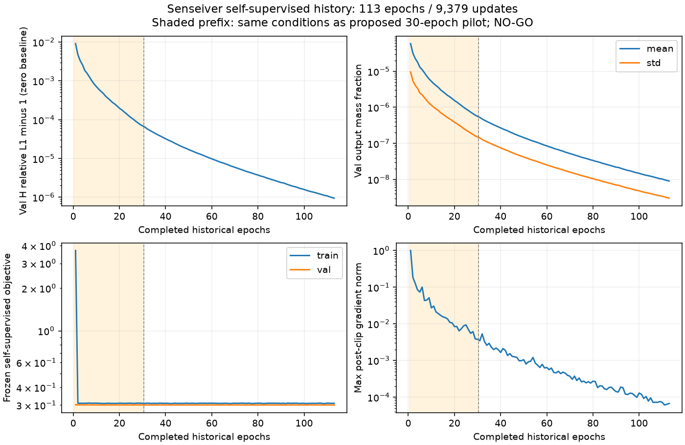

# Senseiver 自监督可学习性与正式训练决策审计

审计日期：2026-10-25（Asia/Shanghai）。**最终判定：`NO_GO_EXISTING_SAME_PROTOCOL_FAILED`。本轮新增训练为 0 epoch / 0 optimizer update；没有启动新的 pilot、300 轮训练、恢复旧队列或读取三维 GT。**

`ray_senseiver_selfsup_v1` 实际训练过，完成 **113 个完整 epoch、9,379 次更新**，随后用户明确要求因近零塌缩停止。它没有完成原登记的 300 epoch / 24,900 更新，不能描述成完整正式预算完成，也不能描述成从未训练。当前原始适配与该失败实验没有足以支持重复训练的新假设。

## 1. 仓库、实验身份与执行证据

起始 main 与 GitHub main 均为 `542f7abfd152354400c13d310afea128f6bd39c3`，起始工作区干净。已审查 README、`configs/baselines/senseiver/model_v1.json`、自监督和有监督协议、supervised/signal-path/quick-repair/consistency 报告、统一比较接口、GeoLift-DeepSets-Sum 报告，以及当前源码与本地实际运行文件。Git 历史包含原协议提交 `098c086`、第68轮诊断提交 `09e4626`；计划与实物证据分别核对。

正式自监督运行目录为 `/data/djc/GeoPhy-Set3D/outputs/comparisons/ray_senseiver_selfsup_v1`，checkpoint 目录为 `/data/djc/GeoPhy-Set3D/outputs/checkpoints/ray_senseiver_selfsup_v1`。证据包括113行 `metrics.jsonl`、`actual_training_inputs.jsonl`、train.log、环境/源码/协议清单、checkpoint 内 optimizer/scheduler/RNG，以及 `early_termination_archive.json` 和进程观察记录。[机器可读审计](artifacts/senseiver_selfsup_decision_v1/history_audit.json)保存路径、hash、配置和逐项比较。

| 身份 | 实际预算与退出 | 结论/使用边界 |
| --- | --- | --- |
| 原始 `ray_senseiver_selfsup_v1` | 113完整轮 ×83=9,379更新；2026-10-14 17:09:25 +08:00用户终止；进程 exit −15 | FAILED_LEARNING / NEAR_ZERO_COLLAPSE / EARLY_TERMINATED；不是300轮完成结果 |
| 后续统一工程 pilot | 4 train /2 Val，5轮/10更新，exit0 | best H4=85.027897；engineering=true、scientific=false、formal=false |
| 已有有监督 Senseiver | 187完整轮×83+下一轮59=15,580更新；两小时预算 | Val best NMSE=0.286811；仅为有监督参考 |
| 本轮只读复核 | 18个完整64³干预场 +完整36例Val重放，零更新 | 独立审计命名空间；不是新训练实验 |

工程 pilot 的 `status.json` 残留 `state=training`，但 `pilot_complete.json` 和调度终态均为 complete/exit0，原 PID 已退出。不能把残留状态当作正在训练，更不能把小样本工程完成当作正式自监督成功。旧训练队列未恢复。

## 2. 配置与源码同一性：为何不重复 pilot

历史归档配置与当前 `configs/train_ray_senseiver_selfsup_v1.yaml` **完全相同**；历史训练源码清单85个文件全部hash一致。seed20261011重建的 fresh 权重 state SHA 与历史初态一致；当前 `RaySenseiverV1` wrapper 同 seed 也逐位一致，254,913参数。wrapper 仅校验分块选项和强制 FP32，无新的读出或初始化修复。

当前 Plain 主模型和 GeoLift-DeepSets-Sum 的 dataset、normalization、loss、train/Val采样、optimizer、scheduler、training 字段也与本实验逐项相同。Senseiver 是射线积分任务适配版本，不是原论文有监督点传感器实验的直接复现。

- 官方166 train /36 Val，Pool A；train自然 A3–5/B3–5/H2、Val固定A4/B4/H4，两两不交。A/B分别进模型，H不进网络。
- 原始64个latent、原注意力、全部有效射线、完整262144查询、原始sigmoid，FP32、batch2/accum1、clip1。
- AdamW lr2e−4 /wd1e−4，cosine T_max300；未缩短 scheduler 或改变 loss。
- 直接复用 `training.selfsup`：hold1、cross0.5、observed0.1、consistency0.05；beta0.01、relative_L1系数0.1、epsilon1e−6、measurement_scale32284.894580078173。原mask、归约与Pdiff/K96保持。
- 数据 source_index 与 train_statistics 的当前SHA均匹配历史登记。历史协议没有逐个Pool A projection文件的完整字节SHA，因此不把元信息匹配夸大为对全部历史数据字节的追溯证明；本轮完整Val站位digest和所有测量指标精确重放一致。

拟议30轮/2,490更新已被上述失败实验的前30轮覆盖。没有新结构、目标、信息边界或初始化假设，仅独立改名和重置计数没有新的科学价值。因此遵守“不通过重新命名规避历史NO-GO”的要求，不登记重复训练 pilot。`model_v1.json` 中“pending independently registered pilot”的旧文字不是许可令牌；本报告补足实际历史审计，保留原配置原文。

## 3. 权重、更新与历史轨迹

| 对象 | SHA256 |
| --- | --- |
| 自监督 fresh 初态（tensor-content state hash） | `1fd1e876755be64371fa85c584410063b8f3b7f135f9ab7630e495ededf8e1e1` |
| 自监督 best.pt（文件hash） | `c2a748696a806aba28f9483679edead0a69bb986b8e04ce7e123f2985a12ad91` |
| 自监督 last.pt（文件hash） | `567ec1f88bdaa1e78cd14665727ee353add0cd1ce457256ff9bb963b95e367b9` |
| 有监督 best.pt（文件hash，仅校验，未加载到网络） | `eca3419f19b103feeb14840741d14a369110a970c55f7d7d746b727848d63d9f` |

best/last均对应零起点epoch112，即113完整轮；所有optimizer参数的step均为9,379，scheduler last_epoch113，RNG完整存在。113轮日志连续，每轮83实际更新，无缺轮；所有日志数值有限，每轮裁剪后梯度非零且有限。初态到末态净参数变化L2=3.2367102321，排除完全没有参数变化的解释。**净变化不是每次更新范数**；原完整训练没有逐step真实更新范数，不能追补为已记录。本轮没有optimizer，也没有用额外训练补齐日志。

| 完整epoch | 实际更新 | Val H relative L1 | Val输出mean | Val输出std |
| --- | --- | --- | --- | --- |
| 1 | 83 | 1.009128472 | 5.81916e−5 | 9.53800e−6 |
| 10 | 830 | 1.000714095 | 5.25989e−6 | 1.14992e−6 |
| 29 | 2,407 | 1.000075137 | 6.07032e−7 | 1.61659e−7 |
| 30 | 2,490 | 1.000069285 | 5.61406e−7 | 1.50309e−7 |
| 68 | 5,644 | 1.000006489 | 5.72937e−8 | 1.74288e−8 |
| 112 | 9,296 | 1.000000985 | 9.37629e−9 | 3.14272e−9 |
| 113 | 9,379 | 1.000000950 | 9.06261e−9 | 3.04338e−9 |

[逐轮CSV](artifacts/senseiver_selfsup_decision_v1/training_curve.csv)包含train/Val损失、held-out误差、输出变化、梯度、学习率、耗时与峰值显存。全部113轮Val H L1均>1，持续接近零预测，而非越过零基准。末轮Val L2=0.999999304；输出跨案例MA差仅1.17750e−12。不断刷新best是趋向零场，不能据此称为有效学习。

## 4. 预登记零更新复核与逐案例条件能力

[只读复核协议](../senseiver_selfsup_decision_v1_protocol_zh.md)和执行源码在计算前提交 `2bb3d2c`。固定train索引0/1/2、donor1/2/3、sampler epoch0；A/B分别执行normal、zero、wrong_case。错配在**recipient的站位与完整射线几何**取donor测量，只替换raw与normalized两个字段；其余几何/路径/mask对象保持不变。H仅用于输出后的原投影指标。

以下为每案例A/B等权平均。relative MA分母为正常输出L1，epsilon1e−30，与历史定义一致。逐分支18行见[干预CSV](artifacts/senseiver_selfsup_decision_v1/interventions.csv)，完整案例ID见[案例CSV](artifacts/senseiver_selfsup_decision_v1/case_summary.csv)。

| train索引 | normal-zero relative MA | 正常H relative L1 | 错配H relative L1 −正常 | 依赖>=1e−3 |
| --- | --- | --- | --- | --- |
| 0 | 1.94276e−5 | 1.000001242532 | +1.32423e−11 | 否 |
| 1 | 6.31332e−6 | 1.000005322632 | +9.83680e−12 | 否 |
| 2 | 3.88257e−6 | 1.000020212491 | −1.59733e−10 | 否 |

严格按“误差增大”符号判据，错配2/3例为正，**该单项达到数量要求**；但其量级极小，不能解释为可靠实用的测量利用。置零依赖0/3，所有正常分支均值约9.06e−9，logit均值约−18.572、全部logit<−10。输出有非零空间std，但近零饱和和测量不敏感已明确违反工程/科学门槛。第68轮历史置零依赖也仅5.75e−5、1.81e−5、5.85e−6。

完整36例Val重放直接调用原 `run_epoch(..., optimizer=None)`，原始objective没有复制：held-out/cross/observed L1/L2全部与末轮日志**精确相等**，站位digest也一致。仅loader workers改为0以审计；模型参数/buffers前后state hash不变、所有.grad仍None。

这些train案例的H曾进入历史训练loss，本轮干预不等于独立泛化测试；36例Val也参与过开发。没有三维GT评价，不能把本轮结论解释为三维重建精度审计。

## 5. 固定科学门槛的结论

| 必要条件 | 证据 | 判定 |
| --- | --- | --- |
| 数值有限且确有参数更新 | 113轮有限梯度、optimizer9,379、非零净参数变化 | 有工程执行证据；逐step更新范数历史缺失 |
| 无持续近零/恒定/饱和及依赖消失 | 近零均值、全logit<−10、长期缩幅 | **失败** |
| 至少2/3例置零依赖>=1e−3 | 0/3 | **失败** |
| 至少2/3例错配使H误差增大 | 2/3，增量约1e−11 | 符号条件通过，不能替代其他门槛 |
| 正常Val H L1<零预测1.0 | 1.000000950284751；113轮均>1 | **失败** |
| 相对真正epoch0 full-Val改善>=5% | 历史未保存full-Val epoch0；只有单train案例初态 | 不可核验，不用epoch1替代 |
| 最终连续两次检查全部通过 | 无此证据；历史和末态均有明确失败项 | 未建立 |

既有8例修复协议中 H<0.90、最后三次检查等更严条件对应不同初始化/修改loss实验，本轮不挪用或放宽。原始适配已经违反两套规则共有的必要条件，无需进行阈值取舍，也没有通过新训练解决的规则冲突。原300轮“不得自行早停”约束已被当时用户明确停止指令覆盖，退出原因保留；本轮不将其改写成自然完成。

**结论为NO-GO，非“等待完整300轮”的INCONCLUSIVE。** 缺失的epoch0和逐step范数需要如实披露，但已经证实的必要条件失败足以拒绝GO。当前预算只读复核完成，不追加任何训练或局部修复。

## 6. 独立复算、访问边界与资源

[独立CPU复核](artifacts/senseiver_selfsup_decision_v1/independent_review.json)14项通过：从封存NPZ重新以NumPy计算全部场、sigmoid/logit关系、H L1/L2与normal-zero依赖；没有调用诊断计算指标的函数。另核对113轮更新、optimizer、Val重放、源码/历史文件与checkpoint。这里“独立”指第二套数值实现，**不是外部独立人员复核**。

历史最终访问审计记录68,802次projection打开、202个train/Val Pool A文件、0 GT/越界/监督checkpoint尝试。终止归档内嵌的access快照为0次projection，系不同时间快照；不以该陈旧快照推断训练未读数据。当前复核为135次projection打开、40个文件（4 train +36 Val），0 GT/越界/外部权重尝试；未读GT128、Pool B或test。

开始检查时GPU0/1/2空闲，GPU3由用户yl的PID2127978使用。只读任务通过既有全局UUID锁、间隔15秒双空闲快照取得GPU0；没有终止外来进程。GPU计算段5.313秒、峰值allocated 174,025,216 bytes；调度区间22:32:20–22:32:35 +08:00，exit0，无OOM/资源冲突/恢复。详见[资源与执行记录](artifacts/senseiver_selfsup_decision_v1/resource_and_execution.json)。GPU0已释放。

所有起始已跟踪文件保持hash不变（包括历史DeepSets/GNOT报告、配置与协议），冻结Plain checkpoint SHA正确，已有Senseiver监督/自监督checkpoint未覆盖，旧队列状态文件hash不变。新增文件均在独立审计命名空间。

## 7. 单一替代候选与结论边界

唯一建议候选：**query到ray的几何寻址交叉注意力网络**。待验证的机制假设是：64个全局latent先压缩全部射线，再由仅坐标查询解码，可能削弱局部查询处的测量条件性；给每个空间query保留直接访问完整ray测量value的通路，或可避免全局压缩后主要生成坐标先验。

结构差异明确限定为：以query到有限射线段距离/投影位置作为attention几何偏置，由局部query直接交叉注意全部有效ray token并聚合测量value；分块只控制显存，保留全部射线/查询。它不采用64个全局latent作为唯一信息瓶颈，也不是已经失败的“latent均值残差读出”修复。不声称射线积分就是局部浓度，不使用拟合GT先验，不把候选称为已验证的解法。

当前信号诊断未唯一定位瓶颈，已有有监督适配能够条件学习，因此这只是一个可证伪的候选机制，不能证明latent结构是塌缩的唯一原因。若以后另行授权，应只预登记一次与当前适配固定目标/预算的条件性对照，仍以原门槛决定是否继续；本轮**未实现、未训练、未搜索**该候选。

监督NMSE=0.286811结果维持为有监督参考，不能纳入纯自监督排名。自监督失败只约束当前射线积分适配与冻结目标，不外推原Senseiver方法能力上限，也不形成独立测试集确认。

## 8. 交付、复算与文件位置

- [训练前只读协议](../senseiver_selfsup_decision_v1_protocol_zh.md)、[审计与配置/hash](artifacts/senseiver_selfsup_decision_v1/history_audit.json)、[末态诊断](artifacts/senseiver_selfsup_decision_v1/final_checkpoint_diagnostic.json)。
- [曲线CSV](artifacts/senseiver_selfsup_decision_v1/training_curve.csv)、[案例指标](artifacts/senseiver_selfsup_decision_v1/case_summary.csv)、[逐干预指标](artifacts/senseiver_selfsup_decision_v1/interventions.csv)、[复核](artifacts/senseiver_selfsup_decision_v1/independent_review.json)、[决策追踪表](artifacts/senseiver_selfsup_decision_v1/experiment_status.csv)。
- 封存完整预测/logit/H投影/reference/mask：`/scratch/djc/GeoPhy-Set3D/senseiver_selfsup_decision_v1/case{0,1,2}.npz`，逐文件SHA见末态诊断和复核JSON；checkpoint保留原路径，不复制成新模型。
- 源码：`scripts/senseiver_selfsup_decision_v1/{audit,diagnose,launch,review}.py`。audit/launch拒绝覆盖既有完成结果；不要为复算再次启动GPU或训练。现有封存结果的CPU复算命令：`PYTHONPATH=src PYTHONDONTWRITEBYTECODE=1 MPLCONFIGDIR=/scratch/djc/GeoPhy-Set3D/senseiver_selfsup_decision_v1/matplotlib /scratch/djc/envs/gas-torch/bin/python scripts/senseiver_selfsup_decision_v1/review.py`。

本轮没有新训练checkpoint：这是对“先核实已有失败、不得重复”的执行结果，不是遗漏交付。
