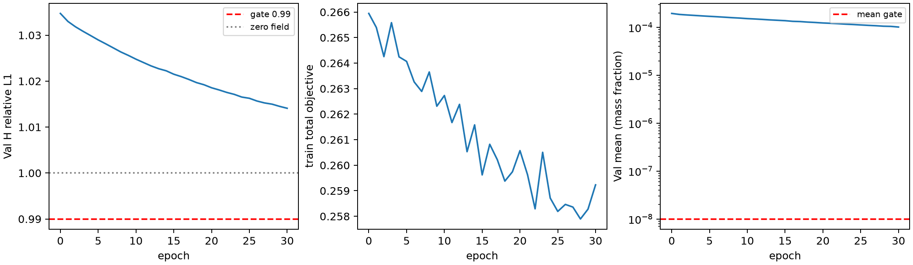

# 标准 3D U-Net v1 基线验证

结论：**NO_GO**。本轮固定结构与协议，完成 30 轮、480 次真实更新；不构成正式三维精度排名。

## 仓库、既有结果与数据保护

训练基于已fetch的远端main `279814b5152c3916913766e7a0fb28134e7d320d`，独立分支 `experiment/3d_unet_baseline_v1`，独立worktree `/scratch/djc/GeoPhy-Set3D-3d-unet-v1`。main未合并。新增路径仅限U-Net源码、配置、协议、执行/复核脚本和报告。
主模型 uniform_plain_set_interaction_seed20261011 的checkpoint SHA为0ccea9b24a77e9d5fac025c626a98b167c3ab57fa202688e3e4acc75261bc18c；正式GeoLift-DeepSets-Sum为949fb63be9068f676e7c6740fa8ce67b766d1f4d3ced86127e38b67a8eccdad0。前后核验相同；后者已有300轮/24900更新及900正式预测均保留。Senseiver/GNOT/DeepONet/FNO与独立v2分支的原日志、协议、失败证据、checkpoint未改。
保护清单包括4924项原main文件、611项历史运行文件和1897项外部冻结文件。DeepSets900预测文件/行身份已核验。v2发布清单和62份初始化/逐轮checkpoint均核验；其旧NO_GO不重写。
迁移后的/data/djc路径与原home目录符号链接保留；main显示的178项删除逐一核对实际内容与原Git blob一致，未暂存、未恢复覆盖。全166 train+36 Val投影、index、训练归一化元数据、Pool A几何及冻结构建清单，训练前全部登记逐文件SHA（207输入文件），结束后再次一致。未读取真实三维GT/GT128、Pool B或最终test真值。

## 失败机制审查与假设

H1：标准3D U-Net可用三维卷积、多尺度与skip连接改善回投影网格中的测量条件重建。H2：共享目标的近零方向、sigmoid饱和或优化瓶颈可能在更换U-Net后仍存在。两者均可证伪，不预设网络必然成功。
已有报告的含义必须区分：Senseiver真实自监督跑过113轮/9379更新并由用户因近零塌缩终止；并非从未训练。ray DeepSets/GNOT在真实少样本和固定几何诊断中条件响应不足，而部分解析合成目标可拟合，不能据此说物理梯度完全失效或所有空间结构均不可表达。正式GeoLift-DeepSets-Sum是另一已冻结正式基线，不能把射线DeepSets诊断的NO_GO覆盖到它。
DeepONet v1保存checkpoint96更新，进程精确计数仅知96–111；v2完成480仍塌缩。FNO v1/v2完成480，有条件响应和部分H改善，但末态饱和与Val置零收益不足。共同现象支持检查共享训练机制，但不足以证明唯一根因是loss、初始化或某一架构。

## 原始目标的零更新数值审查

在实现网络之前，直接调用原training.selfsup.objective，对固定train[0,1]与[2,3]、epoch0原A/B/H，检查共享常量0、1e-10、1e-8、1e-6、冻结c0及不对称A=c0/B=.5c0。无optimizer、无初始化候选选择。所有分支导数保存在objective_direction_audit.json，并由独立NumPy FP64闭式物理投影、Huber/relative-L1/consistency及解析导数核验12组条件。

| train indices | 常量c | 原始总loss | dL/dc_A | dL/dc_B |
|---|---:|---:|---:|---:|
| [0, 1] | 0 | 0.216822118 | -68.26446 | -68.30603 |
| [0, 1] | 1e-10 | 0.216822147 | 25.95392 | 26.02312 |
| [0, 1] | 1e-08 | 0.216822684 | 28.26662 | 28.39252 |
| [0, 1] | 1e-06 | 0.216882527 | 30.69661 | 30.7793 |
| [0, 1] | 0.00019270036 | 0.232852802 | 47.65392 | 48.02718 |
| [2, 3] | 0 | 0.20746991 | -129.0501 | -128.6839 |
| [2, 3] | 1e-10 | 0.207469925 | 90.54985 | 90.28575 |
| [2, 3] | 1e-08 | 0.207471758 | 92.62126 | 92.20614 |
| [2, 3] | 1e-06 | 0.20765841 | 94.94576 | 94.5527 |
| [2, 3] | 0.00019270036 | 0.246821612 | 108.3222 | 107.6426 |

极小正c时，两个固定batch的hold/cross/observed导数均为正，下降方向倾向减小常量；A=B时consistency为0且其导数为0，因此该现象无需由一致性项单独产生。A=c0/B=.5c0时，consistency方向会拉近两分支：对A为正、对B为负，且幅度大；不能将它描述成总是同时向零推动。精确零点的AD导数为负，abs/clamp不可微点的子梯度不能冒充严格单边极限。
证据局限：这里只检查固定案例与常量子空间方向，非逐体素全空间或实际网络参数路径；稀疏/极低观测、有限精度及相对L1归约均可能相关。本轮没有改变任何loss权重、epsilon或一致性公式，也没有由上述诊断宣称零场是唯一全局最优。

## 标准网络与输入

普通3D U-Net参考Ronneberger et al., U-Net (2015)和Çiçek et al., 3D U-Net (2016)的编码器/解码器和跳跃连接范式；这是射线任务适配，不声称复现其医学分割训练配置。五层通道16/32/64/128/256，双3³ Conv3d(bias=False)+GroupNorm8(eps1e-5,affine)+ReLU，四次MaxPool2。上采样为trilinear(align_corners=False)+1³降通道，skip拼接后双卷积；1³输出卷积+sigmoid，完整64³单通道质量分数。没有注意力、MRGR、OARI、GCA或新增输出参数化。激活checkpoint只管理逐块内存，不改数学前向或梯度目标。
模型参数数目 5,343,905。模型独立registry/config/入口，无旧注册白名单改动。输入直接复用冻结baseline_fno_v1.FixedRayBackprojection，其源码SHA见registration。前三通道为归一化测量的Tᵀy/Tᵀ1、log1p(Tᵀ1)、覆盖支持，再拼XYZ[-1,1]，ij/zfast。T为K96线性摩尔分数射线积分，使用J(0)ᵀ/χ′(0)计算；不是非线性质量分数映射的全局逆，也不是真值。所有有效射线保留；invalid/padding NaN先掩码归零。输入只含A或B；H只用于原目标和输出后评价。

## 单一尺度初始化与训练前封存

复用冻结v2 c0=0.0001927003566465826，而不是重新校准。v2的训练166/epoch0 A/B共2,977,913有效射线，x=10^6L/Y_SCALE,y=Y/Y_SCALE，固定FP64二分求Σx·clip((xq-y)/.01,-1,1)=0，再用物理质量/摩尔变换反解c0。H/Val/GT不参与；输入文件身份已全部匹配。c0仅为常量投影稳健匹配尺度，不是真实三维浓度均值。
固定seed20261011、train0..3的epoch0 A/B fresh前向，M=2.086603642，唯一alpha=min(1,.1/M)=0.0479247701914；只缩放现有末层weight、bias设logit(c0)=-8.554181412833294，其他参数逐位不变。初始参数state SHA为31d97af83e02322fb5b6050d028db6a461d514d6a821ff0de2cce6c9d12644d8；无候选试跑或Val选尺度。初始固定train0 A均值由0.61740674变为0.00019590192，初始必要有限/range/近零/非饱和检查通过。初始空间CV/条件响应不足不冒充终态合格。
设计在ec2f92e登记，完整源码/配置/数据/阈值和初始化身份在首次CPU优化测试与任何GPU更新之前封存；registration的147源码SHA和207输入SHA结束核验一致。没有重复上轮Val逐文件哈希登记遗漏。

## 工程测试、资源与训练预算

CPU完整batch2/64³通过：同seed参数与输出逐位复现、重复前向、checkpoint保存加载、输入6通道与旧FNO构建逐位一致、有效射线计数、padding/全padding/invalid NaN、H仅进objective、正常/置零/recipient几何不变的donor值替换。真实梯度范数0.0436321098，一次AdamW更新L2=0.374634078；CPU权重丢弃，pilot重新fresh。合成路径GT/外来checkpoint拒绝测试通过；真实运行访问无越界。主模型C0/C1固定CPU输出逐位回归通过。
GPU预登记保守激活/工作空间估计12GiB，参数21,375,620 bytes；实际GPU1 batch2完整64³前向/反向零更新检查峰值1,010,186,752 bytes，pilot峰值1,142,821,376 bytes。使用全局UUID锁、间隔15秒双空闲快照和60秒有界等待，未抢占/停止他人任务。完整快照在scratch，Git只含必要摘要。
固定pilot train0..31、Val全部36、每轮16次更新、30轮480次；原始objective/run_epoch/selection_metric、A/B/H、mask、K96、FP32、batch2/accum1、AdamW2e-4/wd1e-4、clip1、seed20261011、cosineT_max300全部不变。每步真实更新范数和计数fsync，epoch0与每轮checkpoint含optimizer/scheduler/RNG并保存SHA。异常捕获保存真实计数、错误、状态和访问/输入ledger，不重放；不可捕获SIGKILL/断电的处理不保证。本次实际退出状态以资源记录为准。

## 完整pilot结果与科学门槛

| epoch | actual updates | train loss | train H | full Val H | Val field mean | Val field std |
|---|---:|---:|---:|---:|---:|---:|
| 0 | 0 | 0.265945945 | 1.08975783 | 1.03473749 | 0.000195928749 | 1.76288967e-06 |
| 10 | 160 | 0.262730574 | 1.06708857 | 1.02478094 | 0.000152707385 | 1.72583018e-05 |
| 20 | 320 | 0.260571931 | 1.05309755 | 1.01855833 | 0.000123832551 | 2.53224371e-05 |
| 29 | 464 | 0.258279937 | 1.04176664 | 1.01450969 | 0.000105096708 | 3.16851355e-05 |
| 30 | 480 | 0.259231403 | 1.04242072 | 1.01409344 | 0.000101888086 | 2.90337123e-05 |

train/Val零场relative L1均为1。真正epoch0用于改善判定，不以epoch1代替。图中的loss下降和测量误差低于1都不能替代全部科学门槛。

| epoch | 全诊断场健康 | train zero响应≥2/3 | train wrong损害≥2/3 | Val zero响应≥2/4 | Val正常优于zero≥2/4 | Val≤0.99 | e0改善≥5%且≥0.01 |
|---|---|---|---|---|---|---|---|
| 29 | 通过 | 失败 | 通过 | 通过 | 失败 | 失败 | 失败 |
| 30 | 通过 | 失败 | 通过 | 通过 | 失败 | 失败 | 失败 |

epoch29全部42个诊断分支：最小均值0.00010507066，最大近零比例0，最小空间CV0.30119978，最大饱和比例0。所有分支逐一验收，未用平均掩盖失败。

epoch30全部42个诊断分支：最小均值0.00010186463，最大近零比例0，最小空间CV0.28465444，最大饱和比例0。所有分支逐一验收，未用平均掩盖失败。

固定案例干预采用A/B等权；relative=sumabs(normal-zero)/sumabs(normal)，absolute=meanabs(normal-zero)。仅更换recipient站位处的donor raw/normalized测量，其他张量与几何身份不变。本任务Val响应与H收益分别计数，未额外采用旧v2同一案例联合计数门槛。逐案例数值如下。

| epoch | split/index | normal-zero relative | absolute MA | wrong H increase | zero H increase |
|---|---|---:|---:|---:|---:|
| 29 | train/0 | 0.0010812779 | 1.1362879e-07 | 1.9757859e-05 | 3.0483145e-05 |
| 29 | train/1 | 0.00040423583 | 4.247551e-08 | -9.1993891e-07 | -1.9107906e-06 |
| 29 | train/2 | 0.00016526306 | 1.7364613e-08 | 4.9857362e-05 | -6.4236726e-06 |
| 29 | val/0 | 0.0010503755 | 1.103804e-07 | 3.6038866e-06 | 4.6368191e-06 |
| 29 | val/1 | 0.00040732803 | 4.2800401e-08 | 1.3606919e-05 | -4.2887561e-06 |
| 29 | val/2 | 0.0013490738 | 1.4177682e-07 | 6.3817262e-06 | 1.4237611e-05 |
| 29 | val/3 | 0.00078437315 | 8.2423497e-08 | 1.4180781e-06 | 9.3790179e-08 |
| 30 | train/0 | 0.0010963309 | 1.1169359e-07 | 1.7821636e-05 | 2.8182833e-05 |
| 30 | train/1 | 0.00040653766 | 4.1413714e-08 | -9.9539446e-07 | -1.738509e-06 |
| 30 | train/2 | 0.00016249933 | 1.6553195e-08 | 4.5122851e-05 | -5.5167255e-06 |
| 30 | val/0 | 0.0010874918 | 1.1079275e-07 | 4.7177194e-06 | 7.0246495e-06 |
| 30 | val/1 | 0.00041191308 | 4.1961334e-08 | 1.2708374e-05 | -4.3285972e-06 |
| 30 | val/2 | 0.0013779075 | 1.403864e-07 | 6.6391431e-06 | 1.6355615e-05 |
| 30 | val/3 | 0.00081036652 | 8.2556097e-08 | 1.4733642e-06 | 7.6293667e-07 |

## 独立数值复核与状态解释

独立NumPy FP64实现完整场三线性K96采样、物理质量→摩尔变换及H投影，不调用训练的投影/指标/gates函数。复核固定诊断0/10/20/29/30的210个完整场、logits/所有场统计、normal/zero/wrong响应和门槛；另直接用独立积分误差重判干预门槛，均一致。
为核验完整Val门槛，额外只读CPU重放自身epoch0/29/30权重，保存全36案例A/B共216完整场。没有optimizer、参数哈希前后相同，未warm-start新训练。CPU replay与原GPU全Val日志在预定后端舍入容差内一致；再用独立NumPy积分重算全部72分支/epoch的宏平均H和全场mean/std。此补充复核方法在末轮生成前封存，不接触GT、不改变训练/选择/阈值。
独立full Val H：e0=1.03473749，e29=1.014509687，e30=1.01409344；完整Val门槛A判定与主实现一致。独立指第二套数值路径，不是外部人员复核。

## 失败分类、与既有模型的联系与建议

本次当前适配NO_GO；失败项：train_zero_2of3, val_zero_benefit_2of4, val_below_zero, val_initial_improvement。不得正式训练、追加epoch、搜索学习率/结构或修改loss来追求通过。
失败类型为输出健康但有效测量条件依赖或收益不足；本轮没有发生近零塌缩或大面积sigmoid饱和，不能把该机制当作本轮已证实失败原因。
只读目标审查在某些固定常量方向发现近零优化风险，但本轮终态输出健康，未证实H2中的塌缩或饱和机制。本轮条件响应和Val收益不足，不支持“只换标准U-Net即可解决”的H1。跨架构反复出现弱响应或弱Val收益，加上原目标的常量方向证据，支持优先检查共同的优化或条件表达问题；尚未唯一证实H2，也未定位到U-Net独有结构错误。单seed/有限32例pilot不足以唯一分离loss、稀疏可辨识性、固定回投影表达和U-Net优化的贡献；特别是U-Net和FNO共享同一回投影输入，该共同表达也可能构成限制。没有证据断言U-Net普遍无效、loss是唯一主因，或物理算子整体错误。
已有正式GeoLift-DeepSets-Sum结果保持有效；本轮不能推出相同原目标对所有架构都不可能优化，也不能将新的U-Net失败覆盖到它。
建议停止当前适配进入正式训练和相同目标下的无假设重复架构替换。后续若授权，应先围绕已记录的常量/稀疏背景方向进行独立预登记的目标机制诊断或可辨识性正对照；不在本轮自动实施修loss、候选搜索或新模型。

## 工程问题与限制

配置生成最初误用缺少PyYAML的系统Python，导致YAML缺失，准备程序在构建模型/读取训练数据前停止；原日志保留。改用既有gas-torch环境生成同一已登记配置，未改结构、c0或尺度规则。其他异常以原始日志为准，不覆盖失败记录。注册科学源码/输入/协议结束哈希仍一致；新增报告和只读复核脚本另有分析源码清单。
训练是单seed、小train子集pilot；没有真实三维GT精度、正式300轮和900预测，不生成最终测试成绩。不恢复旧队列，不改历史NO_GO或正式GeoLift-DeepSets-Sum身份。CUDA训练反向不额外声称逐位确定性；CPU初态/重复推理与序列化逐位测试通过。

## 交付与复算路径

- 模型：src/geophy_set3d/models/baseline_unet3d_v1.py；独立注册：src/geophy_set3d/training/unet_baseline_v1.py；配置：configs/unet_baseline_v1/unet.yaml。
- 协议：docs/unet_baseline_v1_protocol_zh.md；登记、源码/数据/参数SHA、目标审查、CPU/资源/曲线/干预/NumPy复核、checkpoint与最终状态：docs/reports/artifacts/unet_baseline_v1/。
- 训练入口：scripts/unet_baseline_v1/launch.py unet（拒绝重复pilot）；已完成后不要重新启动。独立复核：review.py unet、independent_scores.py unet、review_full_validation.py，均只读输出且0次更新。
- 完整31份初始化/逐轮checkpoint、逐更新输入/计数、全部诊断NPZ与full36 Val：/scratch/djc/GeoPhy-Set3D/unet_baseline_v1/unet/；SHA见checkpoint_manifest与诊断/验证manifest。
- 完整GPU资源原始快照：/scratch/djc/GeoPhy-Set3D/unet_baseline_v1/scheduling/ 与 gpu_snapshots.jsonl；三份冻结保护清单在scratch根目录。大型数组和checkpoint不入Git。
