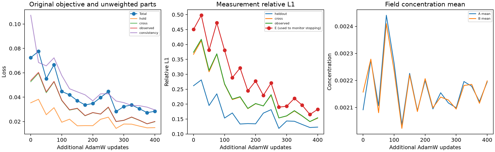

# U-Net 可行场预热后的原目标续训 v1

日期：2026-10-27（北京时间）。用户已授权继续训练、监测loss/误差并在异常或不收敛时中断。

实际追加400次更新，原目标累计500步，另有此前200步自生成场预热。停止原因：**达到预定400步追加上限**。本轮沿用固定train0，并未扩大为跨案例正式训练。

| 指标 | 续训起点 | 末态 | 相对起点改善 |
|---|---:|---:|---:|
| 原总loss | 0.072456315 | 0.028401634 | 60.80% |
| observed | 0.37393034 | 0.15418428 | 58.77% |
| cross | 0.36710373 | 0.15289069 | 58.35% |
| H（参与目标） | 0.26169286 | 0.12301294 | 52.99% |
| E（仅监测，参与早停） | 0.45057493 | 0.18252749 | 59.49% |

## 结果解释

原目标的持续改善应同时看H和E，H始终参与训练。E来自同案例未输入的四个站位，本次用于早停监测，不能再称为未使用的最终测试集。结果不等同三维真值精度或跨案例泛化，未读取GT64/GT128、Pool B、final test或外来权重。

原loss、H与E末态均较续训起点改善，支持自生成场预热后原目标可继续学习的局部可行路径。该结果针对单案例记忆，下一步关键问题是该路径能否在训练集多个案例上共享并泛化；不能据此宣布经典基线已经修复或与主模型公平比较。

末段存在波动：追加375步时loss=0.02730272、H=0.1216735、E=0.1652988；400步末态分别为0.02840163、0.1230129、0.1825275。没有用较好中途节点替代末态。达到400步预算表示这轮有界检查结束，并不等于数值收敛；整段没有触发预定停止规则。

## 监测节点

| 追加步数 | loss | H | cross | E监测 |
|---|---:|---:|---:|---:|
| 0 | 0.07245632 | 0.2616929 | 0.3671037 | 0.4505749 |
| 25 | 0.0775703 | 0.2811528 | 0.4129497 | 0.4977908 |
| 50 | 0.05515255 | 0.1953748 | 0.3083343 | 0.3812438 |
| 75 | 0.06660842 | 0.2344707 | 0.3674145 | 0.4723739 |
| 100 | 0.04469469 | 0.1533571 | 0.2665436 | 0.3806144 |
| 125 | 0.04192372 | 0.1703914 | 0.2152886 | 0.2885679 |
| 150 | 0.037155 | 0.1333901 | 0.2235919 | 0.3212647 |
| 175 | 0.03360876 | 0.1348565 | 0.1849136 | 0.2445193 |
| 200 | 0.03482191 | 0.1340436 | 0.2013759 | 0.2773078 |
| 225 | 0.03967601 | 0.1698914 | 0.1943884 | 0.2292851 |
| 250 | 0.04468396 | 0.1814829 | 0.2298222 | 0.2706755 |
| 275 | 0.02820875 | 0.118694 | 0.1537865 | 0.189967 |
| 300 | 0.03230971 | 0.1435132 | 0.1602118 | 0.1928817 |
| 325 | 0.03363482 | 0.1425942 | 0.1770452 | 0.2192423 |
| 350 | 0.03050999 | 0.1319234 | 0.1601511 | 0.1966131 |
| 375 | 0.02730272 | 0.1216735 | 0.1415495 | 0.1652988 |
| 400 | 0.02840163 | 0.1230129 | 0.1528907 | 0.1825275 |

## 恢复、审计与证据

从原目标100步checkpoint恢复模型/AdamW/scheduler/RNG，AdamW累计step=500，scheduler=31。保持原FP32目标、K96/64³和全部有效射线；未重置动量。CPU只读恢复逐值匹配原末态，GPU启动基线也通过容差核验。

独立NumPy重算初末4个完整场/16组K96积分，最大投影差相对目标L1=5.102e-07；原目标及误差一致。原147源码/207输入、冻结checkpoint、历史证据与本轮源权重再次哈希核验不变。

首次启动发生本地context模块名和既有调度器context的导入冲突，在GPU申请/optimizer更新前失败（0更新），随后仅重命名本地模块并重新检查。原登记protocol_initial.json、失败日志和新登记保留，未重放训练更新。

资源使用既有UUID全局锁与15秒双空闲快照，运行中监测外来进程冲突，仅占用空闲GPU。完整字段、checkpoint、日志：`/scratch/djc/GeoPhy-Set3D/unet_continuation_v1/`；Git保留小型证据和哈希，不合并main。

末态checkpoint：`/scratch/djc/GeoPhy-Set3D/unet_continuation_v1/case0/last.pt`；SHA256：`cc547f0d06335059c0a0763aeaaad5bd2b2dfda5b097dc759676f55be9ed8e30`。

训练在对话中断前已正常完成；对话恢复后仅重启被打断的只读复核，没有重启或重放训练。末次监测状态曾写为running，交付时依据result和调度完成记录校正为complete，原监测状态另存status_last_monitor.json。
