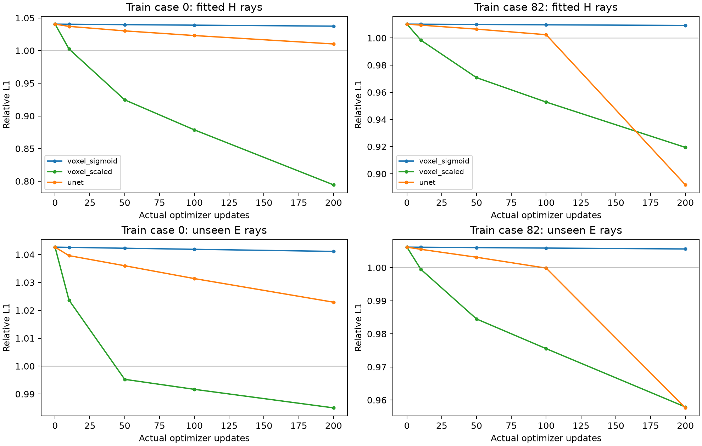
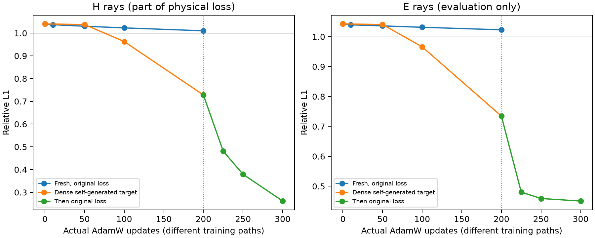

# 固定案例体素优化与U-Net拟合诊断 v1

**核心诊断：原物理目标有可拟合解，同一U-Net也能学习空间结构；本例的关键障碍是从弥散低浓度初态靠稀疏物理监督找到结构的优化过程。自生成可拟合场预热后，原目标能够继续降低误差。**

日期：2026-10-26（Asia/Shanghai）。本轮为机制诊断，不是正式基线或最终三维精度比较。

已完成两个固定train案例×三个预登记臂×200次真实更新，共1200次；全部CPU双线程串行。未改原objective、物理投影器或冻结模型，未读取GT64/GT128、Pool B或最终test。

## 固定设计与可比性

案例索引0、82，原seed20261011和epoch0 A/B/H。原H参与loss，不能作为独立泛化证据。E是A/B/H之外最小的四个站位ID，只做输出后的评价，未进入目标或网络，也不用于调整参数或选checkpoint。

三个臂从fresh U-Net同seed、冻结c0/alpha构造开始。两个直接体素臂初态为fresh A/B浓度均值；网络保留原A/B各自输出。直接体素场是每案例一个共享场，绕过网络和条件映射，A/B一致性严格为零。

| 臂 | 参数化 | AdamW lr | weight decay |
|---|---|---:|---:|
| voxel_sigmoid | 共享262144体素logits→sigmoid | 2e-4 | 1e-4 |
| voxel_scaled | 共享c0×u，每步投影浓度到[0,1] | 0.05 | 1e-4 |
| unet | 原始五层U-Net A/B条件输出 | 2e-4 | 1e-4 |

均为FP32、完整64³、全部有效K96射线，clip1；cosine T_max300每16更新推进一次。单案例batch1是新诊断协议，不冒充原batch2/166例正式训练。尺度化臂故意使用不同变量尺度与学习率，因此它回答“存在可拟合路径吗”，不能用来作严格等优化器性能排名。

预登记操作判据：最终observed/cross/H三组relative L1均≤0.9且总loss下降，记为非平凡测量拟合；E≤0.99单独报告。这些判据不是正式GO资格。完整评价节点0/10/50/100/200，最终只判断200，不挑中途最佳。

## 末态与独立复核

| 案例 | 臂 | 初始loss→末态loss | 初始H→末态H | 末态E | 测量拟合 | E≤.99 |
|---|---|---|---|---:|---|---|
| 0 | voxel_sigmoid | 0.2445017 → 0.2439809 | 1.040462 → 1.037396 | 1.041132 | 未通过 | 未通过 |
| 0 | voxel_scaled | 0.2445017 → 0.2061397 | 1.040462 → 0.7944888 | 0.9850206 | 未通过 | 通过 |
| 0 | unet | 0.2446773 → 0.2390886 | 1.040462 → 1.010139 | 1.022916 | 未通过 | 未通过 |
| 82 | voxel_sigmoid | 0.3311818 → 0.3309387 | 1.010173 → 1.00921 | 1.005656 | 未通过 | 未通过 |
| 82 | voxel_scaled | 0.3311818 → 0.3050134 | 1.010173 → 0.9194507 | 0.9578924 | 未通过 | 通过 |
| 82 | unet | 0.3313596 → 0.2969464 | 1.010173 → 0.8918771 | 0.9576233 | 未通过 | 通过 |

独立NumPy从全部初末完整场重新计算三线性K96物理积分、测量误差及原objective：24完整场、96组积分，主实现与复核一致。两A/B相同的直接场仍逐分支复核；这不是24个独立案例或外部人员复核。最大投影差相对目标L1为4.6054e-08。

## 对失败机制的含义

案例0：尺度化体素拟合未通过，直接sigmoid拟合未通过，U-Net拟合未通过。
全部臂在本200步预算内未达预定拟合标准，不能据此证明原目标无解；仍需区分步长/参数化和测量约束。保留曲线的实际改善程度，不强行归因。
案例82：尺度化体素拟合未通过，直接sigmoid拟合未通过，U-Net拟合未通过。
全部臂在本200步预算内未达预定拟合标准，不能据此证明原目标无解；仍需区分步长/参数化和测量约束。保留曲线的实际改善程度，不强行归因。

结合上一轮全166例梯度分解，relative-L1在弥散场上可提供明显幅度下压，而此前关闭relative/consistency均不足以解决Senseiver条件重建。当前对照应与这些证据共同解释，不能从单一成功或失败臂直接断言loss是唯一原因。

## 工程异常、真实更新与保护

首次voxel_sigmoid启动在初态checkpoint保存时，未向rng_state提供必须的generator参数；发生在0次优化更新。原run.py、失败日志与失败初态数组目录均保留；新run_v2.py只补充序列化generator，修订SHA在更新前登记。未修改目标、模型、初始化、学习率、预算或阈值，没有更新重放。

六个科学run各200次更新，逐步journal记录有限非零梯度与真实参数变化并fsync；最终checkpoint的每参数AdamW step=200、scheduler=12、RNG完整。全部CPU，无GPU抢占或外来进程终止。前序147源码、207输入、U-Net及共享诊断封存证据和冻结checkpoint身份再次核验。未合并main、未启动正式训练。

## 产物

- 协议：docs/voxel_network_probe_v1_protocol_zh.md；登记与小型证据：docs/reports/artifacts/voxel_probe_v1/。
- 完整体素场、checkpoint、逐更新journal：/scratch/djc/GeoPhy-Set3D/voxel_probe_v1/。
- 执行：scripts/voxel_probe_v1/run_v2.py；已完成目录拒绝覆盖，不应删除完成目录重跑。独立复核：review.py；报告：report.py。
- 本报告只解释固定案例的测量拟合与优化，未使用真实三维GT，不能给出真实场精度结论。

## 补充：原目标的有效体素拟合路径已得到独立确认

**这两例的原始物理目标存在明显优于零场的可拟合路径；当前U-Net失败不能统一解释为物理投影不可微、目标根本无有效解或只需更多同样的Adam小步更新。** 有效场由案例专属体素求解得到，尚不构成测量到场的条件网络，也没有三维GT证明其空间解唯一或准确。

直接Adam尺度臂仍受固定步长和200步上限限制，因此另行预登记一次[0,1]浓度边界L-BFGS-B存在性检查：同fresh平均场、原objective、FP64求解、每例最多60接受迭代/120函数求值。仅训练A/B/H loss进入线搜索，E从不参与。两个求解器均因60迭代上限停止，未声称达到全局最优或数值收敛。最终指标均重新使用原FP32投影器及目标计算，并独立NumPy复核。

| 案例 | 接受迭代/函数求值 | 原FP32总loss | A/B cross误差 | H误差 | 独立E误差 |
|---|---|---:|---:|---:|---:|
| 0 | 60/62 | 0.02820366 | 0.3147776 | 0.007414587 | 0.3917623 |
| 82 | 60/61 | 0.00759488 | 0.06430076 | 0.006207031 | 0.1075401 |

这项结果把证据从“loss存在常量缩幅方向”推进到“原目标有更好的空间解，但当前网络训练没有到达”。它仍不能单独分离网络参数化、一致性约束、数据动态范围和优化器各自的贡献：共享体素场自动满足A/B一致性且无需推理，网络则有这些额外要求。

## 补充：只改变U-Net优化器还不足以解决

看到体素存在性结果后，独立登记一个fresh train0原U-Net的优化器单因素检查：结构/输入/初始化/原FP32目标完全不变，使用torch L-BFGS强Wolfe线搜索，最多20外层调用/60原目标梯度求值，不裁剪以免破坏线搜索导数；没有从体素解或失败网络warm-start。E仍仅评价，不能选步或调参。

实际接受20次参数变化、42次目标/梯度求值；末态A/B cross=1.003196，H=0.9890845，E=1.001918。预定测量拟合未通过。线搜索改善了部分H，但仍没有有效独立射线收益，单换优化器不足以修复。接受迭代与Adam更新不是等价计算预算，不作同预算排名。

## 补充：自生成可拟合场的稠密目标对照

另行登记一个稠密目标诊断：用上述train0体素解作为固定自生成场，原fresh U-Net同时拟合A/B对应同一个场；AdamW2e-4/wd1e-4、clip1、原cosine更新尺度，200步。唯一训练目标为浓度MSE除以该固定场均方值，以移除稀疏物理目标的空间归因困难。这个场不是真值，也不是监督模型权重；其来源仅为合法训练A/B/H和原目标，E未参与生成或选择。此诊断不改变任何正式训练loss。

normalized MSE：0.9878576 → 0.4181157；对自生成场的relative L1：1.070241 → 0.7609093。末态原物理H=0.727943、E=0.7344851。MSE至少减半条件通过，自生成场L1≤0.9条件通过。

稠密目标下网络能够学习该空间场，支持物理监督下的优化/空间信用分配是重要障碍；仍不能据单例证明所有架构或跨案例重建都能解决，也不能将自生成场拟合质量等同真实场精度。

## 最后检查：空间结构预热后，原目标是否仍可继续优化

在稠密目标对照成功并完成独立复核后，单独预登记100步原目标续训：只加载本轮自己的200步自生成场拟合权重，重置AdamW，结构、输入、物理投影、原objective及裁剪均保持。此阶段不读稠密目标数组，E只评价，不能选择步数或checkpoint。没有加载主模型、GT监督模型或外来权重。末态固定为100步。

| train0条件 | 优化预算 | 原总loss | observed | cross | H（参与目标） | E（仅评价） |
|---|---|---:|---:|---:|---:|---:|
| fresh原目标AdamW | 200更新 | 0.2390886 | 1.022861 | 1.022861 | 1.010139 | 1.022916 |
| fresh原目标L-BFGS | 20接受/42求值 | 0.2365864 | 1.003193 | 1.003196 | 0.9890845 | 1.001918 |
| 自生成场稠密目标预热 | 200更新 | 0.1801666 | 0.7336923 | 0.734643 | 0.727943 | 0.7344851 |
| 预热后原目标续训 | 100更新 | 0.07245636 | 0.3739305 | 0.3671039 | 0.261693 | 0.450575 |

续训原loss：0.1801666 → 0.07245636；H：0.727943 → 0.261693；E：0.7344851 → 0.450575。最终A/B/H拟合判据通过，E≤.99判据通过。

原物理目标可以保持并进一步改善已学出的结构，排除了“本例原目标必然让所有网络输出塌缩”的强解释。结合fresh网络原目标失败、稠密自生成目标成功，证据支持初始空间定位/稀疏物理梯度的空间归因/优化路径为重要因素；尚不能把这些相互作用拆成唯一根因，也不能将一个U-Net案例外推至DeepONet/FNO等全部架构。

该两阶段过程累计300次AdamW更新，额外依赖案例专属体素求解及稠密目标；fresh对照为200次更新，不能作等预算性能排名。它回答可行路径和失败机制，不是新的正式基线结果。E是同案例未见射线，不是跨案例验证；全程没有GT，测量误差降低不能证明三维真值恢复正确。

## 最终证据边界与后续处理

已确认：物理/目标在这两个案例可达到有效测量拟合；低浓度直接sigmoid与固定Adam步长确实进展很慢；原relative-L1对弥散输出的缩幅压力已有全166例及实际参数梯度证据；网络并未自动利用这个有效解空间。

尚未解决：在保持正式公平协议时，如何让经典条件网络稳定学习空间结构与跨案例映射。既有relative/consistency开关失败、当前单次优化器检查与稠密目标结果应共同解释，不能由此宣布“经典算法不行”或“删一个loss即可”。不自动启动300轮，不将当前网络列为已修复成功，不改旧NO_GO。

本轮停止边界是完成上述各自预登记的有界诊断，而非证明所有可能修复都无效。下一步应在独立协议中验证“训练案例自生成可行场预热→原目标微调”能否跨案例推广，并统一预算与数据使用后再讨论正式适配；不继续无目的更换架构或扫描学习率、尺度、loss系数。

累计预算分开记录：原六臂Adam1200更新；独立稠密目标Adam200更新；最后原目标续训Adam100更新（Adam更新总计1500）；共享体素L-BFGS-B的120次接受迭代及123次函数求值；网络L-BFGS的20次接受迭代及42次梯度求值。它们不混写为“同一种优化器步数”。全部CPU，每进程2线程；补充独立进程与原串行对照可同时运行，总任务线程不超过4。无GPU使用或他人任务干预。

独立复核合计44个完整A/B场、176组K96积分（包含相同共享场的逐分支复核，并非44个独立案例）。所有科学run的访问审计无GT64/GT128/Pool B/final test/外来权重，原科学源码/数据/冻结结果身份保持。
